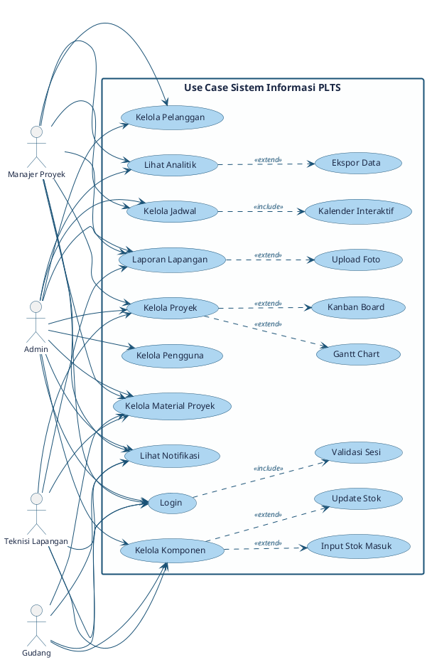

# REPOSITORY COMPLETE CODEBASE: SISTEM-PLTS
Generated: 2026-10-26 14:22:53
Total Files Included: 74
Description: Single-file bundle of the entire codebase for AI Context (Gemini, Claude, GPT).

## 1. PROJECT DIRECTORY TREE
```text
README.md                                                    (  0.0 KB)
api/auth/login.php                                           (  1.4 KB)
api/auth/logout.php                                          (  0.4 KB)
api/export/material-csv.php                                  (  4.0 KB)
api/jadwal/delete.php                                        (  0.4 KB)
api/jadwal/reschedule.php                                    (  1.0 KB)
api/jadwal/store.php                                         (  0.9 KB)
api/jadwal/update.php                                        (  0.7 KB)
api/komponen/delete.php                                      (  0.5 KB)
api/komponen/komponen.php                                    (  0.0 KB)
api/komponen/stok-masuk.php                                  (  1.8 KB)
api/komponen/store.php                                       (  0.9 KB)
api/komponen/update-stok.php                                 (  2.3 KB)
api/komponen/update.php                                      (  2.5 KB)
api/laporan/store.php                                        (  7.4 KB)
api/material/store.php                                       (  2.1 KB)
api/notifikasi/baca.php                                      (  0.4 KB)
api/pelanggan/bulk.php                                       (  1.4 KB)
api/pelanggan/delete.php                                     (  0.7 KB)
api/pelanggan/eksport.php                                    (  1.3 KB)
api/pelanggan/store.php                                      (  0.7 KB)
api/pelanggan/update.php                                     (  0.7 KB)
api/pengguna/delete.php                                      (  0.9 KB)
api/pengguna/store.php                                       (  0.9 KB)
api/pengguna/update.php                                      (  0.8 KB)
api/proyek/bulk.php                                          (  1.7 KB)
api/proyek/delete.php                                        (  0.8 KB)
api/proyek/export.php                                        (  1.6 KB)
api/proyek/quick-update.php                                  (  1.5 KB)
api/proyek/store.php                                         (  2.5 KB)
api/proyek/update.php                                        (  2.8 KB)
assets/css/style.css                                         ( 24.5 KB)
assets/js/app.js                                             ( 15.9 KB)
assets/js/daily-report.js                                    ( 11.4 KB)
config/database.php                                          (  0.9 KB)
includes/activity.php                                        (  3.6 KB)
includes/auth.php                                            (  1.2 KB)
includes/csrf.php                                            (  0.1 KB)
includes/footer.php                                          (  3.3 KB)
includes/functions.php                                       (  4.7 KB)
includes/header.php                                          (  4.4 KB)
includes/sidebar.php                                         ( 11.8 KB)
index.php                                                    (  0.4 KB)
pages/analitik/index.php                                     ( 13.0 KB)
pages/auth/login.php                                         ( 13.0 KB)
pages/dashboard/index.php                                    ( 43.2 KB)
pages/errors/403.php                                         (  2.5 KB)
pages/jadwal/create.php                                      (  3.0 KB)
pages/jadwal/edit.php                                        (  0.0 KB)
pages/jadwal/index.php                                       ( 36.5 KB)
pages/komponen/create.php                                    (  3.7 KB)
pages/komponen/edit.php                                      (  3.8 KB)
pages/komponen/index.php                                     ( 23.2 KB)
pages/komponen/status.php                                    ( 12.4 KB)
pages/laporan/create.php                                     ( 21.8 KB)
pages/laporan/index.php                                      ( 12.9 KB)
pages/laporan/show.php                                       ( 17.4 KB)
pages/laporan/stok.php                                       ( 15.2 KB)
pages/material/create.php                                    (  7.8 KB)
pages/material/index.php                                     (  4.3 KB)
pages/notifikasi/index.php                                   (  4.4 KB)
pages/pelanggan/create.php                                   (  2.5 KB)
pages/pelanggan/edit.php                                     (  3.2 KB)
pages/pelanggan/index.php                                    (  4.2 KB)
pages/pengguna/create.php                                    (  2.9 KB)
pages/pengguna/edit.php                                      (  3.9 KB)
pages/pengguna/index.php                                     ( 10.0 KB)
pages/proyek/create.php                                      (  4.6 KB)
pages/proyek/edit.php                                        (  6.2 KB)
pages/proyek/gantt.php                                       ( 16.1 KB)
pages/proyek/index.php                                       ( 14.5 KB)
pages/proyek/kanban.php                                      (  8.4 KB)
pages/proyek/show.php                                        ( 26.3 KB)
use-case-diagram.puml                                        (  3.4 KB)
```

---

## 2. SOURCE CODE FILES

================================================================================
FILE [1/74]: README.md
TYPE: MD | SIZE: 13 bytes | LINES: 1
================================================================================
```markdown
# sistem-plts
```

================================================================================
FILE [2/74]: api/auth/login.php
TYPE: PHP | SIZE: 1,463 bytes | LINES: 45
================================================================================
```php
<?php
// api/auth/login.php
require_once __DIR__ . '/../../config/database.php';
require_once __DIR__ . '/../../includes/functions.php';
if (session_status() === PHP_SESSION_NONE) session_start();

if ($_SERVER['REQUEST_METHOD'] !== 'POST') {
    redirect(BASE_URL . '/pages/auth/login.php');
}

$email    = trim($_POST['email'] ?? '');
$password = $_POST['password'] ?? '';

if ($email === '' || $password === '') {
    setFlash('error', 'Email dan password wajib diisi.');
    redirect(BASE_URL . '/pages/auth/login.php');
}

if (!filter_var($email, FILTER_VALIDATE_EMAIL)) {
    setFlash('error', 'Format email tidak valid.');
    redirect(BASE_URL . '/pages/auth/login.php');
}

$stmt = db()->prepare("SELECT * FROM users WHERE email = ? AND status = 'aktif' LIMIT 1");
$stmt->execute([$email]);
$user = $stmt->fetch();

if (!$user || !password_verify($password, $user['password'])) {
    setFlash('error', 'Email atau password salah, atau akun tidak aktif.');
    redirect(BASE_URL . '/pages/auth/login.php');
}

session_regenerate_id(true);
$_SESSION['user'] = [
    'id'    => $user['id'],
    'nama'  => $user['nama'],
    'email' => $user['email'],
    'role'  => $user['role'],
];

require_once __DIR__ . '/../../includes/activity.php';
logActivity('login', 'login', 'Masuk ke sistem', 'auth');
setFlash('success', 'Selamat datang, ' . $user['nama'] . '!');
redirect(BASE_URL . '/pages/dashboard/index.php');

```

================================================================================
FILE [3/74]: api/auth/logout.php
TYPE: PHP | SIZE: 445 bytes | LINES: 14
================================================================================
```php
<?php
require_once __DIR__ . '/../../config/database.php';
require_once __DIR__ . '/../../includes/functions.php';
require_once __DIR__ . '/../../includes/activity.php';
if (session_status() === PHP_SESSION_NONE) session_start();

if (!empty($_SESSION['user'])) {
    logActivity('logout', 'logout', 'Keluar dari sistem', 'auth');
    setOffline();
}

$_SESSION = [];
session_destroy();
redirect(BASE_URL . '/pages/auth/login.php');
```

================================================================================
FILE [4/74]: api/export/material-csv.php
TYPE: PHP | SIZE: 4,083 bytes | LINES: 125
================================================================================
```php
<?php
// api/export/material-csv.php
require_once __DIR__ . '/../../config/database.php';
require_once __DIR__ . '/../../includes/functions.php';
require_once __DIR__ . '/../../includes/auth.php';
require_once __DIR__ . '/../../includes/activity.php';
requireRole(['admin', 'gudang']);

$parseDate = static function (string $key): ?string {
    $value = $_GET[$key] ?? '';
    if (!is_string($value) || $value === '') {
        return null;
    }

    $date = DateTime::createFromFormat('!Y-m-d', $value);
    if (!$date || $date->format('Y-m-d') !== $value) {
        setFlash('error', 'Rentang tanggal untuk export tidak valid.');
        redirect(BASE_URL . '/pages/material/index.php');
    }

    return $value;
};

$search = $_GET['search'] ?? '';
$kategori = $_GET['kategori'] ?? '';
$proyekId = $_GET['proyek_id'] ?? '';
$dari = $parseDate('dari');
$sampai = $parseDate('sampai');

if (!is_string($search) || !is_string($kategori) || !is_string($proyekId)) {
    setFlash('error', 'Filter export tidak valid.');
    redirect(BASE_URL . '/pages/material/index.php');
}
if ($dari && $sampai && $dari > $sampai) {
    setFlash('error', 'Tanggal awal export tidak boleh melewati tanggal akhir.');
    redirect(BASE_URL . '/pages/material/index.php');
}

$where = ['1=1'];
$params = [];
if ($search !== '') {
    $where[] = 'k.nama_komponen LIKE ?';
    $params[] = '%' . $search . '%';
}
if ($kategori !== '') {
    $where[] = 'k.kategori = ?';
    $params[] = $kategori;
}
if ($proyekId !== '') {
    $validatedProjectId = filter_var($proyekId, FILTER_VALIDATE_INT);
    if ($validatedProjectId === false || $validatedProjectId < 1) {
        setFlash('error', 'Filter proyek untuk export tidak valid.');
        redirect(BASE_URL . '/pages/material/index.php');
    }
    $where[] = 'pm.proyek_id = ?';
    $params[] = $validatedProjectId;
}
if ($dari !== null) {
    $where[] = 'pm.tanggal_penggunaan >= ?';
    $params[] = $dari;
}
if ($sampai !== null) {
    $where[] = 'pm.tanggal_penggunaan <= ?';
    $params[] = $sampai;
}

$stmt = db()->prepare("
    SELECT pm.*, k.nama_komponen, k.satuan, k.kategori,
           p.nama_proyek, u.nama AS nama_user
    FROM penggunaan_material pm
    JOIN komponen k ON pm.komponen_id = k.id
    JOIN proyek p ON pm.proyek_id = p.id
    JOIN users u ON pm.user_id = u.id
    WHERE " . implode(' AND ', $where) . "
    ORDER BY pm.tanggal_penggunaan DESC, pm.created_at DESC
");
$stmt->execute($params);
$materials = $stmt->fetchAll();

logActivity(
    'export_material',
    'export',
    'Export ' . count($materials) . ' data penggunaan material ke CSV',
    'material',
    ['dari' => $dari, 'sampai' => $sampai, 'proyek_id' => $proyekId]
);

header('Content-Type: text/csv; charset=utf-8');
header('Content-Disposition: attachment; filename="penggunaan_material_' . date('Y-m-d_His') . '.csv"');
header('Cache-Control: no-store, no-cache, must-revalidate');

$output = fopen('php://output', 'w');
if ($output === false) {
    throw new RuntimeException('Tidak dapat membuka output CSV.');
}

fprintf($output, chr(0xEF) . chr(0xBB) . chr(0xBF));
$writeCell = static function ($value): string {
    $value = (string)$value;
    return preg_match('/^[\x00-\x20]*[=+\-@]/', $value) ? "'" . $value : $value;
};

fputcsv($output, [
    'No', 'Tanggal Penggunaan', 'Nama Komponen', 'Kategori', 'Nama Proyek',
    'Jumlah Digunakan', 'Satuan', 'Dicatat Oleh', 'Keterangan', 'Tanggal Pencatatan',
], ';', '"', '\\');

foreach ($materials as $index => $material) {
    fputcsv($output, array_map($writeCell, [
        $index + 1,
        formatTanggalShort($material['tanggal_penggunaan']),
        $material['nama_komponen'],
        $material['kategori'],
        $material['nama_proyek'],
        $material['jumlah_digunakan'],
        $material['satuan'],
        $material['nama_user'],
        $material['keterangan'] ?? '-',
        $material['created_at'],
    ]), ';', '"', '\\');
}

fclose($output);
exit;

```

================================================================================
FILE [5/74]: api/jadwal/delete.php
TYPE: PHP | SIZE: 417 bytes | LINES: 8
================================================================================
```php
<?php // api/jadwal/delete.php
require_once __DIR__.'/../../config/database.php';
require_once __DIR__.'/../../includes/functions.php';
require_once __DIR__.'/../../includes/auth.php';
requireRole(['admin','manajer_proyek']);
$id=(int)($_POST['id']??0);
db()->prepare("DELETE FROM jadwal WHERE id=?")->execute([$id]);
setFlash('success','Jadwal berhasil dihapus.');redirect(BASE_URL.'/pages/jadwal/index.php');
```

================================================================================
FILE [6/74]: api/jadwal/reschedule.php
TYPE: PHP | SIZE: 1,014 bytes | LINES: 30
================================================================================
```php
<?php
// api/jadwal/reschedule.php — AJAX reschedule via drag-drop
require_once __DIR__ . '/../../config/database.php';
require_once __DIR__ . '/../../includes/functions.php';
require_once __DIR__ . '/../../includes/auth.php';
requireRole(['admin','manajer_proyek']);

header('Content-Type: application/json');

$id    = (int)($_POST['id'] ?? 0);
$start = $_POST['tanggal_mulai'] ?? '';
$end   = $_POST['tanggal_selesai'] ?? '';

if (!$id || !$start || !$end) {
    echo json_encode(['success' => false, 'message' => 'Data tidak lengkap']);
    exit;
}

if ($end < $start) {
    echo json_encode(['success' => false, 'message' => 'Tanggal selesai harus setelah tanggal mulai']);
    exit;
}

try {
    $stmt = db()->prepare("UPDATE jadwal SET tanggal_mulai = ?, tanggal_selesai = ? WHERE id = ?");
    $stmt->execute([$start, $end, $id]);
    echo json_encode(['success' => true]);
} catch (Exception $e) {
    echo json_encode(['success' => false, 'message' => $e->getMessage()]);
}
```

================================================================================
FILE [7/74]: api/jadwal/store.php
TYPE: PHP | SIZE: 966 bytes | LINES: 13
================================================================================
```php
<?php // api/jadwal/store.php
require_once __DIR__.'/../../config/database.php';
require_once __DIR__.'/../../includes/functions.php';
require_once __DIR__.'/../../includes/auth.php';
requireRole(['admin','manajer_proyek']);
foreach(['proyek_id','tanggal_mulai','tanggal_selesai'] as $f) {
    if(empty($_POST[$f])){setFlash('error','Field wajib diisi.');redirect(BASE_URL.'/pages/jadwal/create.php');}
}
$stmt=db()->prepare("INSERT INTO jadwal(proyek_id,tanggal_mulai,tanggal_selesai,keterangan) VALUES(?,?,?,?)");
$stmt->execute([(int)$_POST['proyek_id'],$_POST['tanggal_mulai'],$_POST['tanggal_selesai'],trim($_POST['keterangan']??'')]);
$p=db()->prepare("SELECT nama_proyek FROM proyek WHERE id=?");$p->execute([(int)$_POST['proyek_id']]);
kirimNotifikasiKeRole('manajer_proyek','Jadwal Baru',"Jadwal ditambahkan untuk proyek \"{$p->fetchColumn()}\".");
setFlash('success','Jadwal berhasil ditambahkan.');redirect(BASE_URL.'/pages/jadwal/index.php');
```

================================================================================
FILE [8/74]: api/jadwal/update.php
TYPE: PHP | SIZE: 717 bytes | LINES: 10
================================================================================
```php
<?php // api/jadwal/update.php
require_once __DIR__.'/../../config/database.php';
require_once __DIR__.'/../../includes/functions.php';
require_once __DIR__.'/../../includes/auth.php';
requireRole(['admin','manajer_proyek']);
$id=(int)($_POST['id']??0);
if(!$id){setFlash('error','ID tidak valid.');redirect(BASE_URL.'/pages/jadwal/index.php');}
$stmt=db()->prepare("UPDATE jadwal SET proyek_id=?,tanggal_mulai=?,tanggal_selesai=?,keterangan=?,status=? WHERE id=?");
$stmt->execute([(int)$_POST['proyek_id'],$_POST['tanggal_mulai'],$_POST['tanggal_selesai'],trim($_POST['keterangan']??''),$_POST['status'],$id]);
setFlash('success','Jadwal berhasil diperbarui.');redirect(BASE_URL.'/pages/jadwal/index.php');
```

================================================================================
FILE [9/74]: api/komponen/delete.php
TYPE: PHP | SIZE: 536 bytes | LINES: 13
================================================================================
```php
<?php
// api/komponen/delete.php
require_once __DIR__ . '/../../config/database.php';
require_once __DIR__ . '/../../includes/functions.php';
require_once __DIR__ . '/../../includes/auth.php';
requireRole(['admin','gudang']);

$id = (int)($_POST['id'] ?? 0);
if (!$id) { setFlash('error','ID tidak valid.'); redirect(BASE_URL.'/pages/komponen/index.php'); }

db()->prepare("DELETE FROM komponen WHERE id = ?")->execute([$id]);
setFlash('success','Komponen berhasil dihapus.');
redirect(BASE_URL.'/pages/komponen/index.php');
```

================================================================================
FILE [10/74]: api/komponen/komponen.php
TYPE: PHP | SIZE: 0 bytes | LINES: 1
================================================================================
```php

```

================================================================================
FILE [11/74]: api/komponen/stok-masuk.php
TYPE: PHP | SIZE: 1,832 bytes | LINES: 51
================================================================================
```php
<?php
// api/komponen/stok-masuk.php
require_once __DIR__ . '/../../config/database.php';
require_once __DIR__ . '/../../includes/functions.php';
require_once __DIR__ . '/../../includes/auth.php';
require_once __DIR__ . '/../../includes/csrf.php';
require_once __DIR__ . '/../../includes/activity.php';
requireRole(['admin','gudang']);

if (!verifyCsrf()) {
    setFlash('error', 'Token keamanan tidak valid. Silakan refresh halaman dan coba lagi.');
    redirect(BASE_URL . '/pages/komponen/index.php');
}

$id          = (int)($_POST['komponen_id']  ?? 0);
$jumlah      = (int)($_POST['jumlah_masuk'] ?? 0);
$keterangan  = trim($_POST['keterangan']    ?? '');

if (!$id || $jumlah < 1) {
    setFlash('error', 'Data tidak valid. Pilih komponen dan masukkan jumlah.');
    redirect(BASE_URL . '/pages/komponen/index.php');
}

$db  = db();
$cek = $db->prepare("SELECT * FROM komponen WHERE id = ?");
$cek->execute([$id]);
$k   = $cek->fetch();

if (!$k) {
    setFlash('error', 'Komponen tidak ditemukan.');
    redirect(BASE_URL . '/pages/komponen/index.php');
}

// Tambahkan stok
$db->prepare("UPDATE komponen SET stok_tersedia = stok_tersedia + ? WHERE id = ?")
   ->execute([$jumlah, $id]);

$user = currentUser();
logActivity(
    'stok_masuk',
    'create',
    "Stok masuk \"{$k['nama_komponen']}\" sebanyak {$jumlah} {$k['satuan']}" .
        ($keterangan !== '' ? " — {$keterangan}" : ''),
    'komponen',
    ['id' => $id, 'jumlah' => $jumlah, 'keterangan' => $keterangan]
);

kirimNotifikasiKeRole('admin', 'Stok Masuk', "{$user['nama']} menambahkan stok \"{$k['nama_komponen']}\" sebanyak {$jumlah} {$k['satuan']}.");

setFlash('success', "Stok \"{$k['nama_komponen']}\" berhasil ditambah {$jumlah} {$k['satuan']}.");
redirect(BASE_URL . '/pages/komponen/index.php');
```

================================================================================
FILE [12/74]: api/komponen/store.php
TYPE: PHP | SIZE: 871 bytes | LINES: 19
================================================================================
```php
<?php
// api/komponen/store.php
require_once __DIR__ . '/../../config/database.php';
require_once __DIR__ . '/../../includes/functions.php';
require_once __DIR__ . '/../../includes/auth.php';
requireRole(['admin','gudang']);

foreach (['nama_komponen','kategori','satuan','stok_tersedia','stok_minimum'] as $f) {
    if (!isset($_POST[$f]) || $_POST[$f] === '') {
        setFlash('error','Semua field wajib diisi.');
        redirect(BASE_URL.'/pages/komponen/create.php');
    }
}

$stmt = db()->prepare("INSERT INTO komponen (nama_komponen,kategori,satuan,stok_tersedia,stok_minimum) VALUES (?,?,?,?,?)");
$stmt->execute([trim($_POST['nama_komponen']),$_POST['kategori'],$_POST['satuan'],(int)$_POST['stok_tersedia'],(int)$_POST['stok_minimum']]);

setFlash('success','Komponen berhasil ditambahkan.');
redirect(BASE_URL.'/pages/komponen/index.php');
```

================================================================================
FILE [13/74]: api/komponen/update-stok.php
TYPE: PHP | SIZE: 2,398 bytes | LINES: 70
================================================================================
```php
<?php
// api/komponen/update-stok.php
require_once __DIR__ . '/../../config/database.php';
require_once __DIR__ . '/../../includes/functions.php';
require_once __DIR__ . '/../../includes/auth.php';
require_once __DIR__ . '/../../includes/csrf.php';
require_once __DIR__ . '/../../includes/activity.php';

header('Content-Type: application/json; charset=utf-8');
requireRole(['admin', 'gudang']);

if ($_SERVER['REQUEST_METHOD'] !== 'POST') {
    http_response_code(405);
    header('Allow: POST');
    echo json_encode(['success' => false, 'message' => 'Metode permintaan tidak diizinkan.']);
    exit;
}

if (!verifyCsrf()) {
    http_response_code(403);
    echo json_encode(['success' => false, 'message' => 'Token keamanan tidak valid. Refresh halaman dan coba lagi.']);
    exit;
}

$id = filter_var($_POST['id'] ?? null, FILTER_VALIDATE_INT);
$stok = filter_var($_POST['stok_tersedia'] ?? null, FILTER_VALIDATE_INT);
if ($id === false || $id === null || $id < 1 || $stok === false || $stok === null || $stok < 0) {
    http_response_code(422);
    echo json_encode(['success' => false, 'message' => 'Data stok tidak valid.']);
    exit;
}

$db = db();
$stmt = $db->prepare('SELECT id, nama_komponen, stok_tersedia, stok_minimum, satuan FROM komponen WHERE id = ?');
$stmt->execute([$id]);
$komponen = $stmt->fetch();

if (!$komponen) {
    http_response_code(404);
    echo json_encode(['success' => false, 'message' => 'Komponen tidak ditemukan.']);
    exit;
}

$db->prepare('UPDATE komponen SET stok_tersedia = ? WHERE id = ?')->execute([$stok, $id]);

if ($stok <= (int)$komponen['stok_minimum']) {
    kirimNotifikasiKeRole(
        'admin',
        'Peringatan Stok',
        "Stok \"{$komponen['nama_komponen']}\" diperbarui menjadi {$stok} {$komponen['satuan']} (minimum: {$komponen['stok_minimum']})."
    );
}

logActivity(
    'update_stok_inline',
    'update',
    "Stok \"{$komponen['nama_komponen']}\" diubah dari {$komponen['stok_tersedia']} menjadi {$stok}",
    'komponen',
    ['id' => $id, 'stok_lama' => (int)$komponen['stok_tersedia'], 'stok_baru' => $stok]
);

[, $label, $status] = stokStatus($stok, (int)$komponen['stok_minimum']);
echo json_encode([
    'success' => true,
    'stok_baru' => $stok,
    'status' => $status,
    'label' => $label,
    'message' => 'Stok berhasil diperbarui.',
]);

```

================================================================================
FILE [14/74]: api/komponen/update.php
TYPE: PHP | SIZE: 2,573 bytes | LINES: 67
================================================================================
```php
<?php
// api/komponen/update.php
require_once __DIR__ . '/../../config/database.php';
require_once __DIR__ . '/../../includes/functions.php';
require_once __DIR__ . '/../../includes/auth.php';
require_once __DIR__ . '/../../includes/csrf.php';
require_once __DIR__ . '/../../includes/activity.php';
requireRole(['admin', 'gudang']);

$id = filter_var($_POST['id'] ?? null, FILTER_VALIDATE_INT);
$stok = filter_var($_POST['stok_tersedia'] ?? null, FILTER_VALIDATE_INT);
$stokMinimum = filter_var($_POST['stok_minimum'] ?? null, FILTER_VALIDATE_INT);
$namaInput = $_POST['nama_komponen'] ?? '';
$nama = is_string($namaInput) ? trim($namaInput) : '';
$kategori = $_POST['kategori'] ?? '';
$satuan = $_POST['satuan'] ?? '';
$kategoriValid = ['Panel Surya', 'Inverter', 'Baterai', 'Kabel', 'Mounting', 'Proteksi', 'Monitoring', 'Lainnya'];
$satuanValid = ['unit', 'buah', 'meter', 'set', 'rol', 'lembar', 'kg'];

if (!verifyCsrf()) {
    setFlash('error', 'Token keamanan tidak valid. Silakan refresh halaman dan coba lagi.');
    redirect(BASE_URL . '/pages/komponen/index.php');
}

if ($id === false || $id === null || $id < 1 ||
    $stok === false || $stok === null || $stok < 0 ||
    $stokMinimum === false || $stokMinimum === null || $stokMinimum < 0 ||
    $nama === '' || !is_string($kategori) || !in_array($kategori, $kategoriValid, true) ||
    !is_string($satuan) || !in_array($satuan, $satuanValid, true)) {
    setFlash('error', 'Data komponen tidak valid.');
    redirect(BASE_URL . '/pages/komponen/index.php');
}

$db = db();
$stmt = $db->prepare('SELECT nama_komponen FROM komponen WHERE id = ?');
$stmt->execute([$id]);
$komponen = $stmt->fetch();
if (!$komponen) {
    setFlash('error', 'Komponen tidak ditemukan.');
    redirect(BASE_URL . '/pages/komponen/index.php');
}

$db->prepare("
    UPDATE komponen
    SET nama_komponen = ?, kategori = ?, satuan = ?, stok_tersedia = ?, stok_minimum = ?
    WHERE id = ?
")->execute([$nama, $kategori, $satuan, $stok, $stokMinimum, $id]);

if ($stok <= $stokMinimum) {
    kirimNotifikasiKeRole(
        'admin',
        'Peringatan Stok',
        "Stok \"{$nama}\" diperbarui menjadi {$stok} {$satuan} (minimum: {$stokMinimum})."
    );
}

logActivity(
    'update_komponen',
    'update',
    "Memperbarui komponen \"{$komponen['nama_komponen']}\"",
    'komponen',
    ['id' => $id, 'stok_baru' => $stok, 'stok_minimum' => $stokMinimum]
);

setFlash('success', 'Komponen berhasil diperbarui.');
redirect(BASE_URL . '/pages/komponen/index.php');

```

================================================================================
FILE [15/74]: api/laporan/store.php
TYPE: PHP | SIZE: 7,571 bytes | LINES: 175
================================================================================
```php
<?php
// File: api/laporan/store.php
if (session_status() === PHP_SESSION_NONE) {
    session_start();
}

require_once __DIR__ . '/../../config/database.php';
if (file_exists(__DIR__ . '/../../includes/functions.php')) {
    require_once __DIR__ . '/../../includes/functions.php';
}
if (file_exists(__DIR__ . '/../../includes/auth.php')) {
    require_once __DIR__ . '/../../includes/auth.php';
}
if (file_exists(__DIR__ . '/../../includes/csrf.php')) {
    require_once __DIR__ . '/../../includes/csrf.php';
}
if (file_exists(__DIR__ . '/../../includes/activity.php')) {
    require_once __DIR__ . '/../../includes/activity.php';
}

if ($_SERVER['REQUEST_METHOD'] !== 'POST') {
    header('Location: ../../index.php?page=laporan');
    exit;
}

// Ambil koneksi PDO dari config/database.php
$dbConn = $pdo ?? $db ?? $conn ?? null;
$user_id = $_SESSION['user_id'] ?? $_SESSION['user']['id'] ?? 1;

try {
    if ($dbConn instanceof PDO) {
        $dbConn->beginTransaction();
    }

    $proyek_id         = (int) ($_POST['proyek_id'] ?? 0);
    $jadwal_id         = !empty($_POST['jadwal_id']) ? (int) $_POST['jadwal_id'] : null;
    $judul_laporan     = trim($_POST['judul_laporan'] ?? '');
    $area_kerja        = trim($_POST['area_kerja'] ?? '');
    $tanggal_laporan   = $_POST['tanggal_laporan'] ?? date('Y-m-d');
    $cuaca             = trim($_POST['jam_cuaca'] ?? '08.00 - 17.00') . ' ' . trim($_POST['kondisi_cuaca'] ?? 'Cerah');
    $status_pengerjaan = $_POST['status_pengerjaan'] ?? 'dalam_proses';
    $progres_baru      = (int) ($_POST['progres_proyek'] ?? 0);
    $catatan_tambahan  = trim($_POST['deskripsi'] ?? '');

    // 1. Susun Data Manpower ke JSON
    $mp = [
        'pm'         => (int) ($_POST['mp_pm'] ?? 0),
        'sm'         => (int) ($_POST['mp_sm'] ?? 0),
        'pengawas'   => (int) ($_POST['mp_pengawas'] ?? 0),
        'admin'      => (int) ($_POST['mp_admin'] ?? 0),
        'hse'        => (int) ($_POST['mp_hse'] ?? 0),
        'scaffolder' => (int) ($_POST['mp_scaffolder'] ?? 0),
        'teknisi'    => (int) ($_POST['mp_teknisi'] ?? 0),
        'helper'     => (int) ($_POST['mp_helper'] ?? 0),
    ];
    $mp['total'] = array_sum($mp);
    $json_manpower = json_encode($mp, JSON_UNESCAPED_UNICODE);

    // 2. Susun Data Activity Progress (Dinamis) ke JSON
    $activities = [];
    $ringkasan_teks = [];
    if (!empty($_POST['activity_item']) && is_array($_POST['activity_item'])) {
        foreach ($_POST['activity_item'] as $idx => $item_text) {
            $item_text = trim($item_text);
            if ($item_text !== '') {
                $is_done = isset($_POST['activity_done'][$idx]) && $_POST['activity_done'][$idx] == '1' ? 1 : 0;
                $activities[] = [
                    'item' => $item_text,
                    'done' => $is_done
                ];
                $ringkasan_teks[] = (count($activities)) . ". " . $item_text . ($is_done ? " ✓" : "");
            }
        }
    }
    $json_activity = json_encode($activities, JSON_UNESCAPED_UNICODE);

    // Isi kolom deskripsi otomatis jika catatan tambahan dikosongkan
    $deskripsi_final = $catatan_tambahan !== '' ? $catatan_tambahan : implode("\n", $ringkasan_teks);

    // 3. Susun Data Next Plan ke JSON
    $next_plans = [];
    if (!empty($_POST['next_plan_item']) && is_array($_POST['next_plan_item'])) {
        foreach ($_POST['next_plan_item'] as $plan_text) {
            $plan_text = trim($plan_text);
            if ($plan_text !== '') {
                $next_plans[] = $plan_text;
            }
        }
    }
    $json_next_plan = json_encode($next_plans, JSON_UNESCAPED_UNICODE);

    // 4. Insert ke tabel laporan_lapangan
    $stmt = $dbConn->prepare("
        INSERT INTO laporan_lapangan 
        (proyek_id, jadwal_id, user_id, judul_laporan, area_kerja, cuaca, manpower, deskripsi, activity_progress, next_plan, status_pengerjaan, kontribusi_progres, tanggal_laporan) 
        VALUES (?, ?, ?, ?, ?, ?, ?, ?, ?, ?, ?, ?, ?)
    ");
    $stmt->execute([
        $proyek_id, $jadwal_id, $user_id, $judul_laporan, $area_kerja, 
        $cuaca, $json_manpower, $deskripsi_final, $json_activity, 
        $json_next_plan, $status_pengerjaan, $progres_baru, $tanggal_laporan
    ]);
    $laporan_id = $dbConn->lastInsertId();

    // 5. Update progres pada tabel proyek
    if ($progres_baru >= 100) {
        $stmtProyek = $dbConn->prepare("UPDATE proyek SET progres = 100, status = 'selesai' WHERE id = ?");
        $stmtProyek->execute([$proyek_id]);
    } else {
        $stmtProyek = $dbConn->prepare("UPDATE proyek SET progres = ? WHERE id = ?");
        $stmtProyek->execute([$progres_baru, $proyek_id]);
    }

    // 6. Update status jadwal jika dipilih
    if ($jadwal_id && !empty($_POST['status_jadwal'])) {
        $stmtJadwal = $dbConn->prepare("UPDATE jadwal SET status = ? WHERE id = ?");
        $stmtJadwal->execute([$_POST['status_jadwal'], $jadwal_id]);
    }

    // 7. Upload foto dokumentasi ke tabel foto_lapangan
    if (!empty($_FILES['foto_lapangan']['name'][0])) {
        $upload_dir = __DIR__ . '/../../assets/uploads/laporan/';
        if (!is_dir($upload_dir)) {
            mkdir($upload_dir, 0777, true);
        }
        foreach ($_FILES['foto_lapangan']['tmp_name'] as $key => $tmp_name) {
            if ($_FILES['foto_lapangan']['error'][$key] === UPLOAD_ERR_OK) {
                $orig_name = basename($_FILES['foto_lapangan']['name'][$key]);
                $new_name  = time() . '_' . $key . '_' . preg_replace('/[^a-zA-Z0-9._-]/', '', $orig_name);
                $rel_path  = 'assets/uploads/laporan/' . $new_name;

                if (move_uploaded_file($tmp_name, $upload_dir . $new_name)) {
                    $stmtFoto = $dbConn->prepare("INSERT INTO foto_lapangan (laporan_id, nama_file, path_file, keterangan) VALUES (?, ?, ?, ?)");
                    $stmtFoto->execute([$laporan_id, $orig_name, $rel_path, $area_kerja]);
                }
            }
        }
    }

    // 8. Simpan ke tabel activity_log
    $stmtLog = $dbConn->prepare("
        INSERT INTO activity_log (user_id, aksi, tipe, deskripsi, modul, ip_address, user_agent) 
        VALUES (?, 'upload_laporan', 'create', ?, 'laporan', ?, ?)
    ");
    $stmtLog->execute([
        $user_id,
        "Mengunggah laporan: $judul_laporan ($area_kerja)",
        $_SERVER['REMOTE_ADDR'] ?? '127.0.0.1',
        $_SERVER['HTTP_USER_AGENT'] ?? ''
    ]);

    // 9. Kirim notifikasi ke Manajer Proyek & Admin
    $stmtManagers = $dbConn->query("SELECT id FROM users WHERE role IN ('admin', 'manajer_proyek') AND status = 'aktif'");
    $stmtNotif = $dbConn->prepare("INSERT INTO notifikasi (user_id, judul, pesan) VALUES (?, 'Laporan Lapangan Baru', ?)");
    foreach ($stmtManagers->fetchAll(PDO::FETCH_ASSOC) as $mgr) {
        $stmtNotif->execute([
            $mgr['id'], 
            "Laporan baru '$judul_laporan' ($area_kerja) telah diunggah. Progres proyek kini: {$progres_baru}%."
        ]);
    }

    if ($dbConn instanceof PDO) {
        $dbConn->commit();
    }

    $_SESSION['success'] = "Laporan lapangan berhasil disimpan dan progres proyek diperbarui!";
} catch (Exception $e) {
    if ($dbConn instanceof PDO && $dbConn->inTransaction()) {
        $dbConn->rollBack();
    }
    $_SESSION['error'] = "Gagal menyimpan laporan: " . $e->getMessage();
}

header('Location: ../../index.php?page=laporan');
exit;
```

================================================================================
FILE [16/74]: api/material/store.php
TYPE: PHP | SIZE: 2,106 bytes | LINES: 43
================================================================================
```php
<?php
// api/material/store.php
require_once __DIR__ . '/../../config/database.php';
require_once __DIR__ . '/../../includes/functions.php';
require_once __DIR__ . '/../../includes/auth.php';
requireRole(['admin','gudang']);

$user = currentUser();
foreach (['proyek_id','komponen_id','jumlah_digunakan','tanggal_penggunaan'] as $f) {
    if (empty($_POST[$f])) { setFlash('error','Field wajib diisi.'); redirect(BASE_URL.'/pages/material/create.php'); }
}

$db        = db();
$komponen  = $db->prepare("SELECT * FROM komponen WHERE id = ?");
$komponen->execute([(int)$_POST['komponen_id']]);
$k = $komponen->fetch();

if (!$k) { setFlash('error','Komponen tidak ditemukan.'); redirect(BASE_URL.'/pages/material/create.php'); }

$jml = (int)$_POST['jumlah_digunakan'];
if ($jml > $k['stok_tersedia']) {
    setFlash('error',"Jumlah ($jml) melebihi stok tersedia ({$k['stok_tersedia']} {$k['satuan']}).");
    redirect(BASE_URL.'/pages/material/create.php');
}

// Simpan catatan
$stmt = $db->prepare("INSERT INTO penggunaan_material (proyek_id,komponen_id,user_id,jumlah_digunakan,tanggal_penggunaan,keterangan) VALUES (?,?,?,?,?,?)");
$stmt->execute([(int)$_POST['proyek_id'],(int)$_POST['komponen_id'],$user['id'],$jml,$_POST['tanggal_penggunaan'],trim($_POST['keterangan']??'')]);

// Kurangi stok
$db->prepare("UPDATE komponen SET stok_tersedia = stok_tersedia - ? WHERE id = ?")->execute([$jml,$k['id']]);

// Cek stok minimum
$cek = $db->prepare("SELECT stok_tersedia, stok_minimum FROM komponen WHERE id = ?");
$cek->execute([$k['id']]);
$updated = $cek->fetch();
if ($updated['stok_tersedia'] <= $updated['stok_minimum']) {
    kirimNotifikasiKeRole('gudang','Peringatan Stok Minimum',"Stok \"{$k['nama_komponen']}\" tersisa {$updated['stok_tersedia']} {$k['satuan']} (minimum: {$k['stok_minimum']}).");
    kirimNotifikasiKeRole('admin','Peringatan Stok Minimum',"Stok \"{$k['nama_komponen']}\" perlu segera diisi ulang.");
}

setFlash('success','Penggunaan material berhasil dicatat dan stok diperbarui.');
redirect(BASE_URL.'/pages/material/index.php');
```

================================================================================
FILE [17/74]: api/notifikasi/baca.php
TYPE: PHP | SIZE: 442 bytes | LINES: 9
================================================================================
```php
<?php // api/notifikasi/baca.php
require_once __DIR__.'/../../config/database.php';
require_once __DIR__.'/../../includes/functions.php';
require_once __DIR__.'/../../includes/auth.php';
requireLogin();
$user=$_SESSION['user'];
$id=(int)($_POST['id']??0);
if($id){db()->prepare("UPDATE notifikasi SET status_baca='sudah_dibaca' WHERE id=? AND user_id=?")->execute([$id,$user['id']]);}
redirect(BASE_URL.'/pages/notifikasi/index.php');
```

================================================================================
FILE [18/74]: api/pelanggan/bulk.php
TYPE: PHP | SIZE: 1,416 bytes | LINES: 36
================================================================================
```php
<?php
// api/pelanggan/bulk.php
require_once __DIR__ . '/../../config/database.php';
require_once __DIR__ . '/../../includes/functions.php';
require_once __DIR__ . '/../../includes/auth.php';
require_once __DIR__ . '/../../includes/activity.php';
requireRole(['admin']);

$action = $_POST['action'] ?? '';
$ids    = $_POST['ids'] ?? [];

if (empty($ids) || !is_array($ids)) {
    setFlash('error', 'Tidak ada pelanggan dipilih.');
    redirect(BASE_URL . '/pages/pelanggan/index.php');
}

$ids = array_map('intval', $ids);
$placeholders = implode(',', array_fill(0, count($ids), '?'));
$db = db();

if ($action === 'delete') {
    // Cek apakah ada proyek aktif
    $cek = $db->prepare("SELECT COUNT(*) FROM proyek WHERE pelanggan_id IN ($placeholders) AND status IN ('survei','perencanaan','instalasi')");
    $cek->execute($ids);
    if ($cek->fetchColumn() > 0) {
        setFlash('error', 'Tidak dapat menghapus pelanggan yang masih memiliki proyek aktif.');
        redirect(BASE_URL . '/pages/pelanggan/index.php');
    }

    $stmt = $db->prepare("DELETE FROM pelanggan WHERE id IN ($placeholders)");
    $stmt->execute($ids);
    logActivity('bulk_delete', 'bulk', "Menghapus " . count($ids) . " pelanggan sekaligus", 'pelanggan', ['ids' => $ids]);
    setFlash('success', count($ids) . ' pelanggan berhasil dihapus.');
}

redirect(BASE_URL . '/pages/pelanggan/index.php');
```

================================================================================
FILE [19/74]: api/pelanggan/delete.php
TYPE: PHP | SIZE: 742 bytes | LINES: 12
================================================================================
```php
<?php // api/pelanggan/delete.php
require_once __DIR__.'/../../config/database.php';
require_once __DIR__.'/../../includes/functions.php';
require_once __DIR__.'/../../includes/auth.php';
requireRole(['admin']);
$id=(int)($_POST['id']??0);
// Cek proyek aktif
$cek=db()->prepare("SELECT COUNT(*) FROM proyek WHERE pelanggan_id=? AND status IN('survei','perencanaan','instalasi')");
$cek->execute([$id]);
if($cek->fetchColumn()>0){setFlash('error','Pelanggan tidak dapat dihapus karena masih memiliki proyek aktif.');redirect(BASE_URL.'/pages/pelanggan/index.php');}
db()->prepare("DELETE FROM pelanggan WHERE id=?")->execute([$id]);
setFlash('success','Pelanggan berhasil dihapus.');redirect(BASE_URL.'/pages/pelanggan/index.php');
```

================================================================================
FILE [20/74]: api/pelanggan/eksport.php
TYPE: PHP | SIZE: 1,341 bytes | LINES: 39
================================================================================
```php
<?php
// api/pelanggan/export.php
require_once __DIR__ . '/../../config/database.php';
require_once __DIR__ . '/../../includes/functions.php';
require_once __DIR__ . '/../../includes/auth.php';
require_once __DIR__ . '/../../includes/activity.php';
requireRole(['admin']);

$ids = isset($_GET['ids']) ? array_map('intval', explode(',', $_GET['ids'])) : [];
if (empty($ids)) { redirect(BASE_URL . '/pages/pelanggan/index.php'); }

$placeholders = implode(',', array_fill(0, count($ids), '?'));
$stmt = db()->prepare("SELECT * FROM pelanggan WHERE id IN ($placeholders) ORDER BY nama_pelanggan");
$stmt->execute($ids);
$pelanggans = $stmt->fetchAll();

logActivity('export_pelanggan', 'export', "Export " . count($pelanggans) . " pelanggan ke CSV", 'pelanggan');

header('Content-Type: text/csv; charset=utf-8');
header('Content-Disposition: attachment; filename=pelanggan_' . date('Y-m-d_His') . '.csv');

$output = fopen('php://output', 'w');
fprintf($output, chr(0xEF).chr(0xBB).chr(0xBF));

fputcsv($output, ['ID','Nama Pelanggan','Alamat','No. Telepon','Email','Dibuat']);

foreach ($pelanggans as $p) {
    fputcsv($output, [
        $p['id'],
        $p['nama_pelanggan'],
        $p['alamat'],
        $p['no_telp'],
        $p['email'],
        $p['created_at'],
    ]);
}

fclose($output);
exit;
```

================================================================================
FILE [21/74]: api/pelanggan/store.php
TYPE: PHP | SIZE: 717 bytes | LINES: 11
================================================================================
```php
<?php // api/pelanggan/store.php
require_once __DIR__.'/../../config/database.php';
require_once __DIR__.'/../../includes/functions.php';
require_once __DIR__.'/../../includes/auth.php';
requireRole(['admin']);
foreach(['nama_pelanggan','alamat','no_telp'] as $f){
    if(empty($_POST[$f])){setFlash('error','Field wajib diisi.');redirect(BASE_URL.'/pages/pelanggan/create.php');}
}
$stmt=db()->prepare("INSERT INTO pelanggan(nama_pelanggan,alamat,no_telp,email) VALUES(?,?,?,?)");
$stmt->execute([trim($_POST['nama_pelanggan']),trim($_POST['alamat']),trim($_POST['no_telp']),trim($_POST['email']??'')]);
setFlash('success','Pelanggan berhasil ditambahkan.');redirect(BASE_URL.'/pages/pelanggan/index.php');
```

================================================================================
FILE [22/74]: api/pelanggan/update.php
TYPE: PHP | SIZE: 672 bytes | LINES: 10
================================================================================
```php
<?php // api/pelanggan/update.php
require_once __DIR__.'/../../config/database.php';
require_once __DIR__.'/../../includes/functions.php';
require_once __DIR__.'/../../includes/auth.php';
requireRole(['admin']);
$id=(int)($_POST['id']??0);
if(!$id){setFlash('error','ID tidak valid.');redirect(BASE_URL.'/pages/pelanggan/index.php');}
$stmt=db()->prepare("UPDATE pelanggan SET nama_pelanggan=?,alamat=?,no_telp=?,email=? WHERE id=?");
$stmt->execute([trim($_POST['nama_pelanggan']),trim($_POST['alamat']),trim($_POST['no_telp']),trim($_POST['email']??''),$id]);
setFlash('success','Pelanggan berhasil diperbarui.');redirect(BASE_URL.'/pages/pelanggan/index.php');
```

================================================================================
FILE [23/74]: api/pengguna/delete.php
TYPE: PHP | SIZE: 954 bytes | LINES: 26
================================================================================
```php
<?php
// api/pengguna/delete.php
require_once __DIR__ . '/../../config/database.php';
require_once __DIR__ . '/../../includes/functions.php';
require_once __DIR__ . '/../../includes/auth.php';
require_once __DIR__ . '/../../includes/activity.php';
requireRole(['admin']);

$id = (int)($_POST['id'] ?? 0);
if (!$id) { setFlash('error','ID tidak valid.'); redirect(BASE_URL.'/pages/pengguna/index.php'); }

$user = currentUser();
if ($id === $user['id']) {
    setFlash('error','Tidak dapat menghapus akun sendiri.');
    redirect(BASE_URL.'/pages/pengguna/index.php');
}

$stmt = db()->prepare("SELECT nama FROM users WHERE id = ?");
$stmt->execute([$id]);
$nama = $stmt->fetchColumn();

db()->prepare("DELETE FROM users WHERE id = ?")->execute([$id]);
logActivity('delete_user', 'delete', "Menghapus pengguna: $nama", 'pengguna');

setFlash('success','Pengguna berhasil dihapus.');
redirect(BASE_URL.'/pages/pengguna/index.php');
```

================================================================================
FILE [24/74]: api/pengguna/store.php
TYPE: PHP | SIZE: 936 bytes | LINES: 14
================================================================================
```php
<?php // api/pengguna/store.php
require_once __DIR__.'/../../config/database.php';
require_once __DIR__.'/../../includes/functions.php';
require_once __DIR__.'/../../includes/auth.php';
requireRole(['admin']);
foreach(['nama','email','password','role'] as $f){
    if(empty($_POST[$f])){setFlash('error','Field wajib diisi.');redirect(BASE_URL.'/pages/pengguna/create.php');}
}
// Cek email unik
$cek=db()->prepare("SELECT COUNT(*) FROM users WHERE email=?");$cek->execute([$_POST['email']]);
if($cek->fetchColumn()>0){setFlash('error','Email sudah digunakan.');redirect(BASE_URL.'/pages/pengguna/create.php');}
$stmt=db()->prepare("INSERT INTO users(nama,email,password,role) VALUES(?,?,?,?)");
$stmt->execute([trim($_POST['nama']),trim($_POST['email']),password_hash($_POST['password'],PASSWORD_BCRYPT),$_POST['role']]);
setFlash('success','Pengguna berhasil ditambahkan.');redirect(BASE_URL.'/pages/pengguna/index.php');
```

================================================================================
FILE [25/74]: api/pengguna/update.php
TYPE: PHP | SIZE: 844 bytes | LINES: 15
================================================================================
```php
<?php // api/pengguna/update.php
require_once __DIR__.'/../../config/database.php';
require_once __DIR__.'/../../includes/functions.php';
require_once __DIR__.'/../../includes/auth.php';
requireRole(['admin']);
$id=(int)($_POST['id']??0);
if(!$id){setFlash('error','ID tidak valid.');redirect(BASE_URL.'/pages/pengguna/index.php');}
$data=[trim($_POST['nama']),trim($_POST['email']),$_POST['role'],$_POST['status']??'aktif',$id];
$sql="UPDATE users SET nama=?,email=?,role=?,status=? WHERE id=?";
if(!empty($_POST['password'])){
    array_splice($data,2,0,[password_hash($_POST['password'],PASSWORD_BCRYPT)]);
    $sql="UPDATE users SET nama=?,email=?,password=?,role=?,status=? WHERE id=?";
}
db()->prepare($sql)->execute($data);
setFlash('success','Pengguna berhasil diperbarui.');redirect(BASE_URL.'/pages/pengguna/index.php');
```

================================================================================
FILE [26/74]: api/proyek/bulk.php
TYPE: PHP | SIZE: 1,727 bytes | LINES: 43
================================================================================
```php
<?php
// api/proyek/bulk.php
require_once __DIR__ . '/../../config/database.php';
require_once __DIR__ . '/../../includes/functions.php';
require_once __DIR__ . '/../../includes/auth.php';
require_once __DIR__ . '/../../includes/activity.php';

$action = $_POST['action'] ?? '';
$ids    = $_POST['ids'] ?? [];

if (empty($ids) || !is_array($ids)) {
    setFlash('error', 'Tidak ada proyek dipilih.');
    redirect(BASE_URL . '/pages/proyek/index.php');
}

$ids = array_map('intval', $ids);
$placeholders = implode(',', array_fill(0, count($ids), '?'));
$db = db();

if ($action === 'delete') {
    requireRole(['admin']);
    $stmt = $db->prepare("DELETE FROM proyek WHERE id IN ($placeholders)");
    $stmt->execute($ids);
    logActivity('bulk_delete', 'bulk', "Menghapus " . count($ids) . " proyek sekaligus", 'proyek', ['ids' => $ids]);
    setFlash('success', count($ids) . ' proyek berhasil dihapus.');

} elseif ($action === 'status') {
    requireRole(['admin']);
    $status = $_POST['status'] ?? '';
    if (!in_array($status, ['survei','perencanaan','instalasi','selesai','ditunda'])) {
        setFlash('error', 'Status tidak valid.');
        redirect(BASE_URL . '/pages/proyek/index.php');
    }
    $stmt = $db->prepare("UPDATE proyek SET status = ? WHERE id IN ($placeholders)");
    $stmt->execute(array_merge([$status], $ids));
    logActivity('bulk_status', 'bulk', "Mengubah status " . count($ids) . " proyek menjadi '$status'", 'proyek', ['ids' => $ids, 'status' => $status]);
    setFlash('success', count($ids) . " proyek diubah menjadi status '$status'.");

} else {
    setFlash('error', 'Aksi tidak valid.');
}

redirect(BASE_URL . '/pages/proyek/index.php');
```

================================================================================
FILE [27/74]: api/proyek/delete.php
TYPE: PHP | SIZE: 770 bytes | LINES: 19
================================================================================
```php
<?php
// api/proyek/delete.php
require_once __DIR__ . '/../../config/database.php';
require_once __DIR__ . '/../../includes/functions.php';
require_once __DIR__ . '/../../includes/auth.php';
requireRole(['admin']);

if ($_SERVER['REQUEST_METHOD'] !== 'POST') redirect(BASE_URL . '/pages/proyek/index.php');

$id = (int)($_POST['id'] ?? 0);
if (!$id) { setFlash('error', 'ID tidak valid.'); redirect(BASE_URL . '/pages/proyek/index.php'); }

$stmt = db()->prepare("DELETE FROM proyek WHERE id = ?");
$stmt->execute([$id]);

require_once __DIR__ . '/../../includes/activity.php';
logActivity('delete_proyek', 'delete', "Menghapus proyek ID: $id", 'proyek');
setFlash('success', 'Proyek berhasil dihapus.');
redirect(BASE_URL . '/pages/proyek/index.php');
```

================================================================================
FILE [28/74]: api/proyek/export.php
TYPE: PHP | SIZE: 1,629 bytes | LINES: 49
================================================================================
```php
<?php
// api/proyek/export.php — Export CSV
require_once __DIR__ . '/../../config/database.php';
require_once __DIR__ . '/../../includes/functions.php';
require_once __DIR__ . '/../../includes/auth.php';
require_once __DIR__ . '/../../includes/activity.php';
requireRole(['admin','manajer_proyek']);

$ids = isset($_GET['ids']) ? array_map('intval', explode(',', $_GET['ids'])) : [];
if (empty($ids)) { redirect(BASE_URL . '/pages/proyek/index.php'); }

$placeholders = implode(',', array_fill(0, count($ids), '?'));
$stmt = db()->prepare("
    SELECT p.*, pl.nama_pelanggan
    FROM proyek p
    JOIN pelanggan pl ON p.pelanggan_id = pl.id
    WHERE p.id IN ($placeholders)
    ORDER BY p.created_at DESC
");
$stmt->execute($ids);
$proyeks = $stmt->fetchAll();

logActivity('export_proyek', 'export', "Export " . count($proyeks) . " proyek ke CSV", 'proyek');

header('Content-Type: text/csv; charset=utf-8');
header('Content-Disposition: attachment; filename=proyek_' . date('Y-m-d_His') . '.csv');

$output = fopen('php://output', 'w');
fprintf($output, chr(0xEF).chr(0xBB).chr(0xBF)); // UTF-8 BOM

fputcsv($output, ['ID','Nama Proyek','Pelanggan','Lokasi','Tanggal Mulai','Tanggal Selesai','Status','Progres (%)','Deskripsi','Dibuat']);

foreach ($proyeks as $p) {
    fputcsv($output, [
        $p['id'],
        $p['nama_proyek'],
        $p['nama_pelanggan'],
        $p['lokasi'],
        $p['tanggal_mulai'],
        $p['tanggal_selesai'],
        $p['status'],
        $p['progres'],
        $p['deskripsi'],
        $p['created_at'],
    ]);
}

fclose($output);
exit;
```

================================================================================
FILE [29/74]: api/proyek/quick-update.php
TYPE: PHP | SIZE: 1,504 bytes | LINES: 46
================================================================================
```php
<?php
// api/proyek/quick-update.php — AJAX quick update
require_once __DIR__ . '/../../config/database.php';
require_once __DIR__ . '/../../includes/functions.php';
require_once __DIR__ . '/../../includes/auth.php';
requireRole(['admin','manajer_proyek']);

header('Content-Type: application/json');

$id    = (int)($_POST['id'] ?? 0);
$field = $_POST['field'] ?? '';
$value = $_POST['value'] ?? '';

if (!$id || !$field) {
    echo json_encode(['success' => false, 'message' => 'Data tidak lengkap']);
    exit;
}

$allowedFields = ['status', 'progres'];
if (!in_array($field, $allowedFields)) {
    echo json_encode(['success' => false, 'message' => 'Field tidak valid']);
    exit;
}

// Validasi value
if ($field === 'status') {
    $validStatus = ['survei','perencanaan','instalasi','selesai','ditunda'];
    if (!in_array($value, $validStatus)) {
        echo json_encode(['success' => false, 'message' => 'Status tidak valid']);
        exit;
    }
} elseif ($field === 'progres') {
    $value = (int)$value;
    if ($value < 0 || $value > 100) {
        echo json_encode(['success' => false, 'message' => 'Progres harus 0-100']);
        exit;
    }
}

try {
    $stmt = db()->prepare("UPDATE proyek SET $field = ? WHERE id = ?");
    $stmt->execute([$value, $id]);
    echo json_encode(['success' => true, 'field' => $field, 'value' => $value]);
} catch (Exception $e) {
    echo json_encode(['success' => false, 'message' => $e->getMessage()]);
}
```

================================================================================
FILE [30/74]: api/proyek/store.php
TYPE: PHP | SIZE: 2,540 bytes | LINES: 63
================================================================================
```php
<?php
// api/proyek/store.php
require_once __DIR__ . '/../../config/database.php';
require_once __DIR__ . '/../../includes/functions.php';
require_once __DIR__ . '/../../includes/auth.php';
requireRole(['admin']);

if ($_SERVER['REQUEST_METHOD'] !== 'POST') redirect(BASE_URL . '/pages/proyek/index.php');

$fields = ['pelanggan_id','nama_proyek','lokasi','tanggal_mulai','tanggal_selesai','deskripsi'];
foreach (['pelanggan_id','nama_proyek','lokasi','tanggal_mulai','tanggal_selesai'] as $f) {
    if (empty($_POST[$f])) {
        setFlash('error', 'Semua field wajib diisi.');
        redirect(BASE_URL . '/pages/proyek/create.php');
    }
}

if ($_POST['tanggal_selesai'] <= $_POST['tanggal_mulai']) {
    setFlash('error', 'Tanggal selesai harus setelah tanggal mulai.');
    redirect(BASE_URL . '/pages/proyek/create.php');
}

$latitude = trim($_POST['latitude'] ?? '');
$longitude = trim($_POST['longitude'] ?? '');
if (($latitude === '') !== ($longitude === '')) {
    setFlash('error', 'Latitude dan longitude harus diisi bersama.');
    redirect(BASE_URL . '/pages/proyek/create.php');
}
if ($latitude !== '' && (
    !is_numeric($latitude) || !is_numeric($longitude)
    || (float)$latitude < -90 || (float)$latitude > 90
    || (float)$longitude < -180 || (float)$longitude > 180
)) {
    setFlash('error', 'Koordinat tidak valid.');
    redirect(BASE_URL . '/pages/proyek/create.php');
}

$stmt = db()->prepare("
INSERT INTO proyek (pelanggan_id, nama_proyek, lokasi, latitude, longitude, tanggal_mulai, tanggal_selesai, deskripsi)
VALUES (?, ?, ?, ?, ?, ?, ?, ?)
");
$stmt->execute([
    (int)$_POST['pelanggan_id'],
    trim($_POST['nama_proyek']),
    trim($_POST['lokasi']),
    !empty($_POST['latitude']) ? $_POST['latitude'] : null,
    !empty($_POST['longitude']) ? $_POST['longitude'] : null,
    $_POST['tanggal_mulai'],
    $_POST['tanggal_selesai'],
    trim($_POST['deskripsi'] ?? ''),
]);

$proyekId = db()->lastInsertId();
$proyek   = db()->prepare("SELECT nama_proyek FROM proyek WHERE id = ?");
$proyek->execute([$proyekId]);
$namaProyek = $proyek->fetchColumn();

kirimNotifikasiKeRole('manajer_proyek', 'Proyek Baru Ditambahkan', "Proyek \"$namaProyek\" telah ditambahkan ke sistem.");

require_once __DIR__ . '/../../includes/activity.php';
logActivity('create_proyek', 'create', "Membuat proyek baru: " . trim($_POST['nama_proyek']), 'proyek');
setFlash('success', 'Proyek berhasil ditambahkan.');
redirect(BASE_URL . '/pages/proyek/index.php');
```

================================================================================
FILE [31/74]: api/proyek/update.php
TYPE: PHP | SIZE: 2,836 bytes | LINES: 74
================================================================================
```php
<?php
// api/proyek/update.php
require_once __DIR__ . '/../../config/database.php';
require_once __DIR__ . '/../../includes/functions.php';
require_once __DIR__ . '/../../includes/auth.php';
requireRole(['admin','manajer_proyek']);

if ($_SERVER['REQUEST_METHOD'] !== 'POST') redirect(BASE_URL . '/pages/proyek/index.php');

$id = (int)($_POST['id'] ?? 0);
if (!$id) { setFlash('error', 'ID tidak valid.'); redirect(BASE_URL . '/pages/proyek/index.php'); }

// Cek proyek ada
$cek = db()->prepare("SELECT * FROM proyek WHERE id = ?");
$cek->execute([$id]);
$proyek = $cek->fetch();
if (!$proyek) { setFlash('error', 'Proyek tidak ditemukan.'); redirect(BASE_URL . '/pages/proyek/index.php'); }

// Deteksi apakah ini quick update (hanya status & progres) atau full update
$isQuickUpdate = !isset($_POST['pelanggan_id']) && !isset($_POST['nama_proyek']);

if ($isQuickUpdate) {
    // Quick update: hanya status dan progres
    $stmt = db()->prepare("UPDATE proyek SET status=?, progres=? WHERE id=?");
    $stmt->execute([
        $_POST['status'] ?? $proyek['status'],
        (int)($_POST['progres'] ?? $proyek['progres']),
        $id
    ]);
    $namaProyek = $proyek['nama_proyek'];
} else {
    // Full update: semua field (hanya admin)
    if (!isAdmin()) {
        setFlash('error', 'Anda tidak memiliki izin untuk mengedit semua field.');
        redirect(BASE_URL . '/pages/proyek/show.php?id=' . $id);
    }
    
    // Validasi field wajib
    foreach (['pelanggan_id','nama_proyek','lokasi','tanggal_mulai','tanggal_selesai'] as $f) {
        if (empty($_POST[$f])) {
            setFlash('error', 'Field ' . str_replace('_', ' ', $f) . ' wajib diisi.');
            redirect(BASE_URL . '/pages/proyek/edit.php?id=' . $id);
        }
    }
    
    if ($_POST['tanggal_selesai'] <= $_POST['tanggal_mulai']) {
        setFlash('error', 'Tanggal selesai harus setelah tanggal mulai.');
        redirect(BASE_URL . '/pages/proyek/edit.php?id=' . $id);
    }
    
    $stmt = db()->prepare("
        UPDATE proyek SET pelanggan_id=?, nama_proyek=?, lokasi=?, tanggal_mulai=?,
        tanggal_selesai=?, status=?, progres=?, deskripsi=?
        WHERE id=?
    ");
    $stmt->execute([
        (int)$_POST['pelanggan_id'],
        trim($_POST['nama_proyek']),
        trim($_POST['lokasi']),
        $_POST['tanggal_mulai'],
        $_POST['tanggal_selesai'],
        $_POST['status'],
        (int)$_POST['progres'],
        trim($_POST['deskripsi'] ?? ''),
        $id,
    ]);
    $namaProyek = trim($_POST['nama_proyek']);
}

// Kirim notifikasi
kirimNotifikasiKeRole('admin', 'Proyek Diperbarui', "Proyek \"$namaProyek\" telah diperbarui.");

setFlash('success', 'Proyek berhasil diperbarui.');
redirect(BASE_URL . '/pages/proyek/show.php?id=' . $id);
```

================================================================================
FILE [32/74]: assets/css/style.css
TYPE: CSS | SIZE: 25,126 bytes | LINES: 1128
================================================================================
```css
/* ============================================================
   SISTEM PLTS — Design System v3.0
   Modern, Minimal, Cohesive — Inspired by Linear & Vercel
============================================================ */

/* ============ CSS VARIABLES ============ */
:root {
    /* Brand Colors — Indigo Family */
    --brand-50: #eef2ff;
    --brand-100: #e0e7ff;
    --brand-200: #c7d2fe;
    --brand-300: #a5b4fc;
    --brand-400: #818cf8;
    --brand-500: #6366f1;
    --brand-600: #4f46e5;
    --brand-700: #4338ca;
    --brand-800: #3730a3;
    --brand-900: #1e1b4b;

    /* Neutral — Slate */
    --slate-50: #f8fafc;
    --slate-100: #f1f5f9;
    --slate-200: #e2e8f0;
    --slate-300: #cbd5e1;
    --slate-400: #94a3b8;
    --slate-500: #64748b;
    --slate-600: #475569;
    --slate-700: #334155;
    --slate-800: #1e293b;
    --slate-900: #0f172a;

    /* Semantic */
    --success: #10b981;
    --warning: #f59e0b;
    --danger: #ef4444;
    --info: #3b82f6;
    --accent: #fbbf24;

    /* Spacing Scale (4px base) */
    --space-1: 4px;
    --space-2: 8px;
    --space-3: 12px;
    --space-4: 16px;
    --space-5: 20px;
    --space-6: 24px;
    --space-8: 32px;
    --space-10: 40px;

    /* Radius */
    --radius-sm: 8px;
    --radius-md: 12px;
    --radius-lg: 16px;
    --radius-xl: 20px;
    --radius-2xl: 24px;
    --radius-full: 9999px;

    /* Shadows — Layered for depth */
    --shadow-xs: 0 1px 2px rgba(15, 23, 42, 0.04);
    --shadow-sm: 0 1px 3px rgba(15, 23, 42, 0.06), 0 1px 2px rgba(15, 23, 42, 0.04);
    --shadow-md: 0 4px 6px -1px rgba(15, 23, 42, 0.07), 0 2px 4px -2px rgba(15, 23, 42, 0.05);
    --shadow-lg: 0 10px 15px -3px rgba(15, 23, 42, 0.08), 0 4px 6px -4px rgba(15, 23, 42, 0.05);
    --shadow-xl: 0 20px 25px -5px rgba(15, 23, 42, 0.10), 0 8px 10px -6px rgba(15, 23, 42, 0.05);
    --shadow-glow: 0 0 20px rgba(99, 102, 241, 0.15);

    /* Transitions */
    --ease-out: cubic-bezier(0.16, 1, 0.3, 1);
    --ease-spring: cubic-bezier(0.34, 1.56, 0.64, 1);
    --transition-fast: 150ms var(--ease-out);
    --transition-base: 250ms var(--ease-out);
    --transition-slow: 400ms var(--ease-out);
}

/* ============ BASE ============ */
* {
    box-sizing: border-box;
}

html {
    scroll-behavior: smooth;
    -webkit-font-smoothing: antialiased;
    -moz-osx-font-smoothing: grayscale;
    font-feature-settings: 'cv02', 'cv03', 'cv04', 'cv11';
}

body {
    font-family: 'Plus Jakarta Sans', ui-sans-serif, system-ui, sans-serif;
    letter-spacing: -0.011em;
    color: var(--slate-800);
    background: var(--slate-50);
    line-height: 1.5;
}

::selection {
    background: var(--brand-200);
    color: var(--brand-900);
}

:focus-visible {
    outline: 2px solid var(--brand-500);
    outline-offset: 2px;
    border-radius: var(--radius-sm);
}

/* ============ SCROLLBAR ============ */
*::-webkit-scrollbar {
    width: 8px;
    height: 8px;
}

*::-webkit-scrollbar-track {
    background: transparent;
}

*::-webkit-scrollbar-thumb {
    background: var(--slate-300);
    border-radius: var(--radius-full);
    transition: background var(--transition-fast);
}

*::-webkit-scrollbar-thumb:hover {
    background: var(--slate-400);
}

aside::-webkit-scrollbar-thumb {
    background: rgba(255, 255, 255, 0.15);
}

aside::-webkit-scrollbar-thumb:hover {
    background: rgba(255, 255, 255, 0.25);
}

/* ============ SIDEBAR ============ */
.sidebar-link {
    display: flex;
    align-items: center;
    gap: 12px;
    padding: 10px 14px;
    border-radius: var(--radius-md);
    color: rgba(255, 255, 255, 0.7);
    font-size: 13.5px;
    font-weight: 500;
    transition: all var(--transition-base);
    position: relative;
    cursor: pointer;
    border: none;
    background: transparent;
    width: 100%;
    text-align: left;
    text-decoration: none;
    letter-spacing: -0.005em;
}

.sidebar-link:hover {
    background: rgba(255, 255, 255, 0.08);
    color: #fff;
    transform: translateX(2px);
}

.sidebar-link.active {
    background: rgba(255, 255, 255, 0.12);
    color: #fff;
    font-weight: 600;
}

.sidebar-link.active::before {
    content: '';
    position: absolute;
    left: 0;
    top: 50%;
    transform: translateY(-50%);
    width: 3px;
    height: 20px;
    background: var(--accent);
    border-radius: 0 var(--radius-sm) var(--radius-sm) 0;
    box-shadow: 0 0 12px rgba(251, 191, 36, 0.5);
}

.sidebar-section {
    font-size: 10px;
    letter-spacing: 0.12em;
    color: rgba(255, 255, 255, 0.4);
    text-transform: uppercase;
    font-weight: 700;
}

/* ============ CARDS ============ */
.card {
    background: #fff;
    border-radius: var(--radius-lg);
    box-shadow: var(--shadow-sm);
    border: 1px solid var(--slate-100);
    transition: box-shadow var(--transition-base), transform var(--transition-base);
}

.card-hover:hover {
    box-shadow: var(--shadow-lg);
    transform: translateY(-2px);
}

.card-interactive {
    cursor: pointer;
    transition: all var(--transition-base) var(--ease-spring);
}

.card-interactive:hover {
    box-shadow: var(--shadow-xl);
    transform: translateY(-4px) scale(1.01);
}

.card-interactive:active {
    transform: translateY(-2px) scale(0.99);
}

/* Stat Card dengan aksen kiri */
.stat-card {
    position: relative;
    overflow: hidden;
}

.stat-card::before {
    content: '';
    position: absolute;
    left: 0;
    top: 0;
    bottom: 0;
    width: 4px;
    background: var(--stat-accent, var(--brand-600));
    border-radius: 0 var(--radius-sm) var(--radius-sm) 0;
}

/* ============ BUTTONS ============ */
.btn-primary,
.btn-secondary,
.btn-danger {
    display: inline-flex;
    align-items: center;
    justify-content: center;
    gap: 6px;
    padding: 9px 18px;
    border-radius: var(--radius-md);
    font-size: 13px;
    font-weight: 600;
    cursor: pointer;
    text-decoration: none;
    transition: all var(--transition-base);
    position: relative;
    overflow: hidden;
    border: none;
    letter-spacing: -0.005em;
    white-space: nowrap;
}

.btn-primary {
    background: var(--brand-600);
    color: #fff;
    box-shadow: 0 1px 2px rgba(79, 70, 229, 0.15), 0 1px 3px rgba(79, 70, 229, 0.1);
}

.btn-primary:hover {
    background: var(--brand-700);
    box-shadow: 0 4px 12px rgba(79, 70, 229, 0.3), 0 2px 4px rgba(79, 70, 229, 0.15);
    transform: translateY(-1px);
}

.btn-primary:active {
    transform: translateY(0);
    box-shadow: 0 1px 2px rgba(79, 70, 229, 0.15);
}

.btn-secondary {
    background: #fff;
    color: var(--slate-700);
    border: 1px solid var(--slate-200);
    box-shadow: var(--shadow-xs);
}

.btn-secondary:hover {
    background: var(--slate-50);
    border-color: var(--slate-300);
    color: var(--slate-900);
    transform: translateY(-1px);
    box-shadow: var(--shadow-sm);
}

.btn-danger {
    background: var(--danger);
    color: #fff;
    box-shadow: 0 1px 2px rgba(239, 68, 68, 0.15);
}

.btn-danger:hover {
    background: #dc2626;
    box-shadow: 0 4px 12px rgba(239, 68, 68, 0.3);
    transform: translateY(-1px);
}

.btn-sm {
    padding: 6px 12px !important;
    font-size: 12px !important;
}

/* Ripple Effect */
.btn-primary::after,
.btn-danger::after {
    content: '';
    position: absolute;
    inset: 0;
    background: rgba(255, 255, 255, 0);
    transition: background var(--transition-base);
}

.btn-primary:hover::after,
.btn-danger:hover::after {
    background: rgba(255, 255, 255, 0.08);
}

/* ============ FORMS ============ */
.form-label {
    display: block;
    font-size: 13px;
    font-weight: 600;
    color: var(--slate-700);
    margin-bottom: 6px;
    letter-spacing: -0.005em;
}

.form-input,
.form-select,
.form-textarea {
    width: 100%;
    padding: 10px 14px;
    border: 1.5px solid var(--slate-200);
    border-radius: var(--radius-md);
    font-size: 13.5px;
    color: var(--slate-800);
    background: #fff;
    transition: border-color var(--transition-fast), box-shadow var(--transition-fast);
    outline: none;
    letter-spacing: -0.005em;
}

.form-input::placeholder,
.form-textarea::placeholder {
    color: var(--slate-400);
}

.form-input:hover,
.form-select:hover,
.form-textarea:hover {
    border-color: var(--slate-300);
}

.form-input:focus,
.form-select:focus,
.form-textarea:focus {
    border-color: var(--brand-500);
    box-shadow: 0 0 0 4px rgba(99, 102, 241, 0.1);
}

/* ============ TABLES ============ */
.table-header {
    padding: 12px 20px;
    text-align: left;
    font-size: 11px;
    font-weight: 700;
    color: var(--slate-500);
    text-transform: uppercase;
    letter-spacing: 0.05em;
    white-space: nowrap;
    background: var(--slate-50);
    border-bottom: 1px solid var(--slate-100);
}

.table-cell {
    padding: 14px 20px;
    font-size: 13.5px;
    color: var(--slate-700);
    vertical-align: middle;
    letter-spacing: -0.005em;
}

.table-row {
    border-bottom: 1px solid var(--slate-100);
    transition: background var(--transition-fast);
}

.table-row:hover {
    background: var(--brand-50);
}

.table-row:last-child {
    border-bottom: none;
}

table thead th {
    white-space: nowrap;
}

/* ============ BADGES ============ */
.badge-modern {
    display: inline-flex;
    align-items: center;
    gap: 6px;
    padding: 4px 10px;
    font-size: 11.5px;
    font-weight: 600;
    border-radius: var(--radius-full);
    letter-spacing: -0.005em;
    box-shadow: inset 0 0 0 1px rgba(15, 23, 42, 0.04);
    transition: transform var(--transition-fast);
}

.badge-modern:hover {
    transform: scale(1.05);
}

/* ============ ANIMATIONS ============ */
@keyframes fadeUp {
    from {
        opacity: 0;
        transform: translateY(8px);
    }

    to {
        opacity: 1;
        transform: translateY(0);
    }
}

@keyframes fadeIn {
    from {
        opacity: 0;
    }

    to {
        opacity: 1;
    }
}

@keyframes slideDown {
    from {
        opacity: 0;
        transform: translateY(-8px);
    }

    to {
        opacity: 1;
        transform: translateY(0);
    }
}

@keyframes shimmer {
    0% {
        background-position: 200% 0;
    }

    100% {
        background-position: -200% 0;
    }
}

@keyframes pulseKritis {

    0%,
    100% {
        box-shadow: 0 0 0 0 rgba(239, 68, 68, 0);
    }

    50% {
        box-shadow: 0 0 0 6px rgba(239, 68, 68, 0.15);
    }
}

@keyframes progressShine {
    0% {
        transform: translateX(-100%);
    }

    100% {
        transform: translateX(100%);
    }
}

@keyframes pulseDot {

    0%,
    100% {
        opacity: 1;
        transform: scale(1);
    }

    50% {
        opacity: 0.5;
        transform: scale(1.2);
    }
}

@keyframes scaleIn {
    from {
        opacity: 0;
        transform: scale(0.95);
    }

    to {
        opacity: 1;
        transform: scale(1);
    }
}

@keyframes emptyFloat {

    0%,
    100% {
        transform: translateY(0);
    }

    50% {
        transform: translateY(-6px);
    }
}

/* Page transition */
main>* {
    animation: fadeUp 0.4s var(--ease-out) both;
}

main>*:nth-child(2) {
    animation-delay: 0.05s;
}

main>*:nth-child(3) {
    animation-delay: 0.1s;
}

main>*:nth-child(4) {
    animation-delay: 0.15s;
}

main>*:nth-child(5) {
    animation-delay: 0.2s;
}

/* Flash message */
#flashMsg {
    animation: slideDown 0.35s var(--ease-out);
}

/* Stok kritis pulse */
.stok-kritis-pulse {
    animation: pulseKritis 2s ease-in-out infinite;
}

/* Pulse dot */
.pulse-dot {
    animation: pulseDot 2s ease-in-out infinite;
}

/* ============ SKELETON LOADER ============ */
.skeleton {
    background: linear-gradient(90deg, var(--slate-200) 25%, var(--slate-100) 50%, var(--slate-200) 75%);
    background-size: 200% 100%;
    animation: shimmer 1.5s infinite;
    border-radius: var(--radius-sm);
}

/* ============ PROGRESS BAR ============ */
.progress-track {
    background: var(--slate-100);
    border-radius: var(--radius-full);
    overflow: hidden;
    position: relative;
}

.progress-fill {
    background: linear-gradient(90deg, var(--brand-500), var(--brand-600));
    border-radius: var(--radius-full);
    transition: width 0.6s var(--ease-out);
    position: relative;
    overflow: hidden;
}

/* Progress shine effect */
.progress-fill::after {
    content: '';
    position: absolute;
    inset: 0;
    background: linear-gradient(90deg,
            transparent 0%,
            rgba(255, 255, 255, 0.3) 50%,
            transparent 100%);
    animation: progressShine 2.5s ease-in-out infinite;
}

/* ============ EMPTY STATE ============ */
.empty-icon {
    width: 72px;
    height: 72px;
    display: inline-flex;
    align-items: center;
    justify-content: center;
    border-radius: var(--radius-xl);
    background: var(--brand-50);
    color: var(--brand-400);
    font-size: 28px;
    margin-bottom: 12px;
}

.empty-state {
    text-align: center;
    padding: var(--space-12) var(--space-6);
}

.empty-state-icon {
    width: 88px;
    height: 88px;
    margin: 0 auto var(--space-5);
    display: flex;
    align-items: center;
    justify-content: center;
    border-radius: var(--radius-2xl);
    background: linear-gradient(135deg, var(--brand-50), var(--brand-100));
    color: var(--brand-500);
    font-size: 36px;
    position: relative;
    animation: emptyFloat 3s ease-in-out infinite;
}

.empty-state-icon::after {
    content: '';
    position: absolute;
    inset: -4px;
    border-radius: inherit;
    background: linear-gradient(135deg, var(--brand-200), transparent);
    opacity: 0.5;
    z-index: -1;
    filter: blur(8px);
}

.empty-state-title {
    font-size: 1rem;
    font-weight: 700;
    color: var(--slate-800);
    margin-bottom: var(--space-2);
}

.empty-state-desc {
    font-size: 0.875rem;
    color: var(--slate-500);
    margin-bottom: var(--space-5);
    max-width: 320px;
    margin-left: auto;
    margin-right: auto;
}

/* ============ LOGIN PAGE ============ */
.login-bg {
    background:
        radial-gradient(1100px 500px at 8% -10%, rgba(99, 102, 241, 0.35), transparent 60%),
        radial-gradient(900px 500px at 100% 110%, rgba(251, 191, 36, 0.14), transparent 55%),
        linear-gradient(135deg, var(--brand-900) 0%, #312e81 55%, var(--brand-900) 100%);
}

.login-grid {
    background-image:
        linear-gradient(rgba(255, 255, 255, 0.04) 1px, transparent 1px),
        linear-gradient(90deg, rgba(255, 255, 255, 0.04) 1px, transparent 1px);
    background-size: 44px 44px;
    mask-image: radial-gradient(ellipse 80% 60% at 50% 40%, #000 40%, transparent 100%);
}

.glass {
    background: rgba(255, 255, 255, 0.07);
    backdrop-filter: blur(14px);
    -webkit-backdrop-filter: blur(14px);
    border: 1px solid rgba(255, 255, 255, 0.12);
}

/* ============ BREADCRUMB ============ */
.breadcrumb {
    display: flex;
    align-items: center;
    gap: 6px;
    padding: 8px 0 0;
}

.breadcrumb a {
    font-size: 12px;
    color: var(--slate-500);
    text-decoration: none;
    transition: color var(--transition-fast);
}

.breadcrumb a:hover {
    color: var(--brand-600);
}

.breadcrumb .sep {
    font-size: 11px;
    color: var(--slate-300);
}

.breadcrumb .current {
    font-size: 12px;
    color: var(--brand-700);
    font-weight: 600;
}

/* ============ TYPOGRAPHY ============ */
.display-xl {
    font-size: 2.5rem;
    font-weight: 800;
    letter-spacing: -0.03em;
    line-height: 1.1;
}

.display-lg {
    font-size: 2rem;
    font-weight: 800;
    letter-spacing: -0.025em;
    line-height: 1.15;
}

.heading-lg {
    font-size: 1.5rem;
    font-weight: 700;
    letter-spacing: -0.02em;
}

.heading-md {
    font-size: 1.125rem;
    font-weight: 700;
    letter-spacing: -0.015em;
}

.heading-sm {
    font-size: 0.875rem;
    font-weight: 700;
    letter-spacing: -0.01em;
}

.body-lg {
    font-size: 1rem;
    line-height: 1.6;
}

.body-md {
    font-size: 0.875rem;
    line-height: 1.6;
}

.body-sm {
    font-size: 0.8125rem;
    line-height: 1.5;
}

.caption {
    font-size: 0.75rem;
    font-weight: 500;
    letter-spacing: 0.01em;
}

.overline {
    font-size: 0.6875rem;
    font-weight: 700;
    letter-spacing: 0.08em;
    text-transform: uppercase;
}

/* ============ UTILITIES ============ */
.line-clamp-1 {
    display: -webkit-box;
    -webkit-line-clamp: 1;
    -webkit-box-orient: vertical;
    overflow: hidden;
}

.line-clamp-2 {
    display: -webkit-box;
    -webkit-line-clamp: 2;
    -webkit-box-orient: vertical;
    overflow: hidden;
}

.line-clamp-3 {
    display: -webkit-box;
    -webkit-line-clamp: 3;
    -webkit-box-orient: vertical;
    overflow: hidden;
}

/* Range slider */
input[type="range"] {
    -webkit-appearance: none;
    appearance: none;
    height: 6px;
    background: var(--slate-200);
    border-radius: var(--radius-full);
    outline: none;
}

input[type="range"]::-webkit-slider-thumb {
    -webkit-appearance: none;
    appearance: none;
    width: 18px;
    height: 18px;
    background: var(--brand-600);
    border: 3px solid #fff;
    border-radius: 50%;
    box-shadow: 0 2px 6px rgba(0, 0, 0, 0.15);
    cursor: pointer;
    transition: transform var(--transition-fast);
}

input[type="range"]::-webkit-slider-thumb:hover {
    transform: scale(1.15);
}

/* FAB menu */
.fab-menu-enter {
    animation: fadeUp 0.25s var(--ease-out);
}

/* ============ DARK MODE ============ */
html.dark body {
    background: var(--slate-900) !important;
    color: var(--slate-100) !important;
}

html.dark .card {
    background: var(--slate-800) !important;
    border-color: var(--slate-700) !important;
}

html.dark aside {
    background: var(--slate-900) !important;
}

html.dark header.topbar {
    background: var(--slate-800) !important;
    border-color: var(--slate-700) !important;
}

html.dark .bg-white {
    background: var(--slate-800) !important;
}

html.dark .bg-slate-50 {
    background: var(--slate-900) !important;
}

html.dark .bg-slate-100 {
    background: var(--slate-800) !important;
}

html.dark .border-slate-100,
html.dark .border-slate-200 {
    border-color: var(--slate-700) !important;
}

html.dark .text-slate-800,
html.dark .text-slate-700 {
    color: var(--slate-100) !important;
}

html.dark .text-slate-600,
html.dark .text-slate-500 {
    color: var(--slate-400) !important;
}

html.dark .text-slate-400 {
    color: var(--slate-500) !important;
}

html.dark table {
    color: var(--slate-100);
}

html.dark .table-light,
html.dark thead {
    background: var(--slate-900) !important;
}

html.dark input,
html.dark select,
html.dark textarea {
    background: var(--slate-900) !important;
    border-color: var(--slate-700) !important;
    color: var(--slate-100) !important;
}

html.dark input::placeholder {
    color: var(--slate-500) !important;
}

html.dark .hover\:bg-slate-50:hover {
    background: var(--slate-800) !important;
}

html.dark .hover\:bg-slate-100:hover {
    background: var(--slate-700) !important;
}

html.dark .divide-slate-50>* {
    border-color: var(--slate-800) !important;
}

html.dark .empty-state-title {
    color: var(--slate-100);
}

html.dark .empty-state-desc {
    color: var(--slate-400);
}

html.dark .empty-state-icon {
    background: linear-gradient(135deg, rgba(99, 102, 241, 0.15), rgba(99, 102, 241, 0.05));
    color: var(--brand-400);
}

html.dark .skeleton {
    background: linear-gradient(90deg, var(--slate-700) 25%, var(--slate-800) 50%, var(--slate-700) 75%);
    background-size: 200% 100%;
}

/* ============ PRINT ============ */
@media print {

    aside,
    header,
    #toastContainer,
    #deleteModal,
    #shortcutHint,
    button[onclick*="shortcutHint"],
    .btn-primary,
    .btn-secondary,
    .btn-danger,
    .no-print {
        display: none !important;
    }

    main {
        animation: none;
        padding: 0;
    }

    .card {
        box-shadow: none;
        border: 1px solid var(--slate-200);
    }
}

/* ============ REDUCED MOTION ============ */
@media (prefers-reduced-motion: reduce) {

    *,
    *::before,
    *::after {
        animation-duration: 0.01ms !important;
        animation-iteration-count: 1 !important;
        transition-duration: 0.01ms !important;
    }
}

/* ==========================================================================
   MODUL DAILY REPORT LAPANGAN & WHATSAPP PREVIEW (PT ENERGY LIMA PILAR)
   ========================================================================== */

/* Card & Section Styling */
.report-card {
    background: #ffffff;
    border: 1px solid rgba(0, 0, 0, 0.06);
    border-radius: 12px;
    box-shadow: 0 2px 12px rgba(0, 0, 0, 0.04);
    margin-bottom: 1.5rem;
    overflow: hidden;
    transition: box-shadow 0.2s ease;
}

.report-card:hover {
    box-shadow: 0 4px 18px rgba(0, 0, 0, 0.07);
}

.report-card-header {
    background: #ffffff;
    border-bottom: 1px solid #f1f5f9;
    padding: 1rem 1.25rem;
    font-weight: 600;
    color: #1e293b;
    display: flex;
    justify-content: space-between;
    align-items: center;
}

.report-step-badge {
    display: inline-flex;
    align-items: center;
    justify-content: center;
    width: 26px;
    height: 26px;
    border-radius: 8px;
    background: linear-gradient(135deg, #f59e0b, #d97706);
    color: #fff;
    font-size: 0.8rem;
    font-weight: 700;
    margin-right: 0.6rem;
}

/* Timeline Comparison Box */
.timeline-info-box {
    background: linear-gradient(135deg, #f8fafc 0%, #f1f5f9 100%);
    border: 1px solid #e2e8f0;
    border-left: 4px solid #0284c7;
    border-radius: 10px;
    padding: 0.9rem 1.1rem;
}

/* Manpower Grid Cards */
.manpower-item-box {
    background: #f8fafc;
    border: 1px solid #e2e8f0;
    border-radius: 10px;
    padding: 0.65rem 0.75rem;
    transition: all 0.2s ease;
}

.manpower-item-box:focus-within {
    background: #ffffff;
    border-color: #f59e0b;
    box-shadow: 0 0 0 3px rgba(245, 158, 11, 0.15);
}

.manpower-item-box label {
    font-size: 0.78rem;
    color: #475569;
    font-weight: 600;
    display: block;
    margin-bottom: 0.35rem;
    white-space: nowrap;
    overflow: hidden;
    text-overflow: ellipsis;
}

/* Dynamic Checklist Row */
.activity-row,
.nextplan-row {
    transition: transform 0.15s ease, box-shadow 0.15s ease;
    border-radius: 8px;
}

.activity-row:focus-within,
.nextplan-row:focus-within {
    box-shadow: 0 2px 8px rgba(0, 0, 0, 0.06);
}

.activity-check-wrapper {
    cursor: pointer;
    user-select: none;
    background-color: #f8fafc;
}

.activity-check-wrapper:has(.activity-check:checked) {
    background-color: #ecfdf5 !important;
    border-color: #10b981;
}

/* WhatsApp Live Preview Container */
.wa-preview-card {
    border: none;
    border-radius: 14px;
    overflow: hidden;
    box-shadow: 0 6px 24px rgba(0, 0, 0, 0.08);
}

.wa-preview-header {
    background: linear-gradient(135deg, #075e54 0%, #128c7e 100%);
    color: #ffffff;
    padding: 0.9rem 1.25rem;
    display: flex;
    justify-content: space-between;
    align-items: center;
}

.wa-chat-wallpaper {
    background-color: #efeae2;
    background-image: radial-gradient(#d1cbbf 1px, transparent 1px);
    background-size: 18px 18px;
    padding: 1.1rem;
    border-radius: 10px;
    max-height: 620px;
    overflow-y: auto;
}

.wa-chat-bubble {
    background-color: #d9fdd3;
    color: #111b21;
    border-radius: 10px 0 10px 10px;
    padding: 12px 14px;
    font-family: -apple-system, BlinkMacSystemFont, "Segoe UI", Roboto, Helvetica, Arial, sans-serif;
    font-size: 0.88rem;
    line-height: 1.5;
    white-space: pre-wrap;
    word-break: break-word;
    box-shadow: 0 1px 2px rgba(17, 27, 33, 0.18);
    position: relative;
}

.wa-bubble-time {
    display: block;
    text-align: right;
    font-size: 0.72rem;
    color: #667781;
    margin-top: 6px;
}

/* Galeri Foto Lapangan pada Show Detail */
.foto-lapangan-thumb {
    width: 100%;
    height: 180px;
    object-fit: cover;
    border-radius: 10px;
    border: 1px solid #e2e8f0;
    transition: transform 0.2s ease;
    cursor: pointer;
}

.foto-lapangan-thumb:hover {
    transform: scale(1.02);
}
```

================================================================================
FILE [33/74]: assets/js/app.js
TYPE: JS | SIZE: 16,315 bytes | LINES: 426
================================================================================
```javascript
// assets/js/app.js — VERSI FINAL LENGKAP

const BASE_URL = document.querySelector('meta[name="base-url"]')?.content || '';

// ============================================================
// 1. DARK MODE
// ============================================================
const DarkMode = {
    toggle() {
        const html = document.documentElement;
        const isDark = html.classList.toggle('dark');
        localStorage.setItem('plts_theme', isDark ? 'dark' : 'light');
        this.updateIcon(isDark);
        // Update Chart.js warna jika ada chart
        if (window.activeCharts) {
            window.activeCharts.forEach(chart => chart.update());
        }
    },

    init() {
        const saved = localStorage.getItem('plts_theme');
        const prefersDark = window.matchMedia('(prefers-color-scheme: dark)').matches;
        const isDark = saved === 'dark' || (!saved && prefersDark);
        document.documentElement.classList.toggle('dark', isDark);
        this.updateIcon(isDark);
    },

    updateIcon(isDark) {
        const icon = document.getElementById('darkIcon');
        if (!icon) return;
        icon.className = isDark ? 'bi bi-sun text-base' : 'bi bi-moon text-base';
    }
};

// ============================================================
// 2. TOAST NOTIFICATION
// ============================================================
const Toast = {
    container: null,

    init() {
        this.container = document.getElementById('toastContainer');
        // Cek flash dari server
        const el = document.getElementById('flashData');
        if (el) {
            const type = el.dataset.flashType;
            const msg = el.dataset.flashMsg;
            if (type && msg) {
                // Sedikit delay agar animasi terlihat
                setTimeout(() => this.show(msg, type), 100);
            }
        }
    },

    show(message, type = 'success', duration = 4000) {
        if (!this.container) return;
        const icons = {
            success: 'bi-check-circle-fill',
            error: 'bi-exclamation-triangle-fill',
            warning: 'bi-exclamation-circle-fill',
            info: 'bi-info-circle-fill',
        };
        const colors = {
            success: 'bg-green-500',
            error: 'bg-red-500',
            warning: 'bg-amber-500',
            info: 'bg-blue-500',
        };

        const id = 'toast_' + Date.now();
        const icon = icons[type] || icons.info;
        const bg = colors[type] || colors.info;
        const label = { success: 'Berhasil', error: 'Gagal', warning: 'Peringatan', info: 'Info' }[type] || '';

        const toast = document.createElement('div');
        toast.id = id;
        toast.className = `
            pointer-events-auto flex items-start gap-3 min-w-72 max-w-sm
            bg-white dark:bg-slate-800 border border-slate-200 dark:border-slate-700
            rounded-2xl shadow-2xl p-4
            translate-x-full opacity-0 transition-all duration-300 ease-out
        `.trim();

        toast.innerHTML = `
            <div class="w-9 h-9 ${bg} rounded-xl flex items-center justify-center flex-shrink-0">
                <i class="bi ${icon} text-white"></i>
            </div>
            <div class="flex-1 min-w-0 pt-0.5">
                <p class="text-xs font-semibold text-slate-400 uppercase tracking-wide">${label}</p>
                <p class="text-sm text-slate-800 dark:text-slate-200 mt-0.5 leading-snug">${message}</p>
                <div class="mt-2.5 h-0.5 bg-slate-100 dark:bg-slate-700 rounded-full overflow-hidden">
                    <div class="h-full ${bg} opacity-60 rounded-full"
                        style="animation: toastProgress ${duration}ms linear forwards;"></div>
                </div>
            </div>
            <button onclick="Toast.dismiss('${id}')"
                class="flex-shrink-0 w-6 h-6 flex items-center justify-center rounded-lg
                text-slate-300 hover:text-slate-500 hover:bg-slate-100
                dark:hover:bg-slate-700 transition-colors mt-0.5">
                <i class="bi bi-x text-base"></i>
            </button>`;

        this.container.appendChild(toast);

        // Animate in
        requestAnimationFrame(() => {
            requestAnimationFrame(() => {
                toast.classList.remove('translate-x-full', 'opacity-0');
            });
        });

        if (duration > 0) {
            setTimeout(() => this.dismiss(id), duration);
        }
        return id;
    },

    dismiss(id) {
        const toast = document.getElementById(id);
        if (!toast) return;
        toast.classList.add('translate-x-full', 'opacity-0');
        setTimeout(() => toast.remove(), 300);
    }
};

// ============================================================
// 3. SKELETON LOADER
// ============================================================
const Skeleton = {
    // Buat skeleton card
    card(lines = 3) {
        return `
            <div class="card p-5 animate-pulse">
                <div class="skeleton h-4 w-1/3 mb-4 rounded"></div>
                ${Array(lines).fill('<div class="skeleton h-3 w-full mb-2 rounded"></div>').join('')}
                <div class="skeleton h-3 w-2/3 rounded"></div>
            </div>`;
    },

    // Buat skeleton tabel row
    tableRow(cols = 5) {
        return `
            <tr>
                ${Array(cols).fill(`
                    <td class="table-cell">
                        <div class="skeleton h-3 rounded" style="width:${60 + Math.random() * 30}%"></div>
                    </td>`).join('')}
            </tr>`;
    },

    // Tampilkan skeleton di container
    show(containerId, type = 'card', count = 3) {
        const el = document.getElementById(containerId);
        if (!el) return;
        el.innerHTML = type === 'table'
            ? Array(count).fill(this.tableRow()).join('')
            : Array(count).fill(this.card()).join('');
    }
};

// ============================================================
// 4. SEARCH GLOBAL
// ============================================================
const Search = {
    input: null,
    dropdown: null,
    timer: null,

    init() {
        this.input = document.getElementById('globalSearch');
        this.dropdown = document.getElementById('searchDropdown');
        if (!this.input) return;

        this.input.addEventListener('input', () => this.onInput());
        this.input.addEventListener('keydown', e => {
            if (e.key === 'Escape') { this.close(); this.input.blur(); }
            if (e.key === 'ArrowDown') this.focusResult(0);
        });

        document.addEventListener('click', e => {
            if (!e.target.closest('#searchContainer')) this.close();
        });
    },

    onInput() {
        clearTimeout(this.timer);
        const q = this.input.value.trim();
        if (q.length < 2) { this.close(); return; }

        // Loading state
        this.dropdown.innerHTML = `
            <div class="px-4 py-4 flex items-center gap-2 text-sm text-slate-400">
                <div class="w-4 h-4 border-2 border-slate-300 border-t-primary-600 rounded-full animate-spin"></div>
                Mencari...
            </div>`;
        this.dropdown.classList.remove('hidden');

        this.timer = setTimeout(() => {
            fetch(`${BASE_URL}/api/search/global.php?q=${encodeURIComponent(q)}`)
                .then(r => r.json())
                .then(data => this.renderResults(data, q))
                .catch(() => this.close());
        }, 280);
    },

    renderResults(data, q) {
        if (!data.results?.length) {
            this.dropdown.innerHTML = `
                <div class="px-4 py-8 text-center text-sm text-slate-400">
                    <i class="bi bi-search block text-2xl mb-1 opacity-30"></i>
                    Tidak ada hasil untuk <strong>"${q}"</strong>
                </div>`;
            return;
        }

        this.dropdown.innerHTML = data.results.map((r, i) => `
            <a href="${r.url}" class="search-result flex items-center gap-3 px-4 py-3
                hover:bg-slate-50 transition-colors border-b border-slate-50 last:border-0"
                data-idx="${i}" tabindex="-1">
                <div class="w-8 h-8 bg-primary-50 rounded-lg flex items-center justify-center flex-shrink-0">
                    <i class="bi ${r.icon} text-primary-600 text-sm"></i>
                </div>
                <div class="min-w-0">
                    <div class="text-sm font-medium text-slate-800 truncate">${r.title}</div>
                    <div class="text-xs text-slate-400 truncate">
                        <span class="text-primary-600">${r.type}</span> · ${r.subtitle}
                    </div>
                </div>
            </a>`).join('') +
            `<div class="px-4 py-2 border-t border-slate-50 text-xs text-slate-400 flex items-center gap-1">
                <i class="bi bi-arrow-return-left"></i> Enter untuk pilih · Esc untuk tutup
            </div>`;
    },

    close() {
        this.dropdown?.classList.add('hidden');
    },

    focusResult(idx) {
        const results = this.dropdown?.querySelectorAll('.search-result');
        results?.[idx]?.focus();
    }
};

// ============================================================
// 5. USER DROPDOWN
// ============================================================
function toggleUserMenu() {
    const dd = document.getElementById('userDropdown');
    dd?.classList.toggle('hidden');
}
document.addEventListener('click', e => {
    if (!e.target.closest('#userMenu')) {
        document.getElementById('userDropdown')?.classList.add('hidden');
    }
});

// ============================================================
// 6. SIDEBAR MOBILE
// ============================================================
function openSidebar() {
    document.getElementById('sidebar')?.classList.add('open');
    document.getElementById('sidebarOverlay')?.classList.add('show');
    document.body.style.overflow = 'hidden';
}
function closeSidebar() {
    document.getElementById('sidebar')?.classList.remove('open');
    document.getElementById('sidebarOverlay')?.classList.remove('show');
    document.body.style.overflow = '';
}

// ============================================================
// 7. POLLING NOTIFIKASI
// ============================================================
function pollNotifikasi() {
    fetch(`${BASE_URL}/api/notifikasi/count.php`)
        .then(r => r.json())
        .then(data => {
            if (!data.authenticated) return;
            const count = parseInt(data.count) || 0;
            const dot = document.getElementById('notifDot');
            const badge = document.getElementById('notifBadge');
            if (dot) dot.classList.toggle('hidden', count === 0);
            if (badge) {
                badge.classList.toggle('hidden', count === 0);
                badge.textContent = count > 9 ? '9+' : count;
            }
        })
        .catch(() => { });
}

// ============================================================
// 8. KEYBOARD SHORTCUTS
// ============================================================
document.addEventListener('keydown', e => {
    // Ctrl+K atau / → fokus search
    if ((e.ctrlKey && e.key === 'k') || (e.key === '/' && !['INPUT', 'TEXTAREA'].includes(document.activeElement.tagName))) {
        e.preventDefault();
        document.getElementById('globalSearch')?.focus();
    }
    // Escape → tutup sidebar & dropdown
    if (e.key === 'Escape') {
        closeSidebar();
        document.getElementById('userDropdown')?.classList.add('hidden');
        Search.close();
    }
    // Alt+D → Dashboard
    if (e.altKey && e.key === 'd') {
        e.preventDefault();
        window.location = BASE_URL + '/pages/dashboard/index.php';
    }
    // Alt+N → Notifikasi
    if (e.altKey && e.key === 'n') {
        e.preventDefault();
        window.location = BASE_URL + '/pages/notifikasi/index.php';
    }
});

// ============================================================
// 9. MICRO ANIMATIONS & UX POLISH
// ============================================================
function initMicroAnimations() {
    // Ripple effect pada tombol
    document.querySelectorAll('.btn-primary, .btn-danger').forEach(btn => {
        btn.addEventListener('click', function (e) {
            const ripple = document.createElement('span');
            const rect = this.getBoundingClientRect();
            const size = Math.max(rect.width, rect.height);
            ripple.style.cssText = `
                position:absolute; border-radius:50%;
                width:${size}px; height:${size}px;
                top:${e.clientY - rect.top - size / 2}px;
                left:${e.clientX - rect.left - size / 2}px;
                background:rgba(255,255,255,0.3);
                animation: ripple .5s ease-out forwards;
                pointer-events:none;`;
            this.style.position = 'relative';
            this.style.overflow = 'hidden';
            this.appendChild(ripple);
            setTimeout(() => ripple.remove(), 500);
        });
    });

    // Tabel row clickable (kecuali aksi)
    document.querySelectorAll('.table-row').forEach(row => {
        const link = row.querySelector('a[href]:not([href="#"])');
        if (!link) return;
        row.style.cursor = 'pointer';
        row.addEventListener('click', e => {
            if (e.target.closest('a, button, form, input, select')) return;
            window.location = link.href;
        });
    });

    // Lazy load images
    if ('IntersectionObserver' in window) {
        const observer = new IntersectionObserver((entries) => {
            entries.forEach(entry => {
                if (entry.isIntersecting) {
                    const img = entry.target;
                    img.src = img.dataset.src;
                    img.removeAttribute('data-src');
                    observer.unobserve(img);
                }
            });
        }, { rootMargin: '100px' });

        document.querySelectorAll('img[data-src]').forEach(img => observer.observe(img));
    }

    // Auto-submit filter forms saat select berubah
    document.querySelectorAll('[data-auto-submit]').forEach(el => {
        el.addEventListener('change', () => el.closest('form')?.submit());
    });

    // Tooltip sederhana
    document.querySelectorAll('[data-tooltip]').forEach(el => {
        el.setAttribute('title', el.dataset.tooltip);
    });
}

// ============================================================
// 10. CONFIRM DELETE MODAL (mengganti confirm() bawaan)
// ============================================================
function confirmDelete(formEl, message = 'Yakin ingin menghapus data ini?') {
    const modal = document.getElementById('deleteModal');
    const desc = document.getElementById('deleteModalDesc');
    const btn = document.getElementById('deleteModalBtn');

    if (!modal) {
        // Fallback ke confirm() jika modal belum ada
        return window.confirm(message);
    }

    desc.textContent = message;
    modal.classList.remove('hidden');

    btn.onclick = () => {
        modal.classList.add('hidden');
        if (typeof formEl === 'string') {
            document.getElementById(formEl)?.submit();
        } else {
            formEl?.submit();
        }
    };

    document.getElementById('deleteModalCancel').onclick = () => {
        modal.classList.add('hidden');
    };
}

// ============================================================
// INIT SEMUA
// ============================================================
document.addEventListener('DOMContentLoaded', () => {
    DarkMode.init();
    Toast.init();
    Search.init();
    initMicroAnimations();

    // Polling notifikasi mulai setelah 5 detik
    setTimeout(() => {
        pollNotifikasi();
        setInterval(pollNotifikasi, 30000);
    }, 5000);
});
```

================================================================================
FILE [34/74]: assets/js/daily-report.js
TYPE: JS | SIZE: 11,642 bytes | LINES: 287
================================================================================
```javascript
// File: assets/js/daily-report.js

const semuaJadwal = window.semuaJadwalProyek || [];
const namaHari = ['Minggu', 'Senin', 'Selasa', 'Rabu', 'Kamis', "Jum'at", 'Sabtu'];
const namaBulan = ['Januari', 'Februari', 'Maret', 'April', 'Mei', 'Juni', 'Juli', 'Agustus', 'September', 'Oktober', 'November', 'Desember'];

function formatTanggalIndo(dateStr) {
    if (!dateStr) return '-';
    const parts = dateStr.split('-');
    const d = new Date(parts[0], parts[1] - 1, parts[2]);
    return `${namaHari[d.getDay()]}, ${d.getDate()} ${namaBulan[d.getMonth()]} ${d.getFullYear()}`;
}

function onProyekChange() {
    const sel = document.getElementById('proyek_id');
    const opt = sel.options[sel.selectedIndex];
    const infoBox = document.getElementById('infoTimelineBox');
    const jadwalSelect = document.getElementById('jadwal_id');

    jadwalSelect.innerHTML = '<option value="">-- Menyesuaikan Prioritas Lapangan (Fleksibel) --</option>';

    if (!sel.value) {
        infoBox.classList.add('d-none');
        updatePreview();
        return;
    }

    infoBox.classList.remove('d-none');
    const proyId = sel.value;
    const tMulai = new Date(opt.getAttribute('data-mulai'));
    const tSelesai = new Date(opt.getAttribute('data-selesai'));
    const tLaporan = new Date(document.getElementById('tanggal_laporan').value);
    const progresSaatIni = parseInt(opt.getAttribute('data-progres')) || 0;

    document.getElementById('progres_proyek').value = progresSaatIni;
    document.getElementById('labelSliderProgres').innerText = progresSaatIni + '%';
    document.getElementById('aktualProgresTeks').innerText = progresSaatIni + '%';

    const totalDurasi = (tSelesai - tMulai) / (1000 * 60 * 60 * 24);
    const hariBerjalan = (tLaporan - tMulai) / (1000 * 60 * 60 * 24);
    let targetPersen = 0;
    if (totalDurasi > 0) {
        targetPersen = Math.round((hariBerjalan / totalDurasi) * 100);
        targetPersen = Math.max(0, Math.min(100, targetPersen));
    }

    document.getElementById('teksRentangTanggal').innerText =
        `Kontrak Proyek: ${opt.getAttribute('data-mulai')} s/d ${opt.getAttribute('data-selesai')} (${Math.max(0, Math.round(totalDurasi))} Hari)`;
    document.getElementById('targetTimelinePersen').innerText = targetPersen + '%';
    document.getElementById('progres_proyek').setAttribute('data-target', targetPersen);

    evaluasiKecepatanProyek(progresSaatIni, targetPersen, tLaporan > tSelesai);

    semuaJadwal.filter(j => j.proyek_id == proyId).forEach(j => {
        const o = document.createElement('option');
        o.value = j.id;
        o.text = `${j.tanggal_mulai} s/d ${j.tanggal_selesai} — ${j.keterangan || 'Tahap Pekerjaan'} (${j.status})`;
        jadwalSelect.appendChild(o);
    });

    updatePreview();
}

function onSliderProgresChange(val) {
    document.getElementById('labelSliderProgres').innerText = val + '%';
    const target = parseInt(document.getElementById('progres_proyek').getAttribute('data-target')) || 0;
    const sel = document.getElementById('proyek_id');
    const opt = sel.options[sel.selectedIndex];
    const isLewat = opt && opt.getAttribute('data-selesai')
        ? (new Date(document.getElementById('tanggal_laporan').value) > new Date(opt.getAttribute('data-selesai')))
        : false;
    evaluasiKecepatanProyek(parseInt(val), target, isLewat);
}

function evaluasiKecepatanProyek(aktual, targetTimeline, isOverdue) {
    const badge = document.getElementById('badgeStatusTimeline');
    const label = document.getElementById('statusKecepatanProyek');

    if (aktual >= 100) {
        badge.className = 'badge bg-success';
        badge.innerText = 'Proyek Selesai (100%)';
        label.innerText = 'Selesai';
    } else if (isOverdue && aktual < 100) {
        badge.className = 'badge bg-danger';
        badge.innerText = 'Melewati Estimasi Waktu (Overdue)';
        label.innerText = 'Melewati Estimasi';
    } else if (aktual > targetTimeline + 5) {
        badge.className = 'badge bg-primary';
        badge.innerText = 'Lebih Cepat dari Timeline (Ahead)';
        label.innerText = 'Lebih Cepat (+' + (aktual - targetTimeline) + '%)';
    } else if (aktual < targetTimeline - 10) {
        badge.className = 'badge bg-warning text-dark';
        badge.innerText = 'Di Bawah Target Timeline (Behind)';
        label.innerText = 'Tertinggal (' + (aktual - targetTimeline) + '%)';
    } else {
        badge.className = 'badge bg-info text-dark';
        badge.innerText = 'Sesuai Timeline (On Track)';
        label.innerText = 'Sesuai Target';
    }
}

function hitungManpower() {
    let total = 0;
    document.querySelectorAll('.mp-input').forEach(inp => {
        total += parseInt(inp.value) || 0;
    });
    document.getElementById('totalManpower').innerText = total;
    updatePreview();
}

function tambahBarisActivity() {
    const container = document.getElementById('containerActivity');
    const idx = container.querySelectorAll('.activity-row').length;
    const div = document.createElement('div');
    div.className = 'input-group mb-2 activity-row';
    div.innerHTML = `
        <span class="input-group-text nomor-activity">${idx + 1}.</span>
        <input type="text" name="activity_item[${idx}]" class="form-control activity-text" placeholder="Ketik item pekerjaan..." oninput="updatePreview()">
        <div class="input-group-text bg-white">
            <input class="form-check-input mt-0 me-1 activity-check" type="checkbox" name="activity_done[${idx}]" value="1" checked onchange="updatePreview()">
            <small class="text-success fw-bold">✓</small>
        </div>
        <button type="button" class="btn btn-outline-danger" onclick="hapusBarisActivity(this)">
            <i class="bi bi-trash"></i>
        </button>
    `;
    container.appendChild(div);
    urutkanNomorActivity();
    updatePreview();
}

function hapusBarisActivity(btn) {
    const container = document.getElementById('containerActivity');
    if (container.querySelectorAll('.activity-row').length > 1) {
        btn.closest('.activity-row').remove();
        urutkanNomorActivity();
        updatePreview();
    }
}

function urutkanNomorActivity() {
    document.querySelectorAll('#containerActivity .activity-row').forEach((row, i) => {
        row.querySelector('.nomor-activity').innerText = (i + 1) + '.';
        row.querySelector('.activity-text').name = `activity_item[${i}]`;
        row.querySelector('.activity-check').name = `activity_done[${i}]`;
    });
}

function tambahBarisNextPlan() {
    const container = document.getElementById('containerNextPlan');
    const idx = container.querySelectorAll('.nextplan-row').length;
    const div = document.createElement('div');
    div.className = 'input-group mb-2 nextplan-row';
    div.innerHTML = `
        <span class="input-group-text nomor-nextplan">${idx + 1}.</span>
        <input type="text" name="next_plan_item[]" class="form-control nextplan-text" placeholder="Rencana pekerjaan selanjutnya..." oninput="updatePreview()">
        <button type="button" class="btn btn-outline-danger" onclick="hapusBarisNextPlan(this)">
            <i class="bi bi-trash"></i>
        </button>
    `;
    container.appendChild(div);
    urutkanNomorNextPlan();
    updatePreview();
}

function hapusBarisNextPlan(btn) {
    const container = document.getElementById('containerNextPlan');
    if (container.querySelectorAll('.nextplan-row').length > 1) {
        btn.closest('.nextplan-row').remove();
        urutkanNomorNextPlan();
        updatePreview();
    }
}

function urutkanNomorNextPlan() {
    document.querySelectorAll('#containerNextPlan .nextplan-row').forEach((row, i) => {
        row.querySelector('.nomor-nextplan').innerText = (i + 1) + '.';
    });
}

function formatMpLine(val, suffix = 'orang') {
    const n = parseInt(val) || 0;
    return n === 0 ? '-' : `${n} ${suffix}`;
}

function updatePreview() {
    const salam = document.getElementById('salam_pembuka').value;
    const judul = document.getElementById('judul_laporan').value || 'Maintenance Solar PV Rooftop';

    const sel = document.getElementById('proyek_id');
    const opt = sel.options[sel.selectedIndex];
    const namaKlienProyek = (sel.value && opt)
        ? `${opt.getAttribute('data-klien')} (${opt.getAttribute('data-nama')})`
        : 'PT Yamaha Motor Parts Manufacturing Indonesia KIIC';

    const tglIndo = formatTanggalIndo(document.getElementById('tanggal_laporan').value);
    const jamCuaca = document.getElementById('jam_cuaca').value;
    const kondisiCuaca = document.getElementById('kondisi_cuaca').value;
    const areaKerja = document.getElementById('area_kerja').value;

    const pm = document.getElementById('mp_pm').value;
    const sm = document.getElementById('mp_sm').value;
    const pengawas = document.getElementById('mp_pengawas').value;
    const admin = document.getElementById('mp_admin').value;
    const hse = document.getElementById('mp_hse').value;
    const scaffolder = document.getElementById('mp_scaffolder').value;
    const teknisi = document.getElementById('mp_teknisi').value;
    const helper = document.getElementById('mp_helper').value;
    const totalMp = document.getElementById('totalManpower').innerText;

    let teksActivity = '';
    let totalItem = 0;
    let totalDone = 0;
    document.querySelectorAll('#containerActivity .activity-row').forEach((row, idx) => {
        const teks = row.querySelector('.activity-text').value.trim();
        const isChecked = row.querySelector('.activity-check').checked;
        if (teks !== '') {
            totalItem++;
            if (isChecked) totalDone++;
            teksActivity += `${idx + 1}. ${teks}${isChecked ? ' ✓' : ''}\n`;
        }
    });

    const persenHarian = totalItem > 0 ? Math.round((totalDone / totalItem) * 100) : 0;
    document.getElementById('badgeRealisasiHarian').innerText = `${totalDone}/${totalItem} Selesai (${persenHarian}%)`;

    let teksNextPlan = '';
    document.querySelectorAll('#containerNextPlan .nextplan-row').forEach((row, idx) => {
        const teks = row.querySelector('.nextplan-text').value.trim();
        if (teks !== '') {
            teksNextPlan += `${idx + 1}. ${teks}\n`;
        }
    });

    const waText = `_${salam}_

*Daily Report Project*
_${judul}_
*${namaKlienProyek}*


Date :
${tglIndo}


1. Project Manager : ${formatMpLine(pm)}
2. Site Manager : ${formatMpLine(sm)}
3. Pengawas Teknik : ${formatMpLine(pengawas)}
4. Admin : ${formatMpLine(admin)}
5. Hse / Safetyman : ${formatMpLine(hse)}
6. Scaffolder : ${formatMpLine(scaffolder)}
7. Teknisi : ${formatMpLine(teknisi)}
8. Helper : ${formatMpLine(helper)}
   Total =  ${totalMp} orang    

*Weather Report*
${jamCuaca}  ${kondisiCuaca}

*Activity Progress :*
 ${areaKerja}


${teksActivity.trim()}

*Next Plan* :


${teksNextPlan.trim()}

_terima kasih_`;

    document.getElementById('waOutput').innerText = waText;
}

function copyKeWhatsApp() {
    const teks = document.getElementById('waOutput').innerText;
    navigator.clipboard.writeText(teks).then(() => {
        const alertBox = document.getElementById('copyAlert');
        alertBox.classList.remove('d-none');
        setTimeout(() => alertBox.classList.add('d-none'), 3000);
    });
}

document.addEventListener('DOMContentLoaded', () => {
    hitungManpower();
    updatePreview();
});
```

================================================================================
FILE [35/74]: config/database.php
TYPE: PHP | SIZE: 948 bytes | LINES: 28
================================================================================
```php
<?php
// config/database.php
define('DB_HOST',     'localhost');
define('DB_USER',     'root');
define('DB_PASS',     '');
define('DB_NAME',     'sistem_plts');
define('BASE_URL',    'http://localhost/sistem-plts');
define('UPLOAD_PATH', __DIR__ . '/../uploads/laporan/');

function db(): PDO {
    static $pdo = null;
    if ($pdo === null) {
        try {
            $pdo = new PDO(
                "mysql:host=" . DB_HOST . ";dbname=" . DB_NAME . ";charset=utf8mb4",
                DB_USER, DB_PASS,
                [
                    PDO::ATTR_ERRMODE            => PDO::ERRMODE_EXCEPTION,
                    PDO::ATTR_DEFAULT_FETCH_MODE => PDO::FETCH_ASSOC,
                    PDO::ATTR_EMULATE_PREPARES   => false,
                ]
            );
        } catch (PDOException $e) {
            die(json_encode(['error' => 'Koneksi database gagal: ' . $e->getMessage()]));
        }
    }
    return $pdo;
}
```

================================================================================
FILE [36/74]: includes/activity.php
TYPE: PHP | SIZE: 3,709 bytes | LINES: 84
================================================================================
```php
<?php
// includes/activity.php
// Helper untuk mencatat activity log

function logActivity(string $aksi, string $tipe, string $deskripsi, string $modul = '', array $metadata = []): void {
    if (session_status() === PHP_SESSION_NONE) session_start();
    if (empty($_SESSION['user']['id'])) return;

    try {
        $stmt = db()->prepare("
            INSERT INTO activity_log (user_id, aksi, tipe, deskripsi, modul, ip_address, user_agent, metadata)
            VALUES (?, ?, ?, ?, ?, ?, ?, ?)
        ");
        $stmt->execute([
            $_SESSION['user']['id'],
            $aksi,
            $tipe,
            $deskripsi,
            $modul,
            $_SERVER['REMOTE_ADDR'] ?? 'unknown',
            substr($_SERVER['HTTP_USER_AGENT'] ?? '', 0, 255),
            !empty($metadata) ? json_encode($metadata) : null,
        ]);
    } catch (Exception $e) {
        // Silent fail agar tidak mengganggu proses utama
    }
}

function updateLastSeen(): void {
    if (session_status() === PHP_SESSION_NONE) session_start();
    if (empty($_SESSION['user']['id'])) return;

    try {
        $stmt = db()->prepare("UPDATE users SET last_seen = NOW(), is_online = 1 WHERE id = ?");
        $stmt->execute([$_SESSION['user']['id']]);
    } catch (Exception $e) {}
}

function setOffline(): void {
    if (session_status() === PHP_SESSION_NONE) session_start();
    if (empty($_SESSION['user']['id'])) return;

    try {
        $stmt = db()->prepare("UPDATE users SET is_online = 0 WHERE id = ?");
        $stmt->execute([$_SESSION['user']['id']]);
    } catch (Exception $e) {}
}

function isUserOnline(int $userId): array {
    $stmt = db()->prepare("SELECT is_online, last_seen FROM users WHERE id = ?");
    $stmt->execute([$userId]);
    $u = $stmt->fetch();
    if (!$u) return ['online' => false, 'last_seen' => null];

    // Anggap online jika last_seen < 5 menit lalu
    $online = $u['is_online'] && $u['last_seen'] && (time() - strtotime($u['last_seen'])) < 300;
    return ['online' => $online, 'last_seen' => $u['last_seen']];
}

function formatLastSeen(?string $lastSeen, bool $online): string {
    if ($online) return '<span class="inline-flex items-center gap-1 text-emerald-600 font-medium"><span class="w-1.5 h-1.5 rounded-full bg-emerald-500 pulse-dot"></span>Online</span>';
    if (!$lastSeen) return '<span class="text-slate-400">Belum pernah</span>';

    $diff = time() - strtotime($lastSeen);
    if ($diff < 60) return '<span class="text-slate-500">Baru saja</span>';
    if ($diff < 3600) return '<span class="text-slate-500">' . floor($diff/60) . ' menit lalu</span>';
    if ($diff < 86400) return '<span class="text-slate-500">' . floor($diff/3600) . ' jam lalu</span>';
    return '<span class="text-slate-500">' . formatTanggal($lastSeen) . '</span>';
}

function getActivityIcon(string $tipe): array {
    $map = [
        'create'  => ['bi-plus-circle-fill',    'bg-emerald-100 text-emerald-600'],
        'update'  => ['bi-pencil-fill',         'bg-sky-100 text-sky-600'],
        'delete'  => ['bi-trash-fill',          'bg-red-100 text-red-600'],
        'login'   => ['bi-box-arrow-in-right',  'bg-indigo-100 text-indigo-600'],
        'logout'  => ['bi-box-arrow-right',     'bg-slate-100 text-slate-600'],
        'export'  => ['bi-download',            'bg-amber-100 text-amber-600'],
        'bulk'    => ['bi-stack',               'bg-violet-100 text-violet-600'],
        'view'    => ['bi-eye-fill',            'bg-cyan-100 text-cyan-600'],
        'other'   => ['bi-circle-fill',         'bg-slate-100 text-slate-500'],
    ];
    return $map[$tipe] ?? $map['other'];
}
```

================================================================================
FILE [37/74]: includes/auth.php
TYPE: PHP | SIZE: 1,267 bytes | LINES: 38
================================================================================
```php
<?php
// includes/auth.php
function requireLogin(): void {
    if (session_status() === PHP_SESSION_NONE) session_start();
    if (empty($_SESSION['user'])) {
        header('Location: ' . BASE_URL . '/pages/auth/login.php');
        exit;
    }
}

function requireRole(array $roles): void {
    requireLogin();
    if (!in_array($_SESSION['user']['role'], $roles)) {
        http_response_code(403);
        include __DIR__ . '/../pages/errors/403.php';
        exit;
    }
}

function currentUser(): array {
    if (session_status() === PHP_SESSION_NONE) session_start();
    return $_SESSION['user'] ?? [];
}

function isRole(string $role): bool {
    return (currentUser()['role'] ?? '') === $role;
}

function hasRole(array $roles): bool {
    return in_array(currentUser()['role'] ?? '', $roles);
}

function isAdmin(): bool          { return isRole('admin'); }
function isManajer(): bool        { return isRole('manajer_proyek'); }
function isTeknisi(): bool        { return isRole('teknisi_lapangan'); }
function isGudang(): bool         { return isRole('gudang'); }
function isAdminOrManajer(): bool { return hasRole(['admin','manajer_proyek']); }
function isAdminOrGudang(): bool  { return hasRole(['admin','gudang']); }
```

================================================================================
FILE [38/74]: includes/csrf.php
TYPE: PHP | SIZE: 72 bytes | LINES: 5
================================================================================
```php
<?php
function verifyCsrf(): bool {
    return verifyCsrfToken();
}

```

================================================================================
FILE [39/74]: includes/footer.php
TYPE: PHP | SIZE: 3,384 bytes | LINES: 75
================================================================================
```php
<?php
// includes/footer.php — versi final
?>
    </main>
</div><!-- end main content -->
</div><!-- end flex wrapper -->

<!-- ===== TOAST CONTAINER ===== -->
<div id="toastContainer"
    class="fixed bottom-5 right-5 z-[999] flex flex-col gap-2.5 pointer-events-none"
    aria-live="polite"></div>

<!-- ===== MODAL KONFIRMASI HAPUS ===== -->
<div id="deleteModal"
    class="fixed inset-0 bg-black/50 z-[998] flex items-center justify-center p-4 hidden"
    onclick="if(event.target===this)this.classList.add('hidden')">
    <div class="bg-white dark:bg-slate-800 rounded-2xl shadow-2xl w-full max-w-sm p-6" onclick="event.stopPropagation()">
        <div class="w-14 h-14 bg-red-100 rounded-2xl flex items-center justify-center mx-auto mb-4">
            <i class="bi bi-exclamation-triangle text-red-500 text-2xl"></i>
        </div>
        <h3 class="text-center font-semibold text-slate-800 dark:text-slate-200 mb-2">Konfirmasi Hapus</h3>
        <p class="text-center text-sm text-slate-500 mb-6" id="deleteModalDesc">
            Apakah Anda yakin ingin menghapus data ini?
        </p>
        <div class="flex gap-3">
            <button id="deleteModalCancel"
                class="flex-1 btn-secondary justify-center">
                Batal
            </button>
            <button id="deleteModalBtn"
                class="flex-1 btn-danger justify-center">
                <i class="bi bi-trash"></i> Hapus
            </button>
        </div>
    </div>
</div>

<!-- ===== KEYBOARD SHORTCUT HINT ===== -->
<div id="shortcutHint"
    class="fixed bottom-5 left-5 z-50 hidden bg-slate-900 text-white text-xs rounded-xl px-4 py-3 shadow-xl">
    <div class="font-semibold mb-2 text-slate-300">Keyboard Shortcuts</div>
    <div class="space-y-1.5">
        <div class="flex justify-between gap-6"><span>Buka pencarian</span><kbd class="bg-slate-700 px-1.5 py-0.5 rounded">Ctrl+K</kbd></div>
        <div class="flex justify-between gap-6"><span>Dashboard</span><kbd class="bg-slate-700 px-1.5 py-0.5 rounded">Alt+D</kbd></div>
        <div class="flex justify-between gap-6"><span>Notifikasi</span><kbd class="bg-slate-700 px-1.5 py-0.5 rounded">Alt+N</kbd></div>
        <div class="flex justify-between gap-6"><span>Dark mode</span><kbd class="bg-slate-700 px-1.5 py-0.5 rounded">?</kbd></div>
        <div class="flex justify-between gap-6"><span>Tutup</span><kbd class="bg-slate-700 px-1.5 py-0.5 rounded">Esc</kbd></div>
    </div>
</div>

<!-- Tombol ? untuk shortcut hint -->
<button onclick="document.getElementById('shortcutHint').classList.toggle('hidden')"
    class="fixed bottom-20 right-5 z-50 w-9 h-9 rounded-full bg-slate-200 dark:bg-slate-700
    hover:bg-slate-300 dark:hover:bg-slate-600 text-slate-600 dark:text-slate-300
    flex items-center justify-center text-sm font-semibold transition-colors shadow-md"
    title="Keyboard Shortcuts">
    ?
</button>

<style>
@keyframes ripple {
    from { transform: scale(0); opacity: 1; }
    to   { transform: scale(2); opacity: 0; }
}
@keyframes toastProgress {
    from { width: 100%; }
    to   { width: 0%; }
}
</style>

<script src="<?= BASE_URL ?>/assets/js/app.js"></script>
<!-- Bootstrap JS Bundle -->
<script src="https://cdn.jsdelivr.net/npm/bootstrap@5.3.3/dist/js/bootstrap.bundle.min.js"></script>
</body>
</html>
```

================================================================================
FILE [40/74]: includes/functions.php
TYPE: PHP | SIZE: 4,778 bytes | LINES: 103
================================================================================
```php
<?php
// includes/functions.php
function sanitize(string $str): string {
    return htmlspecialchars(trim($str), ENT_QUOTES, 'UTF-8');
}

function redirect(string $url): void {
    header("Location: $url");
    exit;
}

function setFlash(string $type, string $message): void {
    if (session_status() === PHP_SESSION_NONE) session_start();
    $_SESSION['flash'] = ['type' => $type, 'message' => $message];
}

function getFlash(): ?array {
    if (session_status() === PHP_SESSION_NONE) session_start();
    if (isset($_SESSION['flash'])) {
        $flash = $_SESSION['flash'];
        unset($_SESSION['flash']);
        return $flash;
    }
    return null;
}

function statusBadge(string $status): string {
    // [kelas badge, kelas titik status, label]
    $map = [
        'survei'      => ['bg-slate-50 text-slate-600 ring-1 ring-slate-200',       'bg-slate-400',       'Survei'],
        'perencanaan' => ['bg-sky-50 text-sky-700 ring-1 ring-sky-200',             'bg-sky-500',         'Perencanaan'],
        'instalasi'   => ['bg-indigo-50 text-indigo-700 ring-1 ring-indigo-200',    'bg-indigo-500',      'Instalasi'],
        'selesai'     => ['bg-emerald-50 text-emerald-700 ring-1 ring-emerald-200', 'bg-emerald-500',     'Selesai'],
        'ditunda'     => ['bg-amber-50 text-amber-700 ring-1 ring-amber-200',       'bg-amber-500',       'Ditunda'],
        'terjadwal'   => ['bg-slate-50 text-slate-600 ring-1 ring-slate-200',       'bg-slate-400',       'Terjadwal'],
        'berjalan'    => ['bg-blue-50 text-blue-700 ring-1 ring-blue-200',          'bg-blue-500',        'Berjalan'],
        'belum_mulai' => ['bg-slate-50 text-slate-600 ring-1 ring-slate-200',       'bg-slate-400',       'Belum Mulai'],
        'dalam_proses'=> ['bg-blue-50 text-blue-700 ring-1 ring-blue-200',          'bg-blue-500',        'Dalam Proses'],
        'terkendala'  => ['bg-red-50 text-red-700 ring-1 ring-red-200',             'bg-red-500',         'Terkendala'],
    ];
    [$cls, $dot, $label] = $map[$status] ?? ['bg-gray-50 text-gray-600 ring-1 ring-gray-200', 'bg-gray-400', ucfirst($status)];
    return "<span class=\"badge-modern inline-flex items-center gap-1.5 rounded-full text-xs font-semibold $cls\">"
         . "<span class=\"w-1.5 h-1.5 rounded-full $dot\"></span>$label</span>";
}

function stokStatus(int $stok, int $min): array {
    if ($stok <= 0)           return ['bg-gray-50 text-gray-500 ring-1 ring-gray-200',       'Habis',  'habis'];
    if ($stok <= $min)        return ['bg-red-50 text-red-700 ring-1 ring-red-200',          'Kritis', 'kritis'];
    if ($stok <= $min * 1.5)  return ['bg-amber-50 text-amber-700 ring-1 ring-amber-200',    'Rendah', 'rendah'];
    return ['bg-emerald-50 text-emerald-700 ring-1 ring-emerald-200', 'Aman', 'aman'];
}

function formatTanggal(string $date): string {
    return date('d M Y', strtotime($date));
}

function formatTanggalShort(string $date): string {
    return date('d/m/Y', strtotime($date));
}

function timeAgo(string $datetime): string {
    $time = strtotime($datetime);
    $diff = time() - $time;
    if ($diff < 60)     return 'Baru saja';
    if ($diff < 3600)   return floor($diff/60) . ' menit lalu';
    if ($diff < 86400)  return floor($diff/3600) . ' jam lalu';
    if ($diff < 604800) return floor($diff/86400) . ' hari lalu';
    return formatTanggal($datetime);
}

function kirimNotifikasi(int $userId, string $judul, string $pesan): void {
    $stmt = db()->prepare("INSERT INTO notifikasi (user_id, judul, pesan) VALUES (?, ?, ?)");
    $stmt->execute([$userId, $judul, $pesan]);
}

function kirimNotifikasiKeRole(string $role, string $judul, string $pesan): void {
    $stmt = db()->prepare("SELECT id FROM users WHERE role = ? AND status = 'aktif'");
    $stmt->execute([$role]);
    $users = $stmt->fetchAll();
    foreach ($users as $u) {
        kirimNotifikasi($u['id'], $judul, $pesan);
    }
}

function countNotifBelumDibaca(int $userId): int {
    $stmt = db()->prepare("SELECT COUNT(*) FROM notifikasi WHERE user_id = ? AND status_baca = 'belum_dibaca'");
    $stmt->execute([$userId]);
    return (int) $stmt->fetchColumn();
}

function csrfField(): string {
    if (session_status() === PHP_SESSION_NONE) session_start();
    if (empty($_SESSION['csrf_token'])) {
        $_SESSION['csrf_token'] = bin2hex(random_bytes(32));
    }
    return '<input type="hidden" name="csrf_token" value="' . sanitize($_SESSION['csrf_token']) . '">';
}

function verifyCsrfToken(): bool {
    if (session_status() === PHP_SESSION_NONE) session_start();
    $token = $_POST['csrf_token'] ?? '';
    return !empty($token) && hash_equals($_SESSION['csrf_token'] ?? '', $token);
}
```

================================================================================
FILE [41/74]: includes/header.php
TYPE: PHP | SIZE: 4,492 bytes | LINES: 142
================================================================================
```php
<?php
// includes/header.php
if (session_status() === PHP_SESSION_NONE) session_start();
require_once __DIR__ . '/../config/database.php';
require_once __DIR__ . '/functions.php';
require_once __DIR__ . '/auth.php';
require_once __DIR__ . '/csrf.php';
$user        = currentUser();
$notifCount  = isset($user['id']) ? countNotifBelumDibaca($user['id']) : 0;
$flash       = getFlash();
?>
<!DOCTYPE html>
<html lang="id" id="htmlRoot">
<head>
<meta charset="UTF-8">
<meta name="viewport" content="width=device-width, initial-scale=1.0">
<meta name="base-url" content="<?= BASE_URL ?>">
<title><?= $pageTitle ?? 'Sistem Monitoring PLTS' ?> — PT Energy Lima Pilar</title>

<!-- Preload font -->
<link rel="preconnect" href="https://fonts.googleapis.com">
<link rel="preconnect" href="https://fonts.gstatic.com" crossorigin>
<link href="https://fonts.googleapis.com/css2?family=Plus+Jakarta+Sans:wght@400;500;600;700;800&display=swap" rel="stylesheet">

<!-- Anti-flash dark mode -->
<script>
(function() {
    const saved = localStorage.getItem('plts_theme');
    const prefersDark = window.matchMedia('(prefers-color-scheme: dark)').matches;
    if (saved === 'dark' || (!saved && prefersDark)) {
        document.documentElement.classList.add('dark');
    }
})();
</script>

<!-- TailwindCSS -->
<script src="https://cdn.tailwindcss.com"></script>

<!-- Chart.js -->
<script src="https://cdn.jsdelivr.net/npm/chart.js@4.4.0/dist/chart.umd.min.js"></script>

<!-- Bootstrap CSS -->
<link rel="stylesheet" href="https://cdn.jsdelivr.net/npm/bootstrap@5.3.3/dist/css/bootstrap.min.css">

<!-- Bootstrap Icons -->
<link rel="stylesheet" href="https://cdn.jsdelivr.net/npm/bootstrap-icons@1.11.3/font/bootstrap-icons.css">

<!-- Custom CSS -->
<link rel="stylesheet" href="<?= BASE_URL ?>/assets/css/style.css?v=5">

<script>
tailwind.config = {
    darkMode: 'class',
    theme: {
        extend: {
            fontFamily: {
                sans: ['"Plus Jakarta Sans"', 'ui-sans-serif', 'system-ui', 'sans-serif'],
            },
            colors: {
                primary: {
                    50:  '#ecfeff',
                    100: '#cffafe',
                    200: '#a5f3fc',
                    300: '#67e8f9',
                    400: '#22d3ee',
                    500: '#06b6d4',
                    600: '#0891b2',
                    700: '#0e7490',
                    800: '#155e75',
                    900: '#0C4A8C',
                },
                accent: {
                    DEFAULT: '#2DD4BF',
                    light: '#5eead4',
                    dark: '#14b8a6',
                },
            },
            boxShadow: {
                'card': '0 1px 3px rgba(12, 74, 140, .06), 0 1px 2px rgba(12, 74, 140, .04)',
                'card-hover': '0 10px 15px -3px rgba(15,23,42,.08), 0 4px 6px -4px rgba(15,23,42,.04)',
            },
            borderRadius: {
                'xl': '16px',
                '2xl': '24px',
            }
        }
    }
}
</script>

<style>
/* Smooth page transition */
main {
    animation: fadeUp 0.4s cubic-bezier(0.22, 1, 0.36, 1);
}

/* Sidebar mobile */
@media (max-width: 1023px) {
    #sidebar {
        position: fixed;
        top: 0;
        left: 0;
        height: 100vh;
        z-index: 200;
        transform: translateX(-100%);
        transition: transform 0.3s cubic-bezier(0.22, 1, 0.36, 1);
    }
    #sidebar.open { transform: translateX(0); }
    #sidebarOverlay {
        display: none;
        position: fixed;
        inset: 0;
        background: rgba(15, 23, 42, 0.5);
        backdrop-filter: blur(4px);
        z-index: 199;
    }
    #sidebarOverlay.show { display: block; }
}

/* Search dropdown */
#searchDropdown {
    position: absolute;
    top: calc(100% + 8px);
    left: 0;
    right: 0;
    background: white;
    border: 1px solid var(--slate-200);
    border-radius: 16px;
    box-shadow: 0 20px 25px -5px rgba(0, 0, 0, 0.1);
    z-index: 300;
    max-height: 380px;
    overflow-y: auto;
}

html.dark #searchDropdown {
    background: var(--slate-800);
    border-color: var(--slate-700);
}
</style>
</head>
<body class="bg-slate-50 text-slate-800 antialiased" <?= $flash ? 'data-flash-type="'.htmlspecialchars($flash['type']).'" data-flash-msg="'.htmlspecialchars($flash['message']).'"' : '' ?>>
<div class="flex h-screen overflow-hidden">
```

================================================================================
FILE [42/74]: includes/sidebar.php
TYPE: PHP | SIZE: 12,115 bytes | LINES: 258
================================================================================
```php
<?php
// includes/sidebar.php
$currentPage = $currentPage ?? '';
$roleColors = [
    'admin'            => 'from-rose-500 to-red-600',
    'manajer_proyek'   => 'from-sky-500 to-blue-600',
    'teknisi_lapangan' => 'from-emerald-500 to-green-600',
    'gudang'           => 'from-violet-500 to-purple-600',
];
$roleLabels = [
    'admin'            => 'Admin',
    'manajer_proyek'   => 'Manajer Proyek',
    'teknisi_lapangan' => 'Teknisi Lapangan',
    'gudang'           => 'Gudang',
];
$roleColor = $roleColors[$user['role']] ?? 'from-slate-500 to-slate-600';
$roleLabel = $roleLabels[$user['role']] ?? $user['role'];
$inisial   = strtoupper(substr($user['nama'] ?? 'U', 0, 1));
?>

<!-- Sidebar -->
<aside id="sidebar" class="w-[270px] bg-gradient-to-b from-primary-900 via-[#232258] to-primary-900 flex flex-col flex-shrink-0 overflow-y-auto">
    <!-- Brand -->
    <div class="px-5 py-6 border-b border-white/10">
        <div class="flex items-center gap-3">
            <div class="w-12 h-12 flex items-center justify-center flex-shrink-0">
                /assets/img/Logo-elp.png" alt="ELP"
                    class="w-full h-full object-contain drop-shadow-[0_0_8px_rgba(45,212,191,0.5)]">
            </div>
            <div>
                <div class="text-white font-bold text-sm leading-tight tracking-tight">Sistem PLTS</div>
                <div class="text-cyan-300/80 text-[11px] mt-0.5 font-medium">PT Energy Lima Pilar</div>
            </div>
        </div>
    </div>

    <!-- User Info -->
    <div class="mx-4 mt-4 mb-2 px-4 py-3.5 rounded-xl bg-white/5 border border-white/10">
        <div class="flex items-center gap-3">
            <div class="w-10 h-10 rounded-lg bg-gradient-to-br <?= $roleColor ?> flex items-center justify-center text-white font-bold text-sm flex-shrink-0 ring-2 ring-white/20">
                <?= $inisial ?>
            </div>
            <div class="min-w-0">
                <div class="text-white text-sm font-semibold truncate"><?= sanitize($user['nama'] ?? '') ?></div>
                <div class="text-indigo-300/80 text-xs mt-0.5"><?= $roleLabel ?></div>
            </div>
        </div>
    </div>

    <!-- Navigation -->
    <nav class="flex-1 px-3 py-4 space-y-1">
        <!-- Menu Utama -->
        <p class="px-3 pt-2 pb-2 text-[10px] font-bold uppercase tracking-widest sidebar-section">Menu Utama</p>

        <a href="<?= BASE_URL ?>/pages/dashboard/index.php"
            class="sidebar-link <?= $currentPage === 'dashboard' ? 'active' : '' ?>">
            <i class="bi bi-speedometer2 w-5 text-center"></i>
            <span>Dashboard</span>
        </a>

        <?php if (isAdmin()): ?>
        <a href="<?= BASE_URL ?>/pages/activity-log/index.php"
            class="sidebar-link <?= $currentPage === 'activity-log' ? 'active' : '' ?>">
            <i class="bi bi-activity w-5 text-center"></i>
            <span>Activity Log</span>
        </a>
        <?php endif; ?>

        <?php if (isAdminOrManajer()): ?>
        <a href="<?= BASE_URL ?>/pages/analitik/index.php"
            class="sidebar-link <?= $currentPage === 'analitik' ? 'active' : '' ?>">
            <i class="bi bi-graph-up-arrow w-5 text-center"></i>
            <span>Laporan & Analitik</span>
        </a>
        <?php endif; ?>

        <a href="<?= BASE_URL ?>/pages/notifikasi/index.php"
            class="sidebar-link <?= $currentPage === 'notifikasi' ? 'active' : '' ?>">
            <i class="bi bi-bell w-5 text-center"></i>
            <span>Notifikasi</span>
            <?php if ($notifCount > 0): ?>
            <span class="ml-auto bg-red-500 text-white text-[10px] font-bold rounded-full min-w-[20px] h-5 px-1.5 flex items-center justify-center">
                <?= $notifCount > 9 ? '9+' : $notifCount ?>
            </span>
            <?php endif; ?>
        </a>

        <a href="<?= BASE_URL ?>/pages/komponen/status.php"
            class="sidebar-link <?= $currentPage === 'status-material' ? 'active' : '' ?>">
            <i class="bi bi-boxes w-5 text-center"></i>
            <span>Status Material</span>
        </a>

        <?php if (isAdminOrManajer()): ?>
        <!-- Manajemen Proyek -->
        <p class="px-3 pt-5 pb-2 text-[10px] font-bold uppercase tracking-widest sidebar-section">Manajemen Proyek</p>

        <a href="<?= BASE_URL ?>/pages/proyek/index.php"
            class="sidebar-link <?= $currentPage === 'proyek' ? 'active' : '' ?>">
            <i class="bi bi-diagram-3 w-5 text-center"></i>
            <span>Proyek</span>
        </a>

        <a href="<?= BASE_URL ?>/pages/jadwal/index.php"
            class="sidebar-link <?= $currentPage === 'jadwal' ? 'active' : '' ?>">
            <i class="bi bi-calendar3 w-5 text-center"></i>
            <span>Jadwal Instalasi</span>
        </a>

        <a href="<?= BASE_URL ?>/pages/proyek/gantt.php"
            class="sidebar-link <?= $currentPage === 'gantt' ? 'active' : '' ?>">
            <i class="bi bi-calendar-range w-5 text-center"></i>
            <span>Gantt Chart</span>
        </a>

        <a href="<?= BASE_URL ?>/pages/proyek/kanban.php"
            class="sidebar-link <?= $currentPage === 'kanban' ? 'active' : '' ?>">
            <i class="bi bi-kanban w-5 text-center"></i>
            <span>Kanban Board</span>
        </a>
        <?php endif; ?>

        <?php if (!isGudang()): ?>
        <a href="<?= BASE_URL ?>/pages/laporan/index.php"
            class="sidebar-link <?= $currentPage === 'laporan' ? 'active' : '' ?>">
            <i class="bi bi-file-earmark-text w-5 text-center"></i>
            <span>Laporan Lapangan</span>
        </a>
        <?php endif; ?>

        <?php if (isAdmin()): ?>
        <!-- Data Master -->
        <p class="px-3 pt-5 pb-2 text-[10px] font-bold uppercase tracking-widest sidebar-section">Data Master</p>

        <a href="<?= BASE_URL ?>/pages/pelanggan/index.php"
            class="sidebar-link <?= $currentPage === 'pelanggan' ? 'active' : '' ?>">
            <i class="bi bi-people w-5 text-center"></i>
            <span>Pelanggan</span>
        </a>

        <a href="<?= BASE_URL ?>/pages/pengguna/index.php"
            class="sidebar-link <?= $currentPage === 'pengguna' ? 'active' : '' ?>">
            <i class="bi bi-person-gear w-5 text-center"></i>
            <span>Pengguna</span>
        </a>
        <?php endif; ?>

        <?php if (isAdminOrGudang()): ?>
        <!-- Gudang -->
        <p class="px-3 pt-5 pb-2 text-[10px] font-bold uppercase tracking-widest sidebar-section">Gudang</p>

        <a href="<?= BASE_URL ?>/pages/komponen/index.php"
            class="sidebar-link <?= $currentPage === 'komponen' ? 'active' : '' ?>">
            <i class="bi bi-grid-3x3-gap w-5 text-center"></i>
            <span>Komponen PLTS</span>
        </a>

        <a href="<?= BASE_URL ?>/pages/material/index.php"
            class="sidebar-link <?= $currentPage === 'material' ? 'active' : '' ?>">
            <i class="bi bi-arrow-left-right w-5 text-center"></i>
            <span>Penggunaan Material</span>
        </a>

        <a href="<?= BASE_URL ?>/pages/laporan/stok.php"
            class="sidebar-link <?= $currentPage === 'laporan-stok' ? 'active' : '' ?>">
            <i class="bi bi-file-bar-graph w-5 text-center"></i>
            <span>Laporan Stok</span>
        </a>
        <?php endif; ?>

        <!-- Akun -->
        <p class="px-3 pt-5 pb-2 text-[10px] font-bold uppercase tracking-widest sidebar-section">Akun</p>
        <a href="<?= BASE_URL ?>/pages/profil/index.php"
            class="sidebar-link <?= $currentPage === 'profil' ? 'active' : '' ?>">
            <i class="bi bi-person-circle w-5 text-center"></i>
            <span>Profil Saya</span>
        </a>
    </nav>

    <!-- Logout -->
    <div class="px-3 pb-4">
        <form method="POST" action="<?= BASE_URL ?>/api/auth/logout.php">
            <button type="submit"
                class="sidebar-link w-full text-red-300/90 hover:bg-red-500/15 hover:text-red-200">
                <i class="bi bi-box-arrow-right w-5 text-center"></i>
                <span>Logout</span>
            </button>
        </form>
    </div>
</aside>

<!-- Main Content -->
<div class="flex-1 flex flex-col overflow-hidden">
    <!-- Overlay mobile -->
    <div id="sidebarOverlay" onclick="closeSidebar()"></div>

    <!-- Topbar -->
    <header class="bg-white/80 backdrop-blur-md border-b border-slate-200/80 px-4 lg:px-6 py-3.5 flex items-center justify-between flex-shrink-0 sticky top-0 z-10">
        <div class="flex items-center gap-3">
            <!-- Hamburger mobile -->
            <button onclick="openSidebar()" class="lg:hidden p-2 rounded-lg hover:bg-slate-100 transition-colors">
                <i class="bi bi-list text-xl text-slate-600"></i>
            </button>
            <h1 class="text-base font-bold text-slate-800 hidden sm:block tracking-tight"><?= $pageTitle ?? 'Dashboard' ?></h1>
        </div>

        <div class="flex items-center gap-2">
            <!-- Search Global -->
            <div class="relative hidden md:block" id="searchContainer">
                <div class="relative">
                    <i class="bi bi-search absolute left-3 top-1/2 -translate-y-1/2 text-slate-400 text-sm"></i>
                    <input type="text" id="globalSearch"
                        placeholder="Cari proyek, pelanggan..."
                        class="w-56 pl-9 pr-4 py-2 bg-slate-50 border border-slate-200 rounded-lg text-sm focus:outline-none focus:ring-2 focus:ring-primary-500 focus:bg-white transition-all focus:w-72"
                        autocomplete="off">
                </div>
                <div id="searchDropdown" class="hidden"></div>
            </div>

            <!-- Notifikasi -->
            <a href="<?= BASE_URL ?>/pages/notifikasi/index.php"
                class="relative p-2 rounded-lg hover:bg-slate-100 transition-colors">
                <i class="bi bi-bell text-slate-500 text-lg"></i>
                <?php if ($notifCount > 0): ?>
                <span class="absolute top-1.5 right-1.5 w-2 h-2 bg-red-500 rounded-full ring-2 ring-white" id="notifDot"></span>
                <?php endif; ?>
            </a>

            <div class="w-px h-6 bg-slate-200 mx-1"></div>

            <!-- User -->
            <div class="flex items-center gap-2.5">
                <div class="w-8 h-8 rounded-lg bg-gradient-to-br <?= $roleColor ?> flex items-center justify-center text-white font-semibold text-xs flex-shrink-0 shadow-sm">
                    <?= strtoupper(substr($user['nama'] ?? 'U', 0, 1)) ?>
                </div>
                <span class="text-sm font-semibold text-slate-700 hidden sm:block"><?= sanitize($user['nama'] ?? '') ?></span>
            </div>
        </div>
    </header>

    <!-- Flash Message -->
    <?php if ($flash): ?>
    <?php $flashStyle = $flash['type'] === 'success'
        ? 'bg-emerald-50 border-emerald-200 text-emerald-800'
        : 'bg-red-50 border-red-200 text-red-800'; ?>
    <div class="mx-6 mt-4 px-4 py-3.5 rounded-xl border <?= $flashStyle ?> flex items-center gap-3 text-sm font-medium shadow-sm" id="flashMsg">
        <span class="w-7 h-7 rounded-full <?= $flash['type'] === 'success' ? 'bg-emerald-100 text-emerald-600' : 'bg-red-100 text-red-600' ?> flex items-center justify-center flex-shrink-0">
            <i class="bi <?= $flash['type'] === 'success' ? 'bi-check-lg' : 'bi-exclamation-triangle-fill' ?>"></i>
        </span>
        <?= sanitize($flash['message']) ?>
        <button onclick="document.getElementById('flashMsg').remove()" class="ml-auto text-current opacity-50 hover:opacity-100 transition-opacity">
            <i class="bi bi-x-lg"></i>
        </button>
    </div>
    <?php endif; ?>

    <!-- Page Content -->
    <main class="flex-1 overflow-y-auto p-6">
```

================================================================================
FILE [43/74]: index.php
TYPE: PHP | SIZE: 390 bytes | LINES: 12
================================================================================
```php
<?php
// index.php — redirect otomatis
require_once __DIR__ . '/config/database.php';
require_once __DIR__ . '/includes/functions.php';
if (session_status() === PHP_SESSION_NONE) session_start();

if (!empty($_SESSION['user'])) {
    header('Location: ' . BASE_URL . '/pages/dashboard/index.php');
} else {
    header('Location: ' . BASE_URL . '/pages/auth/login.php');
}
exit;
```

================================================================================
FILE [44/74]: pages/analitik/index.php
TYPE: PHP | SIZE: 13,305 bytes | LINES: 311
================================================================================
```php
<?php
// pages/analitik/index.php — LAPORAN & ANALITIK
$pageTitle   = 'Laporan & Analitik';
$currentPage = 'analitik';
require_once __DIR__ . '/../../config/database.php';
require_once __DIR__ . '/../../includes/functions.php';
require_once __DIR__ . '/../../includes/auth.php';
requireRole(['admin','manajer_proyek']);

$db = db();

// ============ TREN PROYEK PER BULAN (12 bulan) ============
$trenBulanan = [];
for ($i = 11; $i >= 0; $i--) {
    $bulan = date('Y-m', strtotime("-$i months"));
    $label = date('M', strtotime("-$i months"));

    $stmt = $db->prepare("SELECT COUNT(*) FROM proyek WHERE DATE_FORMAT(created_at, '%Y-%m') = ?");
    $stmt->execute([$bulan]);
    $baru = (int) $stmt->fetchColumn();

    $stmt = $db->prepare("SELECT COUNT(*) FROM proyek WHERE status='selesai' AND DATE_FORMAT(tanggal_selesai, '%Y-%m') = ?");
    $stmt->execute([$bulan]);
    $selesai = (int) $stmt->fetchColumn();

    $trenBulanan[] = ['label' => $label, 'baru' => $baru, 'selesai' => $selesai];
}

// ============ DISTRIBUSI STATUS ============
$distribusi = $db->query("SELECT status, COUNT(*) as total FROM proyek GROUP BY status")->fetchAll();

// ============ PRODUKTIVITAS TEKNISI ============
$produktivitas = $db->query("
    SELECT u.nama, u.id, COUNT(l.id) as total_laporan,
    COUNT(DISTINCT l.proyek_id) as total_proyek
    FROM users u
    LEFT JOIN laporan_lapangan l ON l.user_id = u.id
    WHERE u.role = 'teknisi_lapangan'
    GROUP BY u.id, u.nama
    ORDER BY total_laporan DESC
    LIMIT 8
")->fetchAll();

// ============ TOP 5 KOMPONEN TERPAKAI ============
$topKomponen = $db->query("
    SELECT k.nama_komponen, k.kategori, k.satuan,
    SUM(pm.jumlah_digunakan) as total_pakai,
    COUNT(DISTINCT pm.proyek_id) as jumlah_proyek
    FROM penggunaan_material pm
    JOIN komponen k ON pm.komponen_id = k.id
    GROUP BY k.id, k.nama_komponen, k.kategori, k.satuan
    ORDER BY total_pakai DESC
    LIMIT 5
")->fetchAll();

// ============ STATISTIK RINGKASAN ============
$totalProyek     = (int) $db->query("SELECT COUNT(*) FROM proyek")->fetchColumn();
$totalLaporan    = (int) $db->query("SELECT COUNT(*) FROM laporan_lapangan")->fetchColumn();
$rataProgres     = (int) $db->query("SELECT COALESCE(AVG(progres),0) FROM proyek WHERE status != 'selesai'")->fetchColumn();
$teknisiAktif    = (int) $db->query("SELECT COUNT(DISTINCT user_id) FROM laporan_lapangan WHERE created_at >= DATE_SUB(NOW(), INTERVAL 30 DAY)")->fetchColumn();

include __DIR__ . '/../../includes/header.php';
include __DIR__ . '/../../includes/sidebar.php';
?>

<div class="flex items-start justify-between mb-5 flex-wrap gap-3">
    <div class="flex items-center gap-3">
        <span class="w-10 h-10 rounded-xl bg-gradient-to-br from-amber-400 to-orange-500 flex items-center justify-center text-white shadow-lg shadow-amber-500/25">
            <i class="bi bi-graph-up-arrow text-lg"></i>
        </span>
        <div>
            <h2 class="text-lg font-bold text-slate-900 tracking-tight">Laporan & Analitik</h2>
            <p class="text-[13px] text-slate-500 mt-0.5">Insight performa sistem PLTS 12 bulan terakhir</p>
        </div>
    </div>
</div>

<!-- Summary Cards -->
<div class="grid grid-cols-2 lg:grid-cols-4 gap-4 mb-6">
    <?php
    $summary = [
        ['Total Proyek', $totalProyek, 'bi-diagram-3', '#4f46e5', 'bg-indigo-50 text-indigo-600'],
        ['Total Laporan', $totalLaporan, 'bi-file-earmark-text', '#0ea5e9', 'bg-sky-50 text-sky-600'],
        ['Rata-rata Progres', $rataProgres.'%', 'bi-speedometer2', '#f59e0b', 'bg-amber-50 text-amber-600'],
        ['Teknisi Aktif (30d)', $teknisiAktif, 'bi-people', '#10b981', 'bg-emerald-50 text-emerald-600'],
    ];
    foreach ($summary as $s): ?>
    <div class="card p-5 stat-card" style="--stat-accent: <?= $s[3] ?>">
        <div class="flex items-start justify-between">
            <div>
                <p class="text-[13px] font-medium text-slate-500 mb-1"><?= $s[0] ?></p>
                <p class="text-[28px] leading-none font-extrabold text-slate-900 tracking-tight"><?= $s[1] ?></p>
            </div>
            <div class="w-11 h-11 <?= $s[4] ?> rounded-xl flex items-center justify-center flex-shrink-0">
                <i class="bi <?= $s[2] ?> text-lg"></i>
            </div>
        </div>
    </div>
    <?php endforeach; ?>
</div>

<!-- Chart: Tren Bulanan + Pie Status -->
<div class="grid grid-cols-1 lg:grid-cols-3 gap-4 mb-4">
    <div class="card p-5 lg:col-span-2">
        <div class="flex items-center justify-between mb-4">
            <div>
                <h3 class="text-sm font-bold text-slate-800 tracking-tight">Tren Proyek 12 Bulan</h3>
                <p class="text-xs text-slate-400 mt-0.5">Proyek baru dibuat vs proyek selesai</p>
            </div>
            <span class="w-9 h-9 rounded-xl bg-indigo-50 text-indigo-600 flex items-center justify-center">
                <i class="bi bi-graph-up"></i>
            </span>
        </div>
        <div class="h-72"><canvas id="chartTren"></canvas></div>
    </div>

    <div class="card p-5">
        <div class="flex items-center justify-between mb-4">
            <h3 class="text-sm font-bold text-slate-800 tracking-tight">Distribusi Status</h3>
            <span class="w-9 h-9 rounded-xl bg-sky-50 text-sky-600 flex items-center justify-center">
                <i class="bi bi-pie-chart"></i>
            </span>
        </div>
        <div class="h-72 flex items-center justify-center"><canvas id="chartStatus"></canvas></div>
    </div>
</div>

<!-- Produktivitas Teknisi + Top Komponen -->
<div class="grid grid-cols-1 lg:grid-cols-2 gap-4">
    <!-- Produktivitas Teknisi -->
    <div class="card p-5">
        <div class="flex items-center justify-between mb-4">
            <div>
                <h3 class="text-sm font-bold text-slate-800 tracking-tight">Produktivitas Teknisi</h3>
                <p class="text-xs text-slate-400 mt-0.5">Jumlah laporan lapangan per teknisi</p>
            </div>
            <span class="w-9 h-9 rounded-xl bg-emerald-50 text-emerald-600 flex items-center justify-center">
                <i class="bi bi-people-fill"></i>
            </span>
        </div>
        <?php if (empty($produktivitas)): ?>
        <div class="py-10 text-center">
            <p class="text-sm text-slate-400">Belum ada data teknisi</p>
        </div>
        <?php else: ?>
        <div class="h-72"><canvas id="chartTeknisi"></canvas></div>
        <?php endif; ?>
    </div>

    <!-- Top 5 Komponen -->
    <div class="card p-5">
        <div class="flex items-center justify-between mb-4">
            <div>
                <h3 class="text-sm font-bold text-slate-800 tracking-tight">Top 5 Komponen Terpakai</h3>
                <p class="text-xs text-slate-400 mt-0.5">Komponen paling sering digunakan</p>
            </div>
            <span class="w-9 h-9 rounded-xl bg-amber-50 text-amber-600 flex items-center justify-center">
                <i class="bi bi-trophy-fill"></i>
            </span>
        </div>
        <?php if (empty($topKomponen)): ?>
        <div class="py-10 text-center">
            <p class="text-sm text-slate-400">Belum ada data penggunaan</p>
        </div>
        <?php else: ?>
        <div class="space-y-3">
            <?php
            $maxPakai = max(array_column($topKomponen, 'total_pakai'));
            $medals = ['🥇','🥈','🥉','4️⃣','5️⃣'];
            foreach ($topKomponen as $i => $k):
                $pct = $maxPakai > 0 ? round(($k['total_pakai'] / $maxPakai) * 100) : 0;
            ?>
            <div>
                <div class="flex items-center justify-between mb-1.5">
                    <div class="flex items-center gap-2 min-w-0 flex-1">
                        <span class="text-lg"><?= $medals[$i] ?? '•' ?></span>
                        <div class="min-w-0 flex-1">
                            <p class="text-sm font-semibold text-slate-800 truncate"><?= sanitize($k['nama_komponen']) ?></p>
                            <p class="text-[11px] text-slate-400"><?= sanitize($k['kategori']) ?> · <?= $k['jumlah_proyek'] ?> proyek</p>
                        </div>
                    </div>
                    <div class="text-right flex-shrink-0 ml-3">
                        <p class="text-sm font-bold text-slate-900"><?= number_format($k['total_pakai']) ?></p>
                        <p class="text-[10px] text-slate-400"><?= sanitize($k['satuan']) ?></p>
                    </div>
                </div>
                <div class="h-1.5 bg-slate-100 rounded-full overflow-hidden">
                    <div class="h-full bg-gradient-to-r from-amber-400 to-orange-500 rounded-full transition-all" style="width: <?= $pct ?>%"></div>
                </div>
            </div>
            <?php endforeach; ?>
        </div>
        <?php endif; ?>
    </div>
</div>

<script>
// ============ CHART TREN BULANAN ============
const trenData = <?= json_encode($trenBulanan) ?>;
new Chart(document.getElementById('chartTren'), {
    type: 'line',
    data: {
        labels: trenData.map(d => d.label),
        datasets: [
            {
                label: 'Proyek Baru',
                data: trenData.map(d => d.baru),
                borderColor: '#6366f1',
                backgroundColor: 'rgba(99,102,241,0.1)',
                fill: true,
                tension: 0.4,
                borderWidth: 2.5,
                pointRadius: 4,
                pointBackgroundColor: '#6366f1',
                pointHoverRadius: 6,
            },
            {
                label: 'Proyek Selesai',
                data: trenData.map(d => d.selesai),
                borderColor: '#10b981',
                backgroundColor: 'rgba(16,185,129,0.1)',
                fill: true,
                tension: 0.4,
                borderWidth: 2.5,
                pointRadius: 4,
                pointBackgroundColor: '#10b981',
                pointHoverRadius: 6,
            }
        ]
    },
    options: {
        responsive: true,
        maintainAspectRatio: false,
        plugins: {
            legend: { position: 'bottom', labels: { boxWidth: 8, boxHeight: 8, usePointStyle: true, pointStyle: 'circle', font: { size: 11 }, padding: 12, color: '#64748b' } },
            tooltip: { backgroundColor: '#1e293b', padding: 12, cornerRadius: 8 }
        },
        scales: {
            y: { beginAtZero: true, ticks: { stepSize: 1, font: { size: 11 }, color: '#94a3b8' }, grid: { color: '#f1f5f9' } },
            x: { ticks: { font: { size: 11 }, color: '#64748b' }, grid: { display: false } }
        }
    }
});

// ============ CHART STATUS ============
const statusData = <?= json_encode($distribusi) ?>;
const statusColors = {
    survei: '#94a3b8', perencanaan: '#38bdf8', instalasi: '#6366f1',
    selesai: '#10b981', ditunda: '#f59e0b'
};
new Chart(document.getElementById('chartStatus'), {
    type: 'pie',
    data: {
        labels: statusData.map(d => d.status.charAt(0).toUpperCase() + d.status.slice(1)),
        datasets: [{
            data: statusData.map(d => d.total),
            backgroundColor: statusData.map(d => statusColors[d.status] || '#94a3b8'),
            borderWidth: 2,
            borderColor: '#ffffff',
        }]
    },
    options: {
        responsive: true,
        maintainAspectRatio: false,
        plugins: {
            legend: { position: 'bottom', labels: { boxWidth: 8, boxHeight: 8, usePointStyle: true, pointStyle: 'circle', font: { size: 11 }, padding: 12, color: '#64748b' } }
        }
    }
});

// ============ CHART TEKNISI ============
<?php if (!empty($produktivitas)): ?>
const teknisiData = <?= json_encode($produktivitas) ?>;
new Chart(document.getElementById('chartTeknisi'), {
    type: 'bar',
    data: {
        labels: teknisiData.map(d => d.nama.split(' ').slice(0,2).join(' ')),
        datasets: [
            {
                label: 'Laporan',
                data: teknisiData.map(d => d.total_laporan),
                backgroundColor: '#10b981',
                borderRadius: 6,
                barThickness: 24,
            },
            {
                label: 'Proyek',
                data: teknisiData.map(d => d.total_proyek),
                backgroundColor: '#0ea5e9',
                borderRadius: 6,
                barThickness: 24,
            }
        ]
    },
    options: {
        responsive: true,
        maintainAspectRatio: false,
        indexAxis: 'y',
        plugins: {
            legend: { position: 'bottom', labels: { boxWidth: 8, boxHeight: 8, usePointStyle: true, pointStyle: 'circle', font: { size: 11 }, padding: 12, color: '#64748b' } }
        },
        scales: {
            x: { beginAtZero: true, ticks: { stepSize: 1, font: { size: 11 }, color: '#94a3b8' }, grid: { color: '#f1f5f9' } },
            y: { ticks: { font: { size: 11 }, color: '#64748b' }, grid: { display: false } }
        }
    }
});
<?php endif; ?>
</script>

<?php include __DIR__ . '/../../includes/footer.php'; ?>
```

================================================================================
FILE [45/74]: pages/auth/login.php
TYPE: PHP | SIZE: 13,288 bytes | LINES: 249
================================================================================
```php
<?php
// pages/auth/login.php
require_once __DIR__ . '/../../config/database.php';
require_once __DIR__ . '/../../includes/functions.php';
if (session_status() === PHP_SESSION_NONE) session_start();
if (!empty($_SESSION['user'])) {
    header('Location: ' . BASE_URL . '/pages/dashboard/index.php');
    exit;
}
$error = getFlash();
$pageTitle = 'Login';
?>
<!DOCTYPE html>
<html lang="id">
<head>
    <meta charset="UTF-8">
    <meta name="viewport" content="width=device-width, initial-scale=1.0">
    <title>Login — Sistem Monitoring PLTS</title>
    <link rel="preconnect" href="https://fonts.googleapis.com">
    <link rel="preconnect" href="https://fonts.gstatic.com" crossorigin>
    <link href="https://fonts.googleapis.com/css2?family=Plus+Jakarta+Sans:wght@400;500;600;700;800&display=swap" rel="stylesheet">
    <script src="https://cdn.tailwindcss.com"></script>
    <link rel="stylesheet" href="https://cdn.jsdelivr.net/npm/bootstrap-icons@1.11.3/font/bootstrap-icons.css">
    <link rel="stylesheet" href="<?= BASE_URL ?>/assets/css/style.css?v=2">
    <script>
        tailwind.config = {
            darkMode: 'class',
            theme: {
                extend: {
                    fontFamily: {
                        sans: ['"Plus Jakarta Sans"', 'ui-sans-serif', 'system-ui', 'sans-serif'],
                    },
                    colors: {
                        primary: {
                            50:  '#ecfeff',
                            100: '#cffafe',
                            200: '#a5f3fc',
                            300: '#67e8f9',
                            400: '#22d3ee',
                            500: '#06b6d4',
                            600: '#0891b2',
                            700: '#0e7490',
                            800: '#155e75',
                            900: '#0C4A8C',
                        },
                        accent: {
                            DEFAULT: '#2DD4BF',
                            light: '#5eead4',
                            dark: '#14b8a6',
                        },
                    },
                    boxShadow: {
                        card: '0 1px 3px rgba(12, 74, 140, .06), 0 1px 2px rgba(12, 74, 140, .04)',
                    },
                }
            }
        }
    </script>
    <style type="text/tailwindcss">
        .login-input { @apply w-full pl-11 pr-4 py-3 border border-slate-200 rounded-xl text-sm placeholder:text-slate-400 bg-slate-50/60 focus:bg-white focus:outline-none focus:ring-4 focus:ring-cyan-500/15 focus:border-cyan-500 transition-all; }
        .login-bg {
            @apply bg-primary-900;
            background: linear-gradient(135deg, #0C4A8C 0%, #0e3a6e 50%, #082d56 100%);
        }
        .login-grid { background-image: radial-gradient(rgba(45, 212, 191, 0.15) 1px, transparent 1px); background-size: 24px 24px; }
        .shadow-card { box-shadow: 0 10px 40px -10px rgba(0,0,0,0.08); }
        .glass { @apply bg-white/10 backdrop-blur-md border border-white/20; }
    </style>
</head>
<body class="font-sans antialiased">

<div class="min-h-screen flex">

    <!-- ===== Panel Kiri: Branding (desktop) ===== -->
    <div class="hidden lg:flex lg:w-[46%] login-bg relative overflow-hidden flex-col justify-between p-12 text-white">
        <div class="absolute inset-0 login-grid pointer-events-none"></div>

        <div class="relative flex items-center gap-4">
            <!-- Container logo dengan glow -->
            <div class="relative w-16 h-16 flex-shrink-0">
                <!-- Glow effect -->
                <div class="absolute inset-0 bg-gradient-to-br from-cyan-400/40 to-blue-500/40 rounded-2xl blur-xl"></div>
                <!-- Container -->
                <div class="relative w-full h-full bg-gradient-to-br from-white/20 to-white/5 backdrop-blur-md rounded-2xl border border-white/25 flex items-center justify-center p-2 shadow-2xl">
                    /assets/img/Logo-elp.png" alt="Energy Lima Pilar"
                        class="w-full h-full object-contain drop-shadow-xl">
                </div>
            </div>
            <div>
                <div class="font-bold text-xl tracking-tight leading-tight text-white">Sistem PLTS</div>
                <div class="text-cyan-300/80 text-sm mt-0.5 font-medium">PT Energy Lima Pilar</div>
            </div>
        </div>

        <div class="relative max-w-md">
            <h2 class="text-3xl font-extrabold tracking-tight leading-snug mb-4">
                Pantau proyek surya Anda,<br>
                <span class="text-transparent bg-clip-text bg-gradient-to-r from-amber-300 to-yellow-400">dari mana saja.</span>
            </h2>
            <p class="text-indigo-200/80 text-sm leading-relaxed mb-8">
                Kelola proyek instalasi, jadwal, material, dan laporan lapangan dalam satu platform yang terintegrasi.
            </p>
            <div class="space-y-4">
                <?php
                $features = [
                    ['bi-diagram-3',      'Manajemen proyek & progres real-time'],
                    ['bi-boxes',          'Monitoring stok komponen gudang'],
                    ['bi-file-earmark-text','Laporan lapangan digital terstruktur'],
                ];
                foreach ($features as [$icon, $text]): ?>
                <div class="flex items-center gap-3 glass rounded-xl px-4 py-3">
                    <span class="w-8 h-8 rounded-lg bg-white/10 flex items-center justify-center flex-shrink-0">
                        <i class="bi <?= $icon ?> text-amber-300"></i>
                    </span>
                    <span class="text-sm text-indigo-100/90"><?= $text ?></span>
                </div>
                <?php endforeach; ?>
            </div>
        </div>

        <p class="relative text-indigo-300/50 text-xs">© <?= date('Y') ?> PT Energy Lima Pilar — Sistem Monitoring PLTS</p>
    </div>

    <!-- ===== Panel Kanan: Form Login ===== -->
    <div class="flex-1 flex items-center justify-center p-6 sm:p-10 bg-slate-50">
        <div class="w-full max-w-md">
            <!-- Logo versi mobile -->
            <div class="lg:hidden text-center mb-8">
                <div class="relative w-24 h-24 mx-auto mb-4">
                    <!-- Glow effect besar -->
                    <div class="absolute inset-0 bg-gradient-to-br from-cyan-400/50 to-blue-500/50 rounded-3xl blur-2xl"></div>
                    <!-- Container -->
                    <div class="relative w-full h-full bg-gradient-to-br from-white/90 to-white/70 backdrop-blur-md rounded-3xl border border-white/50 flex items-center justify-center p-3 shadow-2xl">
                        /assets/img/Logo-elp.png" alt="Energy Lima Pilar"
                            class="w-full h-full object-contain drop-shadow-xl">
                    </div>
                </div>
                <h1 class="text-slate-900 text-xl font-bold tracking-tight">Sistem Monitoring PLTS</h1>
                <p class="text-slate-500 text-sm mt-1">PT Energy Lima Pilar</p>
            </div>

            <div class="bg-white rounded-3xl shadow-card border border-slate-200/70 p-8 sm:p-10">
                <h2 class="text-xl font-bold text-slate-900 tracking-tight">Selamat datang kembali 👋</h2>
                <p class="text-sm text-slate-500 mt-1 mb-7">Masuk untuk melanjutkan ke dashboard Anda.</p>

                <?php if ($error && $error['type'] === 'error'): ?>
                <div class="bg-red-50 border border-red-200 text-red-700 px-4 py-3 rounded-xl text-sm mb-5 flex items-center gap-2.5" role="alert">
                    <i class="bi bi-exclamation-triangle-fill flex-shrink-0"></i>
                    <?= sanitize($error['message']) ?>
                </div>
                <?php endif; ?>

                <form method="POST" action="<?= BASE_URL ?>/api/auth/login.php" id="loginForm" class="space-y-5">
                    <div>
                        <label class="block text-sm font-semibold text-slate-700 mb-1.5">Email</label>
                        <div class="relative">
                            <div class="absolute inset-y-0 left-0 pl-4 flex items-center pointer-events-none">
                                <i class="bi bi-envelope text-slate-400"></i>
                            </div>
                            <input type="email" name="email" required autofocus
                                value="<?= sanitize($_POST['email'] ?? '') ?>"
                                placeholder="nama@perusahaan.com"
                                autocomplete="email" class="login-input">
                        </div>
                    </div>

                    <div>
                        <label class="block text-sm font-semibold text-slate-700 mb-1.5">Password</label>
                        <div class="relative">
                            <div class="absolute inset-y-0 left-0 pl-4 flex items-center pointer-events-none">
                                <i class="bi bi-lock text-slate-400"></i>
                            </div>
                            <input type="password" name="password" id="pwInput" required
                                placeholder="••••••••"
                                autocomplete="current-password" class="login-input pr-11">
                            <button type="button" id="togglePw"
                                class="absolute inset-y-0 right-0 pr-4 flex items-center text-slate-400 hover:text-primary-600 transition-colors">
                                <i class="bi bi-eye" id="eyeIcon"></i>
                            </button>
                        </div>
                    </div>

                    <button type="submit" id="submitBtn"
                        class="w-full bg-primary-600 hover:bg-primary-700 active:bg-primary-800 text-white font-semibold py-3 px-4 rounded-xl transition-all shadow-lg shadow-primary-600/25 hover:shadow-primary-700/30 hover:-translate-y-0.5 flex items-center justify-center gap-2 text-sm mt-2">
                        <i class="bi bi-box-arrow-in-right"></i>
                        Masuk ke Sistem
                    </button>
                </form>

                <!-- Demo accounts -->
                <div class="mt-7 pt-6 border-t border-slate-100">
                    <p class="text-[11px] font-bold text-slate-400 uppercase tracking-wider mb-3">Akun Demo — klik untuk mengisi</p>
                    <div class="grid grid-cols-2 gap-2.5">
                        <?php
                        $demos = [
                            ['admin@plts.com',   'Admin',   'bi-shield-lock',   'bg-rose-50 text-rose-700 ring-rose-200 hover:bg-rose-100'],
                            ['manajer@plts.com', 'Manajer', 'bi-briefcase',     'bg-sky-50 text-sky-700 ring-sky-200 hover:bg-sky-100'],
                            ['teknisi@plts.com', 'Teknisi', 'bi-tools',         'bg-emerald-50 text-emerald-700 ring-emerald-200 hover:bg-emerald-100'],
                            ['gudang@plts.com',  'Gudang',  'bi-warehouse',     'bg-violet-50 text-violet-700 ring-violet-200 hover:bg-violet-100'],
                        ];
                        foreach ($demos as [$email, $label, $icon, $cls]): ?>
                        <button type="button" onclick="fillDemo('<?= $email ?>')"
                            class="text-xs ring-1 rounded-xl px-3.5 py-2.5 text-left transition-colors <?= $cls ?>">
                            <div class="font-bold flex items-center gap-1.5"><i class="bi <?= $icon ?>"></i> <?= $label ?></div>
                            <div class="opacity-60 mt-0.5 truncate"><?= $email ?></div>
                        </button>
                        <?php endforeach; ?>
                    </div>
                </div>
            </div>

            <p class="lg:hidden text-center text-slate-400 text-xs mt-6">
                © <?= date('Y') ?> PT Energy Lima Pilar — Sistem Monitoring PLTS
            </p>
        </div>
    </div>
</div>

<script>
// Toggle password
document.getElementById('togglePw').addEventListener('click', function () {
    const input = document.getElementById('pwInput');
    const icon  = document.getElementById('eyeIcon');
    if (input.type === 'password') {
        input.type = 'text';
        icon.className = 'bi bi-eye-slash';
    } else {
        input.type = 'password';
        icon.className = 'bi bi-eye';
    }
});

// Isi demo account
function fillDemo(email) {
    document.querySelector('input[name="email"]').value    = email;
    document.querySelector('input[name="password"]').value = 'password';
}

// Loading state saat submit
document.getElementById('loginForm').addEventListener('submit', function () {
    const btn = document.getElementById('submitBtn');
    btn.innerHTML = '<i class="bi bi-arrow-repeat animate-spin"></i> Memproses...';
    btn.disabled  = true;
    btn.classList.add('opacity-70', 'cursor-not-allowed');
});
</script>
</body>
</html>

```

================================================================================
FILE [46/74]: pages/dashboard/index.php
TYPE: PHP | SIZE: 44,276 bytes | LINES: 939
================================================================================
```php
<?php
// pages/dashboard/index.php — UPGRADED
$pageTitle   = 'Dashboard';
$currentPage = 'dashboard';
require_once __DIR__ . '/../../config/database.php';
require_once __DIR__ . '/../../includes/functions.php';
require_once __DIR__ . '/../../includes/auth.php';
require_once __DIR__ . '/../../includes/activity.php';
requireLogin();
updateLastSeen();

$db   = db();
$user = currentUser();
$isAdmin = isAdmin();

if (isGudang()) {

    $db   = db();
    $user = currentUser();

    // Statistik utama
    $totalKomponen  = (int)$db->query("SELECT COUNT(*) FROM komponen")->fetchColumn();
    $stokAman       = (int)$db->query("SELECT COUNT(*) FROM komponen WHERE stok_tersedia > stok_minimum * 1.5")->fetchColumn();
    $stokRendah     = (int)$db->query("SELECT COUNT(*) FROM komponen WHERE stok_tersedia > stok_minimum AND stok_tersedia <= stok_minimum * 1.5")->fetchColumn();
    $stokKritis     = (int)$db->query("SELECT COUNT(*) FROM komponen WHERE stok_tersedia > 0 AND stok_tersedia <= stok_minimum")->fetchColumn();
    $stokHabis      = (int)$db->query("SELECT COUNT(*) FROM komponen WHERE stok_tersedia = 0")->fetchColumn();

    // Penggunaan hari ini
    $penggunaanHariIni = (int)$db->query("SELECT COUNT(*) FROM penggunaan_material WHERE DATE(created_at) = CURDATE()")->fetchColumn();

    // Penggunaan bulan ini
    $penggunaanBulanIni = (int)$db->query("SELECT COUNT(*) FROM penggunaan_material WHERE MONTH(created_at) = MONTH(CURDATE()) AND YEAR(created_at) = YEAR(CURDATE())")->fetchColumn();

    // Komponen kritis & habis
    $komponenKritis = $db->query("
        SELECT * FROM komponen
        WHERE stok_tersedia <= stok_minimum
        ORDER BY stok_tersedia ASC
    ")->fetchAll();

    // Top 5 komponen paling sering dipakai bulan ini
    $topKomponen = $db->query("
        SELECT k.nama_komponen, k.satuan, k.kategori,
               SUM(pm.jumlah_digunakan) as total_digunakan
        FROM penggunaan_material pm
        JOIN komponen k ON pm.komponen_id = k.id
        WHERE MONTH(pm.created_at) = MONTH(CURDATE())
        GROUP BY pm.komponen_id, k.nama_komponen, k.satuan, k.kategori
        ORDER BY total_digunakan DESC
        LIMIT 5
    ")->fetchAll();

    // Penggunaan terbaru
    $penggunaanTerbaru = $db->query("
        SELECT pm.*, k.nama_komponen, k.satuan, p.nama_proyek, u.nama as nama_user
        FROM penggunaan_material pm
        JOIN komponen k ON pm.komponen_id = k.id
        JOIN proyek p ON pm.proyek_id = p.id
        JOIN users u ON pm.user_id = u.id
        ORDER BY pm.created_at DESC
        LIMIT 5
    ")->fetchAll();

    // Chart stok per kategori
    $chartKategori = $db->query("
        SELECT kategori,
               SUM(stok_tersedia) as total_stok,
               COUNT(*) as jumlah_item
        FROM komponen
        GROUP BY kategori
        ORDER BY total_stok DESC
    ")->fetchAll();

    // Chart penggunaan 7 hari terakhir
    $chartPenggunaan = $db->query("
        SELECT DATE_FORMAT(created_at,'%d/%m') as tgl,
               COUNT(*) as transaksi,
               SUM(jumlah_digunakan) as total_unit
        FROM penggunaan_material
        WHERE created_at >= DATE_SUB(CURDATE(), INTERVAL 7 DAY)
        GROUP BY DATE(created_at), DATE_FORMAT(created_at,'%d/%m')
        ORDER BY DATE(created_at) ASC
    ")->fetchAll();

    // Notif belum dibaca
    $notifCount = countNotifBelumDibaca($user['id']);

    include __DIR__ . '/../../includes/header.php';
    include __DIR__ . '/../../includes/sidebar.php';
    ?>

<!-- HEADER -->
<div class="flex items-center justify-between mb-6">
    <div>
        <?php
        $jam = (int)date('H');
        $greeting = $jam < 11 ? 'Selamat pagi' : ($jam < 15 ? 'Selamat siang' : ($jam < 18 ? 'Selamat sore' : 'Selamat malam'));
        ?>
        <h2 class="text-xl font-bold text-slate-800"><?= $greeting ?>, <?= sanitize(explode(' ',$user['nama'])[0]) ?>! 🏭</h2>
        <p class="text-sm text-slate-400 mt-0.5">
            <?= date('l, d F Y') ?>
            <?php if ($stokKritis + $stokHabis > 0): ?>
            · <span class="text-red-500 font-semibold animate-pulse">⚠️ <?= $stokKritis + $stokHabis ?> komponen perlu perhatian</span>
            <?php else: ?>
            · <span class="text-green-600 font-medium">✅ Semua stok dalam kondisi aman</span>
            <?php endif; ?>
        </p>
    </div>
    <div class="flex gap-2">
        <a href="<?= BASE_URL ?>/pages/material/create.php" class="btn-secondary btn-sm">
            <i class="bi bi-arrow-left-right"></i> Catat Penggunaan
        </a>
        <a href="<?= BASE_URL ?>/pages/komponen/create.php" class="btn-primary btn-sm">
            <i class="bi bi-plus-lg"></i> Tambah Komponen
        </a>
    </div>
</div>

<!-- ALERT STOK HABIS -->
<?php if ($stokHabis > 0): ?>
<div class="bg-red-50 border border-red-200 rounded-xl px-5 py-4 mb-5 flex items-start gap-3">
    <div class="w-10 h-10 bg-red-100 rounded-xl flex items-center justify-center flex-shrink-0">
        <i class="bi bi-exclamation-triangle-fill text-red-500 text-lg"></i>
    </div>
    <div>
        <h4 class="text-sm font-semibold text-red-800">
            <?= $stokHabis ?> Komponen Stok Habis!
        </h4>
        <p class="text-xs text-red-600 mt-0.5">
            Segera lakukan pengisian stok untuk komponen yang sudah habis agar tidak mengganggu jadwal instalasi.
        </p>
    </div>
    <a href="<?= BASE_URL ?>/pages/komponen/index.php" class="ml-auto btn-danger btn-sm flex-shrink-0">
        Kelola Stok
    </a>
</div>
<?php endif; ?>

<!-- STAT CARDS -->
<div class="grid grid-cols-2 lg:grid-cols-5 gap-3 mb-6">
    <?php
    $cards = [
        ['val'=>$totalKomponen,  'label'=>'Total Komponen', 'icon'=>'bi-grid-3x3-gap',           'bg'=>'bg-slate-700',   'border'=>'border-slate-200'],
        ['val'=>$stokAman,       'label'=>'Stok Aman',      'icon'=>'bi-check-circle-fill',       'bg'=>'bg-green-500',   'border'=>'border-green-200'],
        ['val'=>$stokRendah,     'label'=>'Stok Rendah',    'icon'=>'bi-dash-circle-fill',        'bg'=>'bg-amber-500',   'border'=>'border-amber-200'],
        ['val'=>$stokKritis,     'label'=>'Stok Kritis',    'icon'=>'bi-exclamation-circle-fill', 'bg'=>'bg-orange-500',  'border'=>'border-orange-200'],
        ['val'=>$stokHabis,      'label'=>'Stok Habis',     'icon'=>'bi-x-circle-fill',           'bg'=>'bg-red-500',     'border'=>'border-red-200'],
    ];
    foreach ($cards as $c): ?>
    <div class="card p-4 border <?= $c['border'] ?> card-hover <?= ($c['val'] > 0 && in_array($c['label'],['Stok Kritis','Stok Habis'])) ? 'stok-kritis-pulse' : '' ?>">
        <div class="w-9 h-9 <?= $c['bg'] ?> rounded-xl flex items-center justify-center mb-3 shadow-sm">
            <i class="bi <?= $c['icon'] ?> text-white"></i>
        </div>
        <div class="text-2xl font-bold text-slate-800"><?= $c['val'] ?></div>
        <div class="text-xs text-slate-500 mt-0.5"><?= $c['label'] ?></div>
    </div>
    <?php endforeach; ?>
</div>

<!-- CHARTS -->
<div class="grid grid-cols-1 lg:grid-cols-2 gap-4 mb-4">

    <!-- Chart Penggunaan 7 Hari -->
    <div class="card p-5">
        <div class="flex items-center justify-between mb-4">
            <h3 class="text-sm font-semibold text-slate-700 flex items-center gap-2">
                <i class="bi bi-graph-up text-primary-600"></i>
                Penggunaan 7 Hari Terakhir
            </h3>
            <span class="text-xs text-slate-400"><?= $penggunaanBulanIni ?> transaksi bulan ini</span>
        </div>
        <div style="height:180px">
            <canvas id="chartPenggunaan"></canvas>
        </div>
    </div>

    <!-- Chart Stok Per Kategori -->
    <div class="card p-5">
        <div class="flex items-center justify-between mb-4">
            <h3 class="text-sm font-semibold text-slate-700 flex items-center gap-2">
                <i class="bi bi-pie-chart text-purple-600"></i>
                Distribusi Stok Per Kategori
            </h3>
        </div>
        <div class="flex items-center gap-4">
            <div style="height:160px;width:160px;flex-shrink:0">
                <canvas id="chartKategori"></canvas>
            </div>
            <div class="flex-1 space-y-2">
                <?php
                $colors = ['#1a237e','#1565c0','#0277bd','#00695c','#2e7d32','#558b2f','#f9a825','#e65100','#6a1b9a'];
                foreach ($chartKategori as $i => $k):
                    $color = $colors[$i % count($colors)];
                ?>
                <div class="flex items-center justify-between">
                    <div class="flex items-center gap-2">
                        <div class="w-2.5 h-2.5 rounded-full flex-shrink-0" style="background:<?= $color ?>"></div>
                        <span class="text-xs text-slate-600 truncate"><?= sanitize($k['kategori']) ?></span>
                    </div>
                    <span class="text-xs font-semibold text-slate-700"><?= $k['total_stok'] ?></span>
                </div>
                <?php endforeach; ?>
            </div>
        </div>
    </div>
</div>

<!-- KOMPONEN KRITIS + TOP PENGGUNAAN + TERBARU -->
<div class="grid grid-cols-1 lg:grid-cols-3 gap-4">

    <!-- Komponen Kritis -->
    <div class="card overflow-hidden">
        <div class="px-5 py-4 border-b border-slate-50 flex items-center justify-between">
            <h3 class="text-sm font-semibold text-slate-700 flex items-center gap-2">
                <i class="bi bi-exclamation-triangle text-red-500"></i>
                Perlu Perhatian
            </h3>
            <a href="<?= BASE_URL ?>/pages/komponen/index.php" class="text-xs text-primary-700 font-medium hover:text-primary-900">
                Kelola <i class="bi bi-arrow-right"></i>
            </a>
        </div>
        <?php if (empty($komponenKritis)): ?>
        <div class="px-5 py-10 text-center">
            <i class="bi bi-check-circle text-4xl text-green-300 block mb-2"></i>
            <p class="text-sm text-slate-400">Semua stok aman!</p>
        </div>
        <?php else: ?>
        <div class="divide-y divide-slate-50">
            <?php foreach ($komponenKritis as $k):
                [$cls, $label, $statusKey] = stokStatus($k['stok_tersedia'], $k['stok_minimum']);
                $pct = $k['stok_minimum'] > 0 ? min(100, round($k['stok_tersedia'] / $k['stok_minimum'] * 100)) : 0;
                $barColor = $statusKey === 'habis' ? 'bg-slate-400' : ($statusKey === 'kritis' ? 'bg-red-500' : 'bg-amber-500');
            ?>
            <div class="px-5 py-3.5">
                <div class="flex items-start justify-between gap-2 mb-1.5">
                    <div class="flex-1 min-w-0">
                        <p class="text-xs font-semibold text-slate-800 leading-tight truncate">
                            <?= sanitize($k['nama_komponen']) ?>
                        </p>
                        <p class="text-xs text-slate-400"><?= sanitize($k['kategori']) ?></p>
                    </div>
                    <span class="inline-flex items-center px-2 py-0.5 rounded-full text-xs font-medium <?= $cls ?> flex-shrink-0">
                        <?= $label ?>
                    </span>
                </div>
                <div class="flex items-center gap-2">
                    <div class="flex-1 h-1.5 bg-slate-100 rounded-full overflow-hidden">
                        <div class="h-full <?= $barColor ?> rounded-full" style="width:<?= $pct ?>%"></div>
                    </div>
                    <span class="text-xs font-semibold <?= $statusKey==='habis' ? 'text-slate-500' : 'text-red-600' ?>">
                        <?= $k['stok_tersedia'] ?> / <?= $k['stok_minimum'] ?>
                    </span>
                </div>
                <!-- Quick Update Stok -->
                <div class="mt-2">
                    <a href="<?= BASE_URL ?>/pages/komponen/edit.php?id=<?= $k['id'] ?>"
                        class="text-xs text-primary-600 hover:text-primary-800 font-medium flex items-center gap-1">
                        <i class="bi bi-plus-circle"></i> Update Stok
                    </a>
                </div>
            </div>
            <?php endforeach; ?>
        </div>
        <?php endif; ?>
    </div>

    <!-- Top Komponen Dipakai -->
    <div class="card overflow-hidden">
        <div class="px-5 py-4 border-b border-slate-50">
            <h3 class="text-sm font-semibold text-slate-700 flex items-center gap-2">
                <i class="bi bi-trophy text-amber-500"></i>
                Paling Banyak Dipakai
            </h3>
            <p class="text-xs text-slate-400 mt-0.5">Bulan <?= date('F Y') ?></p>
        </div>
        <?php if (empty($topKomponen)): ?>
        <div class="px-5 py-10 text-center">
            <i class="bi bi-inbox text-4xl text-slate-200 block mb-2"></i>
            <p class="text-sm text-slate-400">Belum ada penggunaan bulan ini</p>
        </div>
        <?php else: ?>
        <div class="divide-y divide-slate-50">
            <?php
            $maxVal = max(array_column($topKomponen, 'total_digunakan'));
            foreach ($topKomponen as $i => $k):
                $pct = $maxVal > 0 ? round($k['total_digunakan'] / $maxVal * 100) : 0;
                $medals = ['🥇','🥈','🥉','4️⃣','5️⃣'];
            ?>
            <div class="px-5 py-3.5">
                <div class="flex items-start gap-3">
                    <span class="text-lg flex-shrink-0 mt-0.5"><?= $medals[$i] ?></span>
                    <div class="flex-1 min-w-0">
                        <div class="flex items-center justify-between gap-2 mb-1.5">
                            <p class="text-xs font-semibold text-slate-800 truncate">
                                <?= sanitize($k['nama_komponen']) ?>
                            </p>
                            <span class="text-xs font-bold text-primary-700 flex-shrink-0">
                                <?= $k['total_digunakan'] ?> <?= sanitize($k['satuan']) ?>
                            </span>
                        </div>
                        <div class="h-1.5 bg-slate-100 rounded-full overflow-hidden">
                            <div class="h-full bg-primary-600 rounded-full transition-all" style="width:<?= $pct ?>%"></div>
                        </div>
                    </div>
                </div>
            </div>
            <?php endforeach; ?>
        </div>
        <?php endif; ?>
    </div>

    <!-- Penggunaan Terbaru -->
    <div class="card overflow-hidden">
        <div class="px-5 py-4 border-b border-slate-50 flex items-center justify-between">
            <h3 class="text-sm font-semibold text-slate-700 flex items-center gap-2">
                <i class="bi bi-clock-history text-blue-500"></i>
                Penggunaan Terbaru
            </h3>
            <a href="<?= BASE_URL ?>/pages/material/index.php" class="text-xs text-primary-700 font-medium hover:text-primary-900">
                Semua <i class="bi bi-arrow-right"></i>
            </a>
        </div>
        <?php if (empty($penggunaanTerbaru)): ?>
        <div class="px-5 py-10 text-center">
            <i class="bi bi-inbox text-4xl text-slate-200 block mb-2"></i>
            <p class="text-sm text-slate-400">Belum ada catatan penggunaan</p>
        </div>
        <?php else: ?>
        <div class="divide-y divide-slate-50">
            <?php foreach ($penggunaanTerbaru as $pm): ?>
            <div class="px-5 py-3.5">
                <div class="flex items-start justify-between gap-2">
                    <div class="flex-1 min-w-0">
                        <p class="text-xs font-semibold text-slate-800 truncate">
                            <?= sanitize($pm['nama_komponen']) ?>
                        </p>
                        <p class="text-xs text-slate-400 truncate mt-0.5">
                            <?= sanitize($pm['nama_proyek']) ?>
                        </p>
                        <p class="text-xs text-slate-300 mt-0.5"><?= timeAgo($pm['created_at']) ?></p>
                    </div>
                    <div class="text-right flex-shrink-0">
                        <span class="text-sm font-bold text-red-500">
                            -<?= $pm['jumlah_digunakan'] ?>
                        </span>
                        <span class="text-xs text-slate-400"> <?= sanitize($pm['satuan']) ?></span>
                    </div>
                </div>
            </div>
            <?php endforeach; ?>
        </div>
        <?php endif; ?>
    </div>
</div>

<script>
// Chart Penggunaan 7 Hari
const chartPData = <?= json_encode([
    'labels'     => array_column($chartPenggunaan, 'tgl'),
    'transaksi'  => array_column($chartPenggunaan, 'transaksi'),
    'total_unit' => array_column($chartPenggunaan, 'total_unit'),
]) ?>;

const ctxP = document.getElementById('chartPenggunaan');
if (ctxP) {
    new Chart(ctxP, {
        type: 'bar',
        data: {
            labels: chartPData.labels,
            datasets: [{
                label: 'Transaksi',
                data: chartPData.transaksi,
                backgroundColor: 'rgba(26,35,126,0.15)',
                borderColor: '#1a237e',
                borderWidth: 2,
                borderRadius: 8,
                borderSkipped: false,
            }]
        },
        options: {
            responsive: true, maintainAspectRatio: false,
            plugins: { legend: { display: false } },
            scales: {
                y: { beginAtZero: true, ticks: { stepSize:1, font:{size:11} }, grid: { color:'rgba(0,0,0,.04)' } },
                x: { ticks: { font:{size:11} }, grid: { display:false } }
            }
        }
    });
}

// Chart Donut Stok Per Kategori
const chartKData = <?= json_encode([
    'labels' => array_column($chartKategori, 'kategori'),
    'data'   => array_column($chartKategori, 'total_stok'),
]) ?>;
const colors = ['#1a237e','#1565c0','#0277bd','#00695c','#2e7d32','#558b2f','#f9a825','#e65100','#6a1b9a'];

const ctxK = document.getElementById('chartKategori');
if (ctxK) {
    new Chart(ctxK, {
        type: 'doughnut',
        data: {
            labels: chartKData.labels,
            datasets: [{
                data: chartKData.data,
                backgroundColor: colors.slice(0, chartKData.labels.length),
                borderWidth: 0,
                hoverOffset: 4,
            }]
        },
        options: {
            responsive: true, maintainAspectRatio: false, cutout: '65%',
            plugins: { legend: { display: false } }
        }
    });
}
</script>

    <?php
    include __DIR__ . '/../../includes/footer.php';
    exit;
}

// ============ STATISTIK DASAR ============
$totalProyek    = (int) $db->query("SELECT COUNT(*) FROM proyek")->fetchColumn();
$proyekAktif    = (int) $db->query("SELECT COUNT(*) FROM proyek WHERE status IN ('survei','perencanaan','instalasi')")->fetchColumn();
$proyekSelesai  = (int) $db->query("SELECT COUNT(*) FROM proyek WHERE status = 'selesai'")->fetchColumn();
$stokKritis     = (int) $db->query("SELECT COUNT(*) FROM komponen WHERE stok_tersedia <= stok_minimum")->fetchColumn();
$laporanHariIni = (int) $db->query("SELECT COUNT(*) FROM laporan_lapangan WHERE DATE(created_at) = CURDATE()")->fetchColumn();

// ============ KPI vs BULAN LALU ============
$currentMonth = date('Y-m');
$lastMonth    = date('Y-m', strtotime('-1 month'));

$proyekBulanIni  = (int) $db->prepare("SELECT COUNT(*) FROM proyek WHERE DATE_FORMAT(created_at, '%Y-%m') = ?")->execute([$currentMonth]) ? $db->query("SELECT COUNT(*) FROM proyek WHERE DATE_FORMAT(created_at, '%Y-%m') = '$currentMonth'")->fetchColumn() : 0;
$proyekBulanLalu = (int) $db->query("SELECT COUNT(*) FROM proyek WHERE DATE_FORMAT(created_at, '%Y-%m') = '$lastMonth'")->fetchColumn();

$laporanBulanIni  = (int) $db->query("SELECT COUNT(*) FROM laporan_lapangan WHERE DATE_FORMAT(created_at, '%Y-%m') = '$currentMonth'")->fetchColumn();
$laporanBulanLalu = (int) $db->query("SELECT COUNT(*) FROM laporan_lapangan WHERE DATE_FORMAT(created_at, '%Y-%m') = '$lastMonth'")->fetchColumn();

$materialBulanIni  = (int) $db->query("SELECT COALESCE(SUM(jumlah_digunakan),0) FROM penggunaan_material WHERE DATE_FORMAT(tanggal_penggunaan, '%Y-%m') = '$currentMonth'")->fetchColumn();
$materialBulanLalu = (int) $db->query("SELECT COALESCE(SUM(jumlah_digunakan),0) FROM penggunaan_material WHERE DATE_FORMAT(tanggal_penggunaan, '%Y-%m') = '$lastMonth'")->fetchColumn();

$proyekSelesaiBulanIni  = (int) $db->query("SELECT COUNT(*) FROM proyek WHERE status='selesai' AND DATE_FORMAT(tanggal_selesai, '%Y-%m') = '$currentMonth'")->fetchColumn();
$proyekSelesaiBulanLalu = (int) $db->query("SELECT COUNT(*) FROM proyek WHERE status='selesai' AND DATE_FORMAT(tanggal_selesai, '%Y-%m') = '$lastMonth'")->fetchColumn();

function hitungPersen($sekarang, $lalu) {
    if ($lalu == 0) return $sekarang > 0 ? 100 : 0;
    return round((($sekarang - $lalu) / $lalu) * 100);
}

// ============ CHART: TREN PROYEK 6 BULAN ============
$trenProyek = [];
for ($i = 5; $i >= 0; $i--) {
    $bulan = date('Y-m', strtotime("-$i months"));
    $label = date('M Y', strtotime("-$i months"));
    $stmt = $db->prepare("SELECT COUNT(*) FROM proyek WHERE DATE_FORMAT(created_at, '%Y-%m') = ?");
    $stmt->execute([$bulan]);
    $trenProyek[] = ['label' => $label, 'total' => (int) $stmt->fetchColumn()];
}

// ============ HEATMAP: AKTIVITAS PER HARI (30 HARI) ============
$heatmap = [];
$stmt = $db->query("
    SELECT DATE(created_at) as tgl, COUNT(*) as total
    FROM activity_log
    WHERE created_at >= DATE_SUB(NOW(), INTERVAL 30 DAY)
    GROUP BY DATE(created_at)
");
$aktivitasPerHari = $stmt->fetchAll(PDO::FETCH_KEY_PAIR);

for ($i = 29; $i >= 0; $i--) {
    $tgl = date('Y-m-d', strtotime("-$i days"));
    $heatmap[] = [
        'tgl'   => $tgl,
        'label' => date('d', strtotime($tgl)),
        'total' => (int)($aktivitasPerHari[$tgl] ?? 0),
        'hari'  => date('D', strtotime($tgl)),
    ];
}

// ============ ACTIVITY LOG TERKINI ============
$activityLog = $db->query("
    SELECT a.*, u.nama, u.role
    FROM activity_log a
    JOIN users u ON a.user_id = u.id
    ORDER BY a.created_at DESC
    LIMIT 10
")->fetchAll();

// ============ PROYEK TERBARU ============
$proyekTerbaru = $db->query("
    SELECT p.*, pl.nama_pelanggan
    FROM proyek p
    JOIN pelanggan pl ON p.pelanggan_id = pl.id
    ORDER BY p.created_at DESC LIMIT 6
")->fetchAll();

// ============ LAPORAN TERBARU ============
$laporanTerbaru = $db->query("
    SELECT l.*, p.nama_proyek, u.nama as nama_teknisi
    FROM laporan_lapangan l
    JOIN proyek p ON l.proyek_id = p.id
    JOIN users u ON l.user_id = u.id
    ORDER BY l.created_at DESC LIMIT 5
")->fetchAll();

// ============ KOMPONEN KRITIS ============
$komponenKritis = $db->query("
    SELECT * FROM komponen
    WHERE stok_tersedia <= stok_minimum
    ORDER BY stok_tersedia ASC LIMIT 5
")->fetchAll();

// ============ CHART STATUS ============
$chartStatus = $db->query("SELECT status, COUNT(*) as total FROM proyek GROUP BY status")->fetchAll(PDO::FETCH_KEY_PAIR);

include __DIR__ . '/../../includes/header.php';
include __DIR__ . '/../../includes/sidebar.php';

$jam    = (int) date('G');
$sapaan = $jam < 11 ? 'Selamat pagi' : ($jam < 15 ? 'Selamat siang' : ($jam < 18 ? 'Selamat sore' : 'Selamat malam'));
?>

<div class="mb-6 flex items-center justify-between flex-wrap gap-3">
    <div>
        <h2 class="text-xl font-bold text-slate-900 tracking-tight"><?= $sapaan ?>, <?= sanitize(explode(' ', $user['nama'] ?? 'Pengguna')[0]) ?> 👋</h2>
        <p class="text-sm text-slate-500 mt-1">Berikut ringkasan sistem PLTS hari ini · <?= $laporanHariIni ?> laporan masuk hari ini.</p>
    </div>
    <div class="flex gap-2">
        <span class="inline-flex items-center gap-1.5 px-3 py-1.5 bg-white border border-slate-200 rounded-xl text-xs font-medium text-slate-600 shadow-sm">
            <i class="bi bi-calendar3 text-primary-600"></i> <?= date('d M Y') ?>
        </span>
    </div>
</div>

<!-- ============ KPI CARDS MODERN ============ -->
<div class="grid grid-cols-2 lg:grid-cols-4 gap-4 mb-6">
<?php
$kpi = [
    [
        'label'  => 'Proyek Baru',
        'value'  => $proyekBulanIni,
        'sub'    => "bulan ini",
        'icon'   => 'bi-diagram-3',
        'accent' => '#4f46e5',
        'light'  => 'bg-indigo-50 text-indigo-600',
        'persen' => hitungPersen($proyekBulanIni, $proyekBulanLalu),
    ],
    [
        'label'  => 'Laporan Lapangan',
        'value'  => $laporanBulanIni,
        'sub'    => "bulan ini",
        'icon'   => 'bi-file-earmark-text',
        'accent' => '#0ea5e9',
        'light'  => 'bg-sky-50 text-sky-600',
        'persen' => hitungPersen($laporanBulanIni, $laporanBulanLalu),
    ],
    [
        'label'  => 'Material Terpakai',
        'value'  => number_format($materialBulanIni, 0, ',', '.'),
        'sub'    => "unit bulan ini",
        'icon'   => 'bi-boxes',
        'accent' => '#f59e0b',
        'light'  => 'bg-amber-50 text-amber-600',
        'persen' => hitungPersen($materialBulanIni, $materialBulanLalu),
    ],
    [
        'label'  => 'Proyek Selesai',
        'value'  => $proyekSelesaiBulanIni,
        'sub'    => "bulan ini",
        'icon'   => 'bi-check-circle',
        'accent' => '#10b981',
        'light'  => 'bg-emerald-50 text-emerald-600',
        'persen' => hitungPersen($proyekSelesaiBulanIni, $proyekSelesaiBulanLalu),
    ],
];
foreach ($kpi as $k):
    $naik = $k['persen'] >= 0;
    $warnaPersen = $naik ? 'text-emerald-700 bg-emerald-50' : 'text-red-700 bg-red-50';
    $iconPersen  = $naik ? 'bi-arrow-up-right' : 'bi-arrow-down-right';
?>
<div class="card card-hover p-5 relative overflow-hidden group" style="--stat-accent: <?= $k['accent'] ?>">
    <!-- Background gradient subtle -->
    <div class="absolute top-0 right-0 w-32 h-32 opacity-5 group-hover:opacity-10 transition-opacity"
         style="background: radial-gradient(circle, <?= $k['accent'] ?> 0%, transparent 70%);"></div>

    <div class="relative flex items-start justify-between mb-4">
        <div class="w-12 h-12 <?= $k['light'] ?> rounded-xl flex items-center justify-center flex-shrink-0 shadow-sm">
            <i class="bi <?= $k['icon'] ?> text-xl"></i>
        </div>
        <span class="inline-flex items-center gap-1 px-2.5 py-1 rounded-lg text-[11px] font-bold <?= $warnaPersen ?> shadow-sm">
            <i class="bi <?= $iconPersen ?> text-xs"></i>
            <?= abs($k['persen']) ?>%
        </span>
    </div>

    <div class="relative">
        <p class="text-[13px] font-medium text-slate-500 mb-1.5"><?= $k['label'] ?></p>
        <p class="text-[32px] leading-none font-extrabold text-slate-900 tracking-tight"><?= $k['value'] ?></p>
        <p class="text-[11px] text-slate-400 mt-2 flex items-center gap-1">
            <i class="bi bi-clock text-[10px]"></i>
            vs bulan lalu · <?= $k['sub'] ?>
        </p>
    </div>
</div>
<?php endforeach; ?>
</div>

<!-- ============ CHART BAR TREN 6 BULAN + PIE STATUS ============ -->
<div class="grid grid-cols-1 lg:grid-cols-3 gap-4 mb-4">
    <div class="card p-5 lg:col-span-2">
        <div class="flex items-center justify-between mb-4">
            <div>
                <h3 class="text-sm font-bold text-slate-800 tracking-tight">Tren Proyek 6 Bulan Terakhir</h3>
                <p class="text-xs text-slate-400 mt-0.5">Jumlah proyek baru yang dibuat per bulan</p>
            </div>
            <span class="w-9 h-9 rounded-xl bg-indigo-50 text-indigo-600 flex items-center justify-center">
                <i class="bi bi-graph-up"></i>
            </span>
        </div>
        <div class="h-64"><canvas id="chartTren"></canvas></div>
    </div>

    <div class="card p-5">
        <div class="flex items-center justify-between mb-4">
            <h3 class="text-sm font-bold text-slate-800 tracking-tight">Distribusi Status</h3>
            <span class="w-9 h-9 rounded-xl bg-sky-50 text-sky-600 flex items-center justify-center">
                <i class="bi bi-pie-chart"></i>
            </span>
        </div>
        <div class="flex items-center justify-center h-64"><canvas id="chartStatus"></canvas></div>
    </div>
</div>

<!-- ============ HEATMAP AKTIVITAS 30 HARI ============ -->
<div class="card p-5 mb-4">
    <div class="flex items-center justify-between mb-4">
        <div>
            <h3 class="text-sm font-bold text-slate-800 tracking-tight">Heatmap Aktivitas — 30 Hari Terakhir</h3>
            <p class="text-xs text-slate-400 mt-0.5">Intensitas aktivitas sistem per hari</p>
        </div>
        <div class="flex items-center gap-2 text-[11px] text-slate-500">
            <span>Sedikit</span>
            <div class="flex gap-0.5">
                <span class="w-3 h-3 rounded bg-slate-100"></span>
                <span class="w-3 h-3 rounded bg-primary-200"></span>
                <span class="w-3 h-3 rounded bg-primary-400"></span>
                <span class="w-3 h-3 rounded bg-primary-600"></span>
                <span class="w-3 h-3 rounded bg-primary-800"></span>
            </div>
            <span>Banyak</span>
        </div>
    </div>
    <div class="grid grid-cols-15 gap-1.5">
        <?php
        $maxAktivitas = max(array_column($heatmap, 'total') ?: [1]);
        foreach ($heatmap as $h):
            $intensitas = $maxAktivitas > 0 ? $h['total'] / $maxAktivitas : 0;
            if ($h['total'] == 0) $bg = 'bg-slate-100';
            elseif ($intensitas < 0.25) $bg = 'bg-primary-200';
            elseif ($intensitas < 0.5)  $bg = 'bg-primary-400';
            elseif ($intensitas < 0.75) $bg = 'bg-primary-600';
            else $bg = 'bg-primary-800';
        ?>
        <div class="group relative">
            <div class="aspect-square rounded <?= $bg ?> hover:ring-2 hover:ring-primary-500 transition-all cursor-help"></div>
            <div class="absolute bottom-full left-1/2 -translate-x-1/2 mb-2 hidden group-hover:block z-30 pointer-events-none">
                <div class="bg-slate-900 text-white text-xs rounded-lg px-2.5 py-1.5 shadow-xl whitespace-nowrap">
                    <p class="font-bold"><?= formatTanggal($h['tgl']) ?></p>
                    <p class="text-slate-300"><?= $h['total'] ?> aktivitas</p>
                    <div class="absolute top-full left-1/2 -translate-x-1/2 w-2 h-2 bg-slate-900 rotate-45 -mt-1"></div>
                </div>
            </div>
        </div>
        <?php endforeach; ?>
    </div>
    <style>.grid-cols-15{grid-template-columns:repeat(15,minmax(0,1fr));}</style>
</div>

<!-- ============ ACTIVITY LOG TERKINI + PROYEK TERBARU ============ -->
<div class="grid grid-cols-1 lg:grid-cols-2 gap-4 mb-4">
    <!-- Activity Log -->
    <div class="card overflow-hidden">
        <div class="px-5 py-4 border-b border-slate-100 flex items-center justify-between">
            <h3 class="text-sm font-bold text-slate-800 tracking-tight flex items-center gap-2">
                <i class="bi bi-activity text-primary-600"></i>
                Aktivitas Terkini
            </h3>
            <?php if ($isAdmin): ?>
            <a href="<?= BASE_URL ?>/pages/activity-log/index.php" class="text-xs text-primary-600 hover:text-primary-700 font-semibold inline-flex items-center gap-1">
                Lihat Semua <i class="bi bi-arrow-right"></i>
            </a>
            <?php endif; ?>
        </div>
        <div class="divide-y divide-slate-100 max-h-[480px] overflow-y-auto">
            <?php if (empty($activityLog)): ?>
            <div class="px-5 py-10 text-center">
                <span class="empty-icon mb-3"><i class="bi bi-activity"></i></span>
                <p class="text-slate-400 text-sm">Belum ada aktivitas</p>
            </div>
            <?php else: ?>
                <?php foreach ($activityLog as $a):
                    [$icon, $bg] = getActivityIcon($a['tipe']);
                ?>
                <div class="px-5 py-3 hover:bg-slate-50/70 transition-colors">
                    <div class="flex items-start gap-3">
                        <div class="w-8 h-8 rounded-lg <?= $bg ?> flex items-center justify-center flex-shrink-0">
                            <i class="bi <?= $icon ?> text-sm"></i>
                        </div>
                        <div class="flex-1 min-w-0">
                            <p class="text-sm text-slate-700 leading-snug">
                                <span class="font-semibold text-slate-900"><?= sanitize($a['nama']) ?></span>
                                <span class="text-slate-500">— <?= sanitize($a['deskripsi']) ?></span>
                            </p>
                            <div class="flex items-center gap-2 mt-1 text-[11px] text-slate-400">
                                <span class="inline-flex items-center gap-1"><i class="bi bi-clock"></i> <?= timeAgo($a['created_at']) ?></span>
                                <?php if ($a['modul']): ?>
                                <span class="text-slate-300">·</span>
                                <span class="px-1.5 py-0.5 bg-slate-100 rounded text-[10px] font-medium uppercase"><?= sanitize($a['modul']) ?></span>
                                <?php endif; ?>
                            </div>
                        </div>
                    </div>
                </div>
                <?php endforeach; ?>
            <?php endif; ?>
        </div>
    </div>

    <!-- Proyek Terbaru -->
    <div class="card overflow-hidden">
        <div class="px-5 py-4 border-b border-slate-100 flex items-center justify-between">
            <h3 class="text-sm font-bold text-slate-800 tracking-tight">Proyek Terbaru</h3>
            <?php if (isAdminOrManajer()): ?>
            <a href="<?= BASE_URL ?>/pages/proyek/index.php" class="text-xs text-primary-600 hover:text-primary-700 font-semibold inline-flex items-center gap-1">
                Lihat Semua <i class="bi bi-arrow-right"></i>
            </a>
            <?php endif; ?>
        </div>
        <div class="divide-y divide-slate-100 max-h-[480px] overflow-y-auto">
            <?php if (empty($proyekTerbaru)): ?>
            <div class="px-5 py-10 text-center">
                <span class="empty-icon mb-3"><i class="bi bi-diagram-3"></i></span>
                <p class="text-slate-400 text-sm">Belum ada proyek</p>
            </div>
            <?php else: ?>
                <?php foreach ($proyekTerbaru as $p): ?>
                <div class="px-5 py-3.5 flex items-center gap-3 hover:bg-slate-50/70 transition-colors">
                    <div class="w-9 h-9 rounded-xl bg-gradient-to-br from-primary-50 to-indigo-100 text-primary-700 flex items-center justify-center flex-shrink-0 text-xs font-bold">
                        <?= strtoupper(substr($p['nama_proyek'], 0, 2)) ?>
                    </div>
                    <div class="flex-1 min-w-0">
                        <a href="<?= BASE_URL ?>/pages/proyek/show.php?id=<?= $p['id'] ?>" class="text-sm font-semibold text-slate-800 hover:text-primary-600 truncate block transition-colors">
                            <?= sanitize($p['nama_proyek']) ?>
                        </a>
                        <p class="text-xs text-slate-400 mt-0.5"><?= sanitize($p['nama_pelanggan']) ?></p>
                    </div>
                    <?= statusBadge($p['status']) ?>
                    <div class="flex items-center gap-2 w-28 flex-shrink-0">
                        <div class="flex-1 h-1.5 progress-track rounded-full overflow-hidden">
                            <div class="h-full bg-gradient-to-r from-primary-500 to-primary-600 rounded-full progress-fill" style="width:<?= $p['progres'] ?>%"></div>
                        </div>
                        <span class="text-xs font-semibold text-slate-500 w-8 text-right"><?= $p['progres'] ?>%</span>
                    </div>
                </div>
                <?php endforeach; ?>
            <?php endif; ?>
        </div>
    </div>
</div>

<!-- ============ LAPORAN TERBARU + STOK KRITIS ============ -->
<div class="grid grid-cols-1 lg:grid-cols-2 gap-4">
    <div class="card overflow-hidden">
        <div class="px-5 py-4 border-b border-slate-100 flex items-center justify-between">
            <h3 class="text-sm font-bold text-slate-800 tracking-tight">Laporan Lapangan Terbaru</h3>
            <a href="<?= BASE_URL ?>/pages/laporan/index.php" class="text-xs text-primary-600 hover:text-primary-700 font-semibold inline-flex items-center gap-1">
                Lihat Semua <i class="bi bi-arrow-right"></i>
            </a>
        </div>
        <div class="divide-y divide-slate-100">
            <?php if (empty($laporanTerbaru)): ?>
            <div class="px-5 py-10 text-center">
                <span class="empty-icon mb-3"><i class="bi bi-file-earmark-text"></i></span>
                <p class="text-slate-400 text-sm">Belum ada laporan</p>
            </div>
            <?php else: ?>
                <?php foreach ($laporanTerbaru as $l): ?>
                <div class="px-5 py-3.5 hover:bg-slate-50/70 transition-colors">
                    <div class="flex items-start justify-between gap-2">
                        <div class="min-w-0">
                            <p class="text-sm font-semibold text-slate-800 truncate"><?= sanitize($l['judul_laporan']) ?></p>
                            <p class="text-xs text-slate-400 mt-1 flex items-center gap-1.5 flex-wrap">
                                <span class="inline-flex items-center gap-1"><i class="bi bi-person"></i><?= sanitize($l['nama_teknisi']) ?></span>
                                <span class="text-slate-300">·</span>
                                <span class="inline-flex items-center gap-1"><i class="bi bi-folder"></i><?= sanitize($l['nama_proyek']) ?></span>
                            </p>
                            <p class="text-[11px] text-slate-400 mt-1 inline-flex items-center gap-1 bg-slate-100 rounded-full px-2 py-0.5">
                                <i class="bi bi-clock"></i> <?= timeAgo($l['created_at']) ?>
                            </p>
                        </div>
                        <?= statusBadge($l['status_pengerjaan']) ?>
                    </div>
                </div>
                <?php endforeach; ?>
            <?php endif; ?>
        </div>
    </div>

    <div class="card overflow-hidden">
        <div class="px-5 py-4 border-b border-slate-100 flex items-center justify-between">
            <h3 class="text-sm font-bold text-slate-800 tracking-tight flex items-center gap-2">
                <i class="bi bi-exclamation-triangle-fill text-red-500"></i>
                Komponen Stok Kritis
            </h3>
            <a href="<?= BASE_URL ?>/pages/komponen/index.php" class="text-xs text-primary-600 hover:text-primary-700 font-semibold inline-flex items-center gap-1">
                Kelola <i class="bi bi-arrow-right"></i>
            </a>
        </div>
        <?php if (empty($komponenKritis)): ?>
        <div class="px-5 py-10 text-center">
            <span class="empty-icon mb-3 !bg-emerald-50 !text-emerald-500"><i class="bi bi-check-circle"></i></span>
            <p class="text-sm text-slate-400">Semua stok komponen aman</p>
        </div>
        <?php else: ?>
        <div class="divide-y divide-slate-100">
            <?php foreach ($komponenKritis as $k):
                [$cls, $label] = stokStatus($k['stok_tersedia'], $k['stok_minimum']);
            ?>
            <div class="px-5 py-3.5 flex items-center justify-between hover:bg-slate-50/70 transition-colors">
                <div class="flex items-center gap-3 min-w-0">
                    <div class="w-9 h-9 rounded-xl bg-red-50 text-red-500 flex items-center justify-center flex-shrink-0">
                        <i class="bi bi-box-seam"></i>
                    </div>
                    <div class="min-w-0">
                        <p class="text-sm font-semibold text-slate-800 truncate"><?= sanitize($k['nama_komponen']) ?></p>
                        <p class="text-xs text-slate-400"><?= sanitize($k['kategori']) ?></p>
                    </div>
                </div>
                <div class="text-right flex-shrink-0 ml-3">
                    <span class="badge-modern inline-flex items-center rounded-full text-xs font-semibold <?= $cls ?>">
                        <?= $k['stok_tersedia'] ?> <?= sanitize($k['satuan']) ?>
                    </span>
                    <p class="text-[11px] text-slate-400 mt-1">Min: <?= $k['stok_minimum'] ?></p>
                </div>
            </div>
            <?php endforeach; ?>
        </div>
        <?php endif; ?>
    </div>
</div>

<script>
// ============ CHART TREN 6 BULAN ============
const trenData = <?= json_encode($trenProyek) ?>;
new Chart(document.getElementById('chartTren'), {
    type: 'bar',
    data: {
        labels: trenData.map(d => d.label),
        datasets: [{
            label: 'Proyek Baru',
            data: trenData.map(d => d.total),
            backgroundColor: 'rgba(99, 102, 241, 0.85)',
            hoverBackgroundColor: '#4f46e5',
            borderRadius: 8,
            borderSkipped: false,
            barThickness: 32,
        }]
    },
    options: {
        responsive: true,
        maintainAspectRatio: false,
        plugins: {
            legend: { display: false },
            tooltip: {
                backgroundColor: '#1e293b',
                padding: 12,
                titleFont: { size: 12, weight: 'bold' },
                bodyFont: { size: 12 },
                cornerRadius: 8,
                callbacks: {
                    label: ctx => `${ctx.parsed.y} proyek`
                }
            }
        },
        scales: {
            y: {
                beginAtZero: true,
                ticks: { stepSize: 1, font: { size: 11 }, color: '#94a3b8' },
                grid: { color: '#f1f5f9' }
            },
            x: {
                ticks: { font: { size: 11 }, color: '#64748b' },
                grid: { display: false }
            }
        }
    }
});

// ============ CHART STATUS ============
const chartData = <?= json_encode([
    'labels' => ['Survei','Perencanaan','Instalasi','Selesai','Ditunda'],
    'data'   => [
        (int)($chartStatus['survei']      ?? 0),
        (int)($chartStatus['perencanaan'] ?? 0),
        (int)($chartStatus['instalasi']   ?? 0),
        (int)($chartStatus['selesai']     ?? 0),
        (int)($chartStatus['ditunda']     ?? 0),
    ],
]) ?>;
new Chart(document.getElementById('chartStatus'), {
    type: 'doughnut',
    data: {
        labels: chartData.labels,
        datasets: [{
            data: chartData.data,
            backgroundColor: ['#94a3b8','#38bdf8','#6366f1','#10b981','#f59e0b'],
            borderWidth: 2,
            borderColor: '#ffffff',
            hoverOffset: 6,
        }]
    },
    options: {
        responsive: true,
        maintainAspectRatio: false,
        cutout: '70%',
        plugins: {
            legend: {
                position: 'bottom',
                labels: { boxWidth: 8, boxHeight: 8, usePointStyle: true, pointStyle: 'circle', font: { size: 11 }, padding: 12, color: '#64748b' }
            }
        }
    }
});
</script>

<?php include __DIR__ . '/../../includes/footer.php'; ?>

```

================================================================================
FILE [47/74]: pages/errors/403.php
TYPE: PHP | SIZE: 2,588 bytes | LINES: 45
================================================================================
```php
<?php
// pages/errors/403.php
?>
<!DOCTYPE html>
<html lang="id">
<head>
    <meta charset="UTF-8">
    <meta name="viewport" content="width=device-width, initial-scale=1.0">
    <title>403 — Akses Ditolak</title>
    <link rel="preconnect" href="https://fonts.googleapis.com">
    <link rel="preconnect" href="https://fonts.gstatic.com" crossorigin>
    <link href="https://fonts.googleapis.com/css2?family=Plus+Jakarta+Sans:wght@400;500;600;700;800&display=swap" rel="stylesheet">
    <script src="https://cdn.tailwindcss.com"></script>
    <link rel="stylesheet" href="https://cdn.jsdelivr.net/npm/bootstrap-icons@1.11.3/font/bootstrap-icons.css">
    <script>
        tailwind.config = {
            theme: { extend: {
                fontFamily: { sans: ['"Plus Jakarta Sans"', 'ui-sans-serif', 'system-ui', 'sans-serif'] },
                colors: { primary: { 600:'#4f46e5', 700:'#4338ca', 900:'#1e1b4b' } }
            } }
        }
    </script>
</head>
<body class="font-sans antialiased bg-slate-100/70 min-h-screen flex items-center justify-center p-6">
    <div class="text-center max-w-md w-full bg-white rounded-3xl shadow-card border border-slate-200/70 px-10 py-14">
        <div class="w-20 h-20 bg-red-50 text-red-500 rounded-3xl flex items-center justify-center mx-auto mb-6 ring-1 ring-red-100">
            <i class="bi bi-shield-lock text-4xl"></i>
        </div>
        <p class="text-5xl font-extrabold text-slate-200 tracking-tight mb-1">403</p>
        <h2 class="text-xl font-bold text-slate-900 tracking-tight mb-2">Akses Ditolak</h2>
        <p class="text-slate-500 text-sm leading-relaxed mb-8">Anda tidak memiliki izin untuk mengakses halaman ini. Hubungi administrator jika Anda yakin seharusnya punya akses.</p>
        <div class="flex gap-3 justify-center">
            <a href="javascript:history.back()"
                class="inline-flex items-center gap-2 px-5 py-2.5 bg-white hover:bg-slate-50 text-slate-600 border border-slate-200 shadow-sm rounded-xl text-sm font-semibold transition-colors">
                <i class="bi bi-arrow-left"></i> Kembali
            </a>
            <a href="<?= defined('BASE_URL') ? BASE_URL : '' ?>/pages/dashboard/index.php"
                class="inline-flex items-center gap-2 px-5 py-2.5 bg-primary-600 hover:bg-primary-700 text-white rounded-xl text-sm font-semibold shadow-lg shadow-primary-600/25 transition-all hover:-translate-y-0.5">
                <i class="bi bi-speedometer2"></i> Dashboard
            </a>
        </div>
    </div>
</body>
</html>

```

================================================================================
FILE [48/74]: pages/jadwal/create.php
TYPE: PHP | SIZE: 3,063 bytes | LINES: 62
================================================================================
```php
<?php
// pages/jadwal/create.php
$pageTitle   = 'Tambah Jadwal';
$currentPage = 'jadwal';
require_once __DIR__ . '/../../config/database.php';
require_once __DIR__ . '/../../includes/functions.php';
require_once __DIR__ . '/../../includes/auth.php';
requireRole(['admin','manajer_proyek']);

$proyeks   = db()->query("SELECT * FROM proyek WHERE status IN ('survei','perencanaan','instalasi') ORDER BY nama_proyek")->fetchAll();
$selectedP = (int)($_GET['proyek_id'] ?? 0);

include __DIR__ . '/../../includes/header.php';
include __DIR__ . '/../../includes/sidebar.php';
?>

<div class="max-w-lg mx-auto">
    <div class="flex items-center gap-3 mb-5">
        <a href="<?= BASE_URL ?>/pages/jadwal/index.php" class="p-2 hover:bg-slate-100 rounded-lg transition-colors">
            <i class="bi bi-arrow-left text-slate-500"></i>
        </a>
        <h2 class="text-lg font-bold text-slate-900 tracking-tight">Tambah Jadwal Instalasi</h2>
    </div>
    <div class="card p-6">
        <form method="POST" action="<?= BASE_URL ?>/api/jadwal/store.php">
            <div class="space-y-4">
                <div>
                    <label class="form-label">Proyek <span class="text-red-500">*</span></label>
                    <select name="proyek_id" class="form-select" required>
                        <option value="">-- Pilih Proyek --</option>
                        <?php foreach ($proyeks as $p): ?>
                        <option value="<?= $p['id'] ?>" <?= $selectedP === (int)$p['id'] ? 'selected' : '' ?>>
                            <?= sanitize($p['nama_proyek']) ?>
                        </option>
                        <?php endforeach; ?>
                    </select>
                </div>
                <div class="grid grid-cols-2 gap-4">
                    <div>
                        <label class="form-label">Tanggal Mulai <span class="text-red-500">*</span></label>
                        <input type="date" name="tanggal_mulai" class="form-input" required>
                    </div>
                    <div>
                        <label class="form-label">Tanggal Selesai <span class="text-red-500">*</span></label>
                        <input type="date" name="tanggal_selesai" class="form-input" required>
                    </div>
                </div>
                <div>
                    <label class="form-label">Keterangan</label>
                    <input type="text" name="keterangan" class="form-input"
                        placeholder="Contoh: Pemasangan panel dan inverter">
                </div>
                <div class="flex gap-3 pt-2">
                    <a href="<?= BASE_URL ?>/pages/jadwal/index.php" class="btn-secondary flex-1 justify-center">Batal</a>
                    <button type="submit" class="btn-primary flex-1 justify-center"><i class="bi bi-check-lg"></i> Simpan</button>
                </div>
            </div>
        </form>
    </div>
</div>

<?php include __DIR__ . '/../../includes/footer.php'; ?>
```

================================================================================
FILE [49/74]: pages/jadwal/edit.php
TYPE: PHP | SIZE: 0 bytes | LINES: 1
================================================================================
```php

```

================================================================================
FILE [50/74]: pages/jadwal/index.php
TYPE: PHP | SIZE: 37,386 bytes | LINES: 920
================================================================================
```php
<?php
// pages/jadwal/index.php — KALENDAR INTERAKTIF PREMIUM
$pageTitle   = 'Kalender Jadwal';
$currentPage = 'jadwal';
require_once __DIR__ . '/../../config/database.php';
require_once __DIR__ . '/../../includes/functions.php';
require_once __DIR__ . '/../../includes/auth.php';
requireRole(['admin','manajer_proyek']);

$db = db();

// Ambil semua jadwal dengan data lengkap
$stmt = $db->query("
    SELECT j.*, p.nama_proyek, p.id as proyek_id, p.progres, p.status as status_proyek,
           pl.nama_pelanggan,
           DATEDIFF(j.tanggal_selesai, j.tanggal_mulai) as durasi_hari
    FROM jadwal j
    JOIN proyek p ON j.proyek_id = p.id
    JOIN pelanggan pl ON p.pelanggan_id = pl.id
    ORDER BY j.tanggal_mulai ASC
");
$jadwals = $stmt->fetchAll();

// Format untuk FullCalendar dengan custom rendering
$events = [];
$statusMeta = [
    'terjadwal' => ['color' => '#64748b', 'bg'    => 'bg-slate-100',    'text' => 'text-slate-700',    'label' => 'Terjadwal', 'icon' => 'bi-clock'],
    'berjalan'  => ['color' => '#3b82f6', 'bg'    => 'bg-blue-100',     'text' => 'text-blue-700',     'label' => 'Berjalan',  'icon' => 'bi-play-circle'],
    'selesai'   => ['color' => '#10b981', 'bg'    => 'bg-emerald-100',  'text' => 'text-emerald-700',  'label' => 'Selesai',   'icon' => 'bi-check-circle'],
    'ditunda'   => ['color' => '#f59e0b', 'bg'    => 'bg-amber-100',    'text' => 'text-amber-700',    'label' => 'Ditunda',   'icon' => 'bi-pause-circle'],
];

foreach ($jadwals as $j) {
    $meta = $statusMeta[$j['status']] ?? $statusMeta['terjadwal'];
    $events[] = [
        'id'            => $j['id'],
        'title'         => $j['nama_proyek'],
        'start'         => $j['tanggal_mulai'],
        'end'           => date('Y-m-d', strtotime($j['tanggal_selesai'] . ' +1 day')),
        'color'         => $meta['color'],
        'status'        => $j['status'],
        'statusLabel'   => $meta['label'],
        'statusIcon'    => $meta['icon'],
        'keterangan'    => $j['keterangan'] ?? '-',
        'pelanggan'     => $j['nama_pelanggan'],
        'proyek_id'     => $j['proyek_id'],
        'durasi_hari'   => $j['durasi_hari'],
        'progres'       => (int)$j['progres'],
        'extendedProps' => [
            'status'       => $j['status'],
            'statusLabel'  => $meta['label'],
            'statusIcon'   => $meta['icon'],
            'statusColor'  => $meta['color'],
            'keterangan'   => $j['keterangan'] ?? '-',
            'pelanggan'    => $j['nama_pelanggan'],
            'proyek_id'    => $j['proyek_id'],
            'durasi_hari'  => $j['durasi_hari'],
            'progres'      => (int)$j['progres'],
        ],
    ];
}

// Statistik
$totalJadwal = count($jadwals);
$berjalan    = count(array_filter($jadwals, fn($j) => $j['status'] === 'berjalan'));
$terjadwal   = count(array_filter($jadwals, fn($j) => $j['status'] === 'terjadwal'));
$selesai     = count(array_filter($jadwals, fn($j) => $j['status'] === 'selesai'));
$ditunda     = count(array_filter($jadwals, fn($j) => $j['status'] === 'ditunda'));

// Upcoming events (7 hari ke depan)
$today = date('Y-m-d');
$nextWeek = date('Y-m-d', strtotime('+7 days'));
$upcoming = array_filter($jadwals, function($j) use ($today, $nextWeek) {
    return $j['tanggal_mulai'] <= $nextWeek && $j['tanggal_selesai'] >= $today && $j['status'] !== 'selesai';
});
usort($upcoming, fn($a, $b) => strtotime($a['tanggal_mulai']) - strtotime($b['tanggal_mulai']));
$upcoming = array_slice($upcoming, 0, 5);

// Pelanggan untuk filter
$pelangganList = $db->query("SELECT id, nama_pelanggan FROM pelanggan ORDER BY nama_pelanggan")->fetchAll();

include __DIR__ . '/../../includes/header.php';
include __DIR__ . '/../../includes/sidebar.php';
?>

<!-- FullCalendar -->
<link href="https://cdn.jsdelivr.net/npm/fullcalendar@6.1.9/index.global.min.css" rel="stylesheet">
<script src="https://cdn.jsdelivr.net/npm/fullcalendar@6.1.9/index.global.min.js"></script>
<script src="https://cdn.jsdelivr.net/npm/@fullcalendar/interaction@6.1.9/index.global.min.js"></script>

<!-- Breadcrumb -->
<nav class="breadcrumb mb-3">
    <a href="<?= BASE_URL ?>/pages/dashboard/index.php">Dashboard</a>
    <span class="sep"><i class="bi bi-chevron-right text-[10px]"></i></span>
    <a href="<?= BASE_URL ?>/pages/proyek/index.php">Proyek</a>
    <span class="sep"><i class="bi bi-chevron-right text-[10px]"></i></span>
    <span class="current">Kalender Jadwal</span>
</nav>

<!-- Header Premium -->
<div class="flex items-start justify-between mb-6 flex-wrap gap-4">
    <div class="flex items-center gap-4">
        <div class="w-14 h-14 rounded-2xl bg-gradient-to-br from-indigo-500 to-purple-600 flex items-center justify-center text-white shadow-lg shadow-indigo-500/30">
            <i class="bi bi-calendar3 text-2xl"></i>
        </div>
        <div>
            <h2 class="text-2xl font-bold text-slate-900 tracking-tight">Kalender Jadwal Instalasi</h2>
            <p class="text-sm text-slate-500 mt-0.5">Kelola timeline proyek dengan visual interaktif</p>
        </div>
    </div>
    <div class="flex gap-2">
        <a href="<?= BASE_URL ?>/pages/proyek/gantt.php" class="btn-secondary">
            <i class="bi bi-bar-chart-steps"></i>
            <span class="hidden sm:inline">Gantt Chart</span>
        </a>
        <a href="<?= BASE_URL ?>/pages/jadwal/create.php" class="btn-primary">
            <i class="bi bi-calendar-plus"></i>
            <span class="hidden sm:inline">Tambah Jadwal</span>
        </a>
    </div>
</div>

<!-- Stats Cards Premium -->
<div class="grid grid-cols-2 lg:grid-cols-5 gap-3 mb-5">
    <?php
    $statsCards = [
        ['val' => $totalJadwal, 'label' => 'Total Jadwal',  'icon' => 'bi-calendar3',        'gradient' => 'from-slate-500 to-slate-700',    'light' => 'bg-slate-50'],
        ['val' => $berjalan,    'label' => 'Sedang Berjalan','icon' => 'bi-play-circle-fill',  'gradient' => 'from-blue-500 to-blue-700',      'light' => 'bg-blue-50'],
        ['val' => $terjadwal,   'label' => 'Terjadwal',     'icon' => 'bi-clock-fill',        'gradient' => 'from-indigo-500 to-indigo-700',  'light' => 'bg-indigo-50'],
        ['val' => $selesai,     'label' => 'Selesai',       'icon' => 'bi-check-circle-fill', 'gradient' => 'from-emerald-500 to-emerald-700','light' => 'bg-emerald-50'],
        ['val' => $ditunda,     'label' => 'Ditunda',       'icon' => 'bi-pause-circle-fill', 'gradient' => 'from-amber-500 to-amber-700',    'light' => 'bg-amber-50'],
    ];
    foreach ($statsCards as $i => $s):
    ?>
    <div class="card p-4 relative overflow-hidden group hover:shadow-lg transition-all">
        <div class="absolute -right-4 -top-4 w-20 h-20 rounded-full bg-gradient-to-br <?= $s['gradient'] ?> opacity-10 group-hover:opacity-20 transition-opacity"></div>
        <div class="relative flex items-start justify-between">
            <div>
                <p class="text-xs font-semibold text-slate-500 uppercase tracking-wider"><?= $s['label'] ?></p>
                <p class="text-3xl font-extrabold text-slate-900 mt-1 tracking-tight"><?= $s['val'] ?></p>
            </div>
            <div class="w-10 h-10 rounded-xl bg-gradient-to-br <?= $s['gradient'] ?> flex items-center justify-center text-white shadow-md">
                <i class="bi <?= $s['icon'] ?>"></i>
            </div>
        </div>
    </div>
    <?php endforeach; ?>
</div>

<!-- Filter Bar Modern -->
<div class="card p-4 mb-5">
    <div class="flex flex-wrap items-center gap-3">
        <!-- Search -->
        <div class="relative flex-1 min-w-[200px]">
            <i class="bi bi-search absolute left-3 top-1/2 -translate-y-1/2 text-slate-400 text-sm"></i>
            <input type="text" id="calendarSearch" placeholder="Cari proyek atau pelanggan..."
                class="w-full pl-9 pr-4 py-2 bg-slate-50 border border-slate-200 rounded-xl text-sm focus:outline-none focus:ring-2 focus:ring-indigo-500 focus:bg-white transition-all">
        </div>

        <!-- Filter Status -->
        <div class="flex gap-1 bg-slate-100 p-1 rounded-xl">
            <button type="button" data-filter-status="" class="status-filter px-3 py-1.5 text-xs font-semibold rounded-lg transition-all bg-white text-slate-900 shadow-sm">
                Semua
            </button>
            <?php foreach ($statusMeta as $key => $meta): ?>
            <button type="button" data-filter-status="<?= $key ?>"
                class="status-filter px-3 py-1.5 text-xs font-semibold rounded-lg transition-all text-slate-600 hover:text-slate-900">
                <i class="bi <?= $meta['icon'] ?> mr-1" style="color: <?= $meta['color'] ?>"></i>
                <?= $meta['label'] ?>
            </button>
            <?php endforeach; ?>
        </div>

        <!-- View Switcher -->
        <div class="flex gap-1 bg-slate-100 p-1 rounded-xl">
            <button type="button" data-view="dayGridMonth" class="view-switch px-3 py-1.5 text-xs font-semibold rounded-lg transition-all bg-white text-slate-900 shadow-sm" title="Bulan (M)">
                <i class="bi bi-grid-3x3-gap mr-1"></i>Bulan
            </button>
            <button type="button" data-view="timeGridWeek" class="view-switch px-3 py-1.5 text-xs font-semibold rounded-lg transition-all text-slate-600 hover:text-slate-900" title="Minggu (W)">
                <i class="bi bi-layout-three-columns mr-1"></i>Minggu
            </button>
            <button type="button" data-view="listWeek" class="view-switch px-3 py-1.5 text-xs font-semibold rounded-lg transition-all text-slate-600 hover:text-slate-900" title="Agenda (L)">
                <i class="bi bi-list-ul mr-1"></i>Agenda
            </button>
        </div>
    </div>
</div>

<!-- Main Layout: Calendar + Side Panel -->
<div class="grid grid-cols-1 xl:grid-cols-4 gap-5">
    <!-- Calendar -->
    <div class="xl:col-span-3">
        <div class="card p-5">
            <div id="calendar"></div>
        </div>
    </div>

    <!-- Side Panel: Upcoming Events -->
    <div class="xl:col-span-1">
        <div class="card overflow-hidden sticky top-4">
            <div class="px-5 py-4 bg-gradient-to-r from-indigo-500 to-purple-600 text-white">
                <div class="flex items-center gap-2">
                    <i class="bi bi-rocket-takeoff text-lg"></i>
                    <h3 class="text-sm font-bold">Akan Datang</h3>
                </div>
                <p class="text-xs opacity-80 mt-1">7 hari ke depan</p>
            </div>

            <?php if (empty($upcoming)): ?>
            <div class="px-5 py-10 text-center">
                <div class="w-14 h-14 bg-slate-100 rounded-2xl flex items-center justify-center mx-auto mb-3">
                    <i class="bi bi-calendar-check text-2xl text-slate-400"></i>
                </div>
                <p class="text-sm text-slate-500 font-medium">Tidak ada jadwal</p>
                <p class="text-xs text-slate-400 mt-1">dalam 7 hari ke depan</p>
            </div>
            <?php else: ?>
            <div class="divide-y divide-slate-100 max-h-[600px] overflow-y-auto">
                <?php foreach ($upcoming as $u):
                    $meta = $statusMeta[$u['status']] ?? $statusMeta['terjadwal'];
                    $start = new DateTime($u['tanggal_mulai']);
                    $isToday = $start->format('Y-m-d') === date('Y-m-d');
                    $isTomorrow = $start->format('Y-m-d') === date('Y-m-d', strtotime('+1 day'));
                ?>
                <a href="<?= BASE_URL ?>/pages/proyek/show.php?id=<?= $u['proyek_id'] ?>"
                    class="block px-5 py-3.5 hover:bg-slate-50 transition-colors group">
                    <div class="flex items-start gap-3">
                        <div class="flex-shrink-0 text-center">
                            <div class="text-xs font-bold text-slate-400 uppercase"><?= date('M', strtotime($u['tanggal_mulai'])) ?></div>
                            <div class="text-xl font-extrabold <?= $isToday ? 'text-indigo-600' : 'text-slate-800' ?> leading-none">
                                <?= date('d', strtotime($u['tanggal_mulai'])) ?>
                            </div>
                            <?php if ($isToday): ?>
                            <div class="text-[9px] font-bold text-indigo-600 mt-0.5">HARI INI</div>
                            <?php elseif ($isTomorrow): ?>
                            <div class="text-[9px] font-bold text-amber-600 mt-0.5">BESOK</div>
                            <?php endif; ?>
                        </div>
                        <div class="flex-1 min-w-0">
                            <p class="text-sm font-semibold text-slate-800 truncate group-hover:text-indigo-600 transition-colors">
                                <?= sanitize($u['nama_proyek']) ?>
                            </p>
                            <p class="text-xs text-slate-400 truncate mt-0.5">
                                <i class="bi bi-person mr-1"></i><?= sanitize($u['nama_pelanggan']) ?>
                            </p>
                            <div class="flex items-center gap-2 mt-2">
                                <span class="inline-flex items-center gap-1 px-2 py-0.5 rounded-full text-[10px] font-bold"
                                    style="background: <?= $meta['color'] ?>20; color: <?= $meta['color'] ?>">
                                    <i class="bi <?= $meta['icon'] ?>"></i>
                                    <?= $meta['label'] ?>
                                </span>
                                <span class="text-[10px] text-slate-400">
                                    <?= $u['durasi_hari'] ?> hari
                                </span>
                            </div>
                        </div>
                    </div>
                </a>
                <?php endforeach; ?>
            </div>
            <?php endif; ?>

            <!-- Keyboard Shortcuts -->
            <div class="px-5 py-3 bg-slate-50 border-t border-slate-100">
                <p class="text-[10px] font-bold text-slate-500 uppercase tracking-wider mb-2">Keyboard Shortcuts</p>
                <div class="grid grid-cols-2 gap-1.5 text-xs">
                    <div class="flex items-center gap-2">
                        <kbd class="px-1.5 py-0.5 bg-white border border-slate-200 rounded text-[10px] font-mono font-bold text-slate-600">T</kbd>
                        <span class="text-slate-500">Hari ini</span>
                    </div>
                    <div class="flex items-center gap-2">
                        <kbd class="px-1.5 py-0.5 bg-white border border-slate-200 rounded text-[10px] font-mono font-bold text-slate-600">M</kbd>
                        <span class="text-slate-500">Bulan</span>
                    </div>
                    <div class="flex items-center gap-2">
                        <kbd class="px-1.5 py-0.5 bg-white border border-slate-200 rounded text-[10px] font-mono font-bold text-slate-600">W</kbd>
                        <span class="text-slate-500">Minggu</span>
                    </div>
                    <div class="flex items-center gap-2">
                        <kbd class="px-1.5 py-0.5 bg-white border border-slate-200 rounded text-[10px] font-mono font-bold text-slate-600">N</kbd>
                        <span class="text-slate-500">Baru</span>
                    </div>
                </div>
            </div>
        </div>
    </div>
</div>

<!-- Modal Detail Event Premium -->
<div id="modalEvent" class="fixed inset-0 bg-black/60 backdrop-blur-sm z-50 flex items-center justify-center p-4 hidden" onclick="closeEventModal()">
    <div class="bg-white rounded-3xl shadow-2xl w-full max-w-lg overflow-hidden transform transition-all" onclick="event.stopPropagation()" id="modalContent">
        <!-- Header dengan gradient dinamis -->
        <div id="eventHeader" class="px-6 py-5 text-white relative overflow-hidden" style="background: linear-gradient(135deg, #6366f1, #8b5cf6);">
            <div class="absolute inset-0 opacity-20" style="background-image: radial-gradient(circle at 20% 50%, white 1px, transparent 1px); background-size: 20px 20px;"></div>
            <div class="relative flex items-start justify-between gap-3">
                <div class="flex items-start gap-3 min-w-0 flex-1">
                    <div class="w-12 h-12 rounded-xl bg-white/20 backdrop-blur flex items-center justify-center flex-shrink-0">
                        <i class="bi bi-calendar-event text-xl" id="eventIcon"></i>
                    </div>
                    <div class="min-w-0 flex-1">
                        <div class="flex items-center gap-2 mb-1">
                            <span class="px-2 py-0.5 bg-white/20 backdrop-blur rounded-full text-[10px] font-bold uppercase tracking-wider" id="eventStatus">Status</span>
                            <span class="text-xs opacity-80" id="eventDurasi">-</span>
                        </div>
                        <h3 class="text-lg font-bold truncate" id="eventTitle">Judul</h3>
                    </div>
                </div>
                <button onclick="closeEventModal()" class="p-2 rounded-xl bg-white/20 hover:bg-white/30 transition-colors flex-shrink-0">
                    <i class="bi bi-x-lg"></i>
                </button>
            </div>

            <!-- Progress bar di header -->
            <div class="relative mt-4">
                <div class="flex justify-between text-xs mb-1.5">
                    <span class="opacity-80">Progress Proyek</span>
                    <span class="font-bold" id="eventProgresLabel">0%</span>
                </div>
                <div class="h-2 bg-white/20 rounded-full overflow-hidden">
                    <div class="h-full bg-white rounded-full transition-all" id="eventProgresBar" style="width: 0%"></div>
                </div>
            </div>
        </div>

        <!-- Body -->
        <div class="p-6 space-y-4">
            <!-- Info Grid -->
            <div class="grid grid-cols-2 gap-3">
                <div class="p-3 bg-slate-50 rounded-xl">
                    <div class="flex items-center gap-2 mb-1">
                        <i class="bi bi-person text-slate-400 text-sm"></i>
                        <span class="text-[10px] font-bold text-slate-500 uppercase tracking-wider">Pelanggan</span>
                    </div>
                    <p class="text-sm font-semibold text-slate-800 truncate" id="eventPelanggan">-</p>
                </div>
                <div class="p-3 bg-slate-50 rounded-xl">
                    <div class="flex items-center gap-2 mb-1">
                        <i class="bi bi-calendar-event text-slate-400 text-sm"></i>
                        <span class="text-[10px] font-bold text-slate-500 uppercase tracking-wider">Periode</span>
                    </div>
                    <p class="text-sm font-semibold text-slate-800" id="eventPeriode">-</p>
                </div>
            </div>

            <!-- Keterangan -->
            <div class="p-3 bg-slate-50 rounded-xl">
                <div class="flex items-center gap-2 mb-1.5">
                    <i class="bi bi-card-text text-slate-400 text-sm"></i>
                    <span class="text-[10px] font-bold text-slate-500 uppercase tracking-wider">Keterangan</span>
                </div>
                <p class="text-sm text-slate-700 leading-relaxed" id="eventKeterangan">-</p>
            </div>
        </div>

        <!-- Footer Actions -->
        <div class="px-6 py-4 bg-slate-50 border-t border-slate-100 flex gap-2">
            <a href="#" id="eventProyekLink" class="flex-1 btn-secondary justify-center text-xs">
                <i class="bi bi-eye"></i> Lihat Proyek
            </a>
            <a href="#" id="eventEditLink" class="flex-1 btn-primary justify-center text-xs">
                <i class="bi bi-pencil"></i> Edit Jadwal
            </a>
        </div>
    </div>
</div>

<!-- FAB Quick Create -->
<a href="<?= BASE_URL ?>/pages/jadwal/create.php"
    class="fixed bottom-8 right-8 z-40 w-14 h-14 bg-gradient-to-br from-indigo-500 to-purple-600 hover:from-indigo-600 hover:to-purple-700 text-white rounded-2xl shadow-2xl shadow-indigo-500/40 flex items-center justify-center transition-all hover:scale-110 hover:rotate-90 group"
    title="Tambah Jadwal Baru (N)">
    <i class="bi bi-plus-lg text-2xl"></i>
    <span class="absolute right-full mr-3 px-3 py-1.5 bg-slate-900 text-white text-xs font-semibold rounded-lg opacity-0 group-hover:opacity-100 transition-opacity whitespace-nowrap pointer-events-none">
        Tambah Jadwal
    </span>
</a>

<style>
/* ====== CALENDAR PREMIUM STYLING ====== */
.fc {
    font-family: 'Plus Jakarta Sans', sans-serif !important;
}

.fc .fc-toolbar {
    flex-wrap: wrap;
    gap: 1rem;
    margin-bottom: 1.5rem !important;
}

.fc .fc-toolbar-title {
    font-size: 1.25rem !important;
    font-weight: 800 !important;
    color: #1e293b;
    letter-spacing: -0.02em;
}

html.dark .fc .fc-toolbar-title {
    color: #f1f5f9 !important;
}

.fc .fc-button {
    background: #fff !important;
    border: 1.5px solid #e2e8f0 !important;
    color: #475569 !important;
    font-size: 0.8rem !important;
    font-weight: 600 !important;
    padding: 0.5rem 1rem !important;
    text-transform: capitalize !important;
    box-shadow: none !important;
    border-radius: 10px !important;
    transition: all 0.2s !important;
}

html.dark .fc .fc-button {
    background: #1e293b !important;
    border-color: #334155 !important;
    color: #cbd5e1 !important;
}

.fc .fc-button:hover {
    background: #f8fafc !important;
    border-color: #cbd5e1 !important;
    transform: translateY(-1px);
}

html.dark .fc .fc-button:hover {
    background: #334155 !important;
}

.fc .fc-button-primary:not(:disabled).fc-button-active {
    background: linear-gradient(135deg, #6366f1, #8b5cf6) !important;
    border-color: #6366f1 !important;
    color: #fff !important;
    box-shadow: 0 4px 12px rgba(99, 102, 241, 0.3) !important;
}

.fc .fc-button-primary:disabled {
    opacity: 0.5 !important;
}

.fc .fc-today-button {
    background: #f1f5f9 !important;
    border-color: #e2e8f0 !important;
    color: #475569 !important;
    font-weight: 700 !important;
}

.fc .fc-today-button:hover {
    background: #e2e8f0 !important;
}

.fc .fc-today-button:disabled {
    opacity: 0.4 !important;
}

.fc .fc-col-header-cell {
    background: linear-gradient(180deg, #f8fafc 0%, #f1f5f9 100%);
    padding: 0.75rem 0;
    border-bottom: 2px solid #e2e8f0 !important;
}

html.dark .fc .fc-col-header-cell {
    background: linear-gradient(180deg, #1e293b 0%, #0f172a 100%);
    border-color: #334155 !important;
}

.fc .fc-col-header-cell-cushion {
    color: #64748b;
    font-size: 0.7rem;
    font-weight: 700;
    text-transform: uppercase;
    letter-spacing: 0.08em;
    text-decoration: none;
}

.fc .fc-daygrid-day-number {
    color: #475569;
    font-size: 0.85rem;
    font-weight: 600;
    padding: 0.5rem;
    text-decoration: none;
}

html.dark .fc .fc-daygrid-day-number {
    color: #cbd5e1;
}

.fc .fc-day-today {
    background: linear-gradient(135deg, #eef2ff 0%, #e0e7ff 100%) !important;
}

html.dark .fc .fc-day-today {
    background: linear-gradient(135deg, rgba(99,102,241,0.15), rgba(99,102,241,0.05)) !important;
}

.fc .fc-day-today .fc-daygrid-day-number {
    background: linear-gradient(135deg, #6366f1, #8b5cf6);
    color: white !important;
    width: 28px;
    height: 28px;
    border-radius: 50%;
    display: flex;
    align-items: center;
    justify-content: center;
    padding: 0;
    margin: 4px;
    box-shadow: 0 2px 8px rgba(99, 102, 241, 0.4);
}

.fc .fc-event {
    border: none !important;
    border-radius: 8px !important;
    padding: 3px 8px !important;
    font-size: 0.72rem !important;
    font-weight: 600 !important;
    cursor: pointer;
    transition: all 0.2s cubic-bezier(0.22, 1, 0.36, 1);
    margin: 1px 0 !important;
    box-shadow: 0 1px 3px rgba(0,0,0,0.1);
}

.fc .fc-event:hover {
    transform: translateY(-2px) scale(1.02);
    box-shadow: 0 6px 16px rgba(0,0,0,0.15);
    z-index: 10;
}

.fc .fc-event-title {
    white-space: nowrap;
    overflow: hidden;
    text-overflow: ellipsis;
}

.fc .fc-daygrid-event-dot {
    display: none;
}

.fc td, .fc th {
    border-color: #f1f5f9 !important;
}

html.dark .fc td, html.dark .fc th {
    border-color: #334155 !important;
}

.fc .fc-scrollgrid {
    border-color: #e2e8f0 !important;
    border-radius: 16px;
    overflow: hidden;
    box-shadow: 0 1px 3px rgba(0,0,0,0.05);
}

html.dark .fc .fc-scrollgrid {
    border-color: #334155 !important;
}

.fc .fc-daygrid-day-frame {
    padding: 2px;
    min-height: 90px;
}

.fc .fc-day-other .fc-daygrid-day-number {
    opacity: 0.3;
}

.fc .fc-day-other {
    background: #fafafa !important;
}

html.dark .fc .fc-day-other {
    background: #0f172a !important;
}

/* Event custom content */
.event-custom {
    display: flex;
    flex-direction: column;
    gap: 2px;
    width: 100%;
}

.event-custom-top {
    display: flex;
    align-items: center;
    justify-content: space-between;
    gap: 4px;
}

.event-custom-title {
    font-weight: 700;
    font-size: 0.72rem;
    white-space: nowrap;
    overflow: hidden;
    text-overflow: ellipsis;
    flex: 1;
}

.event-custom-pelanggan {
    font-size: 0.65rem;
    opacity: 0.85;
    white-space: nowrap;
    overflow: hidden;
    text-overflow: ellipsis;
}

.event-custom-progress {
    height: 3px;
    background: rgba(255,255,255,0.3);
    border-radius: 9999px;
    overflow: hidden;
    margin-top: 2px;
}

.event-custom-progress-bar {
    height: 100%;
    background: rgba(255,255,255,0.9);
    border-radius: 9999px;
    transition: width 0.6s ease;
}

/* Modal animation */
#modalEvent.hidden #modalContent {
    transform: scale(0.95);
    opacity: 0;
}

#modalContent {
    animation: modalIn 0.3s cubic-bezier(0.22, 1, 0.36, 1);
}

@keyframes modalIn {
    from { transform: scale(0.95) translateY(10px); opacity: 0; }
    to { transform: scale(1) translateY(0); opacity: 1; }
}

/* Filter status button */
.status-filter.active {
    background: white !important;
    color: #0f172a !important;
    box-shadow: 0 1px 3px rgba(0,0,0,0.1);
}

html.dark .status-filter.active {
    background: #334155 !important;
    color: #f1f5f9 !important;
}

/* View switch button */
.view-switch.active {
    background: white !important;
    color: #0f172a !important;
    box-shadow: 0 1px 3px rgba(0,0,0,0.1);
}

html.dark .view-switch.active {
    background: #334155 !important;
    color: #f1f5f9 !important;
}

/* Responsive */
@media (max-width: 768px) {
    .fc .fc-toolbar {
        flex-direction: column;
        align-items: stretch;
    }
    .fc .fc-toolbar-title {
        text-align: center;
    }
    .fc .fc-header-toolbar > .fc-toolbar-chunk {
        display: flex;
        justify-content: center;
    }
}
</style>

<script>
document.addEventListener('DOMContentLoaded', function() {
    const calendarEl = document.getElementById('calendar');
    const allEvents = <?= json_encode($events) ?>;

    // Restore saved view
    const savedView = localStorage.getItem('calendar_view') || 'dayGridMonth';

    const calendar = new FullCalendar.Calendar(calendarEl, {
        initialView: savedView,
        locale: 'id',
        firstDay: 1,
        height: 750,
        fixedWeekCount: false,
        headerToolbar: {
            left: 'prev,next today',
            center: 'title',
            right: ''
        },
        buttonText: {
            today: 'Hari Ini',
            month: 'Bulan',
            week: 'Minggu',
            list: 'Agenda'
        },
        events: allEvents,
        editable: true,
        eventStartEditable: true,
        eventDurationEditable: true,
        dayMaxEvents: 3,
        moreLinkText: (n) => `+${n} lagi`,
        noEventsText: 'Tidak ada jadwal untuk ditampilkan',

        // Custom event rendering
        eventContent: function(arg) {
            const props = arg.event.extendedProps;
            const progres = props.progres || 0;
            const pelanggan = props.pelanggan || '';

            const html = `
                <div class="event-custom">
                    <div class="event-custom-top">
                        <i class="bi ${props.statusIcon || 'bi-calendar'}" style="font-size: 0.7rem;"></i>
                        <span class="event-custom-title">${arg.event.title}</span>
                        <span style="font-size: 0.65rem; opacity: 0.8;">${progres}%</span>
                    </div>
                    ${pelanggan ? `<div class="event-custom-pelanggan"><i class="bi bi-person-fill" style="font-size: 0.6rem;"></i> ${pelanggan}</div>` : ''}
                    <div class="event-custom-progress">
                        <div class="event-custom-progress-bar" style="width: ${progres}%"></div>
                    </div>
                </div>
            `;
            return { html: html };
        },

        eventClick: function(info) {
            showEventModal(info.event);
        },

        eventDrop: function(info) {
            const newStart = info.event.start.toISOString().split('T')[0];
            const newEnd = info.event.end
                ? new Date(info.event.end.getTime() - 86400000).toISOString().split('T')[0]
                : newStart;

            if (!confirm(`Reschedule "${info.event.title}"?\nMulai: ${newStart}\nSelesai: ${newEnd}`)) {
                info.revert();
                return;
            }

            fetch('<?= BASE_URL ?>/api/jadwal/reschedule.php', {
                method: 'POST',
                headers: {'Content-Type': 'application/x-www-form-urlencoded'},
                body: new URLSearchParams({
                    id: info.event.id,
                    tanggal_mulai: newStart,
                    tanggal_selesai: newEnd
                })
            }).then(r => r.json()).then(data => {
                if (!data.success) {
                    Toast?.show('Gagal reschedule: ' + (data.message || 'Unknown error'), 'error');
                    info.revert();
                } else {
                    Toast?.show('Jadwal berhasil direschedule', 'success');
                }
            }).catch(() => {
                Toast?.show('Terjadi kesalahan', 'error');
                info.revert();
            });
        },

        datesSet: function() {
            // Save current view
            localStorage.setItem('calendar_view', calendar.view.type);
            updateViewButtons(calendar.view.type);
        }
    });

    calendar.render();

    // ====== VIEW SWITCHER ======
    document.querySelectorAll('.view-switch').forEach(btn => {
        btn.addEventListener('click', () => {
            const view = btn.dataset.view;
            calendar.changeView(view);
            localStorage.setItem('calendar_view', view);
            updateViewButtons(view);
        });
    });

    function updateViewButtons(currentView) {
        document.querySelectorAll('.view-switch').forEach(b => {
            b.classList.toggle('active', b.dataset.view === currentView);
        });
    }
    updateViewButtons(savedView);

    // ====== STATUS FILTER ======
    let currentFilter = '';
    document.querySelectorAll('.status-filter').forEach(btn => {
        btn.addEventListener('click', () => {
            currentFilter = btn.dataset.filterStatus;
            document.querySelectorAll('.status-filter').forEach(b => b.classList.remove('active'));
            btn.classList.add('active');
            applyFilters();
        });
    });
    document.querySelector('.status-filter[data-filter-status=""]').classList.add('active');

    // ====== SEARCH ======
    const searchInput = document.getElementById('calendarSearch');
    let searchTimer;
    searchInput.addEventListener('input', () => {
        clearTimeout(searchTimer);
        searchTimer = setTimeout(applyFilters, 300);
    });

    function applyFilters() {
        const search = searchInput.value.toLowerCase().trim();
        const filtered = allEvents.filter(ev => {
            const matchStatus = !currentFilter || ev.status === currentFilter;
            const matchSearch = !search ||
                ev.title.toLowerCase().includes(search) ||
                (ev.extendedProps.pelanggan || '').toLowerCase().includes(search);
            return matchStatus && matchSearch;
        });
        calendar.removeAllEvents();
        calendar.addEventSource(filtered);
    }

    // ====== KEYBOARD SHORTCUTS ======
    document.addEventListener('keydown', e => {
        // Skip if typing in input
        if (['INPUT', 'TEXTAREA', 'SELECT'].includes(document.activeElement.tagName)) return;
        // Skip if modal open
        if (!document.getElementById('modalEvent').classList.contains('hidden')) {
            if (e.key === 'Escape') closeEventModal();
            return;
        }

        switch(e.key.toLowerCase()) {
            case 't':
                calendar.today();
                Toast?.show('Kembali ke hari ini', 'info');
                break;
            case 'm':
                calendar.changeView('dayGridMonth');
                break;
            case 'w':
                calendar.changeView('timeGridWeek');
                break;
            case 'l':
                calendar.changeView('listWeek');
                break;
            case 'n':
                window.location = '<?= BASE_URL ?>/pages/jadwal/create.php';
                break;
            case 'arrowleft':
                calendar.prev();
                break;
            case 'arrowright':
                calendar.next();
                break;
        }
    });

    // Store calendar reference globally for shortcuts
    window.pltsCalendar = calendar;
});

// ====== MODAL FUNCTIONS ======
function showEventModal(event) {
    const props = event.extendedProps;
    const color = props.statusColor || '#6366f1';

    document.getElementById('eventTitle').textContent = event.title;
    document.getElementById('eventStatus').textContent = props.statusLabel || props.status;
    document.getElementById('eventIcon').className = 'bi ' + (props.statusIcon || 'bi-calendar-event') + ' text-xl';
    document.getElementById('eventPelanggan').textContent = props.pelanggan || '-';
    document.getElementById('eventKeterangan').textContent = props.keterangan || '-';
    document.getElementById('eventDurasi').textContent = (props.durasi_hari || 0) + ' hari';

    const start = event.start.toISOString().split('T')[0];
    const end = event.end ? new Date(event.end.getTime() - 86400000).toISOString().split('T')[0] : start;
    document.getElementById('eventPeriode').textContent = `${formatTgl(start)} — ${formatTgl(end)}`;

    // Progress
    const progres = props.progres || 0;
    document.getElementById('eventProgresLabel').textContent = progres + '%';
    document.getElementById('eventProgresBar').style.width = progres + '%';

    // Links
    document.getElementById('eventProyekLink').href = '<?= BASE_URL ?>/pages/proyek/show.php?id=' + props.proyek_id;
    document.getElementById('eventEditLink').href = '<?= BASE_URL ?>/pages/jadwal/edit.php?id=' + event.id;

    // Dynamic gradient
    document.getElementById('eventHeader').style.background = `linear-gradient(135deg, ${color}, ${adjustColor(color, -30)})`;

    // Show modal
    document.getElementById('modalEvent').classList.remove('hidden');
    document.body.style.overflow = 'hidden';
}

function closeEventModal() {
    document.getElementById('modalEvent').classList.add('hidden');
    document.body.style.overflow = '';
}

function formatTgl(tgl) {
    const bulan = ['Jan','Feb','Mar','Apr','Mei','Jun','Jul','Agu','Sep','Okt','Nov','Des'];
    const d = new Date(tgl);
    return `${d.getDate()} ${bulan[d.getMonth()]} ${d.getFullYear()}`;
}

// Adjust color brightness
function adjustColor(hex, percent) {
    const num = parseInt(hex.replace('#', ''), 16);
    const amt = Math.round(2.55 * percent);
    const R = Math.max(0, Math.min(255, (num >> 16) + amt));
    const G = Math.max(0, Math.min(255, (num >> 8 & 0x00FF) + amt));
    const B = Math.max(0, Math.min(255, (num & 0x0000FF) + amt));
    return '#' + (0x1000000 + R * 0x10000 + G * 0x100 + B).toString(16).slice(1);
}
</script>

<?php include __DIR__ . '/../../includes/footer.php'; ?>
```

================================================================================
FILE [51/74]: pages/komponen/create.php
TYPE: PHP | SIZE: 3,803 bytes | LINES: 71
================================================================================
```php
<?php
// pages/komponen/create.php
$pageTitle   = 'Tambah Komponen';
$currentPage = 'komponen';
require_once __DIR__ . '/../../config/database.php';
require_once __DIR__ . '/../../includes/functions.php';
require_once __DIR__ . '/../../includes/auth.php';
requireRole(['admin','gudang']);
include __DIR__ . '/../../includes/header.php';
include __DIR__ . '/../../includes/sidebar.php';
?>

<div class="max-w-lg mx-auto">
    <div class="flex items-center gap-3 mb-5">
        <a href="<?= BASE_URL ?>/pages/komponen/index.php" class="p-2 hover:bg-slate-100 rounded-lg transition-colors">
            <i class="bi bi-arrow-left text-slate-500"></i>
        </a>
        <div>
            <h2 class="text-lg font-bold text-slate-900 tracking-tight">Tambah Komponen PLTS</h2>
            <p class="text-sm text-slate-400">Data master komponen dan stok awal</p>
        </div>
    </div>
    <div class="card p-6">
        <form method="POST" action="<?= BASE_URL ?>/api/komponen/store.php">
            <div class="space-y-4">
                <div>
                    <label class="form-label">Nama Komponen <span class="text-red-500">*</span></label>
                    <input type="text" name="nama_komponen" class="form-input"
                        placeholder="Contoh: Panel Surya 500Wp Monocrystalline" required>
                </div>
                <div class="grid grid-cols-2 gap-4">
                    <div>
                        <label class="form-label">Kategori <span class="text-red-500">*</span></label>
                        <select name="kategori" class="form-select" required>
                            <option value="">-- Pilih --</option>
                            <?php foreach (['Panel Surya','Inverter','Baterai','Kabel','Mounting','Proteksi','Monitoring','Lainnya'] as $k): ?>
                            <option value="<?= $k ?>"><?= $k ?></option>
                            <?php endforeach; ?>
                        </select>
                    </div>
                    <div>
                        <label class="form-label">Satuan <span class="text-red-500">*</span></label>
                        <select name="satuan" class="form-select" required>
                            <option value="">-- Pilih --</option>
                            <?php foreach (['unit','buah','meter','set','rol','lembar','kg'] as $s): ?>
                            <option value="<?= $s ?>"><?= $s ?></option>
                            <?php endforeach; ?>
                        </select>
                    </div>
                </div>
                <div class="grid grid-cols-2 gap-4">
                    <div>
                        <label class="form-label">Stok Tersedia <span class="text-red-500">*</span></label>
                        <input type="number" name="stok_tersedia" class="form-input" value="0" min="0" required>
                    </div>
                    <div>
                        <label class="form-label">Stok Minimum <span class="text-red-500">*</span></label>
                        <input type="number" name="stok_minimum" class="form-input" value="5" min="0" required>
                        <p class="text-xs text-slate-400 mt-1">Notifikasi saat stok ≤ nilai ini</p>
                    </div>
                </div>
                <div class="flex gap-3 pt-2">
                    <a href="<?= BASE_URL ?>/pages/komponen/index.php" class="btn-secondary flex-1 justify-center">Batal</a>
                    <button type="submit" class="btn-primary flex-1 justify-center"><i class="bi bi-check-lg"></i> Simpan</button>
                </div>
            </div>
        </form>
    </div>
</div>

<?php include __DIR__ . '/../../includes/footer.php'; ?>
```

================================================================================
FILE [52/74]: pages/komponen/edit.php
TYPE: PHP | SIZE: 3,877 bytes | LINES: 76
================================================================================
```php
<?php
// pages/komponen/edit.php
$pageTitle   = 'Edit Komponen';
$currentPage = 'komponen';
require_once __DIR__ . '/../../config/database.php';
require_once __DIR__ . '/../../includes/functions.php';
require_once __DIR__ . '/../../includes/auth.php';
requireRole(['admin','gudang']);

$id = (int)($_GET['id'] ?? 0);
$stmt = db()->prepare("SELECT * FROM komponen WHERE id = ?");
$stmt->execute([$id]);
$k = $stmt->fetch();
if (!$k) { setFlash('error','Komponen tidak ditemukan.'); redirect(BASE_URL.'/pages/komponen/index.php'); }

include __DIR__ . '/../../includes/header.php';
include __DIR__ . '/../../includes/sidebar.php';
?>

<div class="max-w-lg mx-auto">
    <div class="flex items-center gap-3 mb-5">
        <a href="<?= BASE_URL ?>/pages/komponen/index.php" class="p-2 hover:bg-slate-100 rounded-lg transition-colors">
            <i class="bi bi-arrow-left text-slate-500"></i>
        </a>
        <div>
            <h2 class="text-lg font-bold text-slate-900 tracking-tight">Edit Komponen</h2>
            <p class="text-sm text-slate-400"><?= sanitize($k['nama_komponen']) ?></p>
        </div>
    </div>
    <div class="card p-6">
        <form method="POST" action="<?= BASE_URL ?>/api/komponen/update.php">
            <?= csrfField() ?>
            <input type="hidden" name="id" value="<?= $id ?>">
            <div class="space-y-4">
                <div>
                    <label class="form-label">Nama Komponen <span class="text-red-500">*</span></label>
                    <input type="text" name="nama_komponen" class="form-input" value="<?= sanitize($k['nama_komponen']) ?>" required>
                </div>
                <div class="grid grid-cols-2 gap-4">
                    <div>
                        <label class="form-label">Kategori</label>
                        <select name="kategori" class="form-select" required>
                            <?php foreach (['Panel Surya','Inverter','Baterai','Kabel','Mounting','Proteksi','Monitoring','Lainnya'] as $kat): ?>
                            <option value="<?= $kat ?>" <?= $k['kategori'] === $kat ? 'selected' : '' ?>><?= $kat ?></option>
                            <?php endforeach; ?>
                        </select>
                    </div>
                    <div>
                        <label class="form-label">Satuan</label>
                        <select name="satuan" class="form-select" required>
                            <?php foreach (['unit','buah','meter','set','rol','lembar','kg'] as $s): ?>
                            <option value="<?= $s ?>" <?= $k['satuan'] === $s ? 'selected' : '' ?>><?= $s ?></option>
                            <?php endforeach; ?>
                        </select>
                    </div>
                </div>
                <div class="grid grid-cols-2 gap-4">
                    <div>
                        <label class="form-label">Stok Tersedia</label>
                        <input type="number" name="stok_tersedia" class="form-input" value="<?= $k['stok_tersedia'] ?>" min="0" required>
                    </div>
                    <div>
                        <label class="form-label">Stok Minimum</label>
                        <input type="number" name="stok_minimum" class="form-input" value="<?= $k['stok_minimum'] ?>" min="0" required>
                    </div>
                </div>
                <div class="flex gap-3 pt-2">
                    <a href="<?= BASE_URL ?>/pages/komponen/index.php" class="btn-secondary flex-1 justify-center">Batal</a>
                    <button type="submit" class="btn-primary flex-1 justify-center"><i class="bi bi-check-lg"></i> Simpan</button>
                </div>
            </div>
        </form>
    </div>
</div>

<?php include __DIR__ . '/../../includes/footer.php'; ?>
```

================================================================================
FILE [53/74]: pages/komponen/index.php
TYPE: PHP | SIZE: 23,801 bytes | LINES: 495
================================================================================
```php
<?php
$pageTitle   = 'Komponen PLTS';
$currentPage = 'komponen';
require_once __DIR__ . '/../../config/database.php';
require_once __DIR__ . '/../../includes/functions.php';
require_once __DIR__ . '/../../includes/auth.php';
requireLogin();

$db     = db();
$search = $_GET['search'] ?? '';
$kat    = $_GET['kategori'] ?? '';
$perPage = 12;
$page    = max(1, (int)($_GET['page'] ?? 1));
$offset  = ($page - 1) * $perPage;

$where  = ['1=1'];
$params = [];
if ($search) { $where[] = 'nama_komponen LIKE ?'; $params[] = "%$search%"; }
if ($kat)    { $where[] = 'kategori = ?';          $params[] = $kat; }
$whereStr = implode(' AND ', $where);

$cntStmt = $db->prepare("SELECT COUNT(*) FROM komponen WHERE $whereStr");
$cntStmt->execute($params);
$totalRows = (int)$cntStmt->fetchColumn();
$totalPages = ceil($totalRows / $perPage);

$stmt = $db->prepare("SELECT * FROM komponen WHERE $whereStr ORDER BY kategori, nama_komponen LIMIT $perPage OFFSET $offset");
$stmt->execute($params);
$komponen = $stmt->fetchAll();

// Semua kategori + count
$kategoris = $db->query("
    SELECT kategori, COUNT(*) as total,
           SUM(CASE WHEN stok_tersedia <= stok_minimum THEN 1 ELSE 0 END) as kritis
    FROM komponen GROUP BY kategori ORDER BY kategori
")->fetchAll();

// Summary stok
$summary = $db->query("
    SELECT
        SUM(CASE WHEN stok_tersedia > stok_minimum * 1.5 THEN 1 ELSE 0 END) as aman,
        SUM(CASE WHEN stok_tersedia > stok_minimum AND stok_tersedia <= stok_minimum * 1.5 THEN 1 ELSE 0 END) as rendah,
        SUM(CASE WHEN stok_tersedia > 0 AND stok_tersedia <= stok_minimum THEN 1 ELSE 0 END) as kritis,
        SUM(CASE WHEN stok_tersedia = 0 THEN 1 ELSE 0 END) as habis
    FROM komponen
")->fetch();

// Icon per kategori
$katIcons = [
    'Panel Surya' => '☀️', 'Inverter' => '⚡', 'Baterai' => '🔋',
    'Kabel'       => '🔌', 'Mounting'  => '🔩', 'Proteksi' => '🛡️',
    'Monitoring'  => '📡', 'Lainnya'   => '📦',
];

include __DIR__ . '/../../includes/header.php';
include __DIR__ . '/../../includes/sidebar.php';
?>

<!-- Header -->
<div class="flex items-center justify-between mb-5">
    <div>
        <h2 class="text-lg font-semibold text-slate-800">Komponen PLTS</h2>
        <p class="text-sm text-slate-400 mt-0.5"><?= $totalRows ?> komponen ditemukan</p>
    </div>
    <?php if (isAdminOrGudang()): ?>
    <a href="<?= BASE_URL ?>/pages/komponen/create.php" class="btn-primary">
        <i class="bi bi-plus-lg"></i> Tambah Komponen
    </a>
    <?php endif; ?>
</div>

<!-- Summary Stok -->
<div class="grid grid-cols-4 gap-3 mb-5">
    <?php
    $sCards = [
        ['val'=>$summary['aman'],   'label'=>'Aman',   'cls'=>'bg-green-50 border-green-200', 'dot'=>'bg-green-500', 'text'=>'text-green-700'],
        ['val'=>$summary['rendah'], 'label'=>'Rendah', 'cls'=>'bg-amber-50 border-amber-200', 'dot'=>'bg-amber-500', 'text'=>'text-amber-700'],
        ['val'=>$summary['kritis'], 'label'=>'Kritis', 'cls'=>'bg-orange-50 border-orange-200','dot'=>'bg-orange-500','text'=>'text-orange-700'],
        ['val'=>$summary['habis'],  'label'=>'Habis',  'cls'=>'bg-red-50 border-red-200',     'dot'=>'bg-red-500',   'text'=>'text-red-700'],
    ];
    foreach ($sCards as $s): ?>
    <div class="border rounded-xl p-3 <?= $s['cls'] ?> cursor-pointer hover:shadow-sm transition-shadow"
        onclick="filterByStatus('<?= strtolower($s['label']) ?>')">
        <div class="flex items-center gap-2 mb-1">
            <div class="w-2 h-2 rounded-full <?= $s['dot'] ?>"></div>
            <span class="text-xs font-medium <?= $s['text'] ?>"><?= $s['label'] ?></span>
        </div>
        <div class="text-2xl font-bold text-slate-800"><?= $s['val'] ?></div>
    </div>
    <?php endforeach; ?>
</div>

<!-- Search + Filter Kategori Tab -->
<div class="card p-4 mb-5">
    <form method="GET" id="filterForm">
        <!-- Search -->
        <div class="relative mb-4">
            <i class="bi bi-search absolute left-3 top-1/2 -translate-y-1/2 text-slate-400 text-sm"></i>
            <input type="text" name="search" value="<?= sanitize($search) ?>"
                placeholder="Cari nama komponen..."
                class="w-full pl-9 pr-4 py-2.5 border border-slate-200 rounded-lg text-sm focus:outline-none focus:ring-2 focus:ring-primary-500">
            <input type="hidden" name="kategori" id="katInput" value="<?= sanitize($kat) ?>">
        </div>

        <!-- Tab Kategori -->
        <div class="flex gap-2 flex-wrap">
            <button type="button" onclick="setKategori('')"
                class="kat-tab flex items-center gap-1.5 px-3 py-1.5 rounded-full text-xs font-medium transition-all border
                <?= $kat==='' ? 'bg-primary-900 text-white border-primary-900' : 'bg-white text-slate-600 border-slate-200 hover:border-slate-300' ?>">
                🔍 Semua
                <span class="text-xs opacity-70">(<?= array_sum(array_column($kategoris,'total')) ?>)</span>
            </button>
            <?php foreach ($kategoris as $k): ?>
            <button type="button" onclick="setKategori('<?= addslashes($k['kategori']) ?>')"
                class="kat-tab flex items-center gap-1.5 px-3 py-1.5 rounded-full text-xs font-medium transition-all border relative
                <?= $kat===$k['kategori'] ? 'bg-primary-900 text-white border-primary-900' : 'bg-white text-slate-600 border-slate-200 hover:border-slate-300' ?>">
                <?= $katIcons[$k['kategori']] ?? '📦' ?>
                <?= sanitize($k['kategori']) ?>
                <span class="text-xs opacity-70">(<?= $k['total'] ?>)</span>
                <?php if ($k['kritis'] > 0): ?>
                <span class="absolute -top-1 -right-1 w-4 h-4 bg-red-500 text-white text-xs rounded-full flex items-center justify-center font-bold">
                    <?= $k['kritis'] ?>
                </span>
                <?php endif; ?>
            </button>
            <?php endforeach; ?>
        </div>
    </form>
</div>

<!-- Grid Komponen -->
<?php if (empty($komponen)): ?>
<div class="card px-5 py-16 text-center">
    <i class="bi bi-search text-5xl text-slate-200 block mb-3"></i>
    <p class="text-slate-400">Tidak ada komponen ditemukan</p>
    <?php if ($search || $kat): ?>
    <a href="<?= BASE_URL ?>/pages/komponen/index.php" class="btn-secondary btn-sm mt-3 inline-flex">Reset Filter</a>
    <?php endif; ?>
</div>
<?php else: ?>
<div class="grid grid-cols-1 sm:grid-cols-2 lg:grid-cols-3 xl:grid-cols-4 gap-4">
    <?php foreach ($komponen as $k):
        [$cls, $label, $statusKey] = stokStatus($k['stok_tersedia'], $k['stok_minimum']);
        $pct = $k['stok_minimum'] > 0 ? min(100, round($k['stok_tersedia'] / $k['stok_minimum'] * 100)) : 100;
        $barColor = match($statusKey) {
            'habis'  => 'bg-slate-400',
            'kritis' => 'bg-red-500',
            'rendah' => 'bg-amber-500',
            default  => 'bg-green-500'
        };
        $borderClass = in_array($statusKey,['kritis','habis']) ? 'border-red-200' : 'border-slate-100';
        $katIcon = $katIcons[$k['kategori']] ?? '📦';
    ?>
    <div class="card border <?= $borderClass ?> p-5 card-hover <?= $statusKey==='kritis'||$statusKey==='habis' ? 'stok-kritis-pulse' : '' ?>">
        <!-- Header Card -->
        <div class="flex items-start justify-between mb-3">
            <div class="text-2xl"><?= $katIcon ?></div>
            <span class="inline-flex items-center px-2 py-0.5 rounded-full text-xs font-medium <?= $cls ?>">
                <?= $label ?>
            </span>
        </div>

        <!-- Nama & Kategori -->
        <h4 class="text-sm font-semibold text-slate-800 mb-0.5 leading-tight line-clamp-2">
            <?= sanitize($k['nama_komponen']) ?>
        </h4>
        <p class="text-xs text-slate-400 mb-4"><?= sanitize($k['kategori']) ?></p>

        <!-- Stok Display -->
        <div class="mb-3">
            <!-- Inline Edit Stok -->
            <div class="flex items-center gap-2 mb-2">
                <div class="flex-1">
                    <div class="flex items-baseline gap-1">
                        <span class="text-3xl font-bold <?= in_array($statusKey,['kritis','habis']) ? 'text-red-600' : 'text-slate-800' ?>"
                            id="stokDisplay_<?= $k['id'] ?>">
                            <?= $k['stok_tersedia'] ?>
                        </span>
                        <span class="text-sm text-slate-400"><?= sanitize($k['satuan']) ?></span>
                    </div>
                    <!-- Edit inline form (hidden by default) -->
                    <div id="stokEdit_<?= $k['id'] ?>" class="hidden flex items-center gap-2 mt-1">
                        <input type="number"
                            id="stokInput_<?= $k['id'] ?>"
                            class="w-20 px-2 py-1 border-2 border-primary-400 rounded-lg text-sm font-bold text-center focus:outline-none"
                            value="<?= $k['stok_tersedia'] ?>" min="0">
                        <button onclick="saveStok(<?= $k['id'] ?>)"
                            class="p-1.5 bg-green-500 text-white rounded-lg hover:bg-green-600 transition-colors">
                            <i class="bi bi-check text-sm"></i>
                        </button>
                        <button onclick="cancelEdit(<?= $k['id'] ?>)"
                            class="p-1.5 bg-slate-200 text-slate-600 rounded-lg hover:bg-slate-300 transition-colors">
                            <i class="bi bi-x text-sm"></i>
                        </button>
                    </div>
                </div>
                <?php if (isAdminOrGudang()): ?>
                <button onclick="toggleEdit(<?= $k['id'] ?>)"
                    id="editBtn_<?= $k['id'] ?>"
                    class="p-1.5 rounded-lg hover:bg-slate-100 text-slate-400 hover:text-primary-600 transition-colors"
                    title="Edit stok langsung">
                    <i class="bi bi-pencil text-sm"></i>
                </button>
                <?php endif; ?>
            </div>
            <p class="text-xs text-slate-400">Min: <?= $k['stok_minimum'] ?> <?= sanitize($k['satuan']) ?></p>
        </div>

        <!-- Progress Bar Stok -->
        <div class="mb-4">
            <div class="h-2 bg-slate-100 rounded-full overflow-hidden">
                <div class="h-full <?= $barColor ?> rounded-full transition-all duration-500"
                    style="width:<?= min(100,$pct) ?>%"></div>
            </div>
            <div class="flex justify-between mt-1">
                <span class="text-xs text-slate-400">0</span>
                <span class="text-xs text-slate-400"><?= $pct ?>% dari minimum</span>
            </div>
        </div>

        <!-- Aksi -->
        <?php if (isAdminOrGudang()): ?>
        <div class="flex gap-2 pt-3 border-t border-slate-50">
            <a href="<?= BASE_URL ?>/pages/komponen/edit.php?id=<?= $k['id'] ?>"
                class="flex-1 btn-secondary btn-sm justify-center">
                <i class="bi bi-pencil"></i> Edit
            </a>
            <form method="POST" action="<?= BASE_URL ?>/api/komponen/delete.php" class="flex-1"
                onsubmit="event.preventDefault(); confirmDelete(this, 'Hapus komponen <?= addslashes($k['nama_komponen']) ?>?')">
                <?= csrfField() ?>
                <input type="hidden" name="id" value="<?= $k['id'] ?>">
                <button type="submit" class="w-full btn-secondary btn-sm justify-center text-red-500 hover:text-red-700">
                    <i class="bi bi-trash"></i>
                </button>
            </form>
        </div>
        <?php endif; ?>
    </div>
    <?php endforeach; ?>
</div>
<?php endif; ?>

<!-- Pagination -->
<?php if ($totalPages > 1): ?>
<div class="flex items-center justify-between mt-5">
    <p class="text-xs text-slate-400">
        Menampilkan <?= $offset+1 ?>–<?= min($offset+$perPage,$totalRows) ?> dari <?= $totalRows ?>
    </p>
    <div class="flex gap-1.5">
        <?php for ($pg = 1; $pg <= $totalPages; $pg++): ?>
        <a href="?page=<?= $pg ?>&search=<?= urlencode($search) ?>&kategori=<?= urlencode($kat) ?>"
            class="w-8 h-8 flex items-center justify-center rounded-lg text-xs transition-colors
            <?= $pg===$page ? 'bg-primary-900 text-white' : 'bg-white text-slate-600 hover:bg-slate-100 border border-slate-200' ?>">
            <?= $pg ?>
        </a>
        <?php endfor; ?>
    </div>
</div>
<?php endif; ?>

<!-- FAB — Tambah Stok Masuk -->
<?php if (isAdminOrGudang()): ?>
<div class="fixed bottom-8 right-8 z-40">
    <div id="fabMenu" class="hidden mb-3 space-y-2">
        <a href="<?= BASE_URL ?>/pages/material/create.php"
            class="flex items-center gap-2 bg-white border border-slate-200 shadow-lg rounded-full px-4 py-2.5 text-sm font-medium text-slate-700 hover:bg-slate-50 transition-all whitespace-nowrap">
            <i class="bi bi-arrow-left-right text-blue-500"></i>
            Catat Penggunaan
        </a>
        <a href="<?= BASE_URL ?>/pages/komponen/create.php"
            class="flex items-center gap-2 bg-white border border-slate-200 shadow-lg rounded-full px-4 py-2.5 text-sm font-medium text-slate-700 hover:bg-slate-50 transition-all whitespace-nowrap">
            <i class="bi bi-plus-circle text-green-500"></i>
            Tambah Komponen
        </a>
        <button onclick="openModalStok()"
            class="flex items-center gap-2 bg-white border border-slate-200 shadow-lg rounded-full px-4 py-2.5 text-sm font-medium text-slate-700 hover:bg-slate-50 transition-all whitespace-nowrap w-full">
            <i class="bi bi-box-arrow-in-down text-purple-500"></i>
            Stok Masuk
        </button>
    </div>
    <button id="fabBtn" onclick="toggleFab()"
        class="w-14 h-14 bg-primary-900 hover:bg-primary-800 text-white rounded-full shadow-2xl
        flex items-center justify-center transition-all duration-200 hover:scale-110">
        <i class="bi bi-plus-lg text-2xl transition-transform duration-300" id="fabIcon"></i>
    </button>
</div>

<!-- Modal Stok Masuk -->
<div id="modalStokMasuk" class="fixed inset-0 bg-black/50 z-50 hidden flex items-center justify-center p-4">
    <div class="bg-white rounded-2xl shadow-2xl w-full max-w-md p-6" onclick="event.stopPropagation()">
        <div class="flex items-center justify-between mb-5">
            <div>
                <h3 class="font-semibold text-slate-800">Stok Masuk</h3>
                <p class="text-xs text-slate-400 mt-0.5">Tambahkan stok komponen yang baru diterima</p>
            </div>
            <button onclick="closeModalStok()" class="text-slate-400 hover:text-slate-600 transition-colors">
                <i class="bi bi-x-lg"></i>
            </button>
        </div>

        <form method="POST" action="<?= BASE_URL ?>/api/komponen/stok-masuk.php">
            <?= csrfField() ?>
            <div class="space-y-4">
                <div>
                    <label class="form-label">Komponen <span class="text-red-500">*</span></label>
                    <select name="komponen_id" class="form-select" required id="modalKomponenSel"
                        onchange="updateModalStokInfo(this)">
                        <option value="">-- Pilih Komponen --</option>
                        <?php
                        $allKomponen = $db->query("SELECT * FROM komponen ORDER BY nama_komponen")->fetchAll();
                        foreach ($allKomponen as $k): ?>
                        <option value="<?= $k['id'] ?>"
                            data-stok="<?= $k['stok_tersedia'] ?>"
                            data-satuan="<?= sanitize($k['satuan']) ?>">
                            <?= sanitize($k['nama_komponen']) ?> (<?= $k['stok_tersedia'] ?> <?= sanitize($k['satuan']) ?>)
                        </option>
                        <?php endforeach; ?>
                    </select>
                </div>

                <!-- Info stok saat ini -->
                <div id="modalStokInfo" class="hidden bg-blue-50 border border-blue-200 rounded-xl px-4 py-3">
                    <p class="text-xs text-blue-700 font-medium">Stok saat ini:
                        <span id="modalStokCurrent" class="font-bold"></span>
                    </p>
                </div>

                <div>
                    <label class="form-label">Jumlah Masuk <span class="text-red-500">*</span></label>
                    <div class="flex items-center gap-3">
                        <div class="flex-1 flex border border-slate-200 rounded-xl overflow-hidden">
                            <button type="button" onclick="adjustQty(-1)"
                                class="px-4 py-2.5 bg-slate-50 hover:bg-slate-100 text-slate-600 font-bold transition-colors">
                                −
                            </button>
                            <input type="number" name="jumlah_masuk" id="qtyInput"
                                class="flex-1 text-center border-x border-slate-200 py-2.5 text-sm font-semibold focus:outline-none"
                                value="10" min="1">
                            <button type="button" onclick="adjustQty(1)"
                                class="px-4 py-2.5 bg-slate-50 hover:bg-slate-100 text-slate-600 font-bold transition-colors">
                                +
                            </button>
                        </div>
                        <span class="text-sm text-slate-500" id="modalSatuan">unit</span>
                    </div>
                </div>

                <div>
                    <label class="form-label">Keterangan</label>
                    <input type="text" name="keterangan" class="form-input"
                        placeholder="Contoh: Pengadaan dari supplier ABC">
                </div>

                <div class="flex gap-3 pt-2">
                    <button type="button" onclick="closeModalStok()" class="btn-secondary flex-1 justify-center">
                        Batal
                    </button>
                    <button type="submit" class="btn-primary flex-1 justify-center">
                        <i class="bi bi-box-arrow-in-down"></i> Simpan Stok Masuk
                    </button>
                </div>
            </div>
        </form>
    </div>
</div>
<?php endif; ?>

<script>
// ============================================================
// TAB KATEGORI FILTER
// ============================================================
function setKategori(kat) {
    document.getElementById('katInput').value = kat;
    document.getElementById('filterForm').submit();
}

// ============================================================
// INLINE EDIT STOK
// ============================================================
const originalStok = {};

function toggleEdit(id) {
    const display = document.getElementById('stokDisplay_' + id);
    const editEl  = document.getElementById('stokEdit_' + id);
    originalStok[id] = parseInt(document.getElementById('stokInput_' + id).value);

    display.classList.toggle('hidden');
    editEl.classList.toggle('hidden');

    if (!editEl.classList.contains('hidden')) {
        document.getElementById('stokInput_' + id).focus();
        document.getElementById('stokInput_' + id).select();
    }
}

function cancelEdit(id) {
    document.getElementById('stokDisplay_' + id).classList.remove('hidden');
    document.getElementById('stokEdit_' + id).classList.add('hidden');
    document.getElementById('stokInput_' + id).value = originalStok[id] || 0;
}

function saveStok(id) {
    const input = document.getElementById('stokInput_' + id);
    const val   = parseInt(input.value);

    if (isNaN(val) || val < 0) {
        Toast?.show('Jumlah stok tidak valid', 'error');
        return;
    }

    // Kirim via fetch AJAX
    const fd = new FormData();
    fd.append('id', id);
    fd.append('stok_tersedia', val);
    fd.append('csrf_token', document.querySelector('input[name="csrf_token"]')?.value || '');

    fetch('<?= BASE_URL ?>/api/komponen/update-stok.php', { method:'POST', body: fd })
        .then(r => r.json())
        .then(data => {
            if (data.success) {
                document.getElementById('stokDisplay_' + id).textContent = val;
                document.getElementById('stokDisplay_' + id).classList.remove('hidden');
                document.getElementById('stokEdit_' + id).classList.add('hidden');
                Toast?.show('Stok berhasil diperbarui', 'success');
                // Reload setelah 1.5 detik untuk update badge
                setTimeout(() => location.reload(), 1500);
            } else {
                Toast?.show(data.message || 'Gagal memperbarui stok', 'error');
            }
        })
        .catch(() => Toast?.show('Koneksi gagal', 'error'));
}

// Enter untuk save
document.querySelectorAll('[id^="stokInput_"]').forEach(input => {
    input.addEventListener('keydown', e => {
        const id = input.id.replace('stokInput_', '');
        if (e.key === 'Enter')  saveStok(id);
        if (e.key === 'Escape') cancelEdit(id);
    });
});

// ============================================================
// FAB BUTTON
// ============================================================
let fabOpen = false;
function toggleFab() {
    fabOpen = !fabOpen;
    document.getElementById('fabMenu').classList.toggle('hidden', !fabOpen);
    document.getElementById('fabIcon').style.transform = fabOpen ? 'rotate(45deg)' : 'rotate(0)';
}
document.addEventListener('click', e => {
    if (!e.target.closest('.fixed.bottom-8')) {
        if (fabOpen) toggleFab();
    }
});

// ============================================================
// MODAL STOK MASUK
// ============================================================
function openModalStok() {
    document.getElementById('modalStokMasuk').style.display = 'flex';
    document.getElementById('modalStokMasuk').classList.remove('hidden');
    if (fabOpen) toggleFab();
}
function closeModalStok() {
    document.getElementById('modalStokMasuk').classList.add('hidden');
    document.getElementById('modalStokMasuk').style.display = 'none';
}
function updateModalStokInfo(sel) {
    const opt    = sel.options[sel.selectedIndex];
    const stok   = opt.dataset.stok || 0;
    const satuan = opt.dataset.satuan || 'unit';
    const info   = document.getElementById('modalStokInfo');
    info.classList.toggle('hidden', !sel.value);
    document.getElementById('modalStokCurrent').textContent = `${stok} ${satuan}`;
    document.getElementById('modalSatuan').textContent = satuan;
}
function adjustQty(delta) {
    const input = document.getElementById('qtyInput');
    input.value = Math.max(1, (parseInt(input.value) || 0) + delta);
}

// ============================================================
// FILTER BY STATUS (dari summary card)
// ============================================================
function filterByStatus(status) {
    // Kita bisa tambahkan filter di URL jika perlu
    // Untuk sekarang scroll ke komponen dengan status tsb
    const map = { 'aman':'Aman', 'rendah':'Rendah', 'kritis':'Kritis', 'habis':'Habis' };
    Toast?.show(`Filter: Stok ${map[status] || status}`, 'info');
}
</script>

<?php include __DIR__ . '/../../includes/footer.php'; ?>
```

================================================================================
FILE [54/74]: pages/komponen/status.php
TYPE: PHP | SIZE: 12,688 bytes | LINES: 265
================================================================================
```php
<?php
// pages/komponen/status.php — OVERVIEW STOK (View-only untuk semua role)
$pageTitle   = 'Status Material';
$currentPage = 'status-material';
require_once __DIR__ . '/../../config/database.php';
require_once __DIR__ . '/../../includes/functions.php';
require_once __DIR__ . '/../../includes/auth.php';
requireLogin();

$db = db();

// Summary stok
$summary = $db->query("
    SELECT
        COUNT(*) as total,
        SUM(CASE WHEN stok_tersedia > stok_minimum * 1.5 THEN 1 ELSE 0 END) as aman,
        SUM(CASE WHEN stok_tersedia > stok_minimum AND stok_tersedia <= stok_minimum * 1.5 THEN 1 ELSE 0 END) as rendah,
        SUM(CASE WHEN stok_tersedia > 0 AND stok_tersedia <= stok_minimum THEN 1 ELSE 0 END) as kritis,
        SUM(CASE WHEN stok_tersedia = 0 THEN 1 ELSE 0 END) as habis,
        COALESCE(SUM(stok_tersedia), 0) as total_unit
    FROM komponen
")->fetch();

// Komponen kritis & habis (prioritas atas)
$komponenPerhatian = $db->query("
    SELECT * FROM komponen
    WHERE stok_tersedia <= stok_minimum
    ORDER BY stok_tersedia ASC, nama_komponen ASC
")->fetchAll();

// Stok per kategori
$perKategori = $db->query("
    SELECT kategori,
           COUNT(*) as jumlah_item,
           SUM(stok_tersedia) as total_stok,
           SUM(CASE WHEN stok_tersedia <= stok_minimum THEN 1 ELSE 0 END) as kritis
    FROM komponen
    GROUP BY kategori
    ORDER BY total_stok DESC
")->fetchAll();

// Komponen dengan stok terbanyak (top 5)
$topStok = $db->query("
    SELECT * FROM komponen
    WHERE stok_tersedia > 0
    ORDER BY stok_tersedia DESC
    LIMIT 5
")->fetchAll();

include __DIR__ . '/../../includes/header.php';
include __DIR__ . '/../../includes/sidebar.php';
?>

<div class="flex items-center justify-between mb-5 flex-wrap gap-3">
    <div class="flex items-center gap-3">
        <span class="w-10 h-10 rounded-xl bg-gradient-to-br from-blue-500 to-cyan-600 flex items-center justify-center text-white shadow-lg shadow-blue-500/25">
            <i class="bi bi-boxes text-lg"></i>
        </span>
        <div>
            <h2 class="text-lg font-bold text-slate-900 tracking-tight">Status Material</h2>
            <p class="text-[13px] text-slate-500 mt-0.5">Monitoring stok komponen PLTS secara real-time</p>
        </div>
    </div>
    <?php if (isAdminOrGudang()): ?>
    <a href="<?= BASE_URL ?>/pages/komponen/index.php" class="btn-primary">
        <i class="bi bi-gear"></i> Kelola Komponen
    </a>
    <?php endif; ?>
</div>

<!-- Summary Cards -->
<div class="grid grid-cols-2 lg:grid-cols-5 gap-3 mb-5">
    <?php
    $cards = [
        ['val' => (int)$summary['total'],      'label' => 'Total Komponen', 'icon' => 'bi-grid-3x3-gap',           'color' => 'bg-slate-600',   'border' => 'border-slate-200'],
        ['val' => (int)$summary['aman'],       'label' => 'Stok Aman',      'icon' => 'bi-check-circle-fill',       'color' => 'bg-emerald-500', 'border' => 'border-emerald-200'],
        ['val' => (int)$summary['rendah'],     'label' => 'Stok Rendah',    'icon' => 'bi-dash-circle-fill',        'color' => 'bg-amber-500',   'border' => 'border-amber-200'],
        ['val' => (int)$summary['kritis'],     'label' => 'Stok Kritis',    'icon' => 'bi-exclamation-circle-fill', 'color' => 'bg-orange-500',  'border' => 'border-orange-200'],
        ['val' => (int)$summary['habis'],      'label' => 'Stok Habis',     'icon' => 'bi-x-circle-fill',           'color' => 'bg-red-500',     'border' => 'border-red-200'],
    ];
    foreach ($cards as $c): ?>
    <div class="card p-4 border <?= $c['border'] ?> card-hover">
        <div class="w-9 h-9 <?= $c['color'] ?> rounded-xl flex items-center justify-center mb-3 shadow-sm">
            <i class="bi <?= $c['icon'] ?> text-white"></i>
        </div>
        <div class="text-2xl font-bold text-slate-800"><?= number_format($c['val']) ?></div>
        <div class="text-xs text-slate-500 mt-0.5"><?= $c['label'] ?></div>
    </div>
    <?php endforeach; ?>
</div>

<!-- Alert jika ada stok habis/kritis -->
<?php if ((int)$summary['habis'] > 0 || (int)$summary['kritis'] > 0): ?>
<div class="card p-4 mb-5 border-2 border-red-200 bg-gradient-to-r from-red-50 to-orange-50">
    <div class="flex items-center gap-3">
        <div class="w-10 h-10 bg-red-100 rounded-xl flex items-center justify-center flex-shrink-0">
            <i class="bi bi-exclamation-triangle-fill text-red-500 text-lg"></i>
        </div>
        <div class="flex-1">
            <h4 class="text-sm font-bold text-red-800">
                ⚠️ <?= (int)$summary['habis'] + (int)$summary['kritis'] ?> Komponen Perlu Perhatian
            </h4>
            <p class="text-xs text-red-600 mt-0.5">
                <?php if ((int)$summary['habis'] > 0): ?>
                <strong><?= (int)$summary['habis'] ?> stok habis</strong>
                <?php endif; ?>
                <?php if ((int)$summary['habis'] > 0 && (int)$summary['kritis'] > 0): ?> dan <?php endif; ?>
                <?php if ((int)$summary['kritis'] > 0): ?>
                <strong><?= (int)$summary['kritis'] ?> stok kritis</strong>
                <?php endif; ?>
                — segera lakukan pengisian ulang.
            </p>
        </div>
        <?php if (isAdminOrGudang()): ?>
        <a href="<?= BASE_URL ?>/pages/komponen/index.php?status=kritis" class="btn-danger btn-sm flex-shrink-0">
            Lihat Detail
        </a>
        <?php endif; ?>
    </div>
</div>
<?php endif; ?>

<div class="grid grid-cols-1 lg:grid-cols-3 gap-4 mb-4">
    <!-- Komponen Perlu Perhatian -->
    <div class="card overflow-hidden lg:col-span-2">
        <div class="px-5 py-4 border-b border-slate-100 flex items-center justify-between">
            <h3 class="text-sm font-bold text-slate-800 tracking-tight flex items-center gap-2">
                <i class="bi bi-exclamation-triangle text-red-500"></i>
                Komponen Perlu Perhatian
            </h3>
            <span class="text-xs text-slate-400"><?= count($komponenPerhatian) ?> item</span>
        </div>
        <?php if (empty($komponenPerhatian)): ?>
        <div class="px-5 py-12 text-center">
            <i class="bi bi-check-circle text-4xl text-emerald-300 block mb-2"></i>
            <p class="text-sm text-slate-500">Semua stok dalam kondisi aman!</p>
        </div>
        <?php else: ?>
        <div class="divide-y divide-slate-100 max-h-[480px] overflow-y-auto">
            <?php foreach ($komponenPerhatian as $k):
                [$cls, $label, $statusKey] = stokStatus($k['stok_tersedia'], $k['stok_minimum']);
                $pct = $k['stok_minimum'] > 0 ? min(100, round($k['stok_tersedia'] / $k['stok_minimum'] * 100)) : 0;
                $barColor = $statusKey === 'habis' ? 'bg-slate-400' : 'bg-red-500';
            ?>
            <div class="px-5 py-3.5 hover:bg-slate-50/70 transition-colors">
                <div class="flex items-start justify-between gap-3 mb-2">
                    <div class="flex items-center gap-3 min-w-0 flex-1">
                        <div class="w-10 h-10 rounded-xl bg-red-50 text-red-500 flex items-center justify-center flex-shrink-0">
                            <i class="bi bi-box-seam"></i>
                        </div>
                        <div class="min-w-0 flex-1">
                            <p class="text-sm font-semibold text-slate-800 truncate"><?= sanitize($k['nama_komponen']) ?></p>
                            <p class="text-xs text-slate-400"><?= sanitize($k['kategori']) ?> · Min: <?= $k['stok_minimum'] ?> <?= sanitize($k['satuan']) ?></p>
                        </div>
                    </div>
                    <span class="badge-modern inline-flex items-center rounded-full text-xs font-semibold <?= $cls ?> flex-shrink-0">
                        <?= $label ?>
                    </span>
                </div>
                <div class="flex items-center gap-2">
                    <div class="flex-1 h-1.5 bg-slate-100 rounded-full overflow-hidden">
                        <div class="h-full <?= $barColor ?> rounded-full" style="width: <?= $pct ?>%"></div>
                    </div>
                    <span class="text-xs font-bold <?= $statusKey === 'habis' ? 'text-slate-500' : 'text-red-600' ?> w-20 text-right">
                        <?= $k['stok_tersedia'] ?> / <?= $k['stok_minimum'] ?> <?= sanitize($k['satuan']) ?>
                    </span>
                </div>
            </div>
            <?php endforeach; ?>
        </div>
        <?php endif; ?>
    </div>

    <!-- Stok Per Kategori -->
    <div class="card overflow-hidden">
        <div class="px-5 py-4 border-b border-slate-100">
            <h3 class="text-sm font-bold text-slate-800 tracking-tight flex items-center gap-2">
                <i class="bi bi-pie-chart text-purple-600"></i>
                Stok Per Kategori
            </h3>
        </div>
        <div class="p-5">
            <div style="height: 180px;">
                <canvas id="chartKategori"></canvas>
            </div>
            <div class="mt-4 space-y-2">
                <?php foreach ($perKategori as $k): ?>
                <div class="flex items-center justify-between text-xs">
                    <div class="flex items-center gap-2 min-w-0 flex-1">
                        <span class="text-sm"><?= ['Panel Surya'=>'☀️','Inverter'=>'⚡','Baterai'=>'🔋','Kabel'=>'🔌','Mounting'=>'🔩','Proteksi'=>'🛡️','Monitoring'=>'📡','Lainnya'=>'📦'][$k['kategori']] ?? '📦' ?></span>
                        <span class="text-slate-600 truncate"><?= sanitize($k['kategori']) ?></span>
                    </div>
                    <div class="flex items-center gap-2 flex-shrink-0">
                        <span class="font-semibold text-slate-700"><?= number_format($k['total_stok']) ?></span>
                        <?php if ($k['kritis'] > 0): ?>
                        <span class="text-[10px] bg-red-100 text-red-700 px-1.5 py-0.5 rounded-full font-bold"><?= $k['kritis'] ?> kritis</span>
                        <?php endif; ?>
                    </div>
                </div>
                <?php endforeach; ?>
            </div>
        </div>
    </div>
</div>

<!-- Top Stok Terbanyak -->
<div class="card overflow-hidden">
    <div class="px-5 py-4 border-b border-slate-100">
        <h3 class="text-sm font-bold text-slate-800 tracking-tight flex items-center gap-2">
            <i class="bi bi-trophy text-amber-500"></i>
            Komponen dengan Stok Terbanyak
        </h3>
    </div>
    <div class="grid grid-cols-1 sm:grid-cols-2 lg:grid-cols-5 divide-y sm:divide-y-0 sm:divide-x divide-slate-100">
        <?php foreach ($topStok as $i => $k): ?>
        <div class="p-4 text-center">
            <div class="text-3xl mb-1"><?= ['🥇','🥈','🥉','4️⃣','5️⃣'][$i] ?? '•' ?></div>
            <p class="text-lg font-bold text-slate-800"><?= number_format($k['stok_tersedia']) ?></p>
            <p class="text-xs text-slate-400 mb-1"><?= sanitize($k['satuan']) ?></p>
            <p class="text-xs font-medium text-slate-600 truncate"><?= sanitize($k['nama_komponen']) ?></p>
            <p class="text-[10px] text-slate-400 mt-0.5"><?= sanitize($k['kategori']) ?></p>
        </div>
        <?php endforeach; ?>
    </div>
</div>

<script>
// Chart Stok Per Kategori
const chartData = <?= json_encode([
    'labels' => array_column($perKategori, 'kategori'),
    'data'   => array_map('intval', array_column($perKategori, 'total_stok')),
]) ?>;

const ctx = document.getElementById('chartKategori');
if (ctx) {
    new Chart(ctx, {
        type: 'doughnut',
        data: {
            labels: chartData.labels,
            datasets: [{
                data: chartData.data,
                backgroundColor: ['#4f46e5','#0ea5e9','#10b981','#f59e0b','#ef4444','#8b5cf6','#ec4899','#64748b'],
                borderWidth: 2,
                borderColor: '#ffffff',
                hoverOffset: 6,
            }]
        },
        options: {
            responsive: true,
            maintainAspectRatio: false,
            cutout: '65%',
            plugins: {
                legend: { display: false },
                tooltip: {
                    backgroundColor: '#1e293b',
                    padding: 12,
                    cornerRadius: 8,
                }
            }
        }
    });
}
</script>

<?php include __DIR__ . '/../../includes/footer.php'; ?>
```

================================================================================
FILE [55/74]: pages/laporan/create.php
TYPE: PHP | SIZE: 22,290 bytes | LINES: 358
================================================================================
```php
<?php
// File: pages/laporan/create.php
$pageTitle   = 'Input Laporan Lapangan';
$currentPage = 'laporan';
require_once __DIR__ . '/../../config/database.php';
require_once __DIR__ . '/../../includes/functions.php';
require_once __DIR__ . '/../../includes/auth.php';
requireRole(['admin','manajer_proyek','teknisi_lapangan']);

$db     = db();
$dbConn = $db;

$proyek_list = [];
$jadwal_list = [];

if ($dbConn instanceof PDO) {
    $proyek_list = $dbConn->query("
        SELECT p.*, pel.nama_pelanggan 
        FROM proyek p 
        JOIN pelanggan pel ON p.pelanggan_id = pel.id 
        ORDER BY p.created_at DESC
    ")->fetchAll(PDO::FETCH_ASSOC);

    $jadwal_list = $dbConn->query("
        SELECT * FROM jadwal ORDER BY tanggal_mulai ASC
    ")->fetchAll(PDO::FETCH_ASSOC);
} elseif ($dbConn instanceof mysqli) {
    $resProyek = $dbConn->query("SELECT p.*, pel.nama_pelanggan FROM proyek p JOIN pelanggan pel ON p.pelanggan_id = pel.id ORDER BY p.created_at DESC");
    if ($resProyek) $proyek_list = $resProyek->fetch_all(MYSQLI_ASSOC);

    $resJadwal = $dbConn->query("SELECT * FROM jadwal ORDER BY tanggal_mulai ASC");
    if ($resJadwal) $jadwal_list = $resJadwal->fetch_all(MYSQLI_ASSOC);
}

include __DIR__ . '/../../includes/header.php';
include __DIR__ . '/../../includes/sidebar.php';
?>
<main class="flex-1 overflow-y-auto p-6">

<div class="container-fluid py-3">
    <div class="d-flex flex-wrap justify-content-between align-items-center mb-4 gap-2">
        <div>
            <h4 class="fw-bold mb-1">
                <i class="bi bi-clipboard2-pulse text-warning me-2"></i>Input Laporan Harian Lapangan (Daily Report)
            </h4>
            <p class="text-muted small mb-0">PT Energy Lima Pilar — Form Pelaporan Teknisi & Pemantauan Progres Proyek PLTS</p>
        </div>
        <a href="index.php?page=laporan" class="btn btn-outline-secondary btn-sm px-3">
            <i class="bi bi-arrow-left me-1"></i>Kembali
        </a>
    </div>

    <form action="api/laporan/store.php" method="POST" enctype="multipart/form-data" id="formLaporan">
        <?php if (function_exists('csrf_field')): ?>
            <?= csrf_field() ?>
        <?php elseif (!empty($_SESSION['csrf_token'])): ?>
            <input type="hidden" name="csrf_token" value="<?= htmlspecialchars($_SESSION['csrf_token']) ?>">
        <?php endif; ?>

        <div class="row g-4">
            <!-- KOLOM KIRI: INPUT FORM -->
            <div class="col-lg-7">
                
                <!-- 1. Proyek, Lokasi & Cuaca -->
                <div class="report-card">
                    <div class="report-card-header">
                        <div><span class="report-step-badge">1</span>Informasi Proyek, Lokasi & Cuaca</div>
                        <span class="badge bg-light text-secondary border">Wajib Diisi</span>
                    </div>
                    <div class="card-body p-4">
                        <div class="row g-3">
                            <div class="col-md-12">
                                <label class="form-label fw-semibold">Pilih Proyek PLTS <span class="text-danger">*</span></label>
                                <select name="proyek_id" id="proyek_id" class="form-select" required onchange="onProyekChange()">
                                    <option value="">-- Pilih Proyek --</option>
                                    <?php foreach ($proyek_list as $p): ?>
                                        <option value="<?= $p['id'] ?>"
                                            data-nama="<?= htmlspecialchars($p['nama_proyek']) ?>"
                                            data-klien="<?= htmlspecialchars($p['nama_pelanggan']) ?>"
                                            data-mulai="<?= $p['tanggal_mulai'] ?>"
                                            data-selesai="<?= $p['tanggal_selesai'] ?>"
                                            data-progres="<?= $p['progres'] ?>">
                                            <?= htmlspecialchars($p['nama_proyek']) ?> — <?= htmlspecialchars($p['nama_pelanggan']) ?> (Progres: <?= $p['progres'] ?>%)
                                        </option>
                                    <?php endforeach; ?>
                                </select>
                            </div>

                            <!-- Box Info Perbandingan Timeline vs Aktual -->
                            <div class="col-12 d-none" id="infoTimelineBox">
                                <div class="timeline-info-box">
                                    <div class="d-flex justify-content-between align-items-center mb-1">
                                        <span class="small fw-bold text-dark"><i class="bi bi-calendar-check text-primary me-1"></i>Evaluasi Timeline Kontrak Proyek:</span>
                                        <span class="badge" id="badgeStatusTimeline">-</span>
                                    </div>
                                    <div class="small text-muted mb-2" id="teksRentangTanggal">-</div>
                                    <div class="row g-2 small">
                                        <div class="col-sm-6">Target Timeline Berjalan: <strong class="text-primary" id="targetTimelinePersen">0%</strong></div>
                                        <div class="col-sm-6">Progres Aktual Saat Ini: <strong class="text-success" id="aktualProgresTeks">0%</strong></div>
                                    </div>
                                </div>
                            </div>

                            <div class="col-md-8">
                                <label class="form-label fw-semibold">Acuan Jadwal / Timeline <small class="text-muted">(Opsional)</small></label>
                                <select name="jadwal_id" id="jadwal_id" class="form-select">
                                    <option value="">-- Menyesuaikan Prioritas Lapangan (Fleksibel) --</option>
                                </select>
                            </div>
                            <div class="col-md-4">
                                <label class="form-label fw-semibold">Status Tahapan</label>
                                <select name="status_jadwal" class="form-select">
                                    <option value="berjalan">Sedang Berjalan</option>
                                    <option value="selesai">Tahap Selesai</option>
                                    <option value="ditunda">Ditunda</option>
                                </select>
                            </div>

                            <div class="col-md-6">
                                <label class="form-label fw-semibold">Judul / Jenis Pekerjaan <span class="text-danger">*</span></label>
                                <input type="text" name="judul_laporan" id="judul_laporan" class="form-control" 
                                       value="Maintenance Solar PV Rooftop" required oninput="updatePreview()">
                            </div>

                            <div class="col-md-6">
                                <label class="form-label fw-semibold">Area / Gedung Spesifik <span class="text-danger">*</span></label>
                                <input type="text" name="area_kerja" id="area_kerja" class="form-control" 
                                       value="Building 4" placeholder="Contoh: Building 4 / Block 17" required oninput="updatePreview()">
                            </div>

                            <div class="col-md-4">
                                <label class="form-label fw-semibold">Tanggal Laporan <span class="text-danger">*</span></label>
                                <input type="date" name="tanggal_laporan" id="tanggal_laporan" class="form-control" 
                                       value="<?= date('Y-m-d') ?>" required onchange="onProyekChange(); updatePreview();">
                            </div>

                            <div class="col-md-4">
                                <label class="form-label fw-semibold">Jam Kerja (Cuaca)</label>
                                <input type="text" name="jam_cuaca" id="jam_cuaca" class="form-control" 
                                       value="08.00 - 17.00" oninput="updatePreview()">
                            </div>

                            <div class="col-md-4">
                                <label class="form-label fw-semibold">Kondisi Cuaca</label>
                                <select name="kondisi_cuaca" id="kondisi_cuaca" class="form-select" onchange="updatePreview()">
                                    <option value="Cerah">☀️ Cerah</option>
                                    <option value="Cerah Berawan">⛅ Cerah Berawan</option>
                                    <option value="Mendung">☁️ Mendung</option>
                                    <option value="Hujan Ringan">🌦️ Hujan Ringan</option>
                                    <option value="Hujan Deras">⛈️ Hujan Deras</option>
                                </select>
                            </div>
                        </div>
                    </div>
                </div>

                <!-- 2. Manpower -->
                <div class="report-card">
                    <div class="report-card-header">
                        <div><span class="report-step-badge">2</span>Manpower (Personel Lapangan)</div>
                        <span class="badge bg-primary px-3 py-2">Total: <span id="totalManpower">8</span> Orang</span>
                    </div>
                    <div class="card-body p-4">
                        <div class="row g-3">
                            <?php
                            $roles_mp = [
                                'mp_pm'         => ['label' => '1. Project Manager', 'default' => 0],
                                'mp_sm'         => ['label' => '2. Site Manager', 'default' => 1],
                                'mp_pengawas'   => ['label' => '3. Pengawas Teknik', 'default' => 1],
                                'mp_admin'      => ['label' => '4. Admin', 'default' => 0],
                                'mp_hse'        => ['label' => '5. HSE / Safetyman', 'default' => 1],
                                'mp_scaffolder' => ['label' => '6. Scaffolder', 'default' => 0],
                                'mp_teknisi'    => ['label' => '7. Teknisi', 'default' => 1],
                                'mp_helper'     => ['label' => '8. Helper', 'default' => 4],
                            ];
                            foreach ($roles_mp as $name => $info):
                            ?>
                            <div class="col-6 col-md-3">
                                <div class="manpower-item-box">
                                    <label for="<?= $name ?>"><?= $info['label'] ?></label>
                                    <div class="input-group input-group-sm">
                                        <input type="number" name="<?= $name ?>" id="<?= $name ?>" class="form-control mp-input" 
                                               min="0" value="<?= $info['default'] ?>" oninput="hitungManpower()">
                                        <span class="input-group-text bg-white text-muted">Org</span>
                                    </div>
                                </div>
                            </div>
                            <?php endforeach; ?>
                        </div>
                    </div>
                </div>

                <!-- 3. Activity Progress -->
                <div class="report-card">
                    <div class="report-card-header">
                        <div>
                            <span class="report-step-badge">3</span>Activity Progress (Poin Pengerjaan Hari Ini)
                            <div class="small text-muted fw-normal mt-1 ms-4">Input poin pengerjaan sesuai prioritas di lapangan. Centang (✓) jika selesai.</div>
                        </div>
                        <span class="badge bg-success px-3 py-2" id="badgeRealisasiHarian">7/8 Selesai (88%)</span>
                    </div>
                    <div class="card-body p-4">
                        <div id="containerActivity">
                            <?php
                            $contoh_activity = [
                                ['teks' => 'Pengukuran Volt DC', 'done' => 1],
                                ['teks' => 'Pengukuran Ampere DC', 'done' => 1],
                                ['teks' => 'Pengukuran Volt AC Inverter', 'done' => 1],
                                ['teks' => 'Pengukuran Volt AC Combiner', 'done' => 1],
                                ['teks' => 'Pengukuran Grounding', 'done' => 1],
                                ['teks' => 'Cleaning Inverter', 'done' => 1],
                                ['teks' => 'Cleaning Panel DC Combiner', 'done' => 1],
                                ['teks' => 'Pengukuran Ampere Inverter 3 & 4', 'done' => 0],
                            ];
                            foreach ($contoh_activity as $i => $act):
                            ?>
                            <div class="input-group mb-2 activity-row">
                                <span class="input-group-text bg-light fw-semibold nomor-activity"><?= $i + 1 ?>.</span>
                                <input type="text" name="activity_item[<?= $i ?>]" class="form-control activity-text" 
                                       value="<?= htmlspecialchars($act['teks']) ?>" placeholder="Ketik item pekerjaan..." oninput="updatePreview()">
                                <label class="input-group-text activity-check-wrapper">
                                    <input class="form-check-input mt-0 me-1 activity-check" type="checkbox" 
                                           name="activity_done[<?= $i ?>]" value="1" <?= $act['done'] ? 'checked' : '' ?> onchange="updatePreview()">
                                    <span class="text-success fw-bold">✓ Selesai</span>
                                </label>
                                <button type="button" class="btn btn-outline-danger" onclick="hapusBarisActivity(this)" title="Hapus baris">
                                    <i class="bi bi-trash"></i>
                                </button>
                            </div>
                            <?php endforeach; ?>
                        </div>
                        <button type="button" class="btn btn-sm btn-outline-primary mt-2" onclick="tambahBarisActivity()">
                            <i class="bi bi-plus-circle me-1"></i>Tambah Poin Pekerjaan
                        </button>
                    </div>
                </div>

                <!-- 4. Next Plan -->
                <div class="report-card">
                    <div class="report-card-header">
                        <div><span class="report-step-badge">4</span>Next Plan (Rencana Pekerjaan Selanjutnya)</div>
                    </div>
                    <div class="card-body p-4">
                        <div id="containerNextPlan">
                            <?php
                            $contoh_next = [
                                'Pengukuran Ampere Inverter 1 & 2',
                                'Pengerjaan Sample tagging Tray'
                            ];
                            foreach ($contoh_next as $j => $np):
                            ?>
                            <div class="input-group mb-2 nextplan-row">
                                <span class="input-group-text bg-light fw-semibold nomor-nextplan"><?= $j + 1 ?>.</span>
                                <input type="text" name="next_plan_item[]" class="form-control nextplan-text" 
                                       value="<?= htmlspecialchars($np) ?>" placeholder="Rencana pekerjaan selanjutnya..." oninput="updatePreview()">
                                <button type="button" class="btn btn-outline-danger" onclick="hapusBarisNextPlan(this)" title="Hapus baris">
                                    <i class="bi bi-trash"></i>
                                </button>
                            </div>
                            <?php endforeach; ?>
                        </div>
                        <button type="button" class="btn btn-sm btn-outline-primary mt-2" onclick="tambahBarisNextPlan()">
                            <i class="bi bi-plus-circle me-1"></i>Tambah Next Plan
                        </button>
                    </div>
                </div>

                <!-- 5. Update Progres & Dokumentasi Foto -->
                <div class="report-card">
                    <div class="report-card-header">
                        <div><span class="report-step-badge">5</span>Update Capaian Progres Proyek & Foto Dokumentasi</div>
                    </div>
                    <div class="card-body p-4">
                        <div class="row g-3">
                            <div class="col-md-6">
                                <label class="form-label fw-semibold">Status Pengerjaan Hari Ini</label>
                                <select name="status_pengerjaan" class="form-select">
                                    <option value="dalam_proses">Dalam Proses</option>
                                    <option value="selesai">Target Hari Ini Selesai</option>
                                    <option value="terkendala">Terkendala</option>
                                </select>
                            </div>

                            <div class="col-md-6">
                                <label class="form-label fw-semibold d-flex justify-content-between">
                                    <span>Update Total Progres Proyek (%)</span>
                                    <span class="badge bg-dark" id="labelSliderProgres">65%</span>
                                </label>
                                <input type="range" name="progres_proyek" id="progres_proyek" class="form-range" 
                                       min="0" max="100" value="65" oninput="onSliderProgresChange(this.value)">
                                <div class="d-flex justify-content-between small text-muted">
                                    <span>0%</span>
                                    <span id="statusKecepatanProyek" class="fw-semibold text-primary">-</span>
                                    <span>100%</span>
                                </div>
                            </div>

                            <div class="col-md-12">
                                <label class="form-label fw-semibold">Upload Foto Dokumentasi Lapangan <small class="text-muted">(Bisa pilih beberapa foto sekaligus)</small></label>
                                <input type="file" name="foto_lapangan[]" class="form-control" accept="image/*" multiple>
                            </div>

                            <div class="col-md-12">
                                <label class="form-label fw-semibold">Catatan / Kendala Tambahan <small class="text-muted">(Opsional)</small></label>
                                <textarea name="deskripsi" class="form-control" rows="2" placeholder="Kosongkan jika tidak ada kendala khusus..."></textarea>
                            </div>
                        </div>

                        <hr class="my-4">
                        <button type="submit" class="btn btn-primary w-100 py-2 fw-bold shadow-sm">
                            <i class="bi bi-check2-circle me-2"></i>Simpan Laporan Lapangan & Perbarui Progres
                        </button>
                    </div>
                </div>

            </div>

            <!-- KOLOM KANAN: LIVE PREVIEW WHATSAPP -->
            <div class="col-lg-5">
                <div class="card wa-preview-card sticky-top" style="top: 20px;">
                    <div class="wa-preview-header">
                        <span class="fw-bold"><i class="bi bi-whatsapp me-2"></i>Live Preview Format WhatsApp</span>
                        <button type="button" class="btn btn-sm btn-light fw-semibold shadow-sm" onclick="copyKeWhatsApp()">
                            <i class="bi bi-clipboard-check me-1"></i>Copy Teks
                        </button>
                    </div>
                    <div class="card-body p-3 bg-white">
                        <div class="d-flex align-items-center justify-content-between mb-2">
                            <label class="small fw-semibold text-muted mb-0">Salam Pembuka:</label>
                            <select id="salam_pembuka" class="form-select form-select-sm w-auto" onchange="updatePreview()">
                                <option value="Selamat malam">_Selamat malam_</option>
                                <option value="Selamat sore">_Selamat sore_</option>
                                <option value="Selamat pagi">_Selamat pagi_</option>
                            </select>
                        </div>
                        <div class="wa-chat-wallpaper">
                            <div class="wa-chat-bubble">
                                <div id="waOutput"></div>
                                <span class="wa-bubble-time"><?= date('H:i') ?> ✓✓</span>
                            </div>
                        </div>
                        <div id="copyAlert" class="alert alert-success py-2 px-3 mt-2 mb-0 small d-none">
                            <i class="bi bi-check2-all me-1"></i>Format laporan berhasil disalin ke clipboard!
                        </div>
                    </div>
                </div>
            </div>
        </div>
    </form>
</div>
</main>

<script>
    window.semuaJadwalProyek = <?= json_encode($jadwal_list) ?>;
</script>
<script src="<?= BASE_URL ?>/assets/js/daily-report.js"></script>

<?php include __DIR__ . '/../../includes/footer.php'; ?>
```

================================================================================
FILE [56/74]: pages/laporan/index.php
TYPE: PHP | SIZE: 13,251 bytes | LINES: 269
================================================================================
```php
<?php
$pageTitle   = 'Laporan Lapangan';
$currentPage = 'laporan';
require_once __DIR__ . '/../../config/database.php';
require_once __DIR__ . '/../../includes/functions.php';
require_once __DIR__ . '/../../includes/auth.php';
requireRole(['admin','manajer_proyek','teknisi_lapangan']);

$db   = db();
$user = currentUser();

$filterStatus = $_GET['status'] ?? '';
$search       = $_GET['search'] ?? '';
$filterProyek = $_GET['proyek_id'] ?? '';
$perPage      = isTeknisi() ? 9 : 10;
$page         = max(1, (int)($_GET['page'] ?? 1));
$offset       = ($page - 1) * $perPage;

$where  = ['1=1'];
$params = [];
if (isTeknisi())    { $where[] = 'l.user_id = ?';            $params[] = $user['id']; }
if ($filterStatus)  { $where[] = 'l.status_pengerjaan = ?';  $params[] = $filterStatus; }
if ($filterProyek)  { $where[] = 'l.proyek_id = ?';          $params[] = (int)$filterProyek; }
if ($search)        { $where[] = 'l.judul_laporan LIKE ?';   $params[] = "%$search%"; }
$whereStr = implode(' AND ', $where);

$total = $db->prepare("SELECT COUNT(*) FROM laporan_lapangan l WHERE $whereStr");
$total->execute($params);
$totalRows  = (int)$total->fetchColumn();
$totalPages = ceil($totalRows / $perPage);

$stmt = $db->prepare("
    SELECT l.*,
        p.nama_proyek,
        u.nama as nama_teknisi,
        (SELECT COUNT(*) FROM foto_lapangan f WHERE f.laporan_id = l.id) as jumlah_foto,
        (SELECT path_file FROM foto_lapangan f WHERE f.laporan_id = l.id ORDER BY f.id ASC LIMIT 1) as foto_pertama
    FROM laporan_lapangan l
    JOIN proyek p ON l.proyek_id = p.id
    JOIN users u ON l.user_id = u.id
    WHERE $whereStr
    ORDER BY l.created_at DESC
    LIMIT $perPage OFFSET $offset
");
$stmt->execute($params);
$laporans = $stmt->fetchAll();

// Dropdown proyek untuk filter
$proyekList = $db->query("SELECT id, nama_proyek FROM proyek ORDER BY nama_proyek")->fetchAll();

include __DIR__ . '/../../includes/header.php';
include __DIR__ . '/../../includes/sidebar.php';
?>

<div class="flex items-center justify-between mb-5">
    <div>
        <h2 class="text-lg font-semibold text-slate-800">Laporan Lapangan</h2>
        <p class="text-sm text-slate-400 mt-0.5"><?= $totalRows ?> total laporan</p>
    </div>
    <?php if (!isGudang()): ?>
    <a href="<?= BASE_URL ?>/pages/laporan/create.php" class="btn-primary">
        <i class="bi bi-plus-lg"></i> Unggah Laporan
    </a>
    <?php endif; ?>
</div>

<!-- Filter -->
<div class="card p-4 mb-5">
    <form method="GET" class="flex flex-wrap gap-3">
        <div class="flex-1 min-w-48 relative">
            <i class="bi bi-search absolute left-3 top-1/2 -translate-y-1/2 text-slate-400 text-sm"></i>
            <input type="text" name="search" value="<?= sanitize($search) ?>"
                placeholder="Cari judul laporan..."
                class="w-full pl-9 pr-4 py-2 border border-slate-200 rounded-lg text-sm focus:outline-none focus:ring-2 focus:ring-primary-500">
        </div>
        <select name="status" class="border border-slate-200 rounded-lg px-3 py-2 text-sm focus:outline-none focus:ring-2 focus:ring-primary-500 bg-white" data-auto-submit>
            <option value="">Semua Status</option>
            <?php foreach (['belum_mulai'=>'Belum Mulai','dalam_proses'=>'Dalam Proses','selesai'=>'Selesai','terkendala'=>'Terkendala'] as $v => $l): ?>
            <option value="<?= $v ?>" <?= $filterStatus===$v?'selected':'' ?>><?= $l ?></option>
            <?php endforeach; ?>
        </select>
        <select name="proyek_id" class="border border-slate-200 rounded-lg px-3 py-2 text-sm focus:outline-none focus:ring-2 focus:ring-primary-500 bg-white">
            <option value="">Semua Proyek</option>
            <?php foreach ($proyekList as $p): ?>
            <option value="<?= $p['id'] ?>" <?= $filterProyek==$p['id']?'selected':'' ?>>
                <?= sanitize($p['nama_proyek']) ?>
            </option>
            <?php endforeach; ?>
        </select>
        <button type="submit" class="btn-primary"><i class="bi bi-funnel"></i> Filter</button>
        <?php if ($filterStatus || $search || $filterProyek): ?>
        <a href="<?= BASE_URL ?>/pages/laporan/index.php" class="btn-secondary"><i class="bi bi-x-lg"></i> Reset</a>
        <?php endif; ?>
    </form>
</div>

<?php if (isTeknisi()): ?>
<!-- ===== TAMPILAN GRID CARD UNTUK TEKNISI ===== -->
<?php if (empty($laporans)): ?>
<div class="card px-5 py-16 text-center">
    <div class="w-20 h-20 bg-slate-100 rounded-2xl flex items-center justify-center mx-auto mb-4">
        <i class="bi bi-file-earmark-x text-4xl text-slate-300"></i>
    </div>
    <h3 class="text-base font-semibold text-slate-600 mb-1">Belum ada laporan</h3>
    <p class="text-sm text-slate-400 mb-5">Mulai dokumentasikan pekerjaan lapangan Anda</p>
    <a href="<?= BASE_URL ?>/pages/laporan/create.php" class="btn-primary inline-flex">
        <i class="bi bi-upload"></i> Unggah Laporan Pertama
    </a>
</div>
<?php else: ?>
<div class="grid grid-cols-1 sm:grid-cols-2 lg:grid-cols-3 gap-4">
    <?php foreach ($laporans as $l):
        $statusColors = [
            'selesai'      => ['bg'=>'bg-green-500', 'text'=>'text-green-700', 'light'=>'bg-green-100'],
            'dalam_proses' => ['bg'=>'bg-blue-500',  'text'=>'text-blue-700',  'light'=>'bg-blue-100'],
            'terkendala'   => ['bg'=>'bg-red-500',   'text'=>'text-red-700',   'light'=>'bg-red-100'],
            'belum_mulai'  => ['bg'=>'bg-slate-400', 'text'=>'text-slate-600', 'light'=>'bg-slate-100'],
        ];
        $sc = $statusColors[$l['status_pengerjaan']] ?? $statusColors['belum_mulai'];
    ?>
    <div class="card overflow-hidden card-hover group">
        <!-- Foto Thumbnail -->
        <div class="relative aspect-video bg-slate-100 overflow-hidden">
            <?php if ($l['foto_pertama']): ?>
            /uploads/<?= sanitize($l['foto_pertama']) ?>"
                alt="Foto laporan"
                class="w-full h-full object-cover group-hover:scale-105 transition-transform duration-300"
                loading="lazy"
                onerror="this.parentElement.innerHTML='<div class=\'w-full h-full flex items-center justify-center\'><i class=\'bi bi-image text-4xl text-slate-300\'></i></div>'">
            <?php else: ?>
            <div class="w-full h-full flex flex-col items-center justify-center">
                <i class="bi bi-file-earmark-text text-4xl text-slate-300 mb-1"></i>
                <span class="text-xs text-slate-400">Tidak ada foto</span>
            </div>
            <?php endif; ?>

            <!-- Status Badge Overlay -->
            <div class="absolute top-3 left-3">
                <?= statusBadge($l['status_pengerjaan']) ?>
            </div>

            <!-- Foto Count -->
            <?php if ($l['jumlah_foto'] > 0): ?>
            <div class="absolute bottom-3 right-3 bg-black/60 text-white text-xs px-2 py-1 rounded-lg flex items-center gap-1">
                <i class="bi bi-images"></i> <?= $l['jumlah_foto'] ?>
            </div>
            <?php endif; ?>

            <!-- Hover Overlay -->
            <div class="absolute inset-0 bg-primary-900/0 group-hover:bg-primary-900/60 transition-all duration-300 flex items-center justify-center">
                <a href="<?= BASE_URL ?>/pages/laporan/show.php?id=<?= $l['id'] ?>"
                    class="opacity-0 group-hover:opacity-100 transition-opacity duration-300
                    bg-white text-primary-800 text-sm font-medium px-4 py-2 rounded-xl
                    flex items-center gap-2 shadow-lg">
                    <i class="bi bi-eye"></i> Lihat Detail
                </a>
            </div>
        </div>

        <!-- Card Body -->
        <div class="p-4">
            <h4 class="text-sm font-semibold text-slate-800 mb-1 line-clamp-1">
                <?= sanitize($l['judul_laporan']) ?>
            </h4>
            <div class="flex items-center gap-2 text-xs text-slate-400 mb-3">
                <i class="bi bi-diagram-3"></i>
                <span class="truncate"><?= sanitize($l['nama_proyek']) ?></span>
            </div>
            <div class="text-xs text-slate-500 line-clamp-2 mb-3">
                <?= mb_strimwidth(sanitize($l['deskripsi']), 0, 100, '...') ?>
            </div>
            <div class="flex items-center justify-between">
                <span class="text-xs text-slate-400">
                    <i class="bi bi-calendar2 me-1"></i><?= formatTanggal($l['tanggal_laporan']) ?>
                </span>
                <a href="<?= BASE_URL ?>/pages/laporan/show.php?id=<?= $l['id'] ?>"
                    class="text-xs text-primary-700 hover:text-primary-900 font-medium flex items-center gap-1">
                    Detail <i class="bi bi-arrow-right"></i>
                </a>
            </div>
        </div>
    </div>
    <?php endforeach; ?>
</div>

<!-- Pagination -->
<?php if ($totalPages > 1): ?>
<div class="flex items-center justify-between mt-5">
    <p class="text-xs text-slate-400">
        Menampilkan <?= $offset+1 ?>–<?= min($offset+$perPage,$totalRows) ?> dari <?= $totalRows ?>
    </p>
    <div class="flex gap-1.5">
        <?php for ($pg = 1; $pg <= $totalPages; $pg++): ?>
        <a href="?page=<?= $pg ?>&status=<?= urlencode($filterStatus) ?>&search=<?= urlencode($search) ?>&proyek_id=<?= $filterProyek ?>"
            class="w-8 h-8 flex items-center justify-center rounded-lg text-xs transition-colors
            <?= $pg===$page ? 'bg-primary-900 text-white' : 'bg-white text-slate-600 hover:bg-slate-100 border border-slate-200' ?>">
            <?= $pg ?>
        </a>
        <?php endfor; ?>
    </div>
</div>
<?php endif; ?>
<?php endif; ?>

<?php else: ?>
<!-- ===== TAMPILAN LIST UNTUK ADMIN/MANAJER ===== -->
<div class="space-y-3">
    <?php if (empty($laporans)): ?>
    <div class="card px-5 py-12 text-center">
        <i class="bi bi-file-earmark-x text-5xl text-slate-200 block mb-3"></i>
        <p class="text-slate-400">Belum ada laporan lapangan</p>
    </div>
    <?php else: ?>
    <?php foreach ($laporans as $l): ?>
    <div class="card p-5 hover:shadow-md transition-shadow">
        <div class="flex gap-4">
            <!-- Thumbnail kecil -->
            <div class="w-16 h-16 rounded-xl overflow-hidden bg-slate-100 flex-shrink-0">
                <?php if ($l['foto_pertama']): ?>
                /uploads/<?= sanitize($l['foto_pertama']) ?>"
                    class="w-full h-full object-cover" loading="lazy">
                <?php else: ?>
                <div class="w-full h-full flex items-center justify-center">
                    <i class="bi bi-file-earmark-text text-2xl text-slate-300"></i>
                </div>
                <?php endif; ?>
            </div>

            <div class="flex-1 min-w-0">
                <div class="flex items-start justify-between gap-3">
                    <div>
                        <h4 class="text-sm font-semibold text-slate-800"><?= sanitize($l['judul_laporan']) ?></h4>
                        <div class="flex flex-wrap items-center gap-x-3 gap-y-0.5 mt-1">
                            <span class="text-xs text-slate-400">
                                <i class="bi bi-diagram-3 me-1"></i><?= sanitize($l['nama_proyek']) ?>
                            </span>
                            <span class="text-xs text-slate-400">
                                <i class="bi bi-person me-1"></i><?= sanitize($l['nama_teknisi']) ?>
                            </span>
                            <span class="text-xs text-slate-400">
                                <i class="bi bi-calendar me-1"></i><?= formatTanggal($l['tanggal_laporan']) ?>
                            </span>
                            <?php if ($l['jumlah_foto'] > 0): ?>
                            <span class="text-xs text-primary-600">
                                <i class="bi bi-images me-1"></i><?= $l['jumlah_foto'] ?> foto
                            </span>
                            <?php endif; ?>
                        </div>
                        <p class="text-xs text-slate-500 mt-1.5 line-clamp-1">
                            <?= mb_strimwidth(sanitize($l['deskripsi']), 0, 120, '...') ?>
                        </p>
                    </div>
                    <div class="flex flex-col items-end gap-2 flex-shrink-0">
                        <?= statusBadge($l['status_pengerjaan']) ?>
                        <a href="<?= BASE_URL ?>/pages/laporan/show.php?id=<?= $l['id'] ?>"
                            class="text-xs text-primary-700 font-medium hover:text-primary-900">
                            Lihat Detail <i class="bi bi-arrow-right"></i>
                        </a>
                    </div>
                </div>
            </div>
        </div>
    </div>
    <?php endforeach; ?>
    <?php endif; ?>
</div>
<?php endif; ?>

<?php include __DIR__ . '/../../includes/footer.php'; ?>
```

================================================================================
FILE [57/74]: pages/laporan/show.php
TYPE: PHP | SIZE: 17,855 bytes | LINES: 354
================================================================================
```php
<?php
// File: pages/laporan/show.php
$pageTitle   = 'Detail Laporan Lapangan';
$currentPage = 'laporan';
require_once __DIR__ . '/../../config/database.php';
require_once __DIR__ . '/../../includes/functions.php';
require_once __DIR__ . '/../../includes/auth.php';
requireRole(['admin','manajer_proyek','teknisi_lapangan']);

$db     = db();
$dbConn = $db;
$laporan_id = isset($_GET['id']) ? (int) $_GET['id'] : 0;
$user_id_login = $_SESSION['user']['id'] ?? 1;

// Proses tambah komentar jika ada submit form komentar
if ($_SERVER['REQUEST_METHOD'] === 'POST' && isset($_POST['kirim_komentar']) && $laporan_id > 0) {
    $isi_komentar = trim($_POST['komentar'] ?? '');
    if ($isi_komentar !== '' && $dbConn instanceof PDO) {
        $stmtKom = $dbConn->prepare("INSERT INTO komentar_laporan (laporan_id, user_id, komentar) VALUES (?, ?, ?)");
        $stmtKom->execute([$laporan_id, $user_id_login, $isi_komentar]);
        header("Location: index.php?page=laporan&action=show&id=" . $laporan_id);
        exit;
    }
}

// Ambil detail laporan_lapangan beserta proyek, pelanggan, dan teknisi pembuat
$stmt = $dbConn->prepare("
    SELECT l.*, 
           p.nama_proyek, p.lokasi AS lokasi_proyek, p.progres AS progres_proyek,
           pel.nama_pelanggan,
           u.nama AS nama_teknisi, u.role AS role_pembuat
    FROM laporan_lapangan l
    JOIN proyek p ON l.proyek_id = p.id
    JOIN pelanggan pel ON p.pelanggan_id = pel.id
    JOIN users u ON l.user_id = u.id
    WHERE l.id = ?
");
$stmt->execute([$laporan_id]);
$laporan = $stmt->fetch(PDO::FETCH_ASSOC);

if (!$laporan) {
    echo '<div class="alert alert-warning m-4">Data laporan lapangan tidak ditemukan. <a href="index.php?page=laporan">Kembali</a></div>';
    return;
}

// Ambil foto_lapangan
$stmtFoto = $dbConn->prepare("SELECT * FROM foto_lapangan WHERE laporan_id = ? ORDER BY id ASC");
$stmtFoto->execute([$laporan_id]);
$foto_list = $stmtFoto->fetchAll(PDO::FETCH_ASSOC);

// Ambil komentar_laporan
$stmtKomen = $dbConn->prepare("
    SELECT k.*, u.nama, u.role 
    FROM komentar_laporan k 
    JOIN users u ON k.user_id = u.id 
    WHERE k.laporan_id = ? 
    ORDER BY k.created_at ASC
");
$stmtKomen->execute([$laporan_id]);
$komentar_list = $stmtKomen->fetchAll(PDO::FETCH_ASSOC);

// Decode JSON Manpower, Activity Progress, dan Next Plan
$mp = !empty($laporan['manpower']) ? json_decode($laporan['manpower'], true) : [];
$activities = !empty($laporan['activity_progress']) ? json_decode($laporan['activity_progress'], true) : [];
$next_plans = !empty($laporan['next_plan']) ? json_decode($laporan['next_plan'], true) : [];

// Helper Tanggal Indonesia untuk Teks WhatsApp
$hari_indo = ['Minggu', 'Senin', 'Selasa', 'Rabu', 'Kamis', "Jum'at", 'Sabtu'];
$bulan_indo = [1=>'Januari','Februari','Maret','April','Mei','Juni','Juli','Agustus','September','Oktober','November','Desember'];
$ts = strtotime($laporan['tanggal_laporan']);
$tgl_wa = $hari_indo[date('w', $ts)] . ', ' . date('j', $ts) . ' ' . $bulan_indo[(int)date('n', $ts)] . ' ' . date('Y', $ts);

// Susun Format Teks WhatsApp
$fmtMp = function($val) {
    $n = (int)($val ?? 0);
    return $n === 0 ? '-' : $n . ' orang';
};

$wa_activity_lines = [];
$done_count = 0;
if (!empty($activities)) {
    foreach ($activities as $idx => $act) {
        $is_done = !empty($act['done']);
        if ($is_done) $done_count++;
        $wa_activity_lines[] = ($idx + 1) . '. ' . $act['item'] . ($is_done ? ' ✓' : '');
    }
} else {
    $wa_activity_lines[] = $laporan['deskripsi'];
}

$wa_next_lines = [];
if (!empty($next_plans)) {
    foreach ($next_plans as $idx => $np) {
        $wa_next_lines[] = ($idx + 1) . '. ' . $np;
    }
} else {
    $wa_next_lines[] = '-';
}

$teks_wa_lengkap = "_Selamat malam_\n\n"
    . "*Daily Report Project*\n"
    . "_" . ($laporan['judul_laporan'] ?: 'Maintenance Solar PV Rooftop') . "_\n"
    . "*" . $laporan['nama_pelanggan'] . " (" . $laporan['nama_proyek'] . ")*\n\n\n"
    . "Date :\n" . $tgl_wa . "\n\n\n"
    . "1. Project Manager : " . $fmtMp($mp['pm'] ?? 0) . "\n"
    . "2. Site Manager : " . $fmtMp($mp['sm'] ?? 0) . "\n"
    . "3. Pengawas Teknik : " . $fmtMp($mp['pengawas'] ?? 0) . "\n"
    . "4. Admin : " . $fmtMp($mp['admin'] ?? 0) . "\n"
    . "5. Hse / Safetyman : " . $fmtMp($mp['hse'] ?? 0) . "\n"
    . "6. Scaffolder : " . $fmtMp($mp['scaffolder'] ?? 0) . "\n"
    . "7. Teknisi : " . $fmtMp($mp['teknisi'] ?? 0) . "\n"
    . "8. Helper : " . $fmtMp($mp['helper'] ?? 0) . "\n"
    . "   Total =  " . (int)($mp['total'] ?? 0) . " orang\n\n"
    . "*Weather Report*\n"
    . ($laporan['cuaca'] ?? '08.00 - 17.00 Cerah') . "\n\n"
    . "*Activity Progress :*\n"
    . " " . ($laporan['area_kerja'] ?? '-') . "\n\n\n"
    . implode("\n", $wa_activity_lines) . "\n\n"
    . "*Next Plan* :\n\n\n"
    . implode("\n", $wa_next_lines) . "\n\n"
    . "_terima kasih_";
?>

<?php
include __DIR__ . '/../../includes/header.php';
include __DIR__ . '/../../includes/sidebar.php';
?>
<main class="flex-1 overflow-y-auto p-6">

<div class="container-fluid py-3">
    <!-- Header Navigasi -->
    <div class="d-flex flex-wrap justify-content-between align-items-center mb-4 gap-2">
        <div>
            <h4 class="fw-bold mb-1">
                <i class="bi bi-file-earmark-text text-primary me-2"></i><?= htmlspecialchars($laporan['judul_laporan']) ?>
            </h4>
            <div class="text-muted small">
                Proyek: <strong><?= htmlspecialchars($laporan['nama_proyek']) ?></strong> — Klien: <strong><?= htmlspecialchars($laporan['nama_pelanggan']) ?></strong>
            </div>
        </div>
        <div class="d-flex gap-2">
            <a href="index.php?page=laporan" class="btn btn-outline-secondary btn-sm px-3">
                <i class="bi bi-arrow-left me-1"></i>Kembali
            </a>
        </div>
    </div>

    <div class="row g-4">
        <!-- KOLOM KIRI: RINCIAN LAPORAN LAPANGAN -->
        <div class="col-lg-7">
            
            <!-- Ringkasan Info Laporan -->
            <div class="report-card">
                <div class="report-card-header">
                    <span><i class="bi bi-info-circle text-primary me-2"></i>Informasi Umum Laporan</span>
                    <?php
                    $badge_status = [
                        'belum_mulai'  => 'bg-secondary',
                        'dalam_proses' => 'bg-primary',
                        'selesai'      => 'bg-success',
                        'terkendala'   => 'bg-danger'
                    ][$laporan['status_pengerjaan']] ?? 'bg-secondary';
                    ?>
                    <span class="badge <?= $badge_status ?> text-uppercase"><?= str_replace('_', ' ', $laporan['status_pengerjaan']) ?></span>
                </div>
                <div class="card-body p-4">
                    <div class="row g-3 small">
                        <div class="col-sm-6">
                            <div class="text-muted">Tanggal Laporan</div>
                            <div class="fw-bold fs-6"><?= htmlspecialchars($tgl_wa) ?></div>
                        </div>
                        <div class="col-sm-6">
                            <div class="text-muted">Area / Gedung Spesifik</div>
                            <div class="fw-bold fs-6"><i class="bi bi-building me-1 text-warning"></i><?= htmlspecialchars($laporan['area_kerja'] ?? '-') ?></div>
                        </div>
                        <div class="col-sm-6">
                            <div class="text-muted">Weather Report (Cuaca)</div>
                            <div class="fw-semibold"><i class="bi bi-cloud-sun me-1 text-info"></i><?= htmlspecialchars($laporan['cuaca'] ?? '08.00 - 17.00 Cerah') ?></div>
                        </div>
                        <div class="col-sm-6">
                            <div class="text-muted">Dilaporkan Oleh</div>
                            <div class="fw-semibold"><i class="bi bi-person-badge me-1"></i><?= htmlspecialchars($laporan['nama_teknisi']) ?></div>
                        </div>
                    </div>
                </div>
            </div>

            <!-- Rincian Manpower -->
            <div class="report-card">
                <div class="report-card-header">
                    <span><i class="bi bi-people-fill text-warning me-2"></i>Manpower (Personel di Lapangan)</span>
                    <span class="badge bg-primary">Total: <?= (int)($mp['total'] ?? 0) ?> Orang</span>
                </div>
                <div class="card-body p-4">
                    <div class="row g-2 small">
                        <?php
                        $daftar_posisi = [
                            'pm'         => '1. Project Manager',
                            'sm'         => '2. Site Manager',
                            'pengawas'   => '3. Pengawas Teknik',
                            'admin'      => '4. Admin',
                            'hse'        => '5. HSE / Safetyman',
                            'scaffolder' => '6. Scaffolder',
                            'teknisi'    => '7. Teknisi',
                            'helper'     => '8. Helper',
                        ];
                        foreach ($daftar_posisi as $k => $label):
                            $jml = (int)($mp[$k] ?? 0);
                        ?>
                        <div class="col-6 col-md-3">
                            <div class="p-2 border rounded bg-light d-flex justify-content-between align-items-center">
                                <span class="text-muted"><?= $label ?></span>
                                <span class="fw-bold <?= $jml > 0 ? 'text-dark' : 'text-secondary' ?>"><?= $jml > 0 ? $jml . ' Org' : '-' ?></span>
                            </div>
                        </div>
                        <?php endforeach; ?>
                    </div>
                </div>
            </div>

            <!-- Rincian Activity Progress & Next Plan -->
            <div class="report-card">
                <div class="report-card-header">
                    <span><i class="bi bi-list-check text-success me-2"></i>Activity Progress — <?= htmlspecialchars($laporan['area_kerja'] ?? '') ?></span>
                    <?php if (!empty($activities)): ?>
                        <span class="badge bg-success"><?= $done_count ?>/<?= count($activities) ?> Selesai</span>
                    <?php endif; ?>
                </div>
                <div class="card-body p-4">
                    <?php if (!empty($activities)): ?>
                        <ul class="list-group list-group-flush mb-3">
                            <?php foreach ($activities as $idx => $act): ?>
                                <li class="list-group-item d-flex justify-content-between align-items-center px-0">
                                    <span><strong><?= $idx + 1 ?>.</strong> <?= htmlspecialchars($act['item']) ?></span>
                                    <?php if (!empty($act['done'])): ?>
                                        <span class="badge bg-success-subtle text-success border border-success-subtle px-2 py-1">✓ Selesai</span>
                                    <?php else: ?>
                                        <span class="badge bg-warning-subtle text-dark border border-warning-subtle px-2 py-1">Belum Selesai</span>
                                    <?php endif; ?>
                                </li>
                            <?php endforeach; ?>
                        </ul>
                    <?php else: ?>
                        <p class="mb-3" style="white-space: pre-line;"><?= htmlspecialchars($laporan['deskripsi']) ?></p>
                    <?php endif; ?>

                    <h6 class="fw-bold border-top pt-3 mt-3"><i class="bi bi-calendar2-plus text-primary me-2"></i>Next Plan (Rencana Selanjutnya)</h6>
                    <?php if (!empty($next_plans)): ?>
                        <ol class="mb-0 ps-3">
                            <?php foreach ($next_plans as $np): ?>
                                <li class="mb-1"><?= htmlspecialchars($np) ?></li>
                            <?php endforeach; ?>
                        </ol>
                    <?php else: ?>
                        <p class="text-muted small mb-0">Tidak ada catatan next plan.</p>
                    <?php endif; ?>
                </div>
            </div>

            <!-- Galeri Foto Dokumentasi Lapangan -->
            <div class="report-card">
                <div class="report-card-header">
                    <span><i class="bi bi-images text-info me-2"></i>Foto Dokumentasi Lapangan (<?= count($foto_list) ?>)</span>
                </div>
                <div class="card-body p-4">
                    <?php if (!empty($foto_list)): ?>
                        <div class="row g-3">
                            <?php foreach ($foto_list as $foto): ?>
                                <div class="col-6 col-md-4">
                                    <a href="<?= htmlspecialchars($foto['path_file']) ?>" target="_blank">
                                        " alt="<?= htmlspecialchars($foto['nama_file']) ?>" class="foto-lapangan-thumb">
                                    </a>
                                    <?php if (!empty($foto['keterangan'])): ?>
                                        <div class="small text-muted mt-1 text-truncate"><?= htmlspecialchars($foto['keterangan']) ?></div>
                                    <?php endif; ?>
                                </div>
                            <?php endforeach; ?>
                        </div>
                    <?php else: ?>
                        <div class="text-muted small">Belum ada foto dokumentasi yang diunggah pada laporan ini.</div>
                    <?php endif; ?>
                </div>
            </div>

            <!-- Diskusi / Komentar Laporan (komentar_laporan) -->
            <div class="report-card">
                <div class="report-card-header">
                    <span><i class="bi bi-chat-dots text-secondary me-2"></i>Komentar & Evaluasi Manajer Proyek (<?= count($komentar_list) ?>)</span>
                </div>
                <div class="card-body p-4">
                    <?php if (!empty($komentar_list)): ?>
                        <div class="mb-3">
                            <?php foreach ($komentar_list as $kom): ?>
                                <div class="p-3 rounded bg-light border mb-2">
                                    <div class="d-flex justify-content-between small mb-1">
                                        <strong><?= htmlspecialchars($kom['nama']) ?> <span class="badge bg-secondary ms-1"><?= htmlspecialchars($kom['role']) ?></span></strong>
                                        <span class="text-muted"><?= htmlspecialchars($kom['created_at']) ?></span>
                                    </div>
                                    <div class="small"><?= nl2br(htmlspecialchars($kom['komentar'])) ?></div>
                                </div>
                            <?php endforeach; ?>
                        </div>
                    <?php endif; ?>

                    <form method="POST">
                        <div class="input-group">
                            <input type="text" name="komentar" class="form-control" placeholder="Tulis catatan atau tanggapan untuk laporan ini..." required>
                            <button type="submit" name="kirim_komentar" class="btn btn-primary">
                                <i class="bi bi-send me-1"></i>Kirim
                            </button>
                        </div>
                    </form>
                </div>
            </div>

        </div>

        <!-- KOLOM KANAN: FORMAT WHATSAPP SIAP SALIN -->
        <div class="col-lg-5">
            <div class="card wa-preview-card sticky-top" style="top: 20px;">
                <div class="wa-preview-header">
                    <span class="fw-bold"><i class="bi bi-whatsapp me-2"></i>Format Teks WhatsApp</span>
                    <button type="button" class="btn btn-sm btn-light fw-semibold" onclick="salinTeksDetailWA()">
                        <i class="bi bi-clipboard-check me-1"></i>Copy Teks WA
                    </button>
                </div>
                <div class="card-body p-3 bg-white">
                    <div class="wa-chat-wallpaper">
                        <div class="wa-chat-bubble">
                            <div id="waDetailText"><?= htmlspecialchars($teks_wa_lengkap) ?></div>
                            <span class="wa-bubble-time"><?= date('H:i', strtotime($laporan['created_at'])) ?> ✓✓</span>
                        </div>
                    </div>
                    <div id="alertCopyShow" class="alert alert-success py-2 px-3 mt-2 mb-0 small d-none">
                        <i class="bi bi-check2-all me-1"></i>Teks laporan berhasil disalin ke clipboard!
                    </div>
                </div>
            </div>
        </div>
    </div>
</div>

<script>
function salinTeksDetailWA() {
    const teks = document.getElementById('waDetailText').innerText;
    navigator.clipboard.writeText(teks).then(() => {
        const el = document.getElementById('alertCopyShow');
        el.classList.remove('d-none');
        setTimeout(() => el.classList.add('d-none'), 3000);
    });
}
</script>
</main>
<?php include __DIR__ . '/../../includes/footer.php'; ?>
```

================================================================================
FILE [58/74]: pages/laporan/stok.php
TYPE: PHP | SIZE: 15,531 bytes | LINES: 330
================================================================================
```php
<?php
// pages/laporan/stok.php
$pageTitle   = 'Laporan Stok & Penggunaan';
$currentPage = 'laporan-stok';
require_once __DIR__ . '/../../config/database.php';
require_once __DIR__ . '/../../includes/functions.php';
require_once __DIR__ . '/../../includes/auth.php';
requireRole(['admin', 'gudang', 'manajer_proyek']);

$db = db();
$summary = $db->query("
    SELECT
        COUNT(*) AS total_komponen,
        COALESCE(SUM(stok_tersedia), 0) AS total_stok,
        COALESCE(SUM(CASE WHEN stok_tersedia > stok_minimum * 1.5 THEN 1 ELSE 0 END), 0) AS aman,
        COALESCE(SUM(CASE WHEN stok_tersedia > stok_minimum AND stok_tersedia <= stok_minimum * 1.5 THEN 1 ELSE 0 END), 0) AS rendah,
        COALESCE(SUM(CASE WHEN stok_tersedia > 0 AND stok_tersedia <= stok_minimum THEN 1 ELSE 0 END), 0) AS kritis,
        COALESCE(SUM(CASE WHEN stok_tersedia = 0 THEN 1 ELSE 0 END), 0) AS habis
    FROM komponen
")->fetch();

$stokKategori = $db->query("
    SELECT kategori, SUM(stok_tersedia) AS total_stok, COUNT(*) AS jumlah_item,
           SUM(CASE WHEN stok_tersedia <= stok_minimum THEN 1 ELSE 0 END) AS kritis
    FROM komponen
    GROUP BY kategori
    ORDER BY total_stok DESC
")->fetchAll();

$byProyek = $db->query("
    SELECT p.nama_proyek, SUM(pm.jumlah_digunakan) AS total
    FROM penggunaan_material pm
    JOIN proyek p ON pm.proyek_id = p.id
    WHERE YEAR(pm.created_at) = YEAR(CURDATE())
      AND MONTH(pm.created_at) = MONTH(CURDATE())
    GROUP BY pm.proyek_id, p.nama_proyek
    ORDER BY total DESC
    LIMIT 6
")->fetchAll();

$topKomponen = $db->query("
    SELECT k.nama_komponen, k.kategori, k.satuan,
           SUM(pm.jumlah_digunakan) AS total_digunakan
    FROM penggunaan_material pm
    JOIN komponen k ON pm.komponen_id = k.id
    WHERE YEAR(pm.created_at) = YEAR(CURDATE())
      AND MONTH(pm.created_at) = MONTH(CURDATE())
    GROUP BY pm.komponen_id, k.nama_komponen, k.kategori, k.satuan
    ORDER BY total_digunakan DESC
    LIMIT 5
")->fetchAll();

$komponenKritis = $db->query("
    SELECT id, nama_komponen, kategori, stok_tersedia, stok_minimum, satuan
    FROM komponen
    WHERE stok_tersedia <= stok_minimum
    ORDER BY stok_tersedia ASC, nama_komponen
    LIMIT 10
")->fetchAll();

$riwayat = $db->query("
    SELECT pm.*, k.nama_komponen, k.satuan, p.nama_proyek, u.nama AS nama_user
    FROM penggunaan_material pm
    JOIN komponen k ON pm.komponen_id = k.id
    JOIN proyek p ON pm.proyek_id = p.id
    JOIN users u ON pm.user_id = u.id
    ORDER BY pm.created_at DESC
    LIMIT 10
")->fetchAll();

$penggunaanBulanIni = (int)$db->query("
    SELECT COALESCE(SUM(jumlah_digunakan), 0)
    FROM penggunaan_material
    WHERE YEAR(created_at) = YEAR(CURDATE())
      AND MONTH(created_at) = MONTH(CURDATE())
")->fetchColumn();
$maxPakai = max(array_map(static fn(array $item): int => (int)$item['total_digunakan'], $topKomponen) ?: [0]);
$jumlahKomponenKritis = (int)$summary['kritis'] + (int)$summary['habis'];

include __DIR__ . '/../../includes/header.php';
include __DIR__ . '/../../includes/sidebar.php';
?>

<div class="flex flex-wrap items-center justify-between gap-3 mb-5">
    <div>
        <h2 class="text-lg font-semibold text-slate-800">Laporan Stok & Penggunaan</h2>
        <p class="text-sm text-slate-400 mt-0.5">Ringkasan kondisi stok dan pemakaian material bulan ini</p>
    </div>
    <div class="flex gap-2">
        <?php if (isAdminOrGudang()): ?>
        <a href="<?= BASE_URL ?>/api/export/material-csv.php" class="btn-secondary btn-sm">
            <i class="bi bi-download"></i> Export CSV
        </a>
        <a href="<?= BASE_URL ?>/pages/komponen/index.php" class="btn-primary btn-sm">
            <i class="bi bi-box-seam"></i> Kelola Komponen
        </a>
        <?php endif; ?>
    </div>
</div>

<div class="grid grid-cols-2 xl:grid-cols-4 gap-3 mb-5">
    <?php
    $stats = [
        ['val' => number_format((int)$summary['total_komponen']), 'label' => 'Total Komponen', 'icon' => 'bi-grid-3x3-gap', 'color' => 'bg-indigo-50 text-indigo-600'],
        ['val' => number_format((int)$summary['total_stok']), 'label' => 'Total Unit Stok', 'icon' => 'bi-boxes', 'color' => 'bg-sky-50 text-sky-600'],
        ['val' => number_format($jumlahKomponenKritis), 'label' => 'Komponen Kritis', 'icon' => 'bi-exclamation-triangle', 'color' => $jumlahKomponenKritis ? 'bg-red-50 text-red-600' : 'bg-emerald-50 text-emerald-600'],
        ['val' => number_format($penggunaanBulanIni), 'label' => 'Unit Terpakai Bulan Ini', 'icon' => 'bi-arrow-left-right', 'color' => 'bg-amber-50 text-amber-600'],
    ];
    foreach ($stats as $stat): ?>
    <div class="card p-4 flex items-center gap-3">
        <div class="w-10 h-10 rounded-xl <?= $stat['color'] ?> flex items-center justify-center flex-shrink-0">
            <i class="bi <?= $stat['icon'] ?> text-lg"></i>
        </div>
        <div class="min-w-0">
            <div class="text-xl font-bold text-slate-800"><?= $stat['val'] ?></div>
            <div class="text-xs text-slate-500"><?= $stat['label'] ?></div>
        </div>
    </div>
    <?php endforeach; ?>
</div>

<div class="grid grid-cols-2 xl:grid-cols-4 gap-3 mb-5">
    <?php
    $stockStates = [
        ['value' => $summary['aman'], 'label' => 'Aman', 'colors' => 'bg-green-50 border-green-200 text-green-700', 'dot' => 'bg-green-500'],
        ['value' => $summary['rendah'], 'label' => 'Rendah', 'colors' => 'bg-amber-50 border-amber-200 text-amber-700', 'dot' => 'bg-amber-500'],
        ['value' => $summary['kritis'], 'label' => 'Kritis', 'colors' => 'bg-orange-50 border-orange-200 text-orange-700', 'dot' => 'bg-orange-500'],
        ['value' => $summary['habis'], 'label' => 'Habis', 'colors' => 'bg-red-50 border-red-200 text-red-700', 'dot' => 'bg-red-500'],
    ];
    foreach ($stockStates as $state): ?>
    <div class="border rounded-xl p-3 <?= $state['colors'] ?>">
        <div class="flex items-center gap-2 mb-1">
            <span class="w-2 h-2 rounded-full <?= $state['dot'] ?>"></span>
            <span class="text-xs font-medium"><?= $state['label'] ?></span>
        </div>
        <div class="text-2xl font-bold"><?= (int)$state['value'] ?></div>
    </div>
    <?php endforeach; ?>
</div>

<div class="grid grid-cols-1 lg:grid-cols-2 gap-4 mb-4">
    <div class="card p-5">
        <h3 class="text-sm font-semibold text-slate-700 mb-4 flex items-center gap-2">
            <i class="bi bi-bar-chart-horizontal text-primary-600"></i> Stok Tersedia Per Kategori
        </h3>
        <?php if ($stokKategori): ?>
        <div style="height:220px"><canvas id="chartStokKategori"></canvas></div>
        <?php else: ?>
        <p class="text-sm text-slate-400 py-16 text-center">Belum ada data komponen.</p>
        <?php endif; ?>
    </div>

    <div class="card p-5">
        <h3 class="text-sm font-semibold text-slate-700 mb-4 flex items-center gap-2">
            <i class="bi bi-pie-chart text-purple-600"></i> Penggunaan Per Proyek (Bulan Ini)
        </h3>
        <?php if ($byProyek): ?>
        <div class="flex flex-wrap items-center gap-4">
            <div style="height:190px;width:190px;flex-shrink:0"><canvas id="chartProyek"></canvas></div>
            <div class="flex-1 min-w-[160px] space-y-2">
                <?php foreach ($byProyek as $i => $proyek): ?>
                <div class="flex items-center justify-between gap-2">
                    <span class="text-xs text-slate-600 truncate"><?= sanitize($proyek['nama_proyek']) ?></span>
                    <span class="text-xs font-semibold text-slate-700"><?= number_format((int)$proyek['total']) ?></span>
                </div>
                <?php endforeach; ?>
            </div>
        </div>
        <?php else: ?>
        <p class="text-sm text-slate-400 py-16 text-center">Belum ada penggunaan material bulan ini.</p>
        <?php endif; ?>
    </div>
</div>

<div class="grid grid-cols-1 lg:grid-cols-2 gap-4 mb-4">
    <div class="card p-5">
        <h3 class="text-sm font-semibold text-slate-700 mb-4 flex items-center gap-2">
            <i class="bi bi-trophy text-amber-600"></i> Top 5 Komponen Terpakai Bulan Ini
        </h3>
        <?php if ($topKomponen): ?>
        <div class="space-y-4">
            <?php foreach ($topKomponen as $item):
                $percent = $maxPakai > 0 ? (int)round(((int)$item['total_digunakan'] / $maxPakai) * 100) : 0;
            ?>
            <div>
                <div class="flex items-center justify-between gap-3 mb-1">
                    <div class="min-w-0">
                        <div class="text-sm font-medium text-slate-700 truncate"><?= sanitize($item['nama_komponen']) ?></div>
                        <div class="text-xs text-slate-400"><?= sanitize($item['kategori']) ?></div>
                    </div>
                    <span class="text-sm font-semibold text-slate-700 whitespace-nowrap">
                        <?= number_format((int)$item['total_digunakan']) ?> <?= sanitize($item['satuan']) ?>
                    </span>
                </div>
                <div class="h-2 rounded-full bg-slate-100 overflow-hidden">
                    <div class="h-full rounded-full bg-primary-600" style="width:<?= $percent ?>%"></div>
                </div>
            </div>
            <?php endforeach; ?>
        </div>
        <?php else: ?>
        <p class="text-sm text-slate-400 py-10 text-center">Belum ada data penggunaan bulan ini.</p>
        <?php endif; ?>
    </div>

    <div class="card p-5">
        <div class="flex items-center justify-between gap-2 mb-4">
            <h3 class="text-sm font-semibold text-slate-700 flex items-center gap-2">
                <i class="bi bi-exclamation-triangle text-red-500"></i> Komponen Perlu Perhatian
            </h3>
            <?php if (isAdminOrGudang()): ?>
            <a href="<?= BASE_URL ?>/pages/komponen/index.php" class="text-xs text-primary-600 font-semibold">Kelola</a>
            <?php endif; ?>
        </div>
        <?php if ($komponenKritis): ?>
        <div class="space-y-2">
            <?php foreach ($komponenKritis as $item):
                [, $label] = stokStatus((int)$item['stok_tersedia'], (int)$item['stok_minimum']);
            ?>
            <div class="flex items-center justify-between gap-3 rounded-xl border border-slate-100 px-3 py-2">
                <div class="min-w-0">
                    <div class="text-sm font-medium text-slate-700 truncate"><?= sanitize($item['nama_komponen']) ?></div>
                    <div class="text-xs text-slate-400"><?= sanitize($item['kategori']) ?> · <?= $label ?></div>
                </div>
                <div class="text-right whitespace-nowrap">
                    <div class="text-sm font-semibold text-slate-700"><?= (int)$item['stok_tersedia'] ?> <?= sanitize($item['satuan']) ?></div>
                    <div class="text-xs text-slate-400">Min: <?= (int)$item['stok_minimum'] ?></div>
                </div>
            </div>
            <?php endforeach; ?>
        </div>
        <?php else: ?>
        <div class="text-center py-10">
            <i class="bi bi-check-circle text-3xl text-emerald-500"></i>
            <p class="text-sm text-slate-500 mt-2">Semua stok aman.</p>
        </div>
        <?php endif; ?>
    </div>
</div>

<div class="card p-5">
    <div class="flex items-center justify-between gap-2 mb-3">
        <h3 class="text-sm font-semibold text-slate-700">Riwayat Penggunaan Terbaru</h3>
        <a href="<?= BASE_URL ?>/pages/material/index.php" class="text-xs text-primary-600 font-semibold">Lihat Semua</a>
    </div>
    <div class="overflow-x-auto">
        <table class="w-full">
            <thead>
                <tr class="bg-slate-50 border-y border-slate-200">
                    <th class="table-header">Tanggal</th>
                    <th class="table-header">Komponen</th>
                    <th class="table-header">Proyek</th>
                    <th class="table-header text-right">Jumlah</th>
                    <th class="table-header">Oleh</th>
                </tr>
            </thead>
            <tbody class="divide-y divide-slate-100">
                <?php if (!$riwayat): ?>
                <tr><td colspan="5" class="table-cell text-center text-slate-400">Belum ada riwayat penggunaan.</td></tr>
                <?php else: foreach ($riwayat as $item): ?>
                <tr>
                    <td class="table-cell text-xs text-slate-500"><?= formatTanggalShort($item['tanggal_penggunaan']) ?></td>
                    <td class="table-cell">
                        <div class="text-sm font-medium text-slate-700"><?= sanitize($item['nama_komponen']) ?></div>
                        <div class="text-xs text-slate-400"><?= sanitize($item['kategori']) ?></div>
                    </td>
                    <td class="table-cell text-sm text-slate-600"><?= sanitize($item['nama_proyek']) ?></td>
                    <td class="table-cell text-right text-sm font-semibold text-red-600">
                        -<?= (int)$item['jumlah_digunakan'] ?> <?= sanitize($item['satuan']) ?>
                    </td>
                    <td class="table-cell text-sm text-slate-500"><?= sanitize($item['nama_user']) ?></td>
                </tr>
                <?php endforeach; endif; ?>
            </tbody>
        </table>
    </div>
</div>

<script>
const stokKategoriData = <?= json_encode([
    'labels' => array_column($stokKategori, 'kategori'),
    'data' => array_map('intval', array_column($stokKategori, 'total_stok')),
], JSON_HEX_TAG | JSON_HEX_AMP | JSON_HEX_APOS | JSON_HEX_QUOT) ?>;
const stokKategoriCanvas = document.getElementById('chartStokKategori');
if (stokKategoriCanvas) {
    new Chart(stokKategoriCanvas, {
        type: 'bar',
        data: {
            labels: stokKategoriData.labels,
            datasets: [{
                label: 'Total Stok',
                data: stokKategoriData.data,
                backgroundColor: ['#4f46e5', '#0ea5e9', '#10b981', '#f59e0b', '#ef4444', '#8b5cf6', '#ec4899', '#64748b'],
                borderRadius: 6
            }]
        },
        options: {
            indexAxis: 'y',
            responsive: true,
            maintainAspectRatio: false,
            plugins: { legend: { display: false } },
            scales: { x: { beginAtZero: true }, y: { grid: { display: false } } }
        }
    });
}

const proyekData = <?= json_encode([
    'labels' => array_column($byProyek, 'nama_proyek'),
    'data' => array_map('intval', array_column($byProyek, 'total')),
], JSON_HEX_TAG | JSON_HEX_AMP | JSON_HEX_APOS | JSON_HEX_QUOT) ?>;
const proyekCanvas = document.getElementById('chartProyek');
if (proyekCanvas) {
    new Chart(proyekCanvas, {
        type: 'doughnut',
        data: {
            labels: proyekData.labels,
            datasets: [{
                data: proyekData.data,
                backgroundColor: ['#4f46e5', '#0ea5e9', '#10b981', '#f59e0b', '#ef4444', '#8b5cf6'],
                borderWidth: 2,
                borderColor: '#fff'
            }]
        },
        options: { responsive: true, maintainAspectRatio: false, cutout: '65%' }
    });
}
</script>

<?php include __DIR__ . '/../../includes/footer.php'; ?>

```

================================================================================
FILE [59/74]: pages/material/create.php
TYPE: PHP | SIZE: 7,979 bytes | LINES: 158
================================================================================
```php
<?php
// pages/material/create.php
$pageTitle   = 'Catat Penggunaan Material';
$currentPage = 'material';
require_once __DIR__ . '/../../config/database.php';
require_once __DIR__ . '/../../includes/functions.php';
require_once __DIR__ . '/../../includes/auth.php';
requireRole(['admin','gudang']);

$db       = db();
$proyeks  = $db->query("SELECT * FROM proyek WHERE status IN ('survei','perencanaan','instalasi') ORDER BY nama_proyek")->fetchAll();
$komponen = $db->query("SELECT * FROM komponen WHERE stok_tersedia > 0 ORDER BY nama_komponen")->fetchAll();

include __DIR__ . '/../../includes/header.php';
include __DIR__ . '/../../includes/sidebar.php';
?>

<div class="max-w-2xl mx-auto">
    <div class="flex items-center gap-3 mb-5">
        <a href="<?= BASE_URL ?>/pages/material/index.php" class="p-2 hover:bg-slate-100 rounded-lg transition-colors">
            <i class="bi bi-arrow-left text-slate-500"></i>
        </a>
        <div>
            <h2 class="text-lg font-bold text-slate-900 tracking-tight">Catat Penggunaan Material</h2>
            <p class="text-sm text-slate-400">Stok otomatis berkurang setelah dicatat</p>
        </div>
    </div>

    <div class="card p-6">
        <form method="POST" action="<?= BASE_URL ?>/api/material/store.php" id="formMaterial">
            <div class="space-y-5">

                <div>
                    <label class="form-label">Proyek <span class="text-red-500">*</span></label>
                    <select name="proyek_id" class="form-select" required>
                        <option value="">-- Pilih Proyek --</option>
                        <?php foreach ($proyeks as $p): ?>
                        <option value="<?= $p['id'] ?>"><?= sanitize($p['nama_proyek']) ?></option>
                        <?php endforeach; ?>
                    </select>
                </div>

                <div>
                    <label class="form-label">Komponen <span class="text-red-500">*</span></label>
                    <select name="komponen_id" class="form-select" id="komponenSel" required onchange="updateStokInfo(this)">
                        <option value="">-- Pilih Komponen --</option>
                        <?php foreach ($komponen as $k): ?>
                        <option value="<?= $k['id'] ?>"
                            data-stok="<?= $k['stok_tersedia'] ?>"
                            data-satuan="<?= sanitize($k['satuan']) ?>"
                            data-min="<?= $k['stok_minimum'] ?>">
                            <?= sanitize($k['nama_komponen']) ?> — Stok: <?= $k['stok_tersedia'] ?> <?= sanitize($k['satuan']) ?>
                        </option>
                        <?php endforeach; ?>
                    </select>
                    <!-- Info Stok Real-time -->
                    <div id="stokInfo" class="hidden mt-2 p-3 rounded-lg border text-sm" id="stokBox"></div>
                </div>

                <div class="grid grid-cols-2 gap-4">
                    <div>
                        <label class="form-label">Jumlah Digunakan <span class="text-red-500">*</span></label>
                        <div class="flex">
                            <input type="number" name="jumlah_digunakan" id="jumlahInput" class="form-input rounded-r-none" value="1" min="1" required>
                            <span class="px-3 border border-l-0 border-slate-200 bg-slate-50 rounded-r-lg flex items-center text-sm text-slate-500" id="satuanSpan">unit</span>
                        </div>
                    </div>
                    <div>
                        <label class="form-label">Tanggal <span class="text-red-500">*</span></label>
                        <input type="date" name="tanggal_penggunaan" class="form-input" value="<?= date('Y-m-d') ?>" required>
                    </div>
                </div>

                <div>
                    <label class="form-label">Keterangan</label>
                    <input type="text" name="keterangan" class="form-input" placeholder="Contoh: Untuk pemasangan panel blok A">
                </div>

                <div class="flex gap-3 pt-2">
                    <a href="<?= BASE_URL ?>/pages/material/index.php" class="btn-secondary flex-1 justify-center">Batal</a>
                    <button type="submit" class="btn-primary flex-1 justify-center" id="submitBtn">
                        <i class="bi bi-save"></i> Simpan Catatan
                    </button>
                </div>
            </div>
        </form>
    </div>

    <!-- Tabel stok saat ini -->
    <div class="card mt-4 overflow-hidden">
        <div class="px-5 py-4 border-b border-slate-100">
            <h3 class="text-sm font-bold text-slate-800 tracking-tight">Stok Komponen Tersedia</h3>
        </div>
        <table class="w-full">
            <thead class="bg-slate-50 border-b border-slate-100">
                <tr>
                    <th class="table-header">Komponen</th>
                    <th class="table-header">Stok</th>
                    <th class="table-header">Status</th>
                </tr>
            </thead>
            <tbody class="divide-y divide-slate-100">
                <?php foreach ($komponen as $k):
                    [$cls, $label] = stokStatus($k['stok_tersedia'], $k['stok_minimum']);
                ?>
                <tr class="table-row">
                    <td class="table-cell">
                        <span class="font-medium text-sm"><?= sanitize($k['nama_komponen']) ?></span>
                        <span class="text-xs text-slate-400 ml-1">(<?= sanitize($k['kategori']) ?>)</span>
                    </td>
                    <td class="table-cell"><span class="font-semibold"><?= $k['stok_tersedia'] ?></span> <span class="text-xs text-slate-400"><?= sanitize($k['satuan']) ?></span></td>
                    <td class="table-cell"><span class="badge-modern inline-flex items-center rounded-full text-xs font-semibold <?= $cls ?>"><?= $label ?></span></td>
                </tr>
                <?php endforeach; ?>
            </tbody>
        </table>
    </div>
</div>

<script>
function updateStokInfo(sel) {
    const opt    = sel.options[sel.selectedIndex];
    const stok   = parseInt(opt.dataset.stok   || 0);
    const satuan = opt.dataset.satuan || 'unit';
    const min    = parseInt(opt.dataset.min    || 0);
    const info   = document.getElementById('stokInfo');
    const span   = document.getElementById('satuanSpan');
    const input  = document.getElementById('jumlahInput');

    span.textContent = satuan;
    input.max        = stok;

    if (sel.value) {
        info.classList.remove('hidden');
        const isKritis = stok <= min;
        info.className = `mt-2 p-3 rounded-lg border text-sm flex items-center gap-2 ${isKritis ? 'bg-red-50 border-red-200 text-red-700' : 'bg-green-50 border-green-200 text-green-700'}`;
        info.innerHTML = `<i class="bi ${isKritis ? 'bi-exclamation-triangle' : 'bi-check-circle'}"></i>
            Stok tersedia: <strong>${stok} ${satuan}</strong>${isKritis ? ' — Stok sudah kritis!' : ' — Stok aman'}`;
    } else {
        info.classList.add('hidden');
    }
}

document.getElementById('formMaterial').addEventListener('submit', function(e) {
    const sel   = document.getElementById('komponenSel');
    const stok  = parseInt(sel.options[sel.selectedIndex].dataset.stok || 0);
    const jml   = parseInt(document.getElementById('jumlahInput').value || 0);
    if (jml > stok) {
        e.preventDefault();
        alert(`Jumlah (${jml}) melebihi stok tersedia (${stok})!`);
        return;
    }
    document.getElementById('submitBtn').innerHTML = '<i class="bi bi-arrow-repeat"></i> Menyimpan...';
    document.getElementById('submitBtn').disabled  = true;
});
</script>

<?php include __DIR__ . '/../../includes/footer.php'; ?>
```

================================================================================
FILE [60/74]: pages/material/index.php
TYPE: PHP | SIZE: 4,443 bytes | LINES: 99
================================================================================
```php
<?php
// pages/material/index.php
$pageTitle   = 'Penggunaan Material';
$currentPage = 'material';
require_once __DIR__ . '/../../config/database.php';
require_once __DIR__ . '/../../includes/functions.php';
require_once __DIR__ . '/../../includes/auth.php';
requireRole(['admin','gudang']);

$db      = db();
$perPage = 15;
$page    = max(1, (int)($_GET['page'] ?? 1));
$offset  = ($page - 1) * $perPage;

$total      = $db->query("SELECT COUNT(*) FROM penggunaan_material")->fetchColumn();
$totalPages = ceil($total / $perPage);

$stmt = $db->prepare("
    SELECT pm.*, k.nama_komponen, k.satuan, p.nama_proyek, u.nama as nama_user
    FROM penggunaan_material pm
    JOIN komponen k ON pm.komponen_id = k.id
    JOIN proyek p ON pm.proyek_id = p.id
    JOIN users u ON pm.user_id = u.id
    ORDER BY pm.created_at DESC
    LIMIT $perPage OFFSET $offset
");
$stmt->execute();
$materials = $stmt->fetchAll();

include __DIR__ . '/../../includes/header.php';
include __DIR__ . '/../../includes/sidebar.php';
?>

<div class="flex items-center justify-between mb-5">
    <div>
        <h2 class="text-lg font-semibold text-slate-800">Penggunaan Material</h2>
        <p class="text-sm text-slate-400 mt-0.5"><?= $total ?> total catatan</p>
    </div>
    <a href="<?= BASE_URL ?>/pages/material/create.php" class="btn-primary">
        <i class="bi bi-plus-lg"></i> Catat Penggunaan
    </a>
</div>\ ]   

<div class="card overflow-hidden">
    <div class="overflow-x-auto">
        <table class="w-full">
            <thead class="bg-slate-50 border-b border-slate-100">
                <tr>
                    <th class="table-header">No</th>
                    <th class="table-header">Komponen</th>
                    <th class="table-header">Proyek</th>
                    <th class="table-header">Jumlah</th>
                    <th class="table-header">Dicatat Oleh</th>
                    <th class="table-header">Tanggal</th>
                    <th class="table-header">Keterangan</th>
                </tr>
            </thead>
            <tbody class="divide-y divide-slate-50">
                <?php if (empty($materials)): ?>
                <tr><td colspan="7" class="px-4 py-12 text-center">
                    <i class="bi bi-inbox text-4xl text-slate-200 block mb-2"></i>
                    <p class="text-sm text-slate-400">Belum ada catatan penggunaan material</p>
                </td></tr>
                <?php else: ?>
                <?php foreach ($materials as $i => $m): ?>
                <tr class="table-row">
                    <td class="table-cell text-slate-400"><?= $offset+$i+1 ?></td>
                    <td class="table-cell font-medium"><?= sanitize($m['nama_komponen']) ?></td>
                    <td class="table-cell text-slate-500 text-xs"><?= sanitize($m['nama_proyek']) ?></td>
                    <td class="table-cell">
                        <span class="text-red-600 font-semibold">-<?= $m['jumlah_digunakan'] ?></span>
                        <span class="text-xs text-slate-400"> <?= sanitize($m['satuan']) ?></span>
                    </td>
                    <td class="table-cell text-xs text-slate-500"><?= sanitize($m['nama_user']) ?></td>
                    <td class="table-cell text-xs"><?= formatTanggalShort($m['tanggal_penggunaan']) ?></td>
                    <td class="table-cell text-xs text-slate-400"><?= sanitize($m['keterangan'] ?? '-') ?></td>
                </tr>
                <?php endforeach; ?>
                <?php endif; ?>
            </tbody>
        </table>
    </div>
    <?php if ($totalPages > 1): ?>
    <div class="px-5 py-3 border-t border-slate-100 flex items-center justify-between">
        <p class="text-xs text-slate-400">Menampilkan <?= $offset+1 ?>–<?= min($offset+$perPage,$total) ?> dari <?= $total ?></p>
        <div class="flex gap-1">
            <?php for ($pg = 1; $pg <= $totalPages; $pg++): ?>
            <a href="?page=<?= $pg ?>"
                class="w-8 h-8 flex items-center justify-center rounded-lg text-xs
                <?= $pg === $page ? 'bg-primary-900 text-white' : 'bg-slate-100 text-slate-600 hover:bg-slate-200' ?>">
                <?= $pg ?>
            </a>
            <?php endfor; ?>
        </div>
    </div>
    <?php endif; ?>
</div>

<?php include __DIR__ . '/../../includes/footer.php'; ?>
```

================================================================================
FILE [61/74]: pages/notifikasi/index.php
TYPE: PHP | SIZE: 4,478 bytes | LINES: 101
================================================================================
```php
<?php
// pages/notifikasi/index.php
$pageTitle   = 'Notifikasi';
$currentPage = 'notifikasi';
require_once __DIR__ . '/../../config/database.php';
require_once __DIR__ . '/../../includes/functions.php';
require_once __DIR__ . '/../../includes/auth.php';
requireLogin();

$user = currentUser();
$db   = db();

// Tandai semua dibaca jika ada request
if (isset($_GET['baca_semua'])) {
    $db->prepare("UPDATE notifikasi SET status_baca='sudah_dibaca' WHERE user_id=?")->execute([$user['id']]);
    setFlash('success','Semua notifikasi ditandai sudah dibaca.');
    redirect(BASE_URL.'/pages/notifikasi/index.php');
}

$perPage = 20;
$page    = max(1, (int)($_GET['page'] ?? 1));
$offset  = ($page - 1) * $perPage;

$total = $db->prepare("SELECT COUNT(*) FROM notifikasi WHERE user_id=?");
$total->execute([$user['id']]);
$totalRows  = (int)$total->fetchColumn();
$totalPages = ceil($totalRows / $perPage);

$stmt = $db->prepare("SELECT * FROM notifikasi WHERE user_id=? ORDER BY created_at DESC LIMIT $perPage OFFSET $offset");
$stmt->execute([$user['id']]);
$notifikasis = $stmt->fetchAll();

$belumDibaca = countNotifBelumDibaca($user['id']);

include __DIR__ . '/../../includes/header.php';
include __DIR__ . '/../../includes/sidebar.php';
?>

<div class="max-w-2xl mx-auto">
    <div class="flex items-center justify-between mb-5">
        <div>
            <h2 class="text-lg font-bold text-slate-900 tracking-tight">Notifikasi</h2>
            <p class="text-[13px] text-slate-500 mt-1"><?= $belumDibaca ?> belum dibaca</p>
        </div>
        <?php if ($belumDibaca > 0): ?>
        <a href="?baca_semua=1" class="btn-secondary btn-sm">
            <i class="bi bi-check-all"></i> Tandai Semua Dibaca
        </a>
        <?php endif; ?>
    </div>

    <div class="card overflow-hidden">
        <?php if (empty($notifikasis)): ?>
        <div class="px-5 py-16 text-center">
            <span class="empty-icon mb-3 !w-16 !h-16"><i class="bi bi-bell-slash"></i></span>
            <p class="text-slate-400">Tidak ada notifikasi</p>
        </div>
        <?php else: ?>
        <div class="divide-y divide-slate-100">
            <?php foreach ($notifikasis as $n): ?>
            <div class="flex gap-4 px-5 py-4 <?= $n['status_baca'] === 'belum_dibaca' ? 'bg-blue-50/50' : '' ?> hover:bg-slate-50 transition-colors">
                <div class="flex-shrink-0 mt-0.5">
                    <?php if ($n['status_baca'] === 'belum_dibaca'): ?>
                    <div class="w-2.5 h-2.5 rounded-full bg-primary-600 mt-1.5"></div>
                    <?php else: ?>
                    <div class="w-2.5 h-2.5 rounded-full bg-slate-200 mt-1.5"></div>
                    <?php endif; ?>
                </div>
                <div class="flex-1 min-w-0">
                    <p class="text-sm font-medium text-slate-800"><?= sanitize($n['judul']) ?></p>
                    <p class="text-sm text-slate-500 mt-0.5"><?= sanitize($n['pesan']) ?></p>
                    <p class="text-xs text-slate-400 mt-1.5"><?= timeAgo($n['created_at']) ?></p>
                </div>
                <?php if ($n['status_baca'] === 'belum_dibaca'): ?>
                <form method="POST" action="<?= BASE_URL ?>/api/notifikasi/baca.php" class="flex-shrink-0">
                    <input type="hidden" name="id" value="<?= $n['id'] ?>">
                    <button type="submit" class="p-1.5 rounded-lg hover:bg-slate-200 text-slate-400 hover:text-slate-600 transition-colors" title="Tandai dibaca">
                        <i class="bi bi-check text-sm"></i>
                    </button>
                </form>
                <?php endif; ?>
            </div>
            <?php endforeach; ?>
        </div>
        <?php endif; ?>

        <?php if ($totalPages > 1): ?>
        <div class="px-5 py-3 border-t border-slate-100 flex justify-center gap-1">
            <?php for ($pg = 1; $pg <= $totalPages; $pg++): ?>
            <a href="?page=<?= $pg ?>"
                class="w-8 h-8 flex items-center justify-center rounded-lg text-xs
                <?= $pg === $page ? 'bg-primary-600 text-white shadow-sm shadow-primary-600/30' : 'bg-slate-100 text-slate-600 hover:bg-slate-200' ?>">
                <?= $pg ?>
            </a>
            <?php endfor; ?>
        </div>
        <?php endif; ?>
    </div>
</div>

<?php include __DIR__ . '/../../includes/footer.php'; ?>
```

================================================================================
FILE [62/74]: pages/pelanggan/create.php
TYPE: PHP | SIZE: 2,595 bytes | LINES: 53
================================================================================
```php
<?php
$pageTitle   = 'Tambah Pelanggan';
$currentPage = 'pelanggan';
require_once __DIR__ . '/../../config/database.php';
require_once __DIR__ . '/../../includes/functions.php';
require_once __DIR__ . '/../../includes/auth.php';
requireRole(['admin']);

include __DIR__ . '/../../includes/header.php';
include __DIR__ . '/../../includes/sidebar.php';
?>

<div class="max-w-2xl mx-auto">
    <div class="flex items-center gap-3 mb-5">
        <a href="<?= BASE_URL ?>/pages/pelanggan/index.php" class="p-2 hover:bg-slate-100 rounded-lg">
            <i class="bi bi-arrow-left text-slate-500"></i>
        </a>
        <div>
            <h2 class="text-lg font-bold text-slate-900">Tambah Pelanggan</h2>
            <p class="text-sm text-slate-400">Masukkan informasi pelanggan</p>
        </div>
    </div>
    <div class="card p-6">
        <form method="POST" action="<?= BASE_URL ?>/api/pelanggan/store.php">
            <div class="space-y-4">
                <div>
                    <label class="form-label" for="nama_pelanggan">Nama Pelanggan <span class="text-red-500">*</span></label>
                    <input id="nama_pelanggan" type="text" name="nama_pelanggan" class="form-input" required maxlength="150">
                </div>
                <div>
                    <label class="form-label" for="alamat">Alamat <span class="text-red-500">*</span></label>
                    <textarea id="alamat" name="alamat" class="form-input" rows="3" required></textarea>
                </div>
                <div class="grid sm:grid-cols-2 gap-4">
                    <div>
                        <label class="form-label" for="no_telp">Nomor Telepon <span class="text-red-500">*</span></label>
                        <input id="no_telp" type="tel" name="no_telp" class="form-input" required maxlength="30">
                    </div>
                    <div>
                        <label class="form-label" for="email">Email</label>
                        <input id="email" type="email" name="email" class="form-input" maxlength="150">
                    </div>
                </div>
                <div class="flex gap-3 pt-2">
                    <a href="<?= BASE_URL ?>/pages/pelanggan/index.php" class="btn-secondary flex-1 justify-center">Batal</a>
                    <button type="submit" class="btn-primary flex-1 justify-center"><i class="bi bi-check-lg"></i> Simpan</button>
                </div>
            </div>
        </form>
    </div>
</div>

<?php include __DIR__ . '/../../includes/footer.php'; ?>
```

================================================================================
FILE [63/74]: pages/pelanggan/edit.php
TYPE: PHP | SIZE: 3,270 bytes | LINES: 66
================================================================================
```php
<?php
$pageTitle   = 'Edit Pelanggan';
$currentPage = 'pelanggan';
require_once __DIR__ . '/../../config/database.php';
require_once __DIR__ . '/../../includes/functions.php';
require_once __DIR__ . '/../../includes/auth.php';
requireRole(['admin']);

$id = (int)($_GET['id'] ?? 0);
$stmt = db()->prepare('SELECT * FROM pelanggan WHERE id = ?');
$stmt->execute([$id]);
$pelanggan = $stmt->fetch();
if (!$pelanggan) {
    setFlash('error', 'Pelanggan tidak ditemukan.');
    redirect(BASE_URL . '/pages/pelanggan/index.php');
}

include __DIR__ . '/../../includes/header.php';
include __DIR__ . '/../../includes/sidebar.php';
?>

<div class="max-w-2xl mx-auto">
    <div class="flex items-center gap-3 mb-5">
        <a href="<?= BASE_URL ?>/pages/pelanggan/index.php" class="p-2 hover:bg-slate-100 rounded-lg">
            <i class="bi bi-arrow-left text-slate-500"></i>
        </a>
        <div>
            <h2 class="text-lg font-bold text-slate-900">Edit Pelanggan</h2>
            <p class="text-sm text-slate-400"><?= sanitize($pelanggan['nama_pelanggan']) ?></p>
        </div>
    </div>
    <div class="card p-6">
        <form method="POST" action="<?= BASE_URL ?>/api/pelanggan/update.php">
            <input type="hidden" name="id" value="<?= (int)$pelanggan['id'] ?>">
            <div class="space-y-4">
                <div>
                    <label class="form-label" for="nama_pelanggan">Nama Pelanggan <span class="text-red-500">*</span></label>
                    <input id="nama_pelanggan" type="text" name="nama_pelanggan" class="form-input"
                        value="<?= sanitize($pelanggan['nama_pelanggan']) ?>" required maxlength="150">
                </div>
                <div>
                    <label class="form-label" for="alamat">Alamat <span class="text-red-500">*</span></label>
                    <textarea id="alamat" name="alamat" class="form-input" rows="3" required><?= sanitize($pelanggan['alamat'] ?? '') ?></textarea>
                </div>
                <div class="grid sm:grid-cols-2 gap-4">
                    <div>
                        <label class="form-label" for="no_telp">Nomor Telepon <span class="text-red-500">*</span></label>
                        <input id="no_telp" type="tel" name="no_telp" class="form-input"
                            value="<?= sanitize($pelanggan['no_telp'] ?? '') ?>" required maxlength="30">
                    </div>
                    <div>
                        <label class="form-label" for="email">Email</label>
                        <input id="email" type="email" name="email" class="form-input"
                            value="<?= sanitize($pelanggan['email'] ?? '') ?>" maxlength="150">
                    </div>
                </div>
                <div class="flex gap-3 pt-2">
                    <a href="<?= BASE_URL ?>/pages/pelanggan/index.php" class="btn-secondary flex-1 justify-center">Batal</a>
                    <button type="submit" class="btn-primary flex-1 justify-center"><i class="bi bi-check-lg"></i> Simpan Perubahan</button>
                </div>
            </div>
        </form>
    </div>
</div>

<?php include __DIR__ . '/../../includes/footer.php'; ?>
```

================================================================================
FILE [64/74]: pages/pelanggan/index.php
TYPE: PHP | SIZE: 4,340 bytes | LINES: 95
================================================================================
```php
<?php
$pageTitle   = 'Pelanggan';
$currentPage = 'pelanggan';
require_once __DIR__ . '/../../config/database.php';
require_once __DIR__ . '/../../includes/functions.php';
require_once __DIR__ . '/../../includes/auth.php';
requireRole(['admin']);

$search = trim($_GET['search'] ?? '');
$sql = 'SELECT * FROM pelanggan';
$params = [];
if ($search !== '') {
    $sql .= ' WHERE nama_pelanggan LIKE ? OR email LIKE ? OR no_telp LIKE ?';
    $term = '%' . $search . '%';
    $params = [$term, $term, $term];
}
$sql .= ' ORDER BY nama_pelanggan ASC';
$stmt = db()->prepare($sql);
$stmt->execute($params);
$pelanggan = $stmt->fetchAll();

include __DIR__ . '/../../includes/header.php';
include __DIR__ . '/../../includes/sidebar.php';
?>

<div class="flex flex-wrap items-center justify-between gap-3 mb-5">
    <div>
        <h2 class="text-lg font-bold text-slate-900 tracking-tight">Data Pelanggan</h2>
        <p class="text-[13px] text-slate-500 mt-1"><?= count($pelanggan) ?> pelanggan</p>
    </div>
    <a href="<?= BASE_URL ?>/pages/pelanggan/create.php" class="btn-primary">
        <i class="bi bi-plus-lg"></i> Tambah Pelanggan
    </a>
</div>

<div class="card p-4 mb-4">
    <form method="GET" class="flex flex-wrap gap-3">
        <input type="search" name="search" value="<?= sanitize($search) ?>"
            placeholder="Cari nama, email, atau nomor telepon..."
            class="form-input flex-1 min-w-48">
        <button type="submit" class="btn-primary"><i class="bi bi-search"></i> Cari</button>
        <?php if ($search !== ''): ?>
        <a href="<?= BASE_URL ?>/pages/pelanggan/index.php" class="btn-secondary">Reset</a>
        <?php endif; ?>
    </form>
</div>

<div class="card overflow-hidden">
    <div class="overflow-x-auto">
        <table class="w-full">
            <thead class="bg-slate-50">
                <tr>
                    <th class="table-header">Nama Pelanggan</th>
                    <th class="table-header">Telepon</th>
                    <th class="table-header">Email</th>
                    <th class="table-header">Alamat</th>
                    <th class="table-header text-right">Aksi</th>
                </tr>
            </thead>
            <tbody>
                <?php if (!$pelanggan): ?>
                <tr><td colspan="5" class="px-5 py-12 text-center text-sm text-slate-400">
                    <?= $search !== '' ? 'Pelanggan tidak ditemukan.' : 'Belum ada data pelanggan.' ?>
                </td></tr>
                <?php else: ?>
                <?php foreach ($pelanggan as $pl): ?>
                <tr class="table-row">
                    <td class="table-cell font-semibold"><?= sanitize($pl['nama_pelanggan']) ?></td>
                    <td class="table-cell"><?= sanitize($pl['no_telp'] ?? '') ?></td>
                    <td class="table-cell"><?= sanitize($pl['email'] ?? '') ?></td>
                    <td class="table-cell max-w-sm truncate"><?= sanitize($pl['alamat'] ?? '') ?></td>
                    <td class="table-cell text-right whitespace-nowrap">
                        <a href="<?= BASE_URL ?>/pages/pelanggan/edit.php?id=<?= (int)$pl['id'] ?>"
                            class="inline-flex p-2 rounded-lg hover:bg-amber-50 text-slate-400 hover:text-amber-600"
                            aria-label="Edit pelanggan">
                            <i class="bi bi-pencil"></i>
                        </a>
                        <form method="POST" action="<?= BASE_URL ?>/api/pelanggan/delete.php" class="inline"
                            onsubmit="return confirm('Hapus pelanggan ini?')">
                            <input type="hidden" name="id" value="<?= (int)$pl['id'] ?>">
                            <button type="submit" class="inline-flex p-2 rounded-lg hover:bg-red-50 text-slate-400 hover:text-red-600"
                                aria-label="Hapus pelanggan">
                                <i class="bi bi-trash"></i>
                            </button>
                        </form>
                    </td>
                </tr>
                <?php endforeach; ?>
                <?php endif; ?>
            </tbody>
        </table>
    </div>
</div>

<?php include __DIR__ . '/../../includes/footer.php'; ?>
```

================================================================================
FILE [65/74]: pages/pengguna/create.php
TYPE: PHP | SIZE: 2,951 bytes | LINES: 63
================================================================================
```php
<?php
$pageTitle   = 'Tambah Pengguna';
$currentPage = 'pengguna';
require_once __DIR__ . '/../../config/database.php';
require_once __DIR__ . '/../../includes/functions.php';
require_once __DIR__ . '/../../includes/auth.php';
requireRole(['admin']);

$roles = [
    'admin' => 'Admin',
    'manajer_proyek' => 'Manajer Proyek',
    'teknisi_lapangan' => 'Teknisi Lapangan',
    'gudang' => 'Gudang',
];

include __DIR__ . '/../../includes/header.php';
include __DIR__ . '/../../includes/sidebar.php';
?>

<div class="max-w-lg mx-auto">
    <div class="flex items-center gap-3 mb-5">
        <a href="<?= BASE_URL ?>/pages/pengguna/index.php" class="p-2 hover:bg-slate-100 rounded-lg">
            <i class="bi bi-arrow-left text-slate-500"></i>
        </a>
        <div>
            <h2 class="text-lg font-bold text-slate-900">Tambah Pengguna</h2>
            <p class="text-sm text-slate-400">Buat akun pengguna baru</p>
        </div>
    </div>
    <div class="card p-6">
        <form method="POST" action="<?= BASE_URL ?>/api/pengguna/store.php">
            <div class="space-y-4">
                <div>
                    <label class="form-label" for="nama">Nama <span class="text-red-500">*</span></label>
                    <input id="nama" type="text" name="nama" class="form-input" required maxlength="150">
                </div>
                <div>
                    <label class="form-label" for="email">Email <span class="text-red-500">*</span></label>
                    <input id="email" type="email" name="email" class="form-input" required maxlength="150">
                </div>
                <div>
                    <label class="form-label" for="password">Password <span class="text-red-500">*</span></label>
                    <input id="password" type="password" name="password" class="form-input" required minlength="8" autocomplete="new-password">
                </div>
                <div>
                    <label class="form-label" for="role">Role <span class="text-red-500">*</span></label>
                    <select id="role" name="role" class="form-select" required>
                        <option value="">-- Pilih role --</option>
                        <?php foreach ($roles as $value => $label): ?>
                        <option value="<?= sanitize($value) ?>"><?= sanitize($label) ?></option>
                        <?php endforeach; ?>
                    </select>
                </div>
                <div class="flex gap-3 pt-2">
                    <a href="<?= BASE_URL ?>/pages/pengguna/index.php" class="btn-secondary flex-1 justify-center">Batal</a>
                    <button type="submit" class="btn-primary flex-1 justify-center"><i class="bi bi-check-lg"></i> Simpan</button>
                </div>
            </div>
        </form>
    </div>
</div>

<?php include __DIR__ . '/../../includes/footer.php'; ?>
```

================================================================================
FILE [66/74]: pages/pengguna/edit.php
TYPE: PHP | SIZE: 4,036 bytes | LINES: 83
================================================================================
```php
<?php
$pageTitle   = 'Edit Pengguna';
$currentPage = 'pengguna';
require_once __DIR__ . '/../../config/database.php';
require_once __DIR__ . '/../../includes/functions.php';
require_once __DIR__ . '/../../includes/auth.php';
requireRole(['admin']);

$id = (int)($_GET['id'] ?? 0);
$stmt = db()->prepare('SELECT id, nama, email, role, status FROM users WHERE id = ?');
$stmt->execute([$id]);
$pengguna = $stmt->fetch();
if (!$pengguna) {
    setFlash('error', 'Pengguna tidak ditemukan.');
    redirect(BASE_URL . '/pages/pengguna/index.php');
}
$roles = [
    'admin' => 'Admin',
    'manajer_proyek' => 'Manajer Proyek',
    'teknisi_lapangan' => 'Teknisi Lapangan',
    'gudang' => 'Gudang',
];

include __DIR__ . '/../../includes/header.php';
include __DIR__ . '/../../includes/sidebar.php';
?>

<div class="max-w-lg mx-auto">
    <div class="flex items-center gap-3 mb-5">
        <a href="<?= BASE_URL ?>/pages/pengguna/index.php" class="p-2 hover:bg-slate-100 rounded-lg">
            <i class="bi bi-arrow-left text-slate-500"></i>
        </a>
        <div>
            <h2 class="text-lg font-bold text-slate-900">Edit Pengguna</h2>
            <p class="text-sm text-slate-400"><?= sanitize($pengguna['nama']) ?></p>
        </div>
    </div>
    <div class="card p-6">
        <form method="POST" action="<?= BASE_URL ?>/api/pengguna/update.php">
            <input type="hidden" name="id" value="<?= (int)$pengguna['id'] ?>">
            <div class="space-y-4">
                <div>
                    <label class="form-label" for="nama">Nama <span class="text-red-500">*</span></label>
                    <input id="nama" type="text" name="nama" class="form-input"
                        value="<?= sanitize($pengguna['nama']) ?>" required maxlength="150">
                </div>
                <div>
                    <label class="form-label" for="email">Email <span class="text-red-500">*</span></label>
                    <input id="email" type="email" name="email" class="form-input"
                        value="<?= sanitize($pengguna['email']) ?>" required maxlength="150">
                </div>
                <div>
                    <label class="form-label" for="password">Password Baru</label>
                    <input id="password" type="password" name="password" class="form-input"
                        minlength="8" autocomplete="new-password" placeholder="Kosongkan jika tidak diganti">
                </div>
                <div>
                    <label class="form-label" for="role">Role <span class="text-red-500">*</span></label>
                    <select id="role" name="role" class="form-select" required>
                        <?php foreach ($roles as $value => $label): ?>
                        <option value="<?= sanitize($value) ?>" <?= $pengguna['role'] === $value ? 'selected' : '' ?>>
                            <?= sanitize($label) ?>
                        </option>
                        <?php endforeach; ?>
                    </select>
                </div>
                <div>
                    <label class="form-label" for="status">Status</label>
                    <select id="status" name="status" class="form-select">
                        <option value="aktif" <?= $pengguna['status'] === 'aktif' ? 'selected' : '' ?>>Aktif</option>
                        <option value="nonaktif" <?= $pengguna['status'] === 'nonaktif' ? 'selected' : '' ?>>Nonaktif</option>
                    </select>
                </div>
                <div class="flex gap-3 pt-2">
                    <a href="<?= BASE_URL ?>/pages/pengguna/index.php" class="btn-secondary flex-1 justify-center">Batal</a>
                    <button type="submit" class="btn-primary flex-1 justify-center"><i class="bi bi-check-lg"></i> Simpan Perubahan</button>
                </div>
            </div>
        </form>
    </div>
</div>

<?php include __DIR__ . '/../../includes/footer.php'; ?>
```

================================================================================
FILE [67/74]: pages/pengguna/index.php
TYPE: PHP | SIZE: 10,242 bytes | LINES: 200
================================================================================
```php
<?php
// pages/pengguna/index.php — CARD GRID VISUAL
$pageTitle   = 'Data Pengguna';
$currentPage = 'pengguna';
require_once __DIR__ . '/../../config/database.php';
require_once __DIR__ . '/../../includes/functions.php';
require_once __DIR__ . '/../../includes/auth.php';
require_once __DIR__ . '/../../includes/activity.php';
requireRole(['admin']);

$db = db();

$filterRole   = $_GET['role'] ?? '';
$search       = $_GET['search'] ?? '';

$where  = ['1=1'];
$params = [];
if ($filterRole) { $where[] = 'role = ?'; $params[] = $filterRole; }
if ($search)     { $where[] = '(nama LIKE ? OR email LIKE ?)'; $params[] = "%$search%"; $params[] = "%$search%"; }
$whereStr = implode(' AND ', $where);

$stmt = $db->prepare("SELECT * FROM users WHERE $whereStr ORDER BY nama ASC");
$stmt->execute($params);
$users = $stmt->fetchAll();

// Hitung per role
$roleCounts = $db->query("SELECT role, COUNT(*) as total FROM users GROUP BY role")->fetchAll(PDO::FETCH_KEY_PAIR);

$roleLabels = [
    'admin'            => ['Admin',            'from-rose-500 to-red-600',       'bg-rose-50 text-rose-700 ring-rose-200'],
    'manajer_proyek'   => ['Manajer Proyek',   'from-sky-500 to-blue-600',       'bg-sky-50 text-sky-700 ring-sky-200'],
    'teknisi_lapangan' => ['Teknisi Lapangan', 'from-emerald-500 to-green-600',  'bg-emerald-50 text-emerald-700 ring-emerald-200'],
    'gudang'           => ['Gudang',           'from-violet-500 to-purple-600',  'bg-violet-50 text-violet-700 ring-violet-200'],
];

$tabs = [
    ''       => ['Semua',      'bi-people-fill',     (int) array_sum($roleCounts)],
    'admin'  => ['Admin',      'bi-shield-lock',     (int)($roleCounts['admin'] ?? 0)],
    'manajer_proyek'   => ['Manajer',   'bi-briefcase',       (int)($roleCounts['manajer_proyek'] ?? 0)],
    'teknisi_lapangan' => ['Teknisi',   'bi-tools',           (int)($roleCounts['teknisi_lapangan'] ?? 0)],
    'gudang' => ['Gudang',    'bi-warehouse',       (int)($roleCounts['gudang'] ?? 0)],
];

include __DIR__ . '/../../includes/header.php';
include __DIR__ . '/../../includes/sidebar.php';
?>

<div class="flex items-center justify-between mb-5 flex-wrap gap-3">
    <div>
        <h2 class="text-lg font-bold text-slate-900 tracking-tight">Data Pengguna</h2>
        <p class="text-[13px] text-slate-500 mt-1"><?= count($users) ?> pengguna terdaftar</p>
    </div>
    <a href="<?= BASE_URL ?>/pages/pengguna/create.php" class="btn-primary">
        <i class="bi bi-plus-lg"></i> Tambah Pengguna
    </a>
</div>

<!-- Tab Filter Role -->
<div class="card p-2 mb-4">
    <div class="flex gap-1 overflow-x-auto">
        <?php foreach ($tabs as $val => [$label, $icon, $count]): ?>
        <a href="?role=<?= urlencode($val) ?>&search=<?= urlencode($search) ?>"
            class="flex items-center gap-2 px-4 py-2.5 rounded-xl text-sm font-semibold whitespace-nowrap transition-colors
            <?= $filterRole === $val ? 'bg-primary-600 text-white shadow-sm shadow-primary-600/30' : 'text-slate-600 hover:bg-slate-100' ?>">
            <i class="bi <?= $icon ?>"></i>
            <span><?= $label ?></span>
            <span class="px-1.5 py-0.5 rounded-md text-[10px] font-bold <?= $filterRole === $val ? 'bg-white/20 text-white' : 'bg-slate-200 text-slate-600' ?>">
                <?= $count ?>
            </span>
        </a>
        <?php endforeach; ?>
    </div>
</div>

<!-- Search -->
<div class="card p-4 mb-4">
    <form method="GET" class="flex gap-3">
        <input type="hidden" name="role" value="<?= sanitize($filterRole) ?>">
        <div class="flex-1 relative">
            <i class="bi bi-search absolute left-3 top-1/2 -translate-y-1/2 text-slate-400 text-sm"></i>
            <input type="text" name="search" value="<?= sanitize($search) ?>"
                placeholder="Cari nama atau email..."
                class="w-full pl-9 pr-4 py-2 border border-slate-200 rounded-xl text-sm focus:outline-none focus:ring-4 focus:ring-primary-500/15 focus:border-primary-500 transition-all">
        </div>
        <button type="submit" class="btn-primary"><i class="bi bi-funnel"></i> Cari</button>
        <?php if ($search): ?>
        <a href="?role=<?= urlencode($filterRole) ?>" class="btn-secondary"><i class="bi bi-x-lg"></i> Reset</a>
        <?php endif; ?>
    </form>
</div>

<!-- Card Grid -->
<?php if (empty($users)): ?>
<div class="card px-5 py-16 text-center">
    <span class="empty-icon mb-3 !w-16 !h-16"><i class="bi bi-people"></i></span>
    <p class="text-slate-400">Tidak ada pengguna ditemukan</p>
</div>
<?php else: ?>
<div class="grid grid-cols-1 sm:grid-cols-2 lg:grid-cols-3 xl:grid-cols-4 gap-4">
    <?php foreach ($users as $u):
        [$roleLabel, $roleColor, $roleBadge] = $roleLabels[$u['role']] ?? ['Unknown','from-slate-500 to-slate-600','bg-slate-100 text-slate-600 ring-slate-200'];
        $inisial = strtoupper(substr($u['nama'], 0, 2));
        $status  = isUserOnline($u['id']);
    ?>
    <div class="card card-hover overflow-hidden group">
        <!-- Header gradient -->
        <div class="h-20 bg-gradient-to-br <?= $roleColor ?> relative">
            <div class="absolute inset-0 opacity-20" style="background-image: radial-gradient(circle at 20% 50%, white 1px, transparent 1px); background-size: 20px 20px;"></div>
            <!-- Status badge -->
            <div class="absolute top-3 right-3">
                <?php if ($u['status'] === 'aktif'): ?>
                <span class="inline-flex items-center gap-1 px-2 py-0.5 bg-white/20 backdrop-blur rounded-full text-[10px] font-bold text-white">
                    <span class="w-1.5 h-1.5 rounded-full bg-emerald-300"></span>Aktif
                </span>
                <?php else: ?>
                <span class="inline-flex items-center gap-1 px-2 py-0.5 bg-black/20 backdrop-blur rounded-full text-[10px] font-bold text-white/80">
                    <span class="w-1.5 h-1.5 rounded-full bg-slate-300"></span>Nonaktif
                </span>
                <?php endif; ?>
            </div>
        </div>

        <!-- Avatar -->
        <div class="px-5 -mt-10 relative">
            <div class="w-20 h-20 rounded-2xl bg-gradient-to-br <?= $roleColor ?> flex items-center justify-center text-white font-bold text-2xl shadow-lg ring-4 ring-white">
                <?= $inisial ?>
            </div>
        </div>

        <!-- Info -->
        <div class="px-5 pt-3 pb-5">
            <h4 class="text-base font-bold text-slate-900 truncate"><?= sanitize($u['nama']) ?></h4>
            <p class="text-xs text-slate-500 truncate mt-0.5"><?= sanitize($u['email']) ?></p>

            <div class="mt-3 flex items-center gap-2 flex-wrap">
                <span class="badge-modern inline-flex items-center gap-1 rounded-full text-[11px] font-semibold ring-1 <?= $roleBadge ?>">
                    <i class="bi bi-shield-check text-[10px]"></i>
                    <?= $roleLabel ?>
                </span>
            </div>

            <!-- Online status -->
            <div class="mt-3 pt-3 border-t border-slate-100 flex items-center justify-between text-xs">
                <span class="text-slate-500 flex items-center gap-1.5">
                    <i class="bi bi-clock"></i>
                    <?= formatLastSeen($status['last_seen'], $status['online']) ?>
                </span>
            </div>

            <!-- Actions -->
            <div class="mt-3 flex gap-2">
                <a href="<?= BASE_URL ?>/pages/pengguna/edit.php?id=<?= $u['id'] ?>"
                    class="flex-1 inline-flex items-center justify-center gap-1.5 px-3 py-2 bg-slate-50 hover:bg-amber-50 text-slate-600 hover:text-amber-700 rounded-lg text-xs font-semibold transition-colors border border-slate-200 hover:border-amber-200">
                    <i class="bi bi-pencil text-[11px]"></i> Edit
                </a>
                <?php if ($u['id'] != $user['id']): ?>
                <button onclick="confirmDeleteUser(<?= $u['id'] ?>, '<?= addslashes($u['nama']) ?>')"
                    class="inline-flex items-center justify-center gap-1.5 px-3 py-2 bg-slate-50 hover:bg-red-50 text-slate-600 hover:text-red-700 rounded-lg text-xs font-semibold transition-colors border border-slate-200 hover:border-red-200">
                    <i class="bi bi-trash text-[11px]"></i>
                </button>
                <?php endif; ?>
            </div>
        </div>
    </div>
    <?php endforeach; ?>
</div>
<?php endif; ?>

<!-- Modal Hapus -->
<div id="modalHapus" class="fixed inset-0 bg-black/50 z-50 flex items-center justify-center hidden" onclick="closeModal()">
    <div class="bg-white rounded-2xl shadow-2xl p-6 w-full max-w-sm mx-4" onclick="event.stopPropagation()">
        <div class="w-12 h-12 bg-red-100 rounded-full flex items-center justify-center mx-auto mb-4">
            <i class="bi bi-exclamation-triangle text-red-600 text-xl"></i>
        </div>
        <h3 class="text-center font-semibold text-slate-800 mb-2">Hapus Pengguna?</h3>
        <p class="text-center text-sm text-slate-500 mb-6" id="modalDesc">Tindakan ini tidak dapat dibatalkan.</p>
        <div class="flex gap-3">
            <button onclick="closeModal()" class="flex-1 btn-secondary justify-center">Batal</button>
            <form method="POST" action="<?= BASE_URL ?>/api/pengguna/delete.php" class="flex-1">
                <input type="hidden" name="id" id="deleteId">
                <button type="submit" class="w-full btn-danger justify-center">
                    <i class="bi bi-trash"></i> Hapus
                </button>
            </form>
        </div>
    </div>
</div>

<script>
function confirmDeleteUser(id, nama) {
    document.getElementById('deleteId').value = id;
    document.getElementById('modalDesc').textContent = `Pengguna "${nama}" akan dihapus permanen.`;
    document.getElementById('modalHapus').classList.remove('hidden');
}
function closeModal() {
    document.getElementById('modalHapus').classList.add('hidden');
}
</script>

<?php include __DIR__ . '/../../includes/footer.php'; ?>
```

================================================================================
FILE [68/74]: pages/proyek/create.php
TYPE: PHP | SIZE: 4,681 bytes | LINES: 100
================================================================================
```php
<?php
// pages/proyek/create.php
$pageTitle   = 'Tambah Proyek';
$currentPage = 'proyek';
require_once __DIR__ . '/../../config/database.php';
require_once __DIR__ . '/../../includes/functions.php';
require_once __DIR__ . '/../../includes/auth.php';
requireRole(['admin']);

$pelanggans = db()->query("SELECT * FROM pelanggan ORDER BY nama_pelanggan ASC")->fetchAll();

include __DIR__ . '/../../includes/header.php';
include __DIR__ . '/../../includes/sidebar.php';
?>

<div class="max-w-2xl mx-auto">
    <div class="flex items-center gap-3 mb-5">
        <a href="<?= BASE_URL ?>/pages/proyek/index.php" class="p-2 hover:bg-slate-100 rounded-lg transition-colors">
            <i class="bi bi-arrow-left text-slate-500"></i>
        </a>
        <div>
            <h2 class="text-lg font-bold text-slate-900 tracking-tight">Tambah Proyek Baru</h2>
            <p class="text-sm text-slate-400">Isi data proyek instalasi PLTS</p>
        </div>
    </div>

    <div class="card p-6">
        <form method="POST" action="<?= BASE_URL ?>/api/proyek/store.php" id="formProyek">
            <div class="space-y-5">
                <div>
                    <label class="form-label">Pelanggan <span class="text-red-500">*</span></label>
                    <select name="pelanggan_id" class="form-select" required>
                        <option value="">-- Pilih Pelanggan --</option>
                        <?php foreach ($pelanggans as $pl): ?>
                        <option value="<?= $pl['id'] ?>"><?= sanitize($pl['nama_pelanggan']) ?></option>
                        <?php endforeach; ?>
                    </select>
                </div>

                <div>
                    <label class="form-label">Nama Proyek <span class="text-red-500">*</span></label>
                    <input type="text" name="nama_proyek" class="form-input"
                        placeholder="Contoh: PLTS Atap 50kWp Jakarta" required>
                </div>

                <div>
                    <label class="form-label">Lokasi <span class="text-red-500">*</span></label>
                    <textarea name="lokasi" class="form-input" rows="2"
                        placeholder="Alamat lengkap lokasi proyek" required></textarea>
                </div>


                <div class="grid grid-cols-2 gap-4">
                    <div>
                        <label class="form-label">Tanggal Mulai <span class="text-red-500">*</span></label>
                        <input type="date" name="tanggal_mulai" class="form-input" required>
                    </div>
                    <div>
                        <label class="form-label">Target Selesai <span class="text-red-500">*</span></label>
                        <input type="date" name="tanggal_selesai" class="form-input" required>
                    </div>
                </div>

                <?php if (isAdmin()): ?>
                <div class="grid grid-cols-2 gap-4">
                    <div>
                        <label class="form-label">Latitude <span class="text-xs text-slate-400 font-normal">(opsional)</span></label>
                        <input type="number" step="0.00000001" name="latitude" class="form-input" 
                            placeholder="-6.20880000">
                        <p class="text-xs text-slate-400 mt-1">Koordinat GPS untuk peta</p>
                    </div>
                    <div>
                        <label class="form-label">Longitude <span class="text-xs text-slate-400 font-normal">(opsional)</span></label>
                        <input type="number" step="0.00000001" name="longitude" class="form-input" 
                            placeholder="106.84560000">
                    </div>
                </div>
                <?php endif; ?>

                <div>
                    <label class="form-label">Deskripsi</label>
                    <textarea name="deskripsi" class="form-input" rows="3"
                        placeholder="Deskripsi singkat proyek instalasi..."></textarea>
                </div>

                <div class="flex gap-3 pt-2">
                    <a href="<?= BASE_URL ?>/pages/proyek/index.php" class="btn-secondary flex-1 justify-center">
                        Batal
                    </a>
                    <button type="submit" class="btn-primary flex-1 justify-center">
                        <i class="bi bi-check-lg"></i> Simpan Proyek
                    </button>
                </div>
            </div>
        </form>
    </div>
</div>

<?php include __DIR__ . '/../../includes/footer.php'; ?>
```

================================================================================
FILE [69/74]: pages/proyek/edit.php
TYPE: PHP | SIZE: 6,333 bytes | LINES: 128
================================================================================
```php
<?php
// pages/proyek/edit.php
$pageTitle   = 'Edit Proyek';
$currentPage = 'proyek';
require_once __DIR__ . '/../../config/database.php';
require_once __DIR__ . '/../../includes/functions.php';
require_once __DIR__ . '/../../includes/auth.php';
requireRole(['admin','manajer_proyek']);

$id = (int)($_GET['id'] ?? 0);
if (!$id) { setFlash('error','ID tidak valid.'); redirect(BASE_URL.'/pages/proyek/index.php'); }

$db = db();
$stmt = $db->prepare("SELECT p.*, pl.nama_pelanggan FROM proyek p JOIN pelanggan pl ON p.pelanggan_id = pl.id WHERE p.id = ?");
$stmt->execute([$id]);
$proyek = $stmt->fetch();
if (!$proyek) { setFlash('error','Proyek tidak ditemukan.'); redirect(BASE_URL.'/pages/proyek/index.php'); }

$pelanggans = $db->query("SELECT * FROM pelanggan ORDER BY nama_pelanggan ASC")->fetchAll();

include __DIR__ . '/../../includes/header.php';
include __DIR__ . '/../../includes/sidebar.php';
?>

<div class="max-w-2xl mx-auto">
    <div class="flex items-center gap-3 mb-5">
        <a href="<?= BASE_URL ?>/pages/proyek/show.php?id=<?= $id ?>" class="p-2 hover:bg-slate-100 rounded-lg transition-colors">
            <i class="bi bi-arrow-left text-slate-500"></i>
        </a>
        <div>
            <h2 class="text-lg font-bold text-slate-900 tracking-tight">Edit Proyek</h2>
            <p class="text-sm text-slate-400"><?= sanitize($proyek['nama_proyek']) ?></p>
        </div>
    </div>

    <div class="card p-6">
        <form method="POST" action="<?= BASE_URL ?>/api/proyek/update.php">
            <input type="hidden" name="id" value="<?= $id ?>">
            <div class="space-y-5">

                <?php if (isAdmin()): ?>
                <div>
                    <label class="form-label">Pelanggan <span class="text-red-500">*</span></label>
                    <select name="pelanggan_id" class="form-select" required>
                        <?php foreach ($pelanggans as $pl): ?>
                        <option value="<?= $pl['id'] ?>" <?= $proyek['pelanggan_id'] == $pl['id'] ? 'selected' : '' ?>>
                            <?= sanitize($pl['nama_pelanggan']) ?>
                        </option>
                        <?php endforeach; ?>
                    </select>
                </div>

                <div>
                    <label class="form-label">Nama Proyek <span class="text-red-500">*</span></label>
                    <input type="text" name="nama_proyek" class="form-input"
                        value="<?= sanitize($proyek['nama_proyek']) ?>" required>
                </div>

                <div>
                    <label class="form-label">Lokasi <span class="text-red-500">*</span></label>
                    <textarea name="lokasi" class="form-input" rows="2" required><?= sanitize($proyek['lokasi']) ?></textarea>
                </div>

                <div class="grid grid-cols-2 gap-4">
                    <div>
                        <label class="form-label">Latitude</label>
                        <input type="number" name="latitude" class="form-input" step="any" min="-90" max="90"
                            value="<?= $proyek['latitude'] !== null ? sanitize((string)$proyek['latitude']) : '' ?>"
                            placeholder="-6.2088">
                    </div>
                    <div>
                        <label class="form-label">Longitude</label>
                        <input type="number" name="longitude" class="form-input" step="any" min="-180" max="180"
                            value="<?= $proyek['longitude'] !== null ? sanitize((string)$proyek['longitude']) : '' ?>"
                            placeholder="106.8456">
                    </div>
                </div>
                <p class="text-xs text-slate-400 -mt-3">Isi kedua koordinat agar lokasi proyek dapat ditampilkan di peta.</p>

                <div class="grid grid-cols-2 gap-4">
                    <div>
                        <label class="form-label">Tanggal Mulai</label>
                        <input type="date" name="tanggal_mulai" class="form-input" value="<?= $proyek['tanggal_mulai'] ?>" required>
                    </div>
                    <div>
                        <label class="form-label">Target Selesai</label>
                        <input type="date" name="tanggal_selesai" class="form-input" value="<?= $proyek['tanggal_selesai'] ?>" required>
                    </div>
                </div>
                <?php endif; ?>

                <div class="grid grid-cols-2 gap-4">
                    <div>
                        <label class="form-label">Status</label>
                        <select name="status" class="form-select">
                            <?php foreach (['survei','perencanaan','instalasi','selesai','ditunda'] as $st): ?>
                            <option value="<?= $st ?>" <?= $proyek['status'] === $st ? 'selected' : '' ?>>
                                <?= ucfirst($st) ?>
                            </option>
                            <?php endforeach; ?>
                        </select>
                    </div>
                    <div>
                        <label class="form-label">Progres (%)</label>
                        <input type="number" name="progres" class="form-input"
                            value="<?= $proyek['progres'] ?>" min="0" max="100">
                    </div>
                </div>

                <?php if (isAdmin()): ?>
                <div>
                    <label class="form-label">Deskripsi</label>
                    <textarea name="deskripsi" class="form-input" rows="3"><?= sanitize($proyek['deskripsi'] ?? '') ?></textarea>
                </div>
                <?php endif; ?>

                <div class="flex gap-3 pt-2">
                    <a href="<?= BASE_URL ?>/pages/proyek/show.php?id=<?= $id ?>" class="btn-secondary flex-1 justify-center">Batal</a>
                    <button type="submit" class="btn-primary flex-1 justify-center">
                        <i class="bi bi-check-lg"></i> Simpan Perubahan
                    </button>
                </div>
            </div>
        </form>
    </div>
</div>

<?php include __DIR__ . '/../../includes/footer.php'; ?>
```

================================================================================
FILE [70/74]: pages/proyek/gantt.php
TYPE: PHP | SIZE: 16,537 bytes | LINES: 332
================================================================================
```php
<?php
// pages/proyek/gantt.php
$pageTitle   = 'Gantt Chart Proyek';
$currentPage = 'gantt';
require_once __DIR__ . '/../../config/database.php';
require_once __DIR__ . '/../../includes/functions.php';
require_once __DIR__ . '/../../includes/auth.php';
requireRole(['admin','manajer_proyek']);

$db = db();

// Filter
$filterStatus = $_GET['status'] ?? '';
$filterTahun  = $_GET['tahun']  ?? date('Y');

$where  = ['1=1'];
$params = [];
if ($filterStatus) { $where[] = 'p.status = ?'; $params[] = $filterStatus; }
$where[] = 'YEAR(p.tanggal_mulai) = ? OR YEAR(p.tanggal_selesai) = ?';
$params[] = $filterTahun;
$params[] = $filterTahun;
$whereStr = implode(' AND ', $where);

// Ambil semua proyek
$stmt = $db->prepare("
    SELECT p.*, pl.nama_pelanggan,
    DATEDIFF(p.tanggal_selesai, p.tanggal_mulai) as durasi_hari
    FROM proyek p
    JOIN pelanggan pl ON p.pelanggan_id = pl.id
    WHERE $whereStr
    ORDER BY p.tanggal_mulai ASC
");
$stmt->execute($params);
$proyeks = $stmt->fetchAll();

// Statistik
$totalProyek    = count($proyeks);
$totalDurasi    = 0;
$onTimeCount    = 0;
$delayCount     = 0;
foreach ($proyeks as $p) {
    $totalDurasi += $p['durasi_hari'];
    if ($p['status'] === 'selesai' && strtotime($p['tanggal_selesai']) <= strtotime($p['tanggal_selesai'])) $onTimeCount++;
    if ($p['status'] === 'ditunda') $delayCount++;
}
$rataDurasi = $totalProyek > 0 ? round($totalDurasi / $totalProyek) : 0;

// Tentukan range bulan (12 bulan dari Januari - Desember tahun terpilih)
$bulanLabels = ['Jan','Feb','Mar','Apr','Mei','Jun','Jul','Agu','Sep','Okt','Nov','Des'];
$startDate = new DateTime("$filterTahun-01-01");
$endDate   = new DateTime("$filterTahun-12-31");
$totalDays = $startDate->diff($endDate)->days + 1;

// Warna status
$statusColors = [
    'survei'      => ['bg' => 'bg-slate-400',    'hex' => '#94a3b8', 'label' => 'Survei'],
    'perencanaan' => ['bg' => 'bg-sky-400',      'hex' => '#38bdf8', 'label' => 'Perencanaan'],
    'instalasi'   => ['bg' => 'bg-indigo-500',   'hex' => '#6366f1', 'label' => 'Instalasi'],
    'selesai'     => ['bg' => 'bg-emerald-500',  'hex' => '#10b981', 'label' => 'Selesai'],
    'ditunda'     => ['bg' => 'bg-amber-500',    'hex' => '#f59e0b', 'label' => 'Ditunda'],
];

include __DIR__ . '/../../includes/header.php';
include __DIR__ . '/../../includes/sidebar.php';
?>

<div class="flex items-start justify-between mb-5 flex-wrap gap-3">
    <div class="flex items-center gap-3">
        <span class="w-10 h-10 rounded-xl bg-gradient-to-br from-sky-500 to-blue-600 flex items-center justify-center text-white shadow-lg shadow-sky-500/25">
            <i class="bi bi-calendar-range text-lg"></i>
        </span>
        <div>
            <h2 class="text-lg font-bold text-slate-900 tracking-tight">Gantt Chart Proyek</h2>
            <p class="text-[13px] text-slate-500 mt-0.5">Timeline visual semua proyek instalasi PLTS tahun <?= sanitize($filterTahun) ?></p>
        </div>
    </div>
    <a href="<?= BASE_URL ?>/pages/proyek/index.php" class="btn-secondary">
        <i class="bi bi-list-ul"></i> Tampilan Tabel
    </a>
</div>

<!-- Filter -->
<div class="card p-4 mb-4">
    <form method="GET" class="flex flex-wrap gap-3 items-center">
        <div class="flex gap-1 bg-slate-100 p-1 rounded-xl">
            <?php
            $tahunSekarang = (int) date('Y');
            for ($t = $tahunSekarang - 2; $t <= $tahunSekarang + 1; $t++):
            ?>
            <button type="submit" name="tahun" value="<?= $t ?>"
                class="px-3.5 py-1.5 text-xs font-semibold rounded-lg transition-colors
                <?= $filterTahun == $t ? 'bg-white text-primary-700 shadow-sm' : 'text-slate-600 hover:text-slate-800' ?>">
                <?= $t ?>
            </button>
            <?php endfor; ?>
        </div>
        <select name="status" class="border border-slate-200 rounded-lg px-3 py-2 text-sm focus:outline-none focus:ring-2 focus:ring-primary-500 bg-white">
            <option value="">Semua Status</option>
            <?php foreach (['survei','perencanaan','instalasi','selesai','ditunda'] as $st): ?>
            <option value="<?= $st ?>" <?= $filterStatus === $st ? 'selected' : '' ?>><?= ucfirst($st) ?></option>
            <?php endforeach; ?>
        </select>
        <button type="submit" class="btn-primary"><i class="bi bi-funnel"></i> Filter</button>
        <?php if ($filterStatus): ?>
        <a href="?tahun=<?= $filterTahun ?>" class="btn-secondary"><i class="bi bi-x-lg"></i> Reset</a>
        <?php endif; ?>
    </form>
</div>

<!-- Summary Cards -->
<div class="grid grid-cols-2 lg:grid-cols-4 gap-4 mb-4">
    <div class="card p-4 flex items-center gap-3">
        <div class="w-10 h-10 bg-indigo-50 text-indigo-600 rounded-xl flex items-center justify-center flex-shrink-0">
            <i class="bi bi-diagram-3 text-lg"></i>
        </div>
        <div>
            <p class="text-[11px] text-slate-500 font-medium">Total Proyek</p>
            <p class="text-xl font-bold text-slate-900"><?= $totalProyek ?></p>
        </div>
    </div>
    <div class="card p-4 flex items-center gap-3">
        <div class="w-10 h-10 bg-sky-50 text-sky-600 rounded-xl flex items-center justify-center flex-shrink-0">
            <i class="bi bi-clock-history text-lg"></i>
        </div>
        <div>
            <p class="text-[11px] text-slate-500 font-medium">Rata-rata Durasi</p>
            <p class="text-xl font-bold text-slate-900"><?= $rataDurasi ?> <span class="text-xs font-medium text-slate-400">hari</span></p>
        </div>
    </div>
    <div class="card p-4 flex items-center gap-3">
        <div class="w-10 h-10 bg-emerald-50 text-emerald-600 rounded-xl flex items-center justify-center flex-shrink-0">
            <i class="bi bi-check2-all text-lg"></i>
        </div>
        <div>
            <p class="text-[11px] text-slate-500 font-medium">Selesai</p>
            <p class="text-xl font-bold text-slate-900"><?= (int)($statusColors['selesai'] ?? 0) ?>
                <?php
                $selesaiCount = 0;
                foreach ($proyeks as $p) if ($p['status'] === 'selesai') $selesaiCount++;
                ?>
                <?= $selesaiCount ?>
            </p>
        </div>
    </div>
    <div class="card p-4 flex items-center gap-3">
        <div class="w-10 h-10 bg-amber-50 text-amber-600 rounded-xl flex items-center justify-center flex-shrink-0">
            <i class="bi bi-hourglass-split text-lg"></i>
        </div>
        <div>
            <p class="text-[11px] text-slate-500 font-medium">Ditunda</p>
            <p class="text-xl font-bold text-slate-900"><?= $delayCount ?></p>
        </div>
    </div>
</div>

<!-- Gantt Chart -->
<div class="card overflow-hidden">
    <div class="px-5 py-4 border-b border-slate-100 flex items-center justify-between flex-wrap gap-3">
        <h3 class="text-sm font-bold text-slate-800 tracking-tight flex items-center gap-2">
            <i class="bi bi-calendar3 text-primary-600"></i>
            Timeline <?= $filterTahun ?>
        </h3>
        <div class="flex items-center gap-4 text-xs">
            <?php foreach ($statusColors as $key => $c): ?>
            <span class="flex items-center gap-1.5">
                <span class="w-3 h-3 rounded <?= $c['bg'] ?>"></span>
                <span class="text-slate-600"><?= $c['label'] ?></span>
            </span>
            <?php endforeach; ?>
        </div>
    </div>

    <?php if (empty($proyeks)): ?>
    <div class="px-5 py-20 text-center">
        <span class="empty-icon mb-3 !w-16 !h-16"><i class="bi bi-calendar-x"></i></span>
        <p class="text-slate-400 text-sm">Tidak ada proyek pada tahun <?= sanitize($filterTahun) ?></p>
    </div>
    <?php else: ?>
    <div class="overflow-x-auto">
        <div class="min-w-[900px]">
            <!-- Header Timeline -->
            <div class="flex border-b border-slate-200 bg-slate-50/60 sticky top-0">
                <div class="w-72 flex-shrink-0 px-5 py-3 text-xs font-bold text-slate-500 uppercase tracking-wider border-r border-slate-200">
                    Proyek
                </div>
                <div class="flex-1 grid grid-cols-12">
                    <?php foreach ($bulanLabels as $i => $bl):
                        $isCurrentMonth = ((int)date('n') - 1) === $i && (int)date('Y') === (int)$filterTahun;
                    ?>
                    <div class="text-xs text-center py-3 border-r border-slate-100 last:border-r-0
                        <?= $isCurrentMonth ? 'bg-primary-50 text-primary-700 font-bold' : 'text-slate-500' ?>">
                        <?= $bl ?>
                    </div>
                    <?php endforeach; ?>
                </div>
            </div>

            <!-- Rows -->
            <div class="divide-y divide-slate-100">
                <?php
                $today = new DateTime();
                $todayOffset = 0;
                if ($today >= $startDate && $today <= $endDate) {
                    $todayOffset = $startDate->diff($today)->days;
                }
                ?>
                <?php foreach ($proyeks as $p):
                    $pStart = new DateTime($p['tanggal_mulai']);
                    $pEnd   = new DateTime($p['tanggal_selesai']);

                    // Clamp ke range tahun
                    if ($pStart < $startDate) $pStart = clone $startDate;
                    if ($pEnd   > $endDate)   $pEnd   = clone $endDate;

                    $startOffset = $startDate->diff($pStart)->days;
                    $endOffset   = $startDate->diff($pEnd)->days;

                    $leftPct  = ($startOffset / $totalDays) * 100;
                    $widthPct = (($endOffset - $startOffset + 1) / $totalDays) * 100;

                    $color = $statusColors[$p['status']] ?? $statusColors['survei'];

                    $isOverdue = $p['status'] !== 'selesai' && new DateTime($p['tanggal_selesai']) < new DateTime();
                ?>
                <div class="flex items-center group hover:bg-primary-50/30 transition-colors">
                    <!-- Info Proyek -->
                    <div class="w-72 flex-shrink-0 px-5 py-3.5 border-r border-slate-100">
                        <a href="<?= BASE_URL ?>/pages/proyek/show.php?id=<?= $p['id'] ?>"
                            class="text-sm font-semibold text-slate-800 hover:text-primary-600 transition-colors block truncate">
                            <?= sanitize($p['nama_proyek']) ?>
                        </a>
                        <div class="flex items-center gap-2 mt-1">
                            <span class="text-xs text-slate-400 truncate"><?= sanitize($p['nama_pelanggan']) ?></span>
                            <span class="text-slate-300">·</span>
                            <span class="text-xs text-slate-500 font-medium"><?= $p['durasi_hari'] ?> hari</span>
                            <?php if ($isOverdue): ?>
                            <span class="inline-flex items-center gap-0.5 text-[10px] font-bold text-red-600 bg-red-50 px-1.5 py-0.5 rounded">
                                <i class="bi bi-exclamation-triangle-fill"></i> OVERDUE
                            </span>
                            <?php endif; ?>
                        </div>
                    </div>

                    <!-- Bar Container -->
                    <div class="flex-1 relative h-14 py-2">
                        <!-- Grid lines -->
                        <div class="absolute inset-0 grid grid-cols-12 pointer-events-none">
                            <?php for ($i = 0; $i < 12; $i++): ?>
                            <div class="border-r border-slate-100 last:border-r-0"></div>
                            <?php endfor; ?>
                        </div>

                        <!-- Today marker -->
                        <?php if ($today >= $startDate && $today <= $endDate): ?>
                        <div class="absolute top-0 bottom-0 w-px bg-red-400 z-10 pointer-events-none"
                            style="left: <?= ($todayOffset / $totalDays) * 100 ?>%">
                            <div class="absolute -top-0.5 left-1/2 -translate-x-1/2 w-2 h-2 rounded-full bg-red-500 ring-2 ring-white"></div>
                        </div>
                        <?php endif; ?>

                        <!-- Bar -->
                        <div class="absolute top-2 bottom-2 rounded-md <?= $color['bg'] ?> shadow-sm hover:shadow-md transition-all cursor-pointer group/bar overflow-hidden"
                            style="left: <?= $leftPct ?>%; width: <?= max($widthPct, 0.5) ?>%;"
                            onclick="window.location='<?= BASE_URL ?>/pages/proyek/show.php?id=<?= $p['id'] ?>'">
                            <!-- Progress fill -->
                            <div class="absolute inset-y-0 left-0 bg-white/25 transition-all" style="width: <?= $p['progres'] ?>%"></div>
                            <!-- Label -->
                            <?php if ($widthPct > 6): ?>
                            <div class="absolute inset-0 flex items-center px-2 text-white text-[11px] font-semibold truncate">
                                <span class="truncate drop-shadow-sm"><?= $p['progres'] ?>%</span>
                            </div>
                            <?php endif; ?>
                            <!-- Tooltip -->
                            <div class="absolute bottom-full left-1/2 -translate-x-1/2 mb-2 hidden group-hover/bar:block z-20 pointer-events-none">
                                <div class="bg-slate-900 text-white text-xs rounded-lg px-3 py-2 shadow-xl whitespace-nowrap">
                                    <p class="font-bold mb-1"><?= sanitize($p['nama_proyek']) ?></p>
                                    <p class="text-slate-300"><?= formatTanggal($p['tanggal_mulai']) ?> — <?= formatTanggal($p['tanggal_selesai']) ?></p>
                                    <p class="text-slate-300">Progres: <span class="text-white font-semibold"><?= $p['progres'] ?>%</span></p>
                                    <div class="absolute top-full left-1/2 -translate-x-1/2 w-2 h-2 bg-slate-900 rotate-45 -mt-1"></div>
                                </div>
                            </div>
                        </div>
                    </div>
                </div>
                <?php endforeach; ?>
            </div>
        </div>
    </div>
    <?php endif; ?>

    <!-- Footer info -->
    <div class="px-5 py-3 border-t border-slate-100 bg-slate-50/50 flex items-center justify-between text-xs text-slate-500">
        <div class="flex items-center gap-4">
            <span class="flex items-center gap-1.5">
                <span class="w-2 h-2 rounded-full bg-red-500"></span>
                Garis merah = Hari ini
            </span>
            <span class="flex items-center gap-1.5">
                <i class="bi bi-info-circle"></i>
                Klik bar untuk melihat detail proyek
            </span>
        </div>
        <span><?= count($proyeks) ?> proyek ditampilkan</span>
    </div>
</div>

<!-- Detail per Status -->
<?php if (!empty($proyeks)): ?>
<div class="grid grid-cols-1 md:grid-cols-5 gap-3 mt-4">
    <?php foreach ($statusColors as $key => $c):
        $count = 0;
        foreach ($proyeks as $p) if ($p['status'] === $key) $count++;
        $pct = $totalProyek > 0 ? round(($count / $totalProyek) * 100) : 0;
    ?>
    <div class="card p-4">
        <div class="flex items-center justify-between mb-2">
            <span class="flex items-center gap-1.5 text-xs font-semibold text-slate-600">
                <span class="w-2.5 h-2.5 rounded-full <?= $c['bg'] ?>"></span>
                <?= $c['label'] ?>
            </span>
            <span class="text-[11px] text-slate-400"><?= $pct ?>%</span>
        </div>
        <p class="text-2xl font-bold text-slate-900"><?= $count ?></p>
         <div class="mt-2 h-1.5 bg-slate-100 rounded-full overflow-hidden">
            <div class="h-full <?= $c['bg'] ?> rounded-full transition-all" style="width: <?= $pct ?>%"></div>
        </div>
    </div>
    <?php endforeach; ?>
</div>
<?php endif; ?>

<?php include __DIR__ . '/../../includes/footer.php'; ?>
```

================================================================================
FILE [71/74]: pages/proyek/index.php
TYPE: PHP | SIZE: 14,872 bytes | LINES: 295
================================================================================
```php
<?php
// pages/proyek/index.php — DENGAN QUICK UPDATE MODAL
$pageTitle   = 'Manajemen Proyek';
$currentPage = 'proyek';
require_once __DIR__ . '/../../config/database.php';
require_once __DIR__ . '/../../includes/functions.php';
require_once __DIR__ . '/../../includes/auth.php';
requireRole(['admin','manajer_proyek']);

$db = db();
$filterStatus = $_GET['status'] ?? '';
$search       = $_GET['search'] ?? '';

$where  = ['1=1'];
$params = [];
if ($filterStatus) { $where[] = 'p.status = ?';          $params[] = $filterStatus; }
if ($search)       { $where[] = 'p.nama_proyek LIKE ?';  $params[] = "%$search%"; }
$whereStr = implode(' AND ', $where);

$perPage  = 10;
$page     = max(1, (int)($_GET['page'] ?? 1));
$offset   = ($page - 1) * $perPage;

$total = $db->prepare("SELECT COUNT(*) FROM proyek p JOIN pelanggan pl ON p.pelanggan_id = pl.id WHERE $whereStr");
$total->execute($params);
$totalRows  = (int)$total->fetchColumn();
$totalPages = ceil($totalRows / $perPage);

$stmt = $db->prepare("
    SELECT p.*, pl.nama_pelanggan
    FROM proyek p
    JOIN pelanggan pl ON p.pelanggan_id = pl.id
    WHERE $whereStr
    ORDER BY p.created_at DESC
    LIMIT $perPage OFFSET $offset
");
$stmt->execute($params);
$proyeks = $stmt->fetchAll();

include __DIR__ . '/../../includes/header.php';
include __DIR__ . '/../../includes/sidebar.php';
?>

<div class="flex items-center justify-between mb-5 flex-wrap gap-3">
    <div>
        <h2 class="text-lg font-bold text-slate-900 tracking-tight">Daftar Proyek</h2>
        <p class="text-[13px] text-slate-500 mt-1"><?= $totalRows ?> total proyek</p>
    </div>
    <div class="flex gap-2">
        <a href="<?= BASE_URL ?>/pages/proyek/kanban.php" class="btn-secondary">
            <i class="bi bi-kanban"></i> Kanban
        </a>
        <?php if (isAdmin()): ?>
        <a href="<?= BASE_URL ?>/pages/proyek/create.php" class="btn-primary">
            <i class="bi bi-plus-lg"></i> Tambah Proyek
        </a>
        <?php endif; ?>
    </div>
</div>

<!-- Filter -->
<div class="card p-4 mb-4">
    <form method="GET" class="flex flex-wrap gap-3">
        <div class="flex-1 min-w-48">
            <div class="relative">
                <i class="bi bi-search absolute left-3 top-1/2 -translate-y-1/2 text-slate-400 text-sm"></i>
                <input type="text" name="search" value="<?= sanitize($search) ?>" placeholder="Cari nama proyek..."
                    class="w-full pl-9 pr-4 py-2 border border-slate-200 rounded-xl text-sm focus:outline-none focus:ring-4 focus:ring-primary-500/15 focus:border-primary-500 transition-all">
            </div>
        </div>
        <select name="status" class="border border-slate-200 rounded-lg px-3 py-2 text-sm focus:outline-none focus:ring-2 focus:ring-primary-500 bg-white">
            <option value="">Semua Status</option>
            <?php foreach (['survei','perencanaan','instalasi','selesai','ditunda'] as $st): ?>
            <option value="<?= $st ?>" <?= $filterStatus === $st ? 'selected' : '' ?>><?= ucfirst($st) ?></option>
            <?php endforeach; ?>
        </select>
        <button type="submit" class="btn-primary"><i class="bi bi-funnel"></i> Filter</button>
        <?php if ($filterStatus || $search): ?>
        <a href="<?= BASE_URL ?>/pages/proyek/index.php" class="btn-secondary"><i class="bi bi-x-lg"></i> Reset</a>
        <?php endif; ?>
    </form>
</div>

<!-- Tabel -->
<div class="card overflow-hidden">
    <div class="overflow-x-auto">
        <table class="w-full">
            <thead class="bg-slate-50 border-b border-slate-100">
                <tr>
                    <th class="table-header">No</th>
                    <th class="table-header">Nama Proyek</th>
                    <th class="table-header">Pelanggan</th>
                    <th class="table-header">Tanggal</th>
                    <th class="table-header">Status</th>
                    <th class="table-header">Progres</th>
                    <th class="table-header">Aksi</th>
                </tr>
            </thead>
            <tbody class="divide-y divide-slate-100">
            <?php if (empty($proyeks)): ?>
                <tr><td colspan="7" class="px-4 py-12 text-center">
                    <span class="empty-icon mb-3"><i class="bi bi-diagram-3"></i></span>
                    <p class="text-sm text-slate-400">Belum ada data proyek</p>
                </td></tr>
            <?php else: ?>
                <?php foreach ($proyeks as $i => $p): ?>
                <tr class="table-row" id="row-<?= $p['id'] ?>">
                    <td class="table-cell text-slate-400"><?= $offset + $i + 1 ?></td>
                    <td class="table-cell">
                        <a href="<?= BASE_URL ?>/pages/proyek/show.php?id=<?= $p['id'] ?>" class="font-medium text-slate-800 hover:text-primary-600">
                            <?= sanitize($p['nama_proyek']) ?>
                        </a>
                    </td>
                    <td class="table-cell text-slate-500 text-xs"><?= sanitize($p['nama_pelanggan']) ?></td>
                    <td class="table-cell">
                        <div class="text-xs text-slate-500">
                            <?= formatTanggalShort($p['tanggal_mulai']) ?><br>
                            <span class="text-slate-400">s/d <?= formatTanggalShort($p['tanggal_selesai']) ?></span>
                        </div>
                    </td>
                    <td class="table-cell" id="status-cell-<?= $p['id'] ?>">
                        <?= statusBadge($p['status']) ?>
                    </td>
                    <td class="table-cell" id="progres-cell-<?= $p['id'] ?>">
                        <div class="flex items-center gap-2 min-w-24">
                            <div class="flex-1 h-1.5 progress-track rounded-full overflow-hidden">
                                <div class="h-full bg-gradient-to-r from-primary-500 to-primary-600 rounded-full progress-fill" 
                                    style="width:<?= $p['progres'] ?>%"></div>
                            </div>
                            <span class="text-xs font-semibold text-slate-500 w-10 text-right"><?= $p['progres'] ?>%</span>
                        </div>
                    </td>
                    <td class="table-cell">
                        <div class="flex items-center gap-1">
                            <a href="<?= BASE_URL ?>/pages/proyek/show.php?id=<?= $p['id'] ?>" class="p-1.5 rounded-lg hover:bg-slate-100 text-slate-500 hover:text-primary-600 transition-colors" title="Detail">
                                <i class="bi bi-eye text-sm"></i>
                            </a>
                            <!-- QUICK UPDATE BUTTON -->
                            <button onclick="openQuickUpdate(<?= $p['id'] ?>, '<?= addslashes($p['nama_proyek']) ?>', '<?= $p['status'] ?>', <?= $p['progres'] ?>)" 
                                class="p-1.5 rounded-lg hover:bg-primary-50 text-slate-500 hover:text-primary-600 transition-colors" title="Quick Update">
                                <i class="bi bi-lightning-charge-fill text-sm"></i>
                            </button>
                            <?php if (isAdminOrManajer()): ?>
                            <a href="<?= BASE_URL ?>/pages/proyek/edit.php?id=<?= $p['id'] ?>" class="p-1.5 rounded-lg hover:bg-amber-50 text-slate-500 hover:text-amber-600 transition-colors" title="Edit">
                                <i class="bi bi-pencil text-sm"></i>
                            </a>
                            <?php endif; ?>
                        </div>
                    </td>
                </tr>
                <?php endforeach; ?>
            <?php endif; ?>
            </tbody>
        </table>
    </div>

    <?php if ($totalPages > 1): ?>
    <div class="px-5 py-3 border-t border-slate-100 flex items-center justify-between">
        <p class="text-xs text-slate-400">Menampilkan <?= $offset + 1 ?>–<?= min($offset + $perPage, $totalRows) ?> dari <?= $totalRows ?></p>
        <div class="flex gap-1">
            <?php for ($pg = 1; $pg <= $totalPages; $pg++): ?>
            <a href="?page=<?= $pg ?>&status=<?= urlencode($filterStatus) ?>&search=<?= urlencode($search) ?>"
                class="w-8 h-8 flex items-center justify-center rounded-lg text-xs transition-colors
                <?= $pg === $page ? 'bg-primary-600 text-white shadow-sm shadow-primary-600/30' : 'bg-white text-slate-600 hover:bg-slate-100 border border-slate-200' ?>">
                <?= $pg ?>
            </a>
            <?php endfor; ?>
        </div>
    </div>
    <?php endif; ?>
</div>

<!-- QUICK UPDATE MODAL -->
<div id="quickUpdateModal" class="fixed inset-0 bg-black/50 z-50 flex items-center justify-center hidden" onclick="closeQuickUpdate()">
    <div class="bg-white rounded-2xl shadow-2xl w-full max-w-sm mx-4 overflow-hidden" onclick="event.stopPropagation()">
        <div class="px-5 py-4 bg-gradient-to-br from-primary-600 to-primary-700 text-white">
            <div class="flex items-start justify-between gap-3">
                <div class="min-w-0 flex-1">
                    <div class="flex items-center gap-2 mb-1">
                        <i class="bi bi-lightning-charge-fill text-amber-300"></i>
                        <span class="text-xs font-bold uppercase tracking-wider opacity-90">Quick Update</span>
                    </div>
                    <h3 class="text-sm font-bold truncate" id="quTitle">Proyek</h3>
                </div>
                <button onclick="closeQuickUpdate()" class="p-1.5 rounded-lg bg-white/20 hover:bg-white/30 transition-colors">
                    <i class="bi bi-x-lg text-sm"></i>
                </button>
            </div>
        </div>
        
        <form id="quickUpdateForm" class="p-5 space-y-4">
            <input type="hidden" name="id" id="quId">
            
            <div>
                <label class="form-label text-xs">Status</label>
                <select name="status" id="quStatus" class="form-select text-sm">
                    <?php foreach (['survei','perencanaan','instalasi','selesai','ditunda'] as $st): ?>
                    <option value="<?= $st ?>"><?= ucfirst($st) ?></option>
                    <?php endforeach; ?>
                </select>
            </div>
            
            <div>
                <label class="form-label text-xs flex justify-between">
                    <span>Progres</span>
                    <span class="font-bold text-primary-600" id="quProgresLabel">0%</span>
                </label>
                <input type="range" name="progres" id="quProgres" min="0" max="100" value="0" 
                    class="w-full h-2 bg-slate-200 rounded-lg appearance-none cursor-pointer accent-primary-600"
                    oninput="document.getElementById('quProgresLabel').textContent = this.value + '%'">
                <div class="flex justify-between text-[10px] text-slate-400 mt-1">
                    <span>0%</span><span>50%</span><span>100%</span>
                </div>
            </div>
            
            <div id="quFeedback" class="hidden"></div>
            
            <div class="flex gap-2 pt-2">
                <button type="button" onclick="closeQuickUpdate()" class="flex-1 btn-secondary justify-center text-xs">Batal</button>
                <button type="submit" class="flex-1 btn-primary justify-center text-xs" id="quSubmitBtn">
                    <i class="bi bi-check-lg"></i> Simpan
                </button>
            </div>
        </form>
    </div>
</div>

<script>
function openQuickUpdate(id, nama, status, progres) {
    document.getElementById('quId').value = id;
    document.getElementById('quTitle').textContent = nama;
    document.getElementById('quStatus').value = status;
    document.getElementById('quProgres').value = progres;
    document.getElementById('quProgresLabel').textContent = progres + '%';
    document.getElementById('quFeedback').classList.add('hidden');
    document.getElementById('quSubmitBtn').disabled = false;
    document.getElementById('quSubmitBtn').innerHTML = '<i class="bi bi-check-lg"></i> Simpan';
    document.getElementById('quickUpdateModal').classList.remove('hidden');
}

function closeQuickUpdate() {
    document.getElementById('quickUpdateModal').classList.add('hidden');
}

document.getElementById('quickUpdateForm').addEventListener('submit', function(e) {
    e.preventDefault();
    const id = document.getElementById('quId').value;
    const status = document.getElementById('quStatus').value;
    const progres = document.getElementById('quProgres').value;
    const btn = document.getElementById('quSubmitBtn');
    const feedback = document.getElementById('quFeedback');
    
    btn.disabled = true;
    btn.innerHTML = '<i class="bi bi-arrow-repeat animate-spin"></i> Menyimpan...';
    
    // Update status
    fetch('<?= BASE_URL ?>/api/proyek/quick-update.php', {
        method: 'POST',
        headers: {'Content-Type': 'application/x-www-form-urlencoded'},
        body: new URLSearchParams({id: id, field: 'status', value: status})
    })
    .then(r => r.json())
    .then(data => {
        if (!data.success) throw new Error(data.message);
        // Update progres
        return fetch('<?= BASE_URL ?>/api/proyek/quick-update.php', {
            method: 'POST',
            headers: {'Content-Type': 'application/x-www-form-urlencoded'},
            body: new URLSearchParams({id: id, field: 'progres', value: progres})
        });
    })
    .then(r => r.json())
    .then(data => {
        if (!data.success) throw new Error(data.message);
        
        feedback.className = 'p-3 bg-emerald-50 border border-emerald-200 text-emerald-700 rounded-lg text-xs flex items-center gap-2';
        feedback.innerHTML = '<i class="bi bi-check-circle-fill"></i> Berhasil diperbarui!';
        feedback.classList.remove('hidden');
        
        // Update UI baris tabel
        location.reload();
    })
    .catch(err => {
        feedback.className = 'p-3 bg-red-50 border border-red-200 text-red-700 rounded-lg text-xs flex items-center gap-2';
        feedback.innerHTML = '<i class="bi bi-exclamation-triangle-fill"></i> ' + err.message;
        feedback.classList.remove('hidden');
        btn.disabled = false;
        btn.innerHTML = '<i class="bi bi-check-lg"></i> Simpan';
    });
});

document.addEventListener('keydown', e => { if (e.key === 'Escape') closeQuickUpdate(); });
</script>

<?php include __DIR__ . '/../../includes/footer.php'; ?>
```

================================================================================
FILE [72/74]: pages/proyek/kanban.php
TYPE: PHP | SIZE: 8,634 bytes | LINES: 211
================================================================================
```php
<?php
// pages/proyek/kanban.php — KANBAN BOARD
$pageTitle   = 'Kanban Board';
$currentPage = 'kanban';
require_once __DIR__ . '/../../config/database.php';
require_once __DIR__ . '/../../includes/functions.php';
require_once __DIR__ . '/../../includes/auth.php';
requireRole(['admin','manajer_proyek']);

$db = db();

// Ambil semua proyek
$proyeks = $db->query("
    SELECT p.*, pl.nama_pelanggan,
    (SELECT COUNT(*) FROM laporan_lapangan WHERE proyek_id = p.id) as total_laporan
    FROM proyek p
    JOIN pelanggan pl ON p.pelanggan_id = pl.id
    ORDER BY p.created_at DESC
")->fetchAll();

// Kelompokkan per status
$statuses = [
    'survei'      => ['label' => 'Survei',       'color' => '#94a3b8', 'bg' => 'bg-slate-50',    'icon' => 'bi-search'],
    'perencanaan' => ['label' => 'Perencanaan',  'color' => '#38bdf8', 'bg' => 'bg-sky-50',      'icon' => 'bi-clipboard-data'],
    'instalasi'   => ['label' => 'Instalasi',    'color' => '#6366f1', 'bg' => 'bg-indigo-50',   'icon' => 'bi-tools'],
    'selesai'     => ['label' => 'Selesai',      'color' => '#10b981', 'bg' => 'bg-emerald-50',  'icon' => 'bi-check-circle'],
    'ditunda'     => ['label' => 'Ditunda',      'color' => '#f59e0b', 'bg' => 'bg-amber-50',    'icon' => 'bi-pause-circle'],
];

$grouped = [];
foreach ($statuses as $key => $s) $grouped[$key] = [];
foreach ($proyeks as $p) $grouped[$p['status']][] = $p;

include __DIR__ . '/../../includes/header.php';
include __DIR__ . '/../../includes/sidebar.php';
?>

<div class="flex items-center justify-between mb-5 flex-wrap gap-3">
    <div>
        <h2 class="text-lg font-bold text-slate-900 tracking-tight">Kanban Board Proyek</h2>
        <p class="text-[13px] text-slate-500 mt-1">Drag & drop card untuk update status</p>
    </div>
    <div class="flex gap-2">
        <a href="<?= BASE_URL ?>/pages/proyek/index.php" class="btn-secondary">
            <i class="bi bi-list-ul"></i> Tampilan Tabel
        </a>
        <?php if (isAdmin()): ?>
        <a href="<?= BASE_URL ?>/pages/proyek/create.php" class="btn-primary">
            <i class="bi bi-plus-lg"></i> Tambah Proyek
        </a>
        <?php endif; ?>
    </div>
</div>

<div class="flex gap-4 overflow-x-auto pb-4" id="kanbanBoard">
    <?php foreach ($statuses as $statusKey => $statusMeta):
        $items = $grouped[$statusKey];
    ?>
    <div class="flex-shrink-0 w-80">
        <!-- Column Header -->
        <div class="card mb-3 overflow-hidden">
            <div class="px-4 py-3 flex items-center justify-between" style="background: <?= $statusMeta['color'] ?>15; border-left: 4px solid <?= $statusMeta['color'] ?>;">
                <div class="flex items-center gap-2">
                    <i class="bi <?= $statusMeta['icon'] ?>" style="color: <?= $statusMeta['color'] ?>"></i>
                    <h3 class="text-sm font-bold text-slate-800"><?= $statusMeta['label'] ?></h3>
                    <span class="px-2 py-0.5 bg-white rounded-full text-xs font-bold text-slate-600 shadow-sm">
                        <?= count($items) ?>
                    </span>
                </div>
            </div>
        </div>

        <!-- Drop Zone -->
        <div class="kanban-column space-y-3 min-h-[200px] p-2 rounded-xl transition-colors"
            data-status="<?= $statusKey ?>"
            ondragover="handleDragOver(event)"
            ondragleave="handleDragLeave(event)"
            ondrop="handleDrop(event, '<?= $statusKey ?>')">
            
            <?php if (empty($items)): ?>
            <div class="text-center py-8 text-slate-400 text-xs border-2 border-dashed border-slate-200 rounded-xl">
                <i class="bi bi-inbox text-2xl block mb-2"></i>
                Tidak ada proyek
            </div>
            <?php else: ?>
                <?php foreach ($items as $p): ?>
                <div class="kanban-card card card-hover p-4 cursor-grab active:cursor-grabbing"
                    draggable="true"
                    data-id="<?= $p['id'] ?>"
                    ondragstart="handleDragStart(event, <?= $p['id'] ?>)">
                    
                    <div class="flex items-start justify-between gap-2 mb-2">
                        <a href="<?= BASE_URL ?>/pages/proyek/show.php?id=<?= $p['id'] ?>" 
                            class="text-sm font-semibold text-slate-800 hover:text-primary-600 transition-colors line-clamp-2 flex-1">
                            <?= sanitize($p['nama_proyek']) ?>
                        </a>
                    </div>
                    
                    <div class="flex items-center gap-1.5 text-xs text-slate-500 mb-3">
                        <i class="bi bi-person"></i>
                        <span class="truncate"><?= sanitize($p['nama_pelanggan']) ?></span>
                    </div>

                    <!-- Progress -->
                    <div class="mb-3">
                        <div class="flex justify-between items-center mb-1">
                            <span class="text-[10px] font-semibold text-slate-500 uppercase tracking-wider">Progres</span>
                            <span class="text-xs font-bold" style="color: <?= $statusMeta['color'] ?>"><?= $p['progres'] ?>%</span>
                        </div>
                        <div class="h-1.5 bg-slate-100 rounded-full overflow-hidden">
                            <div class="h-full rounded-full transition-all" 
                                style="width: <?= $p['progres'] ?>%; background: <?= $statusMeta['color'] ?>"></div>
                        </div>
                    </div>

                    <!-- Meta -->
                    <div class="flex items-center justify-between text-[11px] text-slate-400 pt-2 border-t border-slate-100">
                        <span class="inline-flex items-center gap-1">
                            <i class="bi bi-calendar3"></i>
                            <?= formatTanggalShort($p['tanggal_mulai']) ?>
                        </span>
                        <span class="inline-flex items-center gap-1">
                            <i class="bi bi-file-earmark-text"></i>
                            <?= $p['total_laporan'] ?> laporan
                        </span>
                    </div>
                </div>
                <?php endforeach; ?>
            <?php endif; ?>
        </div>
    </div>
    <?php endforeach; ?>
</div>

<style>
.kanban-column.drag-over {
    background: #eef2ff;
    border: 2px dashed #6366f1;
}
.kanban-card.dragging {
    opacity: 0.4;
    transform: rotate(2deg);
}
.line-clamp-2 {
    display: -webkit-box;
    -webkit-line-clamp: 2;
    -webkit-box-orient: vertical;
    overflow: hidden;
}
</style>

<script>
let draggedCardId = null;

function handleDragStart(e, id) {
    draggedCardId = id;
    e.target.classList.add('dragging');
    e.dataTransfer.effectAllowed = 'move';
    e.dataTransfer.setData('text/plain', id);
}

function handleDragOver(e) {
    e.preventDefault();
    e.dataTransfer.dropEffect = 'move';
    e.currentTarget.classList.add('drag-over');
}

function handleDragLeave(e) {
    e.currentTarget.classList.remove('drag-over');
}

function handleDrop(e, newStatus) {
    e.preventDefault();
    e.currentTarget.classList.remove('drag-over');
    
    const id = draggedCardId;
    if (!id) return;
    
    // Optimistic update UI
    const card = document.querySelector(`.kanban-card[data-id="${id}"]`);
    if (card) card.classList.remove('dragging');
    
    // Update via AJAX
    fetch('<?= BASE_URL ?>/api/proyek/quick-update.php', {
        method: 'POST',
        headers: {'Content-Type': 'application/x-www-form-urlencoded'},
        body: new URLSearchParams({
            id: id,
            field: 'status',
            value: newStatus
        })
    }).then(r => r.json()).then(data => {
        if (data.success) {
            setTimeout(() => location.reload(), 400);
        } else {
            alert('Gagal update: ' + (data.message || 'Unknown error'));
            location.reload();
        }
    }).catch(() => {
        alert('Terjadi kesalahan');
        location.reload();
    });
}

document.addEventListener('dragend', e => {
    document.querySelectorAll('.kanban-card').forEach(c => c.classList.remove('dragging'));
    document.querySelectorAll('.kanban-column').forEach(c => c.classList.remove('drag-over'));
});
</script>

<?php include __DIR__ . '/../../includes/footer.php'; ?>
```

================================================================================
FILE [73/74]: pages/proyek/show.php
TYPE: PHP | SIZE: 26,900 bytes | LINES: 514
================================================================================
```php
<?php
// pages/proyek/show.php — DENGAN TIMELINE + PETA
$pageTitle   = 'Detail Proyek';
$currentPage = 'proyek';
require_once __DIR__ . '/../../config/database.php';
require_once __DIR__ . '/../../includes/functions.php';
require_once __DIR__ . '/../../includes/auth.php';
requireLogin();

$id = (int)($_GET['id'] ?? 0);
if (!$id) { setFlash('error','ID tidak valid.'); redirect(BASE_URL.'/pages/proyek/index.php'); }

$db = db();
$stmt = $db->prepare("
    SELECT p.*, pl.nama_pelanggan, pl.no_telp, pl.email as email_pelanggan
    FROM proyek p
    JOIN pelanggan pl ON p.pelanggan_id = pl.id
    WHERE p.id = ?
");
$stmt->execute([$id]);
$proyek = $stmt->fetch();
if (!$proyek) { setFlash('error','Proyek tidak ditemukan.'); redirect(BASE_URL.'/pages/proyek/index.php'); }

$latitude = is_numeric($proyek['latitude'] ?? null) ? (float)$proyek['latitude'] : null;
$longitude = is_numeric($proyek['longitude'] ?? null) ? (float)$proyek['longitude'] : null;
$hasCoordinates = $latitude !== null && $longitude !== null
    && $latitude >= -90 && $latitude <= 90
    && $longitude >= -180 && $longitude <= 180;

// Jadwal
$jadwals = $db->prepare("SELECT * FROM jadwal WHERE proyek_id = ? ORDER BY tanggal_mulai ASC");
$jadwals->execute([$id]);
$jadwals = $jadwals->fetchAll();

// Laporan + foto
$laporans = $db->prepare("
    SELECT l.*, u.nama as nama_teknisi, u.role
    FROM laporan_lapangan l
    JOIN users u ON l.user_id = u.id
    WHERE l.proyek_id = ?
    ORDER BY l.tanggal_laporan ASC, l.created_at ASC
");
$laporans->execute([$id]);
$laporansRaw = $laporans->fetchAll();

// Ambil foto per laporan
foreach ($laporansRaw as &$l) {
    $fotoStmt = $db->prepare("SELECT * FROM foto_lapangan WHERE laporan_id = ? LIMIT 4");
    $fotoStmt->execute([$l['id']]);
    $l['fotos'] = $fotoStmt->fetchAll();
}
unset($l);

// Material
$materials = $db->prepare("
    SELECT pm.*, k.nama_komponen, k.satuan, u.nama as nama_user
    FROM penggunaan_material pm
    JOIN komponen k ON pm.komponen_id = k.id
    JOIN users u ON pm.user_id = u.id
    WHERE pm.proyek_id = ?
    ORDER BY pm.created_at DESC
");
$materials->execute([$id]);
$materials = $materials->fetchAll();

// Role colors
$roleColors = [
    'admin'            => 'from-rose-500 to-red-600',
    'manajer_proyek'   => 'from-sky-500 to-blue-600',
    'teknisi_lapangan' => 'from-emerald-500 to-green-600',
    'gudang'           => 'from-violet-500 to-purple-600',
];

// Timeline events (gabungkan jadwal + laporan)
$timeline = [];
$timeline[] = [
    'type' => 'proyek',
    'tanggal' => $proyek['tanggal_mulai'],
    'judul' => 'Proyek dimulai',
    'data' => $proyek,
];
$timeline[] = [
    'type' => 'proyek',
    'tanggal' => $proyek['tanggal_selesai'],
    'judul' => 'Target penyelesaian',
    'data' => $proyek,
];
foreach ($jadwals as $j) {
    $timeline[] = [
        'type'      => 'jadwal',
        'tanggal'   => $j['tanggal_mulai'],
        'tanggal_end' => $j['tanggal_selesai'],
        'judul'     => $j['keterangan'] ?: 'Jadwal Instalasi',
        'status'    => $j['status'],
        'data'      => $j,
    ];
}
foreach ($laporansRaw as $l) {
    $timeline[] = [
        'type'      => 'laporan',
        'tanggal'   => $l['tanggal_laporan'],
        'judul'     => $l['judul_laporan'],
        'status'    => $l['status_pengerjaan'],
        'data'      => $l,
    ];
}
usort($timeline, fn($a, $b) => strtotime($a['tanggal']) - strtotime($b['tanggal']));

include __DIR__ . '/../../includes/header.php';
include __DIR__ . '/../../includes/sidebar.php';
?>

<!-- Leaflet CSS & JS -->
<link rel="stylesheet" href="https://unpkg.com/leaflet@1.9.4/dist/leaflet.css" />
<script src="https://unpkg.com/leaflet@1.9.4/dist/leaflet.js"></script>

<!-- Header -->
<div class="flex items-start justify-between mb-5 flex-wrap gap-3">
    <div class="flex items-center gap-3">
        <a href="<?= BASE_URL ?>/pages/proyek/index.php" class="p-2 hover:bg-slate-100 rounded-lg transition-colors">
            <i class="bi bi-arrow-left text-slate-500"></i>
        </a>
        <div>
            <h2 class="text-lg font-bold text-slate-900 tracking-tight"><?= sanitize($proyek['nama_proyek']) ?></h2>
            <p class="text-sm text-slate-400"><?= sanitize($proyek['nama_pelanggan']) ?></p>
        </div>
    </div>
    <div class="flex gap-2">
        <?php if (isAdminOrManajer()): ?>
        <a href="<?= BASE_URL ?>/pages/proyek/edit.php?id=<?= $id ?>" class="btn-secondary btn-sm">
            <i class="bi bi-pencil"></i> Edit
        </a>
        <?php endif; ?>
    </div>
</div>

<div class="grid grid-cols-1 lg:grid-cols-3 gap-4">
    <!-- Info Proyek -->
    <div class="space-y-4">
        <div class="card p-5">
            <h3 class="text-sm font-bold text-slate-800 tracking-tight mb-4">Informasi Proyek</h3>
            <div class="mb-5">
                <div class="flex justify-between items-center mb-2">
                    <span class="text-xs text-slate-500">Progres Pengerjaan</span>
                    <span class="text-sm font-bold text-primary-700"><?= $proyek['progres'] ?>%</span>
                </div>
                <div class="h-2.5 bg-slate-100 rounded-full overflow-hidden">
                    <div class="h-full bg-gradient-to-r from-primary-500 to-primary-600 rounded-full progress-fill" style="width:<?= $proyek['progres'] ?>%"></div>
                </div>
                <div class="mt-2"><?= statusBadge($proyek['status']) ?></div>
            </div>
            <div class="space-y-3 text-sm">
                <div class="flex gap-2">
                    <i class="bi bi-geo-alt text-slate-400 mt-0.5 flex-shrink-0"></i>
                    <span class="text-slate-600"><?= sanitize($proyek['lokasi']) ?></span>
                </div>
                <div class="flex gap-2">
                    <i class="bi bi-calendar-event text-slate-400 flex-shrink-0"></i>
                    <span class="text-slate-600"><?= formatTanggal($proyek['tanggal_mulai']) ?></span>
                </div>
                <div class="flex gap-2">
                    <i class="bi bi-calendar-check text-slate-400 flex-shrink-0"></i>
                    <span class="text-slate-600"><?= formatTanggal($proyek['tanggal_selesai']) ?></span>
                </div>
                <div class="flex gap-2">
                    <i class="bi bi-person text-slate-400 flex-shrink-0"></i>
                    <span class="text-slate-600"><?= sanitize($proyek['nama_pelanggan']) ?></span>
                </div>
                <?php if ($proyek['no_telp']): ?>
                <div class="flex gap-2">
                    <i class="bi bi-telephone text-slate-400 flex-shrink-0"></i>
                    <span class="text-slate-600"><?= sanitize($proyek['no_telp']) ?></span>
                </div>
                <?php endif; ?>
                <?php if ($hasCoordinates): ?>
                <div class="flex gap-2">
                    <i class="bi bi-pin-map text-slate-400 mt-0.5 flex-shrink-0"></i>
                    <span class="text-xs text-slate-500 font-mono">
                        <?= number_format($latitude, 6) ?>, <?= number_format($longitude, 6) ?>
                    </span>
                </div>
                <?php endif; ?>
            </div>
            <?php if ($proyek['deskripsi']): ?>
            <div class="mt-4 p-3 bg-slate-50 rounded-lg text-xs text-slate-500">
                <?= sanitize($proyek['deskripsi']) ?>
            </div>
            <?php endif; ?>
        </div>

        <!-- PETA LOKASI -->
        <div class="card overflow-hidden">
            <div class="px-5 py-3 border-b border-slate-100 flex items-center justify-between">
                <h3 class="text-sm font-bold text-slate-800 tracking-tight flex items-center gap-2">
                    <i class="bi bi-pin-map-fill text-primary-600"></i>
                    Lokasi Proyek
                </h3>
                <?php if ($hasCoordinates): ?>
                <a href="https://www.google.com/maps?q=<?= $proyek['latitude'] ?>,<?= $proyek['longitude'] ?>" 
                    target="_blank" class="text-xs text-primary-600 hover:text-primary-700 font-medium">
                    <i class="bi bi-box-arrow-up-right"></i> Google Maps
                </a>
                <?php elseif (isAdmin()): ?>
                <a href="<?= BASE_URL ?>/pages/proyek/edit.php?id=<?= $id ?>" class="text-xs text-primary-600 hover:text-primary-700 font-medium">
                    Tambahkan koordinat
                </a>
                <?php endif; ?>
            </div>
            <?php if ($hasCoordinates): ?>
            <div id="map" style="height: 280px;"></div>
            <?php else: ?>
            <div class="px-5 py-8 text-center">
                <i class="bi bi-geo-alt text-3xl text-slate-300 block mb-2"></i>
                <p class="text-sm text-slate-500">Koordinat lokasi belum diisi.</p>
                <p class="text-xs text-slate-400 mt-1">Edit proyek dan masukkan latitude serta longitude untuk menampilkan peta.</p>
            </div>
            <?php endif; ?>
        </div>

        <?php if (!isGudang()): ?>
        <div class="card p-5">
            <h3 class="text-sm font-bold text-slate-800 tracking-tight mb-4">Perbarui Status</h3>
            <form method="POST" action="<?= BASE_URL ?>/api/proyek/update.php">
                <input type="hidden" name="id" value="<?= $id ?>">
                <div class="space-y-3">
                    <div>
                        <label class="form-label text-xs">Status Pengerjaan</label>
                        <select name="status" class="form-select text-sm">
                            <?php foreach (['survei','perencanaan','instalasi','selesai','ditunda'] as $st): ?>
                            <option value="<?= $st ?>" <?= $proyek['status'] === $st ? 'selected' : '' ?>>
                                <?= ucfirst($st) ?>
                            </option>
                            <?php endforeach; ?>
                        </select>
                    </div>
                    <div>
                        <label class="form-label text-xs">Progres (%)</label>
                        <input type="number" name="progres" class="form-input text-sm"
                            value="<?= $proyek['progres'] ?>" min="0" max="100">
                    </div>
                    <button type="submit" class="btn-primary w-full justify-center text-xs">
                        <i class="bi bi-arrow-repeat"></i> Perbarui Status
                    </button>
                </div>
            </form>
        </div>
        <?php endif; ?>

        <?php if (isAdminOrManajer()): ?>
        <a href="<?= BASE_URL ?>/pages/jadwal/create.php?proyek_id=<?= $id ?>" class="btn-secondary w-full justify-center">
            <i class="bi bi-calendar-plus"></i> Tambah Jadwal
        </a>
        <?php endif; ?>
    </div>

    <!-- Konten Detail -->
    <div class="lg:col-span-2 space-y-4">
        
        <!-- PROGRESS TIMELINE -->
        <div class="card overflow-hidden">
            <div class="px-5 py-4 border-b border-slate-100 flex items-center justify-between">
                <h3 class="text-sm font-bold text-slate-800 tracking-tight flex items-center gap-2">
                    <i class="bi bi-timeline text-primary-600"></i>
                    Progress Timeline
                </h3>
                <span class="text-xs text-slate-400"><?= count($timeline) ?> milestone</span>
            </div>
            
            <?php if (empty($timeline)): ?>
            <div class="px-5 py-10 text-center">
                <i class="bi bi-clock-history text-4xl text-slate-200 block mb-2"></i>
                <p class="text-sm text-slate-400">Belum ada milestone</p>
            </div>
            <?php else: ?>
            <div class="p-5">
                <div class="relative">
                    <!-- Vertical Line -->
                    <div class="absolute left-[19px] top-2 bottom-2 w-0.5 bg-slate-200"></div>
                    
                    <div class="space-y-5">
                        <?php foreach ($timeline as $t):
                            if ($t['type'] === 'laporan'):
                                $l = $t['data'];
                                $roleColor = $roleColors[$l['role']] ?? 'from-slate-500 to-slate-600';
                                $inisial = strtoupper(substr($l['nama_teknisi'], 0, 1));
                                $statusColor = [
                                    'belum_mulai'  => 'bg-slate-400',
                                    'dalam_proses' => 'bg-blue-500',
                                    'selesai'      => 'bg-emerald-500',
                                    'terkendala'   => 'bg-red-500',
                                ][$l['status']] ?? 'bg-slate-400';
                            ?>
                            <div class="relative flex gap-4">
                                <!-- Dot -->
                                <div class="relative z-10 flex-shrink-0">
                                    <div class="w-10 h-10 rounded-full bg-gradient-to-br <?= $roleColor ?> flex items-center justify-center text-white font-bold text-sm ring-4 ring-white shadow-md">
                                        <?= $inisial ?>
                                    </div>
                                    <div class="absolute -bottom-0.5 -right-0.5 w-3.5 h-3.5 rounded-full <?= $statusColor ?> ring-2 ring-white"></div>
                                </div>
                                
                                <!-- Content -->
                                <div class="flex-1 min-w-0 card p-4 hover:shadow-md transition-shadow">
                                    <div class="flex items-start justify-between gap-3 mb-2">
                                        <div class="min-w-0 flex-1">
                                            <div class="flex items-center gap-2 mb-1">
                                                <span class="px-2 py-0.5 bg-green-100 text-green-700 rounded text-[10px] font-bold uppercase tracking-wider">
                                                    <i class="bi bi-file-earmark-text"></i> Laporan
                                                </span>
                                                <?= statusBadge($l['status_pengerjaan']) ?>
                                            </div>
                                            <a href="<?= BASE_URL ?>/pages/laporan/show.php?id=<?= $l['id'] ?>" 
                                                class="text-sm font-semibold text-slate-800 hover:text-primary-600 block">
                                                <?= sanitize($l['judul_laporan']) ?>
                                            </a>
                                            <p class="text-xs text-slate-400 mt-1">
                                                <i class="bi bi-person"></i> <?= sanitize($l['nama_teknisi']) ?>
                                                <span class="mx-1">·</span>
                                                <i class="bi bi-calendar3"></i> <?= formatTanggal($l['tanggal_laporan']) ?>
                                            </p>
                                        </div>
                                    </div>
                                    
                                    <p class="text-xs text-slate-600 leading-relaxed mb-3">
                                        <?= mb_strimwidth(sanitize($l['deskripsi']), 0, 180, '...') ?>
                                    </p>
                                    
                                    <?php if (!empty($l['fotos'])): ?>
                                    <div class="flex gap-1.5 flex-wrap">
                                        <?php foreach ($l['fotos'] as $f): ?>
                                        <a href="<?= BASE_URL ?>/uploads/<?= $f['path_file'] ?>" target="_blank" 
                                            class="group relative">
                                            /uploads/<?= $f['path_file'] ?>" 
                                                class="w-16 h-16 object-cover rounded-lg border border-slate-200 group-hover:border-primary-400 transition-colors">
                                            <div class="absolute inset-0 bg-black/0 group-hover:bg-black/20 rounded-lg transition-colors flex items-center justify-center">
                                                <i class="bi bi-zoom-in text-white opacity-0 group-hover:opacity-100 transition-opacity"></i>
                                            </div>
                                        </a>
                                        <?php endforeach; ?>
                                    </div>
                                    <?php endif; ?>
                                </div>
                            </div>
                            <?php else:
                                $isProjectMilestone = $t['type'] === 'proyek';
                                $j = $t['data'];
                                $statusColor = $isProjectMilestone
                                    ? 'bg-primary-500'
                                    : ([
                                        'terjadwal' => 'bg-slate-400',
                                        'berjalan'  => 'bg-blue-500',
                                        'selesai'   => 'bg-emerald-500',
                                        'ditunda'   => 'bg-amber-500',
                                    ][$j['status']] ?? 'bg-slate-400');
                                $eventTitle = $isProjectMilestone ? $t['judul'] : ($j['keterangan'] ?: 'Jadwal Instalasi');
                            ?>
                            <div class="relative flex gap-4">
                                <div class="relative z-10 flex-shrink-0">
                                    <div class="w-10 h-10 rounded-full bg-white border-2 border-slate-300 flex items-center justify-center shadow-sm">
                                        <i class="bi bi-calendar3 text-slate-600"></i>
                                    </div>
                                    <div class="absolute -bottom-0.5 -right-0.5 w-3.5 h-3.5 rounded-full <?= $statusColor ?> ring-2 ring-white"></div>
                                </div>
                                <div class="flex-1 min-w-0 card p-4 bg-slate-50/50">
                                    <div class="flex items-center gap-2 mb-1">
                                        <span class="px-2 py-0.5 bg-slate-200 text-slate-700 rounded text-[10px] font-bold uppercase tracking-wider">
                                            <i class="bi <?= $isProjectMilestone ? 'bi-flag' : 'bi-calendar-event' ?>"></i>
                                            <?= $isProjectMilestone ? 'Proyek' : 'Jadwal' ?>
                                        </span>
                                        <?= statusBadge($isProjectMilestone ? $proyek['status'] : $j['status']) ?>
                                    </div>
                                    <p class="text-sm font-semibold text-slate-800"><?= sanitize($eventTitle) ?></p>
                                    <p class="text-xs text-slate-400 mt-1">
                                        <i class="bi bi-calendar3"></i>
                                        <?php if ($isProjectMilestone): ?>
                                        <?= formatTanggal($t['tanggal']) ?>
                                        <?php else: ?>
                                        <?= formatTanggal($j['tanggal_mulai']) ?> — <?= formatTanggal($j['tanggal_selesai']) ?>
                                        <?php endif; ?>
                                    </p>
                                </div>
                            </div>
                            <?php endif; ?>
                        <?php endforeach; ?>
                    </div>
                </div>
            </div>
            <?php endif; ?>
        </div>

        <!-- Jadwal Instalasi -->
        <div class="card overflow-hidden">
            <div class="px-5 py-4 border-b border-slate-100 flex items-center justify-between">
                <h3 class="text-sm font-bold text-slate-800 tracking-tight">
                    <i class="bi bi-calendar3 text-primary-600 mr-1"></i> Jadwal Instalasi
                </h3>
                <span class="text-xs text-slate-400"><?= count($jadwals) ?> jadwal</span>
            </div>
            <?php if (empty($jadwals)): ?>
            <div class="px-5 py-8 text-center">
                <i class="bi bi-calendar-x text-3xl text-slate-200 block mb-2"></i>
                <p class="text-sm text-slate-400">Belum ada jadwal instalasi</p>
            </div>
            <?php else: ?>
            <table class="w-full">
                <thead class="bg-slate-50 border-b border-slate-100">
                    <tr>
                        <th class="table-header">Mulai</th>
                        <th class="table-header">Selesai</th>
                        <th class="table-header">Keterangan</th>
                        <th class="table-header">Status</th>
                    </tr>
                </thead>
                <tbody class="divide-y divide-slate-100">
                    <?php foreach ($jadwals as $j): ?>
                    <tr class="table-row">
                        <td class="table-cell text-xs"><?= formatTanggalShort($j['tanggal_mulai']) ?></td>
                        <td class="table-cell text-xs"><?= formatTanggalShort($j['tanggal_selesai']) ?></td>
                        <td class="table-cell text-xs text-slate-500"><?= sanitize($j['keterangan'] ?? '-') ?></td>
                        <td class="table-cell"><?= statusBadge($j['status']) ?></td>
                    </tr>
                    <?php endforeach; ?>
                </tbody>
            </table>
            <?php endif; ?>
        </div>

        <!-- Penggunaan Material -->
        <div class="card overflow-hidden">
            <div class="px-5 py-4 border-b border-slate-100 flex items-center justify-between">
                <h3 class="text-sm font-bold text-slate-800 tracking-tight">
                    <i class="bi bi-boxes text-amber-600 mr-1"></i> Penggunaan Material
                </h3>
                <span class="text-xs text-slate-400"><?= count($materials) ?> catatan</span>
            </div>
            <?php if (empty($materials)): ?>
            <div class="px-5 py-8 text-center">
                <i class="bi bi-inbox text-3xl text-slate-200 block mb-2"></i>
                <p class="text-sm text-slate-400">Belum ada catatan penggunaan material</p>
            </div>
            <?php else: ?>
            <table class="w-full">
                <thead class="bg-slate-50 border-b border-slate-100">
                    <tr>
                        <th class="table-header">Komponen</th>
                        <th class="table-header">Jumlah</th>
                        <th class="table-header">Dicatat Oleh</th>
                        <th class="table-header">Tanggal</th>
                    </tr>
                </thead>
                <tbody class="divide-y divide-slate-100">
                    <?php foreach ($materials as $m): ?>
                    <tr class="table-row">
                        <td class="table-cell text-sm font-medium"><?= sanitize($m['nama_komponen']) ?></td>
                        <td class="table-cell">
                            <span class="text-red-600 font-medium text-sm">-<?= $m['jumlah_digunakan'] ?></span>
                            <span class="text-xs text-slate-400"> <?= sanitize($m['satuan']) ?></span>
                        </td>
                        <td class="table-cell text-xs text-slate-500"><?= sanitize($m['nama_user']) ?></td>
                        <td class="table-cell text-xs text-slate-500"><?= formatTanggalShort($m['tanggal_penggunaan']) ?></td>
                    </tr>
                    <?php endforeach; ?>
                </tbody>
            </table>
            <?php endif; ?>
        </div>
    </div>
</div>

<?php if ($hasCoordinates): ?>
<script>
document.addEventListener('DOMContentLoaded', function() {
    if (typeof L === 'undefined') {
        document.getElementById('map').innerHTML =
            '<div class="h-full flex items-center justify-center px-5 text-center text-sm text-red-600">Peta gagal dimuat karena pustaka peta tidak tersedia. Periksa koneksi internet lalu muat ulang halaman.</div>';
        return;
    }
    const map = L.map('map').setView([<?= json_encode($latitude) ?>, <?= json_encode($longitude) ?>], 15);
    L.tileLayer('https://{s}.tile.openstreetmap.org/{z}/{x}/{y}.png', {
        attribution: '© OpenStreetMap',
        maxZoom: 19
    }).addTo(map);
    
    const customIcon = L.divIcon({
        className: 'custom-marker',
        html: `<div style="background: #4f46e5; width: 32px; height: 32px; border-radius: 50% 50% 50% 0; transform: rotate(-45deg); border: 3px solid white; box-shadow: 0 4px 12px rgba(0,0,0,0.3); display: flex; align-items: center; justify-content: center;">
            <i class="bi bi-sun-fill" style="color: white; transform: rotate(45deg); font-size: 14px;"></i>
        </div>`,
        iconSize: [32, 32],
        iconAnchor: [16, 32]
    });
    
    const popup = document.createElement('div');
    const title = document.createElement('strong');
    title.textContent = <?= json_encode($proyek['nama_proyek'], JSON_HEX_TAG | JSON_HEX_APOS | JSON_HEX_QUOT | JSON_HEX_AMP) ?>;
    title.style.color = '#1e293b';
    title.style.fontSize = '13px';
    popup.appendChild(title);
    const location = document.createElement('p');
    location.textContent = <?= json_encode($proyek['lokasi'], JSON_HEX_TAG | JSON_HEX_APOS | JSON_HEX_QUOT | JSON_HEX_AMP) ?>;
    location.style.cssText = 'color:#64748b;font-size:11px;margin:4px 0 0';
    popup.appendChild(location);

    L.marker([<?= json_encode($latitude) ?>, <?= json_encode($longitude) ?>], {icon: customIcon})
        .addTo(map)
        .bindPopup(popup)
        .openPopup();
    
    setTimeout(() => map.invalidateSize(), 100);
});
</script>
<?php endif; ?>

<?php include __DIR__ . '/../../includes/footer.php'; ?>
```

================================================================================
FILE [74/74]: use-case-diagram.puml
TYPE: PUML | SIZE: 3,497 bytes | LINES: 133
================================================================================

